# Chapter 1 · Basic image processing

**Sources**
- Lecture 1, *Image Processing*: [34759-PfAS-1-Image_Processing.pdf](../Class_1_basic_processing/34759-PfAS-1-Image_Processing.pdf), cited as **L1 s.N** (slide N = PDF page N).
- [Exercise 1.ipynb](../Class_1_weekly_project/Exercises_week_1/Exercise%201.ipynb) and [Exercise 2.ipynb](../Class_1_weekly_project/Exercises_week_1/Exercise%202.ipynb). Exercise cells are cited as **cell 1.1**, **cell 4.3**, and so on.
- Canny edges are taught in the Class 2 lecture (cited as **L2 s.N**); this chapter only uses them.
- Every function and term used here is listed in [reference.md](reference.md).

**Contents**
1. [Overview](#overview)
2. [Digital images](#digital-images)
3. [Colour spaces](#colour-spaces)
4. [Geometric operations](#geometric-operations)
5. [Linear filtering](#linear-filtering)
6. [Non-linear filters and thresholding](#non-linear-filters-and-thresholding)
7. [Morphology](#morphology)
8. [Connected components and contours](#connected-components-and-contours)
9. [Masks and bitwise operations](#masks-and-bitwise-operations)
10. [Edges and inpainting](#edges-and-inpainting)
11. [Exercise 1: image basics](#exercise-1-image-basics)
12. [Exercise 2: the tutorial pipeline](#exercise-2-the-tutorial-pipeline)
13. [Task 1: remove the yellow square](#task-1-remove-the-yellow-square)
14. [Tasks 2 and 3: spheres and the threshold](#tasks-2-and-3-spheres-and-the-threshold)
15. [Tasks 4 and 5: remove the red and the green sphere](#tasks-4-and-5-remove-the-red-and-the-green-sphere)
16. [Weekly Project 1](#weekly-project-1)
17. [When it fails](#when-it-fails)
18. [Key takeaways](#key-takeaways)

---

## Overview

Image processing is the set of operations applied to an image to change or enhance it, so that useful information is highlighted or can be extracted from it (L1 s.5). In this class the information is *which pixels belong to which object*. Every Class 1 exercise uses the same chain of steps:

| Step | What it does | Tools in this chapter |
|---|---|---|
| 1. Represent | the image is a numeric array in a colour space | arrays, channels, RGB, gray, HSV |
| 2. Pre-process | change pixel values to reduce noise or bring out structure | mean, Gaussian and median filters, sharpening |
| 3. Segment | decide for every pixel: object or background. The result is a binary mask | thresholding, colour ranges, Otsu |
| 4. Clean | remove specks and fill holes in the mask | erosion, dilation, opening, closing |
| 5. Group and measure | join mask pixels into objects; measure their area and colour | connected components, contours |
| 6. Use | count, remove, recolour, draw | bitwise masks, inpainting, drawing |

---

## Digital images

**Digital image.** A matrix of samples. The 2-D scene is discretised into a grid of pixels, and each pixel value is quantised to an integer (L1 s.9–10). The usual type is 8-bit unsigned (`uint8`): values from 0 (black) to 255 (white).

**Channels.** A gray image is one matrix, shape `(h, w)`. A colour image is three matrices R(x, y), G(x, y), B(x, y), each with values 0–255, stacked into shape `(h, w, 3)` (L1 s.13–14). The three values of one pixel say how red, green and blue it is.

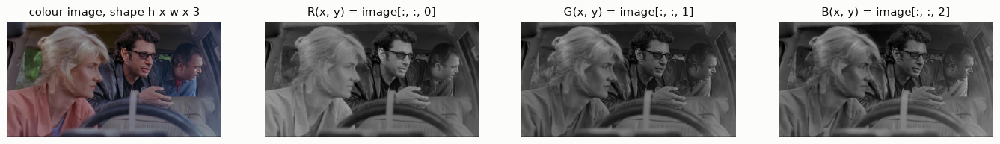
*Fig. 1. jp.png and its three channels shown as gray images. A channel is bright where that colour component is strong.*

**Coordinates.** NumPy indexes rows first: `image[y, x]`. OpenCV functions that take a point or a size use `(x, y)` and `(width, height)`. The origin is the top-left corner and y grows downwards. In Exercise 1, `image[100, 50]` is the pixel at x = 50, y = 100. The ROI `image[60:160, 320:420]` and `cv2.rectangle(output, (320, 60), (420, 160), ...)` describe the same box.

**How a colour camera measures RGB** (L1 s.11–12). Each photosite measures only one colour, through a filter laid out in a **Bayer pattern**: 50 % green, 25 % red, 25 % blue. The two missing values at every pixel are interpolated from the neighbouring photosites (demosaicing).

**BGR order.** `cv2.imread` returns the channels in B, G, R order, while Matplotlib expects R, G, B. The tutorials swap them with `b, g, r = cv2.split(bgr_img)` and `image = cv2.merge([r, g, b])`. `cv2.cvtColor(bgr_img, cv2.COLOR_BGR2RGB)` does the same in one call.

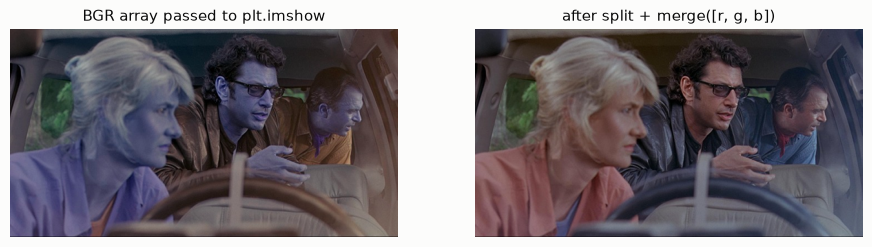
*Fig. 2. Exercise 1 asks what happens if `bgr_img` is displayed: red and blue are swapped.*

---

## Colour spaces

**RGB** (L1 s.15). Additive model: every colour is a mix of red, green and blue, i.e. a point in the cube [0, 255]³. A change in brightness (shading, light level) moves all three values together, so one surface colour covers a whole range of RGB points. A box-shaped range in RGB (a minimum and maximum per channel) therefore catches only part of a shaded object.

**Grayscale.** `cv2.cvtColor(image, cv2.COLOR_RGB2GRAY)` computes

$$Y = 0.299\,R + 0.587\,G + 0.114\,B$$

Green gets the largest weight because it contributes most to perceived brightness. Example: the yellow tetris piece (mean RGB 235, 235, 6) has Y ≈ 209, and the white background has 255.

**HSV** (L1 s.16).
- **Hue H** says which colour: an angle on the colour circle (red 0°, yellow 60°, green 120°, cyan 180°, blue 240°, magenta 300°).
- **Saturation S** says how far the colour is from gray.
- **Value V** is the brightness.

For 8-bit images OpenCV computes

$$V = \max(R,G,B), \qquad S = 255\cdot\frac{V - \min(R,G,B)}{V}\quad(S = 0 \text{ if } V = 0)$$

$$H = \begin{cases} 60\,(G-B)/(V-\min) & \text{if } V = R \\ 120 + 60\,(B-R)/(V-\min) & \text{if } V = G \\ 240 + 60\,(R-G)/(V-\min) & \text{if } V = B \end{cases}\qquad (+360 \text{ if } H<0),\ \text{then } H \leftarrow H/2$$

Four consequences matter in the exercises:
- **Shading changes V (and S at highlights) much more than H.** One interval of H can select an object across its shading. This is why HSV ranges are the standard tool for colour segmentation.
- **OpenCV's H runs 0–179** (degrees / 2) for 8-bit images, while S and V run 0–255. Other programs use 0–360 or 0–1, so copied ranges must be converted.
- **Red wraps around.** Red sits at both ends of the H axis (near 0 and near 179). A red range is normally the union of two intervals, and a single red object can have pixels at both ends (see [Tasks 4 and 5](#tasks-4-and-5-remove-the-red-and-the-green-sphere)).
- **H is unreliable when S or V is low.** For grays, whites and highlights, V − min ≈ 0 and the H formula amplifies noise; R = G = B gives H = 0. HSV ranges therefore also set a minimum S and V.

**L\*a\*b\*** (L1 s.16, not used in the exercises). L\* is lightness, a\* runs from green to red, and b\* from blue to yellow. It is built so that the Euclidean distance between two colours approximates their perceived difference.

---

## Geometric operations

This section covers Exercise 1; these operations are not on the lecture slides.

**Region of interest (ROI).** A slice `image[y0:y1, x0:x1]`. The slice is a *view*, so writing into it writes into the original image. Use `.copy()` to get an independent array.

**Resizing.** `cv2.resize(image, (w_new, h_new))` builds a new pixel grid and computes each new pixel by interpolating the nearest original pixels (bilinear by default). Passing a fixed size changes the aspect ratio w/h and distorts the image. To keep the ratio, scale both sides by r = w_new / w (`dim = (300, int(h * r))`), which is what `imutils.resize(image, width=300)` does.

**Rotation (affine warp).** An affine transformation maps every pixel position p = (x, y) to p′ = A p + t, with a 2×2 matrix A and a translation t. Straight lines stay straight and parallel lines stay parallel. `cv2.getRotationMatrix2D(center, angle, scale)` returns the 2×3 matrix [A | t] of a rotation about `center`:

$$M = \begin{bmatrix} \alpha & \beta & (1-\alpha)\,c_x - \beta\,c_y \\ -\beta & \alpha & \beta\,c_x + (1-\alpha)\,c_y \end{bmatrix}, \qquad \alpha = s\cos\theta,\quad \beta = s\sin\theta$$

A positive angle rotates counter-clockwise on screen, so Exercise 1 passes −45 to rotate 45° clockwise.

`cv2.warpAffine(image, M, (w, h))` fills each output pixel by mapping it back into the input and interpolating. Positions that fall outside the input become black. The output keeps the size (w, h), so the rotated corners are cut off.

`imutils.rotate_bound` instead enlarges the canvas to w′ = h|sin θ| + w|cos θ| and h′ = h|cos θ| + w|sin θ| (651 × 651 px for jp.png at 45°), and shifts the image to the centre. Its positive angle means clockwise.

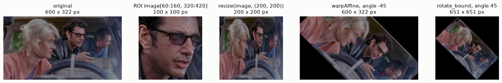
*Fig. 3. Crop, fixed-size resize (distorted), rotation on a fixed canvas (corners cut off), rotation on an enlarged canvas.*

**Drawing.** `cv2.rectangle`, `cv2.circle`, `cv2.line` and `cv2.putText` draw directly into the array they receive, which is why the tutorials draw on `output = image.copy()`. A thickness of −1 fills the shape. The colour tuple is written in the array's own channel order. After the swap to RGB, `(0, 0, 255)` is blue, so the tutorial's "red rectangle" and "red line" come out blue. Its "blue circle" `(255, 0, 0)` comes out red.

---

## Linear filtering

A **filter** forms a new image whose pixels are combinations of the original pixels (L1 s.27). Filters are used to extract information (edges, contours) and to enhance images (remove noise, sharpen).

**Mean filter** (L1 s.19–28). Neighbouring pixels usually belong to the same object and so should have similar values; the differences between them are mostly noise. Replacing every pixel by the average of its neighbourhood reduces that noise. Slide example (L1 s.28): the 3×3 neighbourhood

```
10  5  3
 4  5  1
 1  1  7
```

gives (10 + 5 + 3 + 4 + 5 + 1 + 1 + 1 + 7) / 9 = 37 / 9 ≈ 4.1 at the centre pixel.

**General linear filter** (L1 s.29–31). A kernel w of size (2k+1) × (2k+1) holds one weight per neighbour, and the output is the weighted sum

$$G(i,j) = \sum_{u=-k}^{k}\sum_{v=-k}^{k} w(u,v)\,F(i+u,\,j+v)$$

- The mean filter has w(u, v) = 1/(2k+1)².
- If all weights are ≥ 0 and sum to 1, the filter is a weighted mean and keeps the overall brightness.
- The weights can be any real numbers, including negative ones (sharpening, derivatives).
- The filter is *linear*: filtering a·F₁ + b·F₂ gives a·G₁ + b·G₂.
- It is *shift-invariant*: the same weights are used at every position.

**Cross-correlation and convolution** (L1 s.32–35). The formula above is **cross-correlation**. **Convolution** flips the kernel in both directions:

$$G(i,j) = \sum_{u}\sum_{v} w(u,v)\,F(i-u,\,j-v)$$

Slide example (L1 s.33–34), with w = F = [[1,2,3],[4,5,6],[7,8,9]], at the centre pixel:
- correlation = 1·1 + 2·2 + … + 9·9 = **285**;
- convolution = 1·9 + 2·8 + … + 9·1 = **165**.

For symmetric kernels (mean, Gaussian) the two give the same result. Convolution is commutative and associative, so several filters can be combined into one kernel.

**Kernel examples** (L1 s.36–37, 43):

| 3×3 kernel | Effect |
|---|---|
| all weights 1/9 | blur (mean filter) |
| 1 at the centre, 0 elsewhere | identical image |
| 2 at the centre, minus 1/9 everywhere | sharpening: accentuates edges |

**Gaussian filter.** The weights come from the 2-D Gaussian, normalised to sum to 1:

$$w(u,v) \propto \exp\!\left(-\frac{u^2+v^2}{2\sigma^2}\right)$$

- Close neighbours weigh more than distant ones, which gives a smoother result than the box-shaped mean filter.
- The 2-D kernel is the product of two 1-D kernels (it is *separable*), so OpenCV filters the rows first and then the columns.
- In `cv2.GaussianBlur(image, (k, k), 0)`, the 0 tells OpenCV to derive σ from k: σ = 0.3·((k − 1)/2 − 1) + 0.8. That gives σ = 0.8 for k = 3, 2.0 for k = 11 and 5.0 for k = 31.
- k must be odd, so that the kernel has a centre pixel.

This answers Exercise 1's question about the kernel size: a larger kernel averages over a larger neighbourhood, so ever larger details (fine texture, then thin edges) disappear.

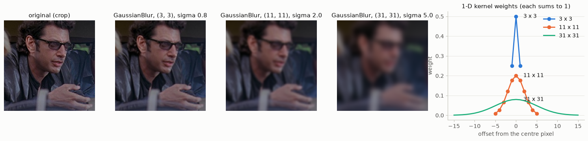
*Fig. 4. Gaussian blur with k = 3, 11 and 31, and the 1-D weights OpenCV uses for each k.*

**Sharpening** (L1 s.38–43). Blurring removes the fine detail, so detail = original − blurred. Adding the detail back amplifies it:

$$\text{sharpened} = F + \alpha\,\big(F - \text{blur}(F)\big)$$

With α = 1 and a 3×3 mean blur this becomes a single kernel: 2 at the centre minus 1/9 everywhere (L1 s.43). The method is also called *unsharp masking*. Compute it in floating point, because `uint8` arithmetic in NumPy wraps around (250 + 10 = 4).

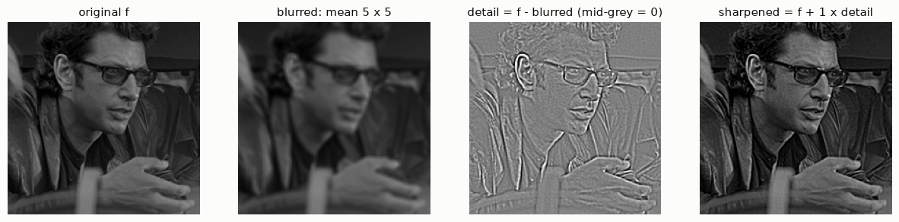
*Fig. 5. Original, mean filter 5 × 5, the detail layer (mid-gray = 0, lighter = positive, darker = negative), and original + detail.*

**Borders.** Near the edge of the image, part of the kernel falls outside it. The slides fill the outside with zeros; OpenCV's filters reflect the image at the border by default.

---

## Non-linear filters and thresholding

**Thresholding** (L1 s.45). A per-pixel rule that turns a gray image into a binary mask:

| OpenCV type | Output pixel |
|---|---|
| `cv2.THRESH_BINARY` | maxval if F > T, else 0 |
| `cv2.THRESH_BINARY_INV` | 0 if F > T, else maxval |

`cv2.threshold(gray, T, maxval, type)` returns the pair `(T_used, mask)`, hence the `[1]` in the tutorial. The tutorial's background is white, so `THRESH_BINARY_INV` with T = 225 marks everything darker than 225 as object (255).

**Histogram.** The number of pixels at each gray level. A single (*global*) threshold separates object from background only if their values fall in different parts of the histogram. T belongs in the gap between the two groups.

**Otsu's method** (L1 s.46). Chooses T automatically. For each candidate T, the pixels are split into class 0 (≤ T) and class 1 (> T), and the within-class variance is computed:

$$\sigma_w^2(T) = \omega_0(T)\,\sigma_0^2(T) + \omega_1(T)\,\sigma_1^2(T)$$

Here ω is the fraction of pixels in the class and σ² is their variance.
- Otsu tries every T (an exhaustive search) and keeps the one with the smallest σ_w².
- This is the same as maximising the between-class variance ω₀ω₁(μ₀ − μ₁)².
- It works when the histogram has two well-separated peaks.
- In OpenCV, add the flag (`cv2.THRESH_BINARY_INV + cv2.THRESH_OTSU`). The T you pass is then ignored, and the chosen T is returned as the first output.

**Rectification** (L1 s.47, not used in the exercises). g = max(f, 0), so negative values become 0. This is the ReLU activation of convolutional networks.

**Median filter** (L1 s.48–51). The mean is sensitive to outliers: in a 3×3 window of eight 10s and one 255, the mean is 37 while the median is 10. The median filter replaces each pixel by the median of its neighbourhood.
- It removes impulse ("salt-and-pepper") noise.
- It keeps step edges sharp, because its output is always one of the input values.
- It is non-linear: the median of a sum is not the sum of the medians.

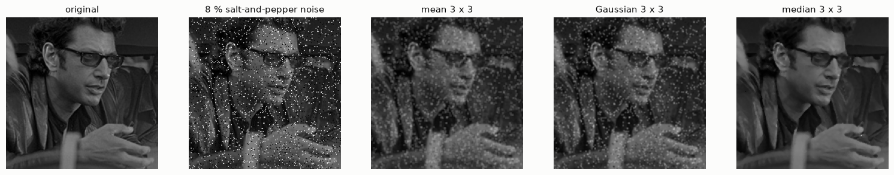
*Fig. 6. 8 % salt-and-pepper noise. Mean absolute error against the clean image: noisy 10.1, mean 3 × 3 9.7, Gaussian 3 × 3 9.6, median 3 × 3 1.6 gray levels.*

---

## Morphology

Morphological operations work on binary images (L1 s.53). A **structuring element (SE)** is a small binary shape (disk, rectangle, cross, …) with a centre. It slides over the image like a kernel, but instead of a weighted sum, the pixels under it are combined with a logical rule:

| Operation | Rule at each position | Effect |
|---|---|---|
| **Erosion** (s.54) | 1 only if the SE fits entirely inside the foreground (a minimum) | objects shrink by the SE radius; objects and bridges thinner than the SE vanish; holes grow |
| **Dilation** (s.55) | 1 if the SE overlaps any foreground pixel (a maximum) | objects grow; holes and gaps narrower than the SE fill; nearby objects merge |
| **Opening** = erosion, then dilation (s.56) | | removes small objects and thin bridges; larger objects keep their size and shape |
| **Closing** = dilation, then erosion (s.57) | | fills small holes and gaps; objects keep their size and shape |

Opening and closing are idempotent: applying either one a second time changes nothing. The same operations exist for gray images, where erosion is a local minimum and dilation a local maximum (s.53).

**In OpenCV:**
- `cv2.erode(mask, kernel, iterations=n)` and `cv2.dilate(...)`. `kernel=None` means a 3×3 square.
- n iterations with a 3×3 square equal one pass with a (2n+1) × (2n+1) square, so the tutorial's 5 iterations shrink or grow every object by 5 px on each side.
- The industry cells build the SE with `cv2.getStructuringElement(cv2.MORPH_ELLIPSE, (k, k))` and call `cv2.morphologyEx(mask, cv2.MORPH_OPEN, kernel)` (or `MORPH_CLOSE`).

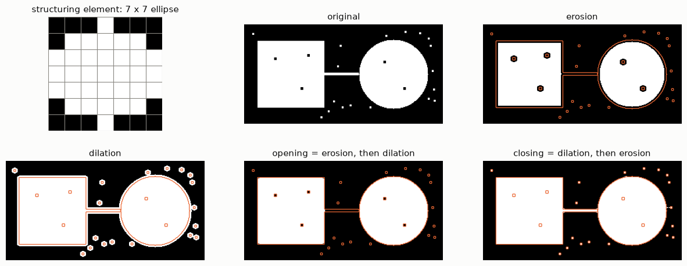
*Fig. 7. A synthetic mask: a square and a disk joined by a 4-px bridge, five 4 × 4 holes and 18 specks of 3 × 3 px. It is processed with a 7 × 7 elliptical SE. The orange line is the outline of the original.*

Measured on Fig. 7:
- **Erosion:** 19 objects become 2 (the specks and the bridge are gone). The area drops by 15 % (18,988 → 16,162 px) and the holes get bigger.
- **Dilation:** the area grows by 19 % (22,562 px), the holes close and the specks grow.
- **Opening:** 2 objects, 5 holes, 18,604 px. Only the specks, the bridge and the sharp corners of the square were removed (384 px in total).
- **Closing:** 19 objects, 0 holes, 19,099 px. The holes were filled and everything else was kept.

---

## Connected components and contours

**Connected component analysis** (L1 s.59). Each pixel is checked for connectivity with its neighbours. Every group of connected pixels is one *component* and gets one label. Two neighbouring pixels are connected if they have the same (or a similar) value. The neighbourhood is either **4-connectivity** (up, down, left, right) or **8-connectivity** (which adds the four diagonals). The method works on binary, gray and colour images.

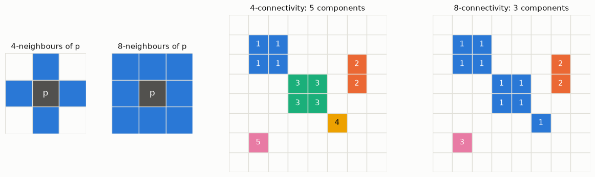
*Fig. 8. The same mask has 5 components with 4-connectivity and 3 with 8-connectivity: pixels that touch only at a corner are joined only in the second case. Numbers are labels; colours follow the object.*

**Contours.** The tutorials find objects with `cv2.findContours`. It follows the border of every region of non-zero pixels (the border-following algorithm of Suzuki and Abe) and returns each border as an array of (x, y) points.
- Mode `cv2.RETR_EXTERNAL` returns only the outermost borders; holes, and anything inside a hole, are ignored. `RETR_LIST` returns all borders, and `RETR_TREE` also returns how they are nested.
- Method `cv2.CHAIN_APPROX_SIMPLE` keeps only the end points of straight horizontal, vertical and diagonal runs (a rectangle becomes 4 points). `CHAIN_APPROX_NONE` keeps every border pixel.
- `imutils.grab_contours` extracts the list of contours. It is needed because `findContours` returns 3 values in OpenCV 3 and 2 values from OpenCV 4 on.
- `cv2.drawContours(img, contours, -1, colour, thickness)`: index −1 draws every contour in the list, and a thickness of −1 fills the inside.

One external contour is the outer border of one 8-connected component. An object's area can be measured in three ways, with different results:

| Method | Holes | Used in |
|---|---|---|
| pixels of the filled contour, `np.sum(filled == 255)` | counted as object | cells 1.2, 4.2, 5.2 |
| `cv2.contourArea(c)`: area of the polygon through the border pixel centres | counted as object | cells 1.3, 4.3, 5.3 |
| pixel count of the connected component | excluded | not used in the exercises |

`contourArea` comes out a little smaller than the pixel count: a filled n × n square gives (n − 1)² against n² pixels.

---

## Masks and bitwise operations

A **mask** is a `uint8` image with 255 where a pixel is selected and 0 elsewhere. Masks are combined with set operations:

| Operation | Set meaning | Function |
|---|---|---|
| A AND B | intersection | `cv2.bitwise_and(A, B)` |
| A OR B | union | `cv2.bitwise_or(A, B)` |
| NOT A | complement | `cv2.bitwise_not(A)`, or `cv2.threshold(A, 127, 255, cv2.THRESH_BINARY_INV)[1]` |
| A AND NOT B | difference | the two combined |

`cv2.bitwise_and(image, image, mask=m)` keeps the image where m ≠ 0 and sets every other pixel to 0 (black). This is how all the exercises "remove" something.

---

## Edges and inpainting

These two tools appear in the exercises but are not part of Lecture 1.

**Canny edge detector** (taught in Class 2, L2 s.14–15). Its steps:
1. noise reduction;
2. gradient magnitude and direction (Sobel);
3. non-maximum suppression: a pixel is kept only if it is the largest along its gradient direction, which gives 1-px-wide edges;
4. a double threshold;
5. edge tracking by hysteresis: pixels above the high threshold are strong edges; pixels between the two thresholds are kept only if they connect to a strong edge.

`cv2.Canny(gray, 30, 150)` uses 30 and 150 as the two thresholds. OpenCV's function starts directly with 3×3 Sobel derivatives and does not blur first; if you want smoothing, apply a `GaussianBlur` before it. In the Exercise 2 tutorial the edge image is only displayed; the objects are found from the threshold mask.

**Inpainting** (cells 1.3, 4.3, 5.3). `cv2.inpaint(image, mask, radius, cv2.INPAINT_TELEA)` replaces the masked pixels with values estimated from the surrounding image.
- Telea's method fills the region from its border inwards, in order of distance from the border (*fast marching*).
- Each new pixel is a weighted average of the already-known pixels within `radius`. Closer pixels weigh more, and so do pixels in the direction normal to the border.
- It works well for small regions on smooth backgrounds; large regions come out smeared.

---

## Exercise 1: image basics

[Exercise 1.ipynb](../Class_1_weekly_project/Exercises_week_1/Exercise%201.ipynb) is a guided tour of jp.png (600 × 322 px, 3 channels). It walks through these steps:
- read the image and swap BGR → RGB, then print the shape;
- read one pixel (`image[100, 50]` gives R = 41, G = 49, B = 37);
- show the channels and crop a ROI;
- resize: to a fixed size, with the aspect ratio kept, and with `imutils.resize`;
- rotate: with matrix + `warpAffine`, `imutils.rotate` and `imutils.rotate_bound`;
- blur with an 11 × 11 Gaussian;
- draw a rectangle, a circle, a line and text.

The task is to repeat these steps on a picture of your choice. The concepts are in [Digital images](#digital-images), [Geometric operations](#geometric-operations) and [Linear filtering](#linear-filtering), and Figs. 1–4 show the results.

---

## Exercise 2: the tutorial pipeline

The tutorial in Exercise 2 counts the tetris blocks with this pipeline:
1. **Grayscale conversion**, which reduces the colour image to one brightness value per pixel.
2. **Canny edges (30, 150)**, which outline the objects (displayed only).
3. **Inverse binary threshold at 225**, which marks everything darker than the white background as foreground. The result is the mask `thresh`.
4. **`findContours` with `RETR_EXTERNAL`**, which turns the mask into one outline per object. The outlines are drawn and counted: "I found 6 objects!".
5. **5 iterations of erosion and of dilation**, which shrink and grow the mask by 5 px.
6. **`bitwise_and` of the image with the mask**, which keeps the objects on a black background.

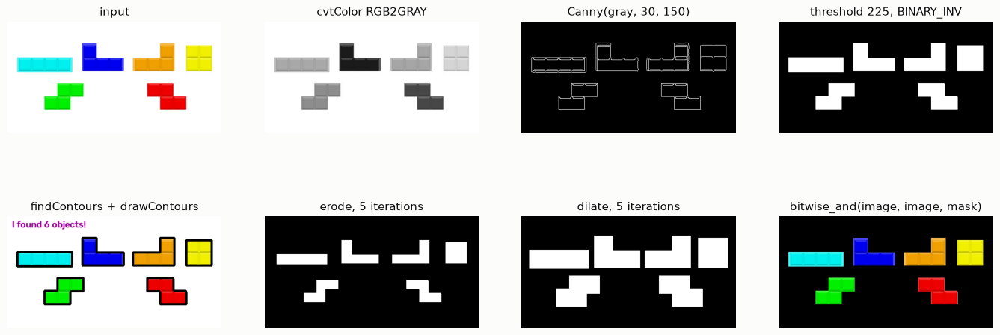
*Fig. 9. The tutorial steps on tetris_blocks.png.*

---

## Task 1: remove the yellow square

Three methods were used, one cell each.

**Cell 1.1: RGB range + bitwise.** A colour range in RGB was used to obtain the yellow pixels. The range consists of one threshold per channel (R > 200, G > 200, B ≤ 100), and the three masks are combined with `bitwise_and`. The yellow mask was then inverted (threshold at 127 with `BINARY_INV`), intersected with the tutorial foreground (foreground AND NOT yellow), and applied to the image.

```python
r_mask = cv2.threshold(r, r_min, 255, cv2.THRESH_BINARY)[1]        # r > 200
g_mask = cv2.threshold(g, g_min, 255, cv2.THRESH_BINARY)[1]        # g > 200
b_mask = cv2.threshold(b, b_max, 255, cv2.THRESH_BINARY_INV)[1]    # b <= 100
yellow = cv2.bitwise_and(cv2.bitwise_and(r_mask, g_mask), b_mask)
not_yellow = cv2.threshold(yellow, 127, 255, cv2.THRESH_BINARY_INV)[1]
mask = cv2.bitwise_and(thresh, not_yellow)                          # foreground AND NOT yellow
```

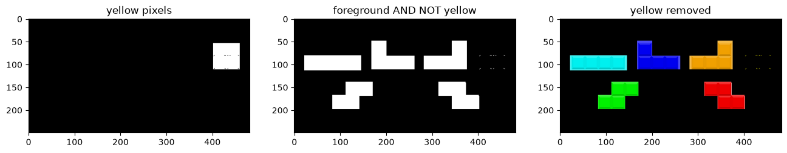
*Fig. 10. Cell 1.1.*

The flat, evenly lit O-piece falls inside the box: 3,338 of its pixels are selected. Only 26 darker edge pixels (≈ RGB 199, 198, 0) are missed, because their R and G are below 200; they remain as a faint outline.

**Cell 1.2: size of the cluster.** Every block is one cluster of foreground pixels, i.e. one external contour. A per-object area measurement was used to obtain the size of every block: each contour is drawn filled on an empty mask and its pixels are counted. The yellow O-piece is the smallest block (3,364 px, against 3,598–4,092 px for the others), so keeping only the clusters larger than `area_threshold = 3500` removes it, rim included.

```python
for c in cnts:
    cluster = np.zeros_like(thresh)
    cv2.drawContours(cluster, [c], -1, 255, -1)       # this cluster only, filled
    area = np.sum(cluster == 255)
    if area > area_threshold:
        cv2.drawContours(mask, [c], -1, 255, -1)      # keep it
```

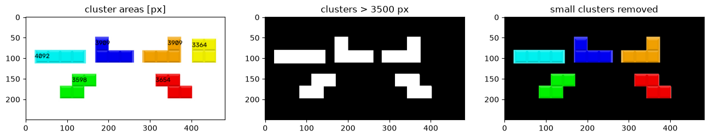
*Fig. 11. Cell 1.2, with each cluster's area written on it.*

The method works here only because the yellow piece happens to be the smallest; it would fail if another piece had a similar size.

**Cell 1.3: industry pipeline.** The standard colour-removal pipeline was used to obtain a mask that follows the object's hue whatever its shading. It has five steps:
1. An HSV range (H 25–35, S ≥ 100, V ≥ 100) gives the raw colour mask.
2. Opening and then closing with a 5 × 5 ellipse clean the mask.
3. External contours larger than 500 px are drawn filled, which rejects specks and fills holes.
4. A dilation of 3 px covers the anti-aliased rim.
5. The final mask is used twice: subtracted from the foreground (as in cell 1.1), and passed to `cv2.inpaint`, which fills the object's area from its surroundings instead of leaving it black.

The final mask covers 100 % of the yellow piece.

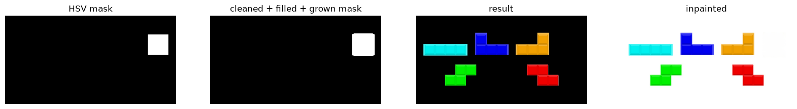
*Fig. 12. Cell 1.3: raw HSV mask, cleaned and grown mask, foreground without the object, inpainted image.*

| | 1.1 RGB range | 1.2 cluster size | 1.3 HSV pipeline |
|---|---|---|---|
| Object defined by | a colour box in RGB | the blob's size | a hue band plus mask cleanup |
| Effect of shading | large (all three channels change) | none | small |
| Anti-aliased rim | partly left (26 px) | removed with the contour | removed by the dilation |
| Fails when | the colour varies, or other objects share it | another object has a similar size | another object has a similar hue |
| Output | object turned black | object turned black | object turned black, plus an inpainted image |

---

## Tasks 2 and 3: spheres and the threshold

**Cell 2.1** runs the tutorial unchanged on spheres.png (965 × 955 px). It reports "I found 1 objects!", and two spheres come out dented.

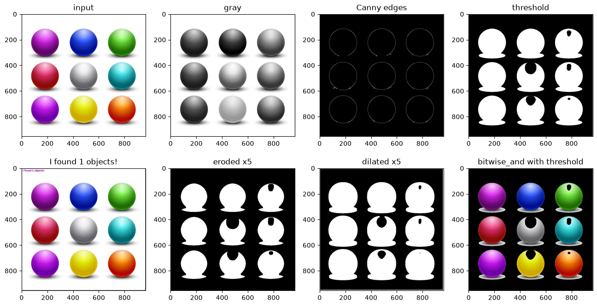
*Fig. 13. Cell 2.1.*

Two separate problems cause this.

**1. The frame.** spheres.png has a 1-px border of gray 219 around the whole image, and every pixel just inside it is 255. Any T above 219 marks the border as foreground. Because the border is a closed ring around everything, `RETR_EXTERNAL` returns only the ring: every sphere lies inside its hole. Cropping one pixel on every side (`image[1:-1, 1:-1]`), or setting the border of the mask to 0, fixes it.

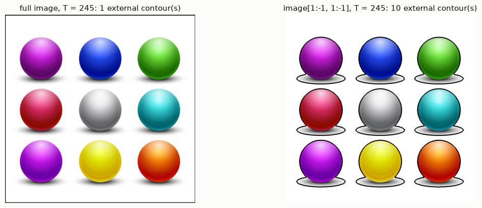
*Fig. 14. At T = 245: one contour with the frame; the nine spheres plus one speck without it.*

**2. The threshold.** The background is pure white (255), but parts of the spheres are almost as bright: highlights reach gray ≈ 250. A faint shadow around each sphere has gray values of 238–254. Fig. 15 shows the histogram and the mask at four values of T. The table lists the measurements, with the frame cropped; "objects" are contours larger than 1,000 px.

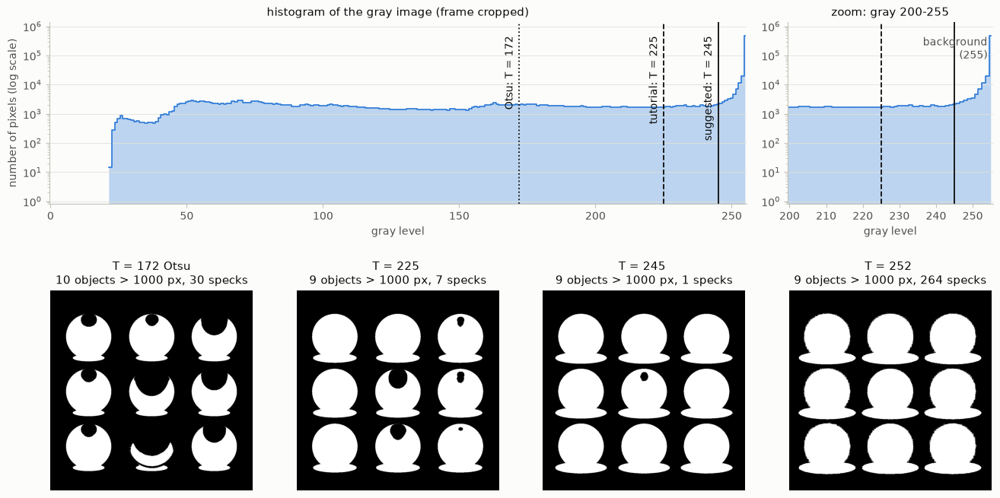
*Fig. 15. Top: gray-level histogram (log scale) with Otsu's T, the tutorial's T and the suggested T. Bottom: the mask at four thresholds.*

| T | Objects | Contour areas [px] | Small specks | What happens |
|---|---|---|---|---|
| 172 (Otsu) | 10 | 2,383 – 35,304 | 30 | the bright part of the spheres is cut away; spheres break into pieces |
| 225 (tutorial) | 9 | 33,979 – 41,128 | 7 | the grey and yellow spheres are dented by their highlights |
| 235 | 9 | 41,940 – 42,155 | 1 | all outlines complete; highlights still leave holes inside |
| **245** | 9 | 43,582 – 43,687 | 1 | complete outlines, almost no holes (suggested in cell 3.1) |
| 248 | 9 | 44,339 – 44,421 | 25 | near-white noise starts to pass |
| 250 | 9 | 44,932 – 45,094 | 190 | many noise specks |
| 252 | 9 | 45,841 – 46,443 | 264 | the shadow starts joining the spheres |
| 254 | 9 | 49,174 – 49,954 | 29 | spheres ≈ 14 % too large: the shadow is included |

**Why Otsu fails here.** The histogram does not have two separated peaks. The background is a single spike at 255 with zero variance, while the sphere pixels spread over almost the whole 0–250 range. The within-class variance is smallest when T splits that wide sphere distribution, not when it separates spheres from background, so Otsu returns 172.

**Parameters that do not matter for this task.** `threshold_value` (255) only sets the output value of the selected pixels. The Canny thresholds only change the edge image. The erode/dilate iterations post-process the mask.

---

## Tasks 4 and 5: remove the red and the green sphere

The "red" sphere is the crimson one (middle row, left); the orange one (bottom right) is a different object. Every sphere cell crops the 1-px frame first. In this section, "sphere" means the filled outline at T = 245: 44,046 px for the red sphere and 44,073 px for the green one. The outline includes a thin ring of shadow.

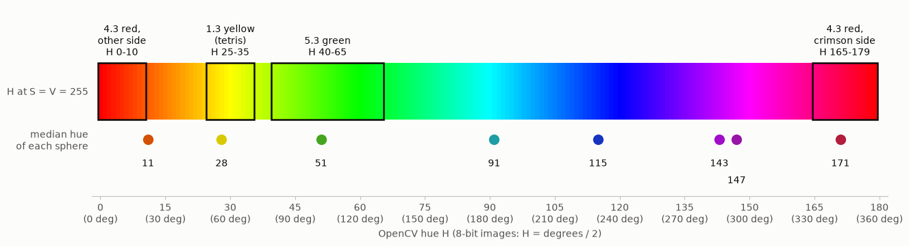
*Fig. 16. The OpenCV hue axis with the bands used in the cells, and the median hue of every coloured sphere: orange 11, yellow 28, green 51, cyan 91, blue 115, violet 143, purple 147, crimson 171. The grey sphere has no hue.*

**Cells 4.1 and 5.1: RGB range (the logic of 1.1).** Per-channel limits were used to obtain the coloured pixels. For red the limits are R > 130, G ≤ 80 and 20 < B ≤ 130; the band on B needs two thresholds. For green they are R ≤ 140, G > 100 and B ≤ 100. The coloured pixels are then subtracted from the foreground, as in 1.1. The box selects 41 % of the red sphere and 63 % of the green one, so a large part of each sphere survives. For red, most of the rest fails on G > 80 (39 % of the sphere) or B > 130 (36 %), which are the lighter part, the highlight and the shadow ring, or on B ≤ 20 (18 %), the darker lower part. Only 3 % fails on R. Widening the box doesn't help: R > 110, G ≤ 110 and 0 < B ≤ 170 reach 64 % of the red sphere, but also 51 % of the orange one.

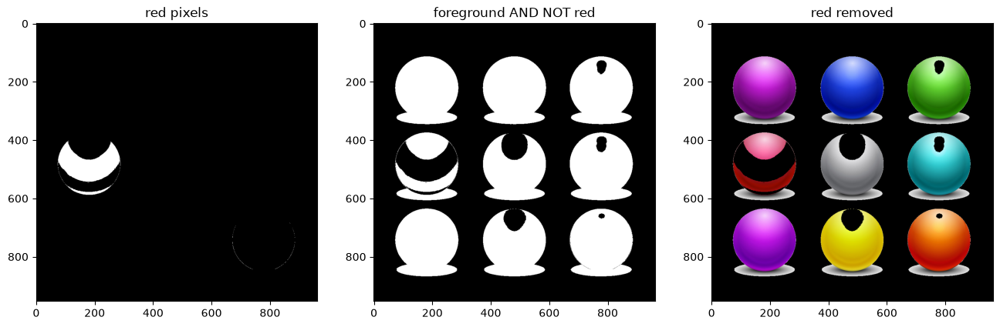
*Fig. 17. Cell 4.1.*

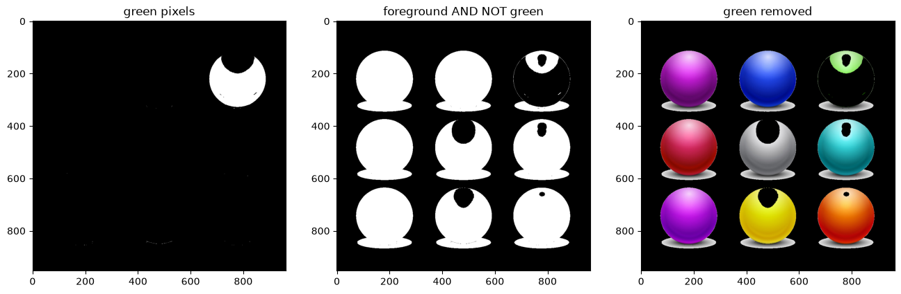
*Fig. 18. Cell 5.1.*

**Why the red sphere is hard.** Its colour is not uniform (Fig. 19).
- The upper part is crimson: median H 171 along row a. There the crimson band H 165–179 passes 100 % of the row and the RGB box 85 %.
- The lower, darker part is pure red: median H 1 along row b. There B ≤ 20, so the RGB box fails (1 %), and the hue is on the other side of the 0/180 wrap, so the crimson band alone fails too (1 %).
- 18 % of the sphere has H between 0 and 10.

A red hue range therefore needs both ends of the H axis, and with both bands 99 % of row b passes. But the orange sphere's hue (median 11) reaches down to the low end as well, so cell 4.3 also has to tell the two spheres apart.

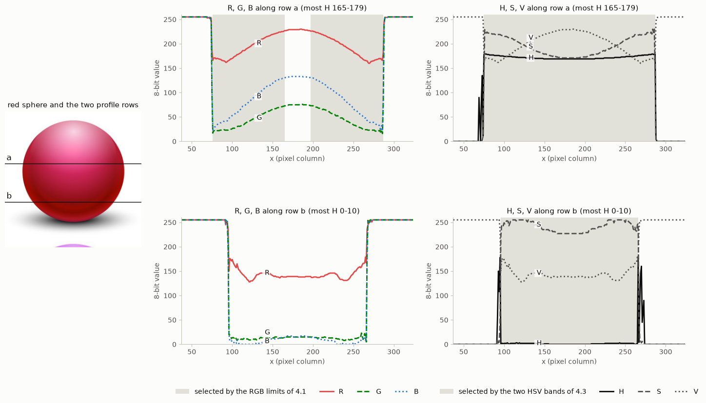
*Fig. 19. R, G, B and H, S, V along two rows of the red sphere. Gray shading marks the pixels each rule selects, here with both hue bands of cell 4.3. Row a is crimson (H ≈ 171); row b has H ≈ 0–2, across the wrap.*

**Cells 4.2 and 5.2: the colour inside each object (the logic of 1.2).** All nine spheres are about the same size, so area cannot single one out. A per-object colour count was used instead. Each sphere's outline is drawn filled, the mask from 4.1 (or 5.1) is intersected with it, and its pixels are counted. Objects with more than 1,000 coloured pixels are left out of the final mask.

```python
red_area = int(np.sum(cv2.bitwise_and(sphere, red) == 255))   # red pixels inside this object
if red_area <= red_threshold:
    cv2.drawContours(mask, [c], -1, 255, -1)                  # keep the object
```

The red sphere holds 18,155 red pixels against at most 151 in any other object; the green sphere holds 27,881 green pixels against at most 40. The decision is made per object, not per pixel, so the whole sphere disappears: its rim, its highlight and its pure-red lower part go with it.

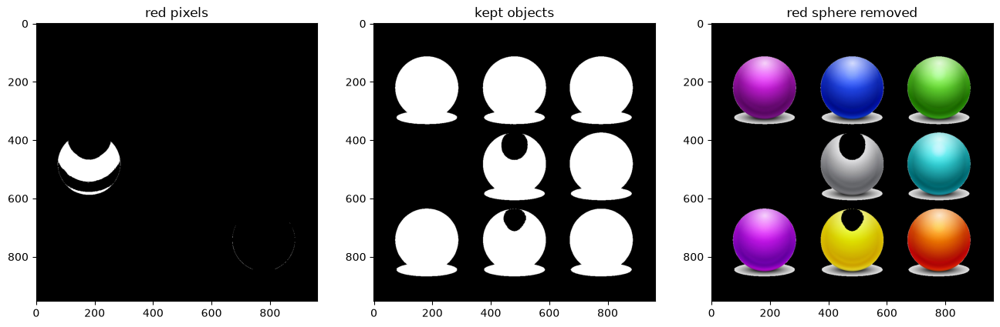
*Fig. 20. Cell 4.2.*

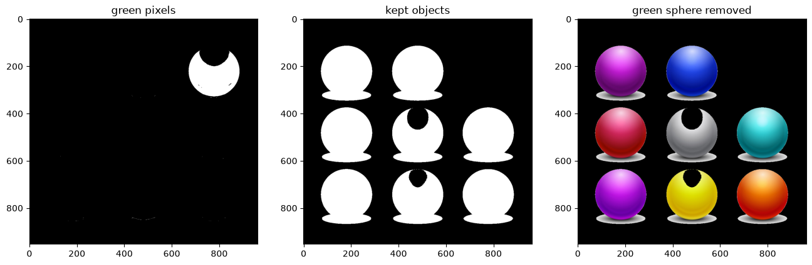
*Fig. 21. Cell 5.2.*

**Cells 4.3 and 5.3: industry pipeline (the logic of 1.3).** The pipeline is the same as in 1.3, with a 7 × 7 SE and 25 px of growth. The frame is removed by setting the border of the foreground mask to 0.
- **5.3** uses one band, H 40–65, and a minimum blob size of 5,000 px. The final mask covers 94 % of the green sphere; the missed 6 % are unsaturated shadow pixels, so the sphere is fully removed.
- **4.3** uses two bands, H 165–179 and H 0–10. The low band also selects the orange sphere as a separate blob, and a size filter can't reject it: it would erase 29,000 px of that sphere. So only the blob with the most crimson pixels is kept. The final mask covers 94 % of the red sphere, again missing only unsaturated shadow pixels, and touches no other sphere. With the crimson band alone it covered 77 %, and a crescent of about 2,800 saturated pixels remained.

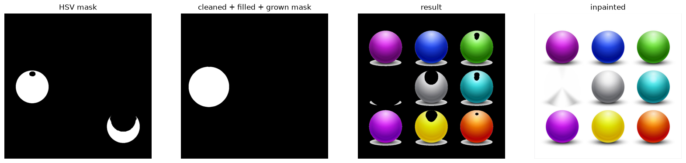
*Fig. 22. Cell 4.3.*

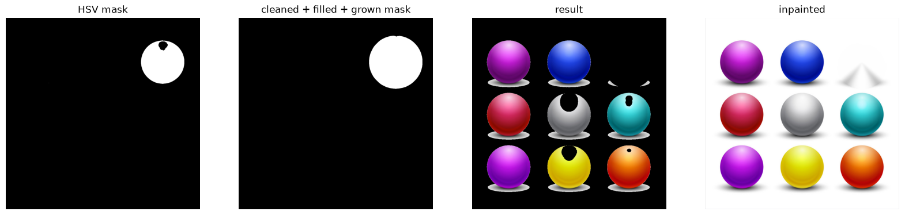
*Fig. 23. Cell 5.3.*

| | 4.1 / 5.1 RGB range | 4.2 / 5.2 colour count per object | 4.3 / 5.3 HSV pipeline |
|---|---|---|---|
| Decision made | per pixel | per object | per pixel, then per blob |
| Share of the sphere removed | red 41 %, green 63 % | 100 % (whole outline) | red 94 %, green 94 % (the rest is shadow) |
| What survives | the lighter part, the highlight, red's lower part | nothing | only faint shadow |
| Output | black hole | black hole | black hole, plus an inpainted image |

---

## Weekly Project 1

[Weekly Project.ipynb](../Class_1_weekly_project/Exercises_week_1/Weekly%20Project.ipynb) is the graded group hand-in.
- **Part 1, appletree.jpg:** segment the apples, count them (the ground truth is 26), recolour one apple, segment the leaves. These tasks use [colour spaces](#colour-spaces) (red apples need both ends of the hue axis), [morphology](#morphology), and [connected components and contours](#connected-components-and-contours) with an area filter for counting. Recolouring is a masked assignment.
- **Part 2, ittsp.png:** remove the green screen and replace the background, then improve the edge with erosion and dilation. The notebook's part 2 does this:
  - an HSV range (H 35–85, S ≥ 80, V ≥ 40) selects the screen;
  - `bitwise_not` gives the subject;
  - dilation, erosion and closing (15 iterations each) are compared on the subject mask.

---

## When it fails

| Problem | Where it showed up | Cause | Fix |
|---|---|---|---|
| Red and blue swapped | Exercise 1, Fig. 2 | `cv2.imread` gives BGR; Matplotlib expects RGB | swap the channels once, right after reading |
| Drawn colours wrong | Exercise 1 drawing cells | the colour tuple follows the array's channel order | write tuples in the array's order |
| Wrong pixel or box | any indexing | NumPy uses `[y, x]`; OpenCV uses `(x, y)` and `(w, h)` | check which convention a function uses |
| One contour for the whole image | cell 2.1 | a closed 1-px frame around the image, plus `RETR_EXTERNAL` | crop the border or zero it in the mask |
| Dented objects | cell 2.1 at T = 225 | highlights brighter than T | raise T (≈ 245) or close the mask |
| Objects too large | T ≥ 252 | the shadow is darker than T | lower T |
| Otsu's T far too low | cell 3.1 | the histogram is not bimodal | inspect the histogram; set T by hand |
| Colour box catches part of an object | cells 4.1, 5.1 | shading moves R, G and B together | use HSV, or decide per object |
| Part of a red object missed | cell 4.3, with one band | the object's hue crosses 0/180 | use both red bands, and keep the blob with the crimson pixels |
| Hue noise in highlights and grays | HSV masks | H is undefined when S ≈ 0 | require a minimum S and V |
| Area cannot tell objects apart | spheres | all spheres ≈ 44k px | measure a different property per object (colour count) |
| Objects vanish or merge | erosion/dilation with many iterations | the SE is larger than the object or the gap | match the SE size to the defect you want to remove |
| Wrong values after arithmetic | sharpening | `uint8` wraps around (250 + 10 = 4) | compute in float, then clip |
| Original image changed | drawing, ROI | drawing works in place; slices are views | `.copy()` first |

---

## Key takeaways

- An image is an array of numbers, and every operation in this chapter is arithmetic or logic on that array.
- **Segmentation is a per-pixel decision that produces a mask.** It works as well as the chosen feature (gray level, RGB, hue) separates object from background. The histogram shows whether one threshold can separate them.
- **Choose the feature that does not change with the disturbance.** Hue hardly changes with shading, while gray level and RGB do. Hue fails for unsaturated pixels and at the red wrap.
- **Linear filters are weighted sums** (correlation or convolution with a kernel): the mean and Gaussian filters smooth, sharpening adds back the detail. **Non-linear filters** use order or logic: the median removes impulse noise, a threshold makes a mask, morphology edits shapes.
- **Morphology cleans masks.** Opening removes things smaller than the SE; closing fills holes smaller than the SE. Choose the SE size from the size of the defect.
- **Group pixels into objects, then decide per object** (area, colour content). A decision per object removes the whole object, including the parts a pixel rule missed.
- **Removing an object** means intersecting the foreground with NOT(object mask). Inpainting fills the hole from its surroundings instead of leaving it black.
