# Chapter 2 · Edges, features, matching, fitting and optical flow

**Sources**
- Class 2 lecture: [34759-PAS-3-Lecture-3-2026-v4.pdf](../Class_2_feature_detection_and_description/34759-PAS-3-Lecture-3-2026-v4.pdf). It covers edge detection, feature detection and description, fitting, and deep features and matching. Cited as **L2 s.N** (slide N = PDF page N).
- [Exercise 1 - Hough transform](../Class_2_feature_detection_and_description/Exercises_week_2/Exercise%201%20-%20Hough%20transform.ipynb), [Exercise 2 - Feature Detection](../Class_2_feature_detection_and_description/Exercises_week_2/Exercise%202%20-%20Feature%20Detection.ipynb), [Exercise 3 - Feature Matching](../Class_2_feature_detection_and_description/Exercises_week_2/Exercise%203%20-%20Feature%20Matching.ipynb), [Exercise 4 - Optical Flow](../Class_2_feature_detection_and_description/Exercises_week_2/Exercise%204%20-%20Optical%20Flow.ipynb), and [Weekly Project 2](../Class_2_weekly_project/Weekly%20Project%202.ipynb).
- Functions and terms: [reference.md](reference.md). Class 1 material is in [chapter 1](01_basic_image_processing.md).

**Contents**
1. [Overview](#overview)
2. [Edges](#edges)
3. [Corners: Harris and Shi-Tomasi](#corners-harris-and-shi-tomasi)
4. [Scale space, DoG and SIFT](#scale-space-dog-and-sift)
5. [Binary descriptors: ORB](#binary-descriptors-orb)
6. [Matching](#matching)
7. [Fitting a model with outliers](#fitting-a-model-with-outliers)
8. [Optical flow](#optical-flow)
9. [Learned features](#learned-features)
10. [Exercise 1: Hough lines and circles](#exercise-1-hough-lines-and-circles)
11. [Exercise 2: corner detection](#exercise-2-corner-detection)
12. [Exercise 3: feature matching](#exercise-3-feature-matching)
13. [Exercise 4: optical flow](#exercise-4-optical-flow)
14. [Weekly Project 2: robot tracking](#weekly-project-2-robot-tracking)
15. [When it fails](#when-it-fails)
16. [Key takeaways](#key-takeaways)

---

## Overview

The lecture follows one question: how does a system turn pixels into a geometrically consistent interpretation (L2 s.3)? The answer has three parts:
1. detect stable image structure (edges, keypoints);
2. establish correspondence between images (descriptors, matching, optical flow);
3. reject inconsistent measurements (voting or robust sampling) before a geometric model is estimated.

L2 s.4 draws this as a pipeline. Camera-motion estimation is the example running through the lecture.

| Stage | Output | Methods in this chapter |
|---|---|---|
| image (sensor data) | pixels | — |
| edges and keypoints | stable structure | gradient, Sobel, Canny, Harris, Shi-Tomasi, DoG |
| feature matching | candidate matches | SIFT, ORB, brute-force and kd-tree matching, ratio and mutual checks |
| geometric verification | consistent matches and a model | least squares, Hough transform, RANSAC |
| task output | pose, map, tracked objects | optical flow, robot tracking (weekly project) |

---

## Edges

**Edge.** A place where the image intensity changes sharply. Edges come from object boundaries, surface markings, shadows and depth discontinuities (L2 s.5–6).

**Image derivative** (L2 s.6–8). The image is a sampled function, so the derivative is approximated by differences between neighbours:

$$\frac{\partial I}{\partial x} \approx \frac{I(x+1,y) - I(x-1,y)}{2}$$

This is a linear filter with the 1-D kernel [−1, 0, 1] (up to the factor ½).

**Gradient** (L2 s.7, 9). The vector of the two partial derivatives. It points in the direction of the most rapid increase in intensity, and the edge runs perpendicular to it.

$$\nabla I = \left(\frac{\partial I}{\partial x}, \frac{\partial I}{\partial y}\right),\qquad |\nabla I| = \sqrt{\left(\tfrac{\partial I}{\partial x}\right)^2 + \left(\tfrac{\partial I}{\partial y}\right)^2},\qquad \theta = \operatorname{atan2}\!\left(\tfrac{\partial I}{\partial y}, \tfrac{\partial I}{\partial x}\right)$$

**Sobel** (L2 s.10). The practical derivative kernels:

$$G_x = \begin{bmatrix} -1 & 0 & 1 \\ -2 & 0 & 2 \\ -1 & 0 & 1 \end{bmatrix} \qquad G_y = \begin{bmatrix} -1 & -2 & -1 \\ 0 & 0 & 0 \\ 1 & 2 & 1 \end{bmatrix}$$

Each kernel is a derivative [−1, 0, 1] in one direction multiplied by a smoothing [1, 2, 1] in the other. The magnitude and orientation are computed from the two responses as above.

**Derivatives and noise** (L2 s.12). A derivative amplifies noise, because noise changes quickly from pixel to pixel. Smoothing first solves this. Convolution is associative, so smoothing with a Gaussian G and then differentiating equals one filter with the derivative of the Gaussian: (G ∗ f)′ = G′ ∗ f.

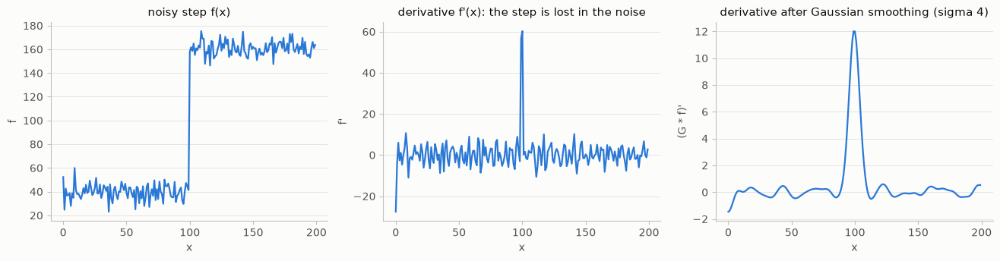
*Fig. 1. The derivative of a noisy step is noise everywhere. After Gaussian smoothing the edge is one clear peak.*

**Laplacian of Gaussian (LoG)** (L2 s.13). The Laplacian is the sum of the second derivatives, ∇²I = ∂²I/∂x² + ∂²I/∂y². It is zero where the first derivative peaks, so edges are its *zero crossings*. It is isotropic (the same in every direction) and even more sensitive to noise, so it is applied to a smoothed image (LoG). The LoG also responds strongly to blobs of a size matching σ, which [scale space](#scale-space-dog-and-sift) uses.

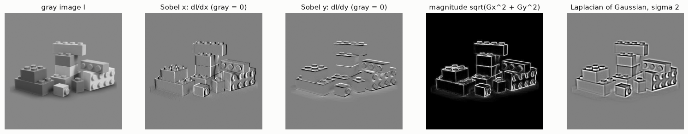
*Fig. 2. Lego.jpg: the Sobel responses (gray = 0, light = positive, dark = negative), the gradient magnitude, and the LoG.*

**Canny edge detector** (L2 s.14–16). Its steps:
1. noise reduction (Gaussian smoothing);
2. gradient magnitude and direction (Sobel);
3. non-maximum suppression: a pixel is kept only if its magnitude is the largest along the gradient direction, which leaves 1-px-wide edges;
4. double threshold: pixels above the upper threshold are *strong* edge seeds; pixels between the two thresholds are *weak* candidates;
5. edge tracking by hysteresis: weak pixels are kept only if they connect to a strong one.

In OpenCV, `cv2.Canny(gray, low, high)` starts at step 2 with 3×3 Sobel derivatives. If smoothing is wanted, it is a separate `GaussianBlur` before the call. The effect of the thresholds (L2 s.15):

| Thresholds | Result |
|---|---|
| too low | texture and sensor noise become edges; long false contours appear |
| useful range | strong boundaries remain connected; weak edges survive only where a strong edge supports them |
| too high | low-contrast boundaries disappear; contours break into fragments |

The Gaussian scale decides how much detail exists before the thresholds make the final selection. L2 s.16 asks what happens when both thresholds are lowered: more weak edges and more noise (answer B).

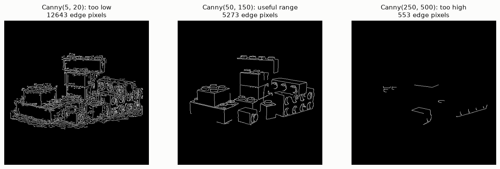
*Fig. 3. Canny on Lego.jpg: 12,643 edge pixels at (5, 20), 5,273 at (50, 150) and 553 at (250, 500).*

---

## Corners: Harris and Shi-Tomasi

**Image features** (L2 s.18).
- **Feature detection** finds the most prominent points of an image: the ones likely to be detected in other images too.
- **Feature description** creates a distinctive descriptor (a fingerprint) for each point.
- **Feature matching** finds correspondences between images.

**Why corners** (L2 s.20). Look at a small window and shift it slightly:
- in a flat region nothing changes in any direction;
- on an edge, a shift along the edge changes nothing, so the position along the edge is ambiguous;
- at a corner, every shift changes the window, so the position is defined in both directions.

This is why corners make good features and lines do not.

**Harris corner detector** (L2 s.20–22). The change caused by a small shift (u, v) of the window w is

$$E(u,v) = \sum_{w}\big[I(x+u,\,y+v) - I(x,y)\big]^2 \approx \begin{bmatrix} u & v\end{bmatrix} M \begin{bmatrix} u \\ v\end{bmatrix},\qquad M = \sum_{w}\begin{bmatrix} I_x^2 & I_x I_y \\ I_x I_y & I_y^2\end{bmatrix}$$

The eigenvalues λ₁, λ₂ of M measure the change in the two main directions (L2 s.21–22):

| λ₁, λ₂ | Region |
|---|---|
| both small | flat |
| one large, one small | edge |
| both large | corner |

Harris avoids computing the eigenvalues with the score

$$R = \det M - k\,(\operatorname{trace} M)^2 = \lambda_1\lambda_2 - k\,(\lambda_1+\lambda_2)^2,\qquad k \approx 0.04\text{–}0.06$$

R is large and positive at corners, negative on edges, and small in flat regions. The eigenvalues do not change when the image is rotated, so the detector is rotation invariant (L2 s.21). It is **not** scale invariant (L2 s.23).

**Shi-Tomasi** (`cv2.goodFeaturesToTrack`, Exercise 2b). Same matrix M, with the score R = min(λ₁, λ₂): a point is a corner only if even its weaker direction changes strongly.

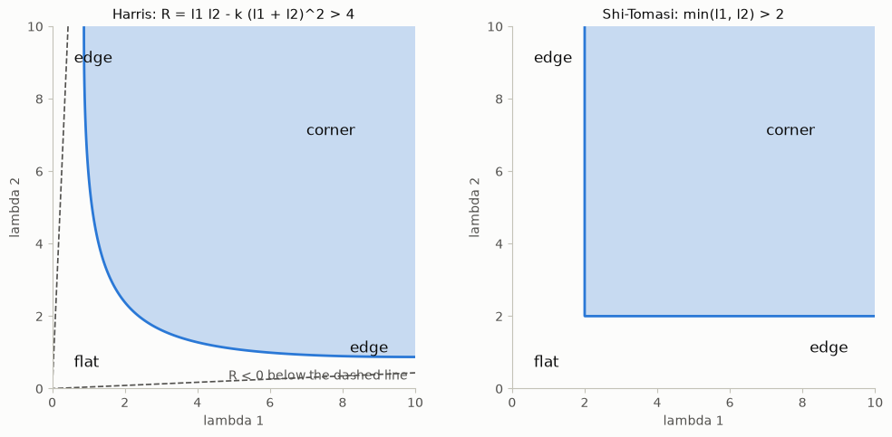
*Fig. 4. Where each score accepts a corner in the (λ₁, λ₂) plane. Harris' curved boundary accepts some points with one strong and one moderate direction; Shi-Tomasi's boundary is the square min(λ₁, λ₂) > threshold.*

---

## Scale space, DoG and SIFT

**The scale problem** (L2 s.23–25). Seen through a fixed-size window, a corner that appears twice as large looks like an edge, so Harris at the original scale no longer finds it. Scale-space theory (Lindeberg) instead detects points at the scale where their response is strongest:
- the image is blurred with Gaussians of increasing σ;
- the blur levels are grouped into *octaves*, and the image is halved from one octave to the next;
- a point is detected at the (x, y, σ) where its response peaks, so the same physical feature is found again after resizing.

L2 s.25 asks which detector can return a point at its new, doubled size: a scale-space detector (answer B).

**Difference of Gaussians (DoG)** (L2 s.26). With L(x, y, σ) = G_σ ∗ I,

$$D(x,y,\sigma) = L(x,y,k\sigma) - L(x,y,\sigma)$$

The DoG approximates the scale-normalised LoG at a fraction of the cost (one subtraction of two images that are already blurred). It responds to blobs whose size matches σ.

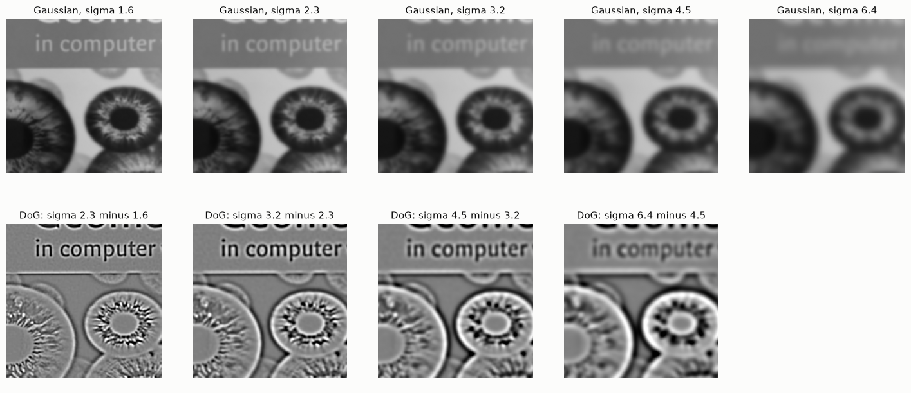
*Fig. 5. A crop of Book.jpg blurred with σ = 1.6 · √2ⁱ, and the DoG between neighbouring levels: each DoG keeps the structures of one size band.*

**SIFT** (Scale-Invariant Feature Transform; Lowe 2004, L2 s.27–33) does detection, description and matching. It is robust to changes in translation, scale, rotation, 3-D viewpoint and illumination (L2 s.28).
- **Detection** (L2 s.29): DoG on the scale space. A point is kept only if it is the maximum or minimum of its neighbourhood in space and scale (8 neighbours at its own level, 9 above, 9 below). Every octave is searched; in the slide's set-up, 4 octaves give 8 sets of points.
- **Orientation** (L2 s.30): around each keypoint, the gradient of the blurred image L is computed,

  $$m(x,y) = \sqrt{\big(L(x{+}1,y) - L(x{-}1,y)\big)^2 + \big(L(x,y{+}1) - L(x,y{-}1)\big)^2},\quad \theta(x,y) = \tan^{-1}\frac{L(x,y{+}1) - L(x,y{-}1)}{L(x{+}1,y) - L(x{-}1,y)}$$

  and the gradient directions are collected in a 36-bin histogram (10° per bin). The peak becomes the keypoint's orientation, and the descriptor is computed relative to it, which gives rotation invariance.
- **Descriptor** (L2 s.31): a 16 × 16 area around the keypoint is split into 4 × 4 cells, and each cell gets an 8-bin orientation histogram. That makes 4 × 4 × 8 = **128 values**, weighted by proximity to the keypoint.
- **Matching** (L2 s.32–33): Lowe compares all descriptors with all others by Euclidean distance. With about 1,000 features per image and 128 values per feature this becomes expensive, so he proposed **kd-trees**. The descriptor space is split in half, then each half again, and so on; a search descends into the closer half at every split until it reaches a stored feature.

In OpenCV, `sift = cv2.SIFT_create()` and `kp, des = sift.detectAndCompute(gray, None)`. `kp` is a list of keypoints (position, size, angle, response, octave) and `des` an N × 128 `float32` array.

---

## Binary descriptors: ORB

L2 s.34 lists other features: SURF, BRISK, FREAK, MSER, ORB, and plain patches. The exercise uses **ORB** (Oriented FAST and Rotated BRIEF). Its details come from OpenCV's documentation rather than the slides:
- **keypoints**: the FAST test. A pixel is a corner if a continuous arc of at least 9 of the 16 pixels on a circle around it is all brighter or all darker than it. The strongest are kept by Harris score;
- **scale**: an 8-level image pyramid;
- **orientation**: the direction from the keypoint to the intensity centroid of its patch;
- **descriptor**: rotated BRIEF, 256 binary brightness comparisons between pixel pairs in the rotated patch, i.e. 32 bytes.

Binary descriptors are compared with the **Hamming distance**: the number of differing bits (XOR, then count the 1s). This is much faster than Euclidean distance on 128 floats.

---

## Matching

**Brute force.** Every descriptor of image 1 is compared with every descriptor of image 2, and the nearest one is kept: `cv2.BFMatcher(norm).match(des1, des2)`. The norm must suit the descriptor: `cv2.NORM_L2` (the default) for SIFT, `cv2.NORM_HAMMING` for ORB. Each result is a `DMatch` with `queryIdx` (index in image 1), `trainIdx` (index in image 2) and `distance`.

A nearest neighbour **always** exists, even for a feature that is not visible in the other image at all. So the raw matches contain outliers, and correspondence needs rejection steps (L2 s.35):

| Step | What it checks |
|---|---|
| 1. candidate | the nearest descriptor |
| 2. ratio check | is the best candidate clearly better than the second best? Keep the match only if d₁ / d₂ is below a limit (Lowe used 0.8) |
| 3. mutual check | is the match the best in both directions (image 1 → 2 and 2 → 1)? (`crossCheck=True` in `BFMatcher`) |
| 4. geometry | fit a model (e.g. a homography) with RANSAC and count the inliers |

Sorting by descriptor distance, as the exercise does, ranks the candidates; it does not remove the wrong ones.

**Homography.** A 3 × 3 matrix H that maps the points of a *plane* between two views, in homogeneous coordinates: (x′, y′, 1)ᵀ ∝ H (x, y, 1)ᵀ. It has 8 degrees of freedom, so 4 point pairs determine it. The book cover in Exercise 3 is flat, so all correct matches agree with one H. Multiple-view geometry is covered in Class 3.

---

## Fitting a model with outliers

L2 s.41 introduces three ways to fit a line to data: least squares (no or few outliers), the Hough transform (voting), and RANSAC (random sampling).

**Least squares** (L2 s.42–43). For the line y = β₀ + β₁x, minimise the residual sum of squares

$$\text{RSS} = \sum_{i=1}^{n}\big(y_i - (\beta_0 + \beta_1 x_i)\big)^2 \quad\Rightarrow\quad \beta_1 = \frac{\sum (x_i-\bar x)(y_i - \bar y)}{\sum (x_i - \bar x)^2},\qquad \beta_0 = \bar y - \beta_1 \bar x$$

With the line written as ax + by + c = 0, the distance of a point is |axᵢ + byᵢ + cᵢ| (for a² + b² = 1), and E = Σ(axᵢ + byᵢ + c)² is minimised instead. With many unknowns the problem becomes a set of normal equations that needs a matrix inversion (L2 s.43). Least squares assumes that every residual is measurement noise (L2 s.52). A few outliers pull the line away.

**Hough transform** (L2 s.44–48). The problem is turned into voting:
1. bound the parameter space;
2. build a grid of parameter values (the *accumulator*);
3. let every data point vote for all the parameter cells it is consistent with;
4. find the local maxima and map them back to lines in the image.

The slope form y = mx + b cannot be bounded (a vertical line has m = ∞), so the polar form is used (L2 s.45):

$$\rho = x\cos\theta + y\sin\theta$$

Here ρ is the perpendicular distance from the origin to the line, and θ the angle of that perpendicular with the x-axis. Both are bounded: θ ∈ [0°, 180°) and |ρ| ≤ the image diagonal. (The slide writes x cos θ − y sin θ = ρ, the same line for a y-axis pointing up; OpenCV uses the form above with y pointing down.) A single image point (x, y) is consistent with every line through it, so it votes along a sinusoid in the (θ, ρ) plane. Points on one line produce sinusoids that cross at that line's (θ, ρ).

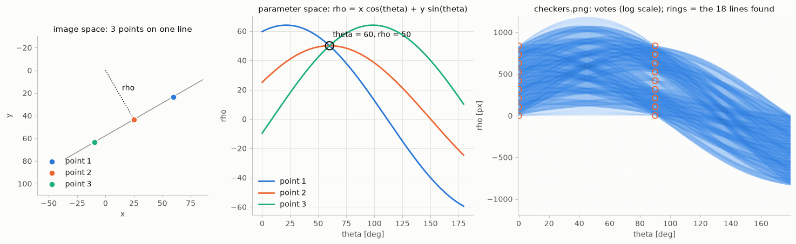
*Fig. 6. Left and middle: three points on the line θ = 60°, ρ = 50 and their sinusoids, which cross at (60°, 50). Right: the accumulator of the 34,330 Canny edge pixels of checkers.png. The rings are the 18 lines `cv2.HoughLines` found, all at θ = 0° (vertical grid lines) and θ = 90° (horizontal ones).*

**Circles and higher models** (L2 s.49). A circle (x − a)² + (y − b)² = r² has 3 parameters, so its accumulator is 3-D. The cost grows exponentially with the number of parameters; up to about 4 is advised, and RANSAC handles higher-order models. OpenCV's `cv2.HOUGH_GRADIENT` reduces the work in three steps:
1. it runs Canny internally (`param1` is the upper threshold);
2. each edge pixel votes for centres only along its gradient direction, so the centres are found in a 2-D accumulator;
3. the radius of each centre is chosen from the distances of the edge pixels around it.

**RANSAC** (RANdom SAmple Consensus, L2 s.50–55):
1. randomly sample the minimal number of points that defines the model (2 for a line, 4 for a homography);
2. fit the model to the sample;
3. score it by the number (fraction) of inliers: points within the threshold δ of the model.

Steps 1–3 are repeated, the best model is kept, and it is refitted on all of its inliers (L2 s.51). Three settings matter (L2 s.53–54):

| Setting | Failure mechanism |
|---|---|
| threshold too small | correct points fall outside the inlier band, so the consensus set becomes too small |
| too few iterations | an all-inlier sample may never be drawn; a poor hypothesis stays the best one tested |
| sample larger than necessary | every extra point must also be an inlier, so the chance of drawing a clean sample drops |

The number of iterations needed (a standard result, not on the slides): to draw at least one all-inlier sample with probability p, when a fraction w of the data are inliers and a sample has s points,

$$N = \frac{\log(1-p)}{\log(1-w^s)}$$

For p = 0.99 and w = 0.5 this gives 17 iterations for a line (s = 2) and 72 for a homography (s = 4).

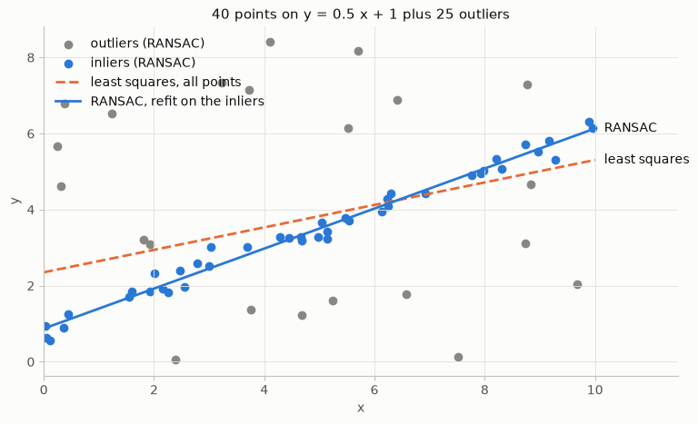
*Fig. 7. 40 points on y = 0.5x + 1 plus 25 outliers. Least squares on all points gives y = 0.30x + 2.35. RANSAC (200 iterations, δ = 0.5), refitted on its 43 inliers, gives y = 0.53x + 0.87.*

**Hough or RANSAC** (L2 s.52). Both look for agreement among measurements that contain outliers.

| | Hough transform | RANSAC |
|---|---|---|
| How | every measurement votes in a discretised parameter space | small random samples generate hypotheses; an inlier test scores each |
| Result | clusters of votes = likely models | the hypothesis with the most inliers |
| Suited for | few parameters, a bounded parameter space, several models at once | models that are easy to fit from a minimal sample (lines, homographies) |

Learned matchers improve the measurements, but RANSAC still checks geometric consistency (L2 s.55).

---

## Optical flow

**Optical flow** is the apparent motion of image content between two frames, caused by relative motion between the observer and the objects (L2 s.38–39). It rests on two assumptions:
- **brightness constancy**: a point keeps its intensity, I(x + u, y + v, t + 1) = I(x, y, t);
- **small motion**, so the first-order expansion holds:

$$I_x\,u + I_y\,v + I_t = 0$$

This is one equation with two unknowns (u, v). A single pixel only fixes the motion component along the gradient: this is the *aperture problem*.

**Sparse: Lucas–Kanade** (L2 s.39). The displacement is assumed small and the same for every pixel in a window. Each pixel of the window adds one equation, and the system is solved by linear least squares through the normal equations:

$$\underbrace{\begin{bmatrix} \sum I_x^2 & \sum I_xI_y \\ \sum I_xI_y & \sum I_y^2\end{bmatrix}}_{M}\begin{bmatrix} u \\ v\end{bmatrix} = -\begin{bmatrix} \sum I_xI_t \\ \sum I_yI_t\end{bmatrix}$$

M is the Harris matrix. The system is well conditioned only when both eigenvalues of M are large, i.e. at a corner. That is why Lucas–Kanade tracks Shi-Tomasi corners (`goodFeaturesToTrack`, "good features to track"). `cv2.calcOpticalFlowPyrLK` runs it on an image pyramid, from a reduced image up to full size, so that larger motions are found. It returns the new positions, a `status` (1 = found, 0 = lost) and an error per point.

**Dense: Farnebäck** (L2 s.39). A displacement is computed for every pixel. The slide calls it Lucas–Kanade on a pyramid scheme. Strictly, Farnebäck's method approximates the neighbourhood of each pixel by a quadratic polynomial in both frames and derives the displacement from how the polynomial moved. Like Lucas–Kanade, it assumes locally uniform motion and works coarse to fine. Its parameters are explained in [Exercise 4](#exercise-4-optical-flow). RAFT is the learned counterpart (L2 s.63).

**Showing a flow field.** `cv2.cartToPolar(dx, dy)` gives the length and the direction of every vector. A colour image encodes the direction as hue and the length as brightness.

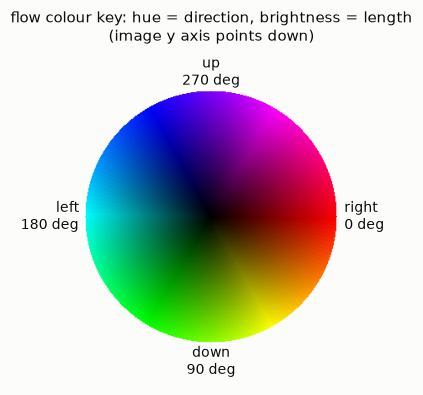
*Fig. 8. The colour key used in Exercise 4b and the weekly project. The image y axis points down, so 90° is downwards: right = red, down = yellow-green, left = cyan, up = blue-violet.*

---

## Learned features

The last part of the lecture (L2 s.56–68) replaces classical components with learned ones, while keeping the geometric check:

| Classical component | Learned replacement | What changes |
|---|---|---|
| Sobel / Canny edges | learned edge detector (s.58–59) | training decides which boundaries matter; the output is a boundary probability per pixel; it can suppress texture edges, but needs training data and may degrade under domain shift |
| Harris / DoG detector and SIFT descriptor | **SuperPoint** (s.60) | one network predicts keypoints and descriptors. It is pre-trained on synthetic shapes with known corners, then on warped views (homographic adaptation) |
| nearest neighbour + ratio test | **LightGlue** (s.61) | attention within each image and across the two images predicts the correspondences and the unmatched points; it spends less computation on easy pairs |
| detector + descriptor + matching | **LoFTR** (s.62) | detector-free: dense feature maps are matched coarse to fine with attention. It works in low texture and repeated patterns |
| variational / Farnebäck dense flow | **RAFT** (s.63) | a feature vector per pixel, correlation volumes of all pairs, and iterative refinement of one flow field |

The message of L2 s.65 and s.68: *learning proposes, geometry verifies*. Better matches reduce the burden on robust fitting, but they do not guarantee geometric consistency, so RANSAC (or another geometric model) still decides. L2 s.67 lists the typical failure modes:
- texture, blur or domain shift for edges;
- low texture or large viewpoint change for keypoints;
- repeated patterns for sparse matching;
- occlusion or weak calibration for detector-free matching;
- large motion or unseen imagery for dense flow.

---

## Exercise 1: Hough lines and circles

**Tutorial: lines.** A line detection pipeline was used to find the grid of checkers.png:
1. gray image;
2. Canny edges with thresholds 20 and 200;
3. `cv2.HoughLines(edges, 1, np.pi/180, 200)`: ρ resolution 1 px, θ resolution 1°, at least 200 votes per line.

The text of the notebook says 1 radian and 150, but the code uses π/180 and 200. The result is 18 lines: the 9 vertical and 9 horizontal grid lines (Fig. 6). Each line comes back as (ρ, θ) and is converted to two drawable points. (x₀, y₀) = (ρ cos θ, ρ sin θ) is the point of the line closest to the origin, and the line runs along (−sin θ, cos θ), so the end points are (x₀ ∓ 1000 sin θ, y₀ ± 1000 cos θ).

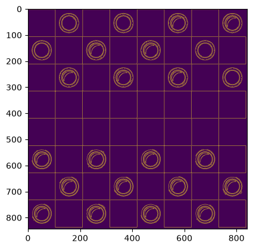 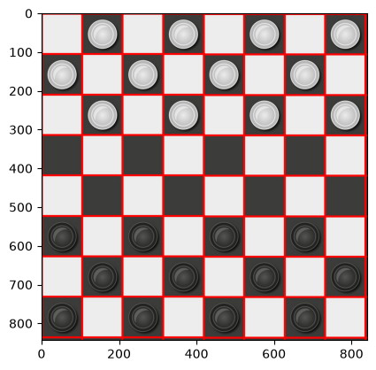
*Fig. 9. The tutorial's Canny edges (shown with Matplotlib's default colour map) and the 18 detected lines.*

**Exercise: circles.** `cv2.HoughCircles(gray, cv2.HOUGH_GRADIENT, dp=1, minDist=75, param1=100, param2=30, minRadius=30, maxRadius=45)` was used to find the pieces, with the parameters chosen from the geometry of the image. Each piece has a radius of ≈ 37 px, a square is ≈ 104 px, and diagonal neighbours are ≈ 148 px apart. It finds all 24 pieces. Each circle is drawn by converting polar to cartesian coordinates around its centre, x = x₀ + r cos θ and y = y₀ + r sin θ, for 100 angles joined with `cv2.line`.

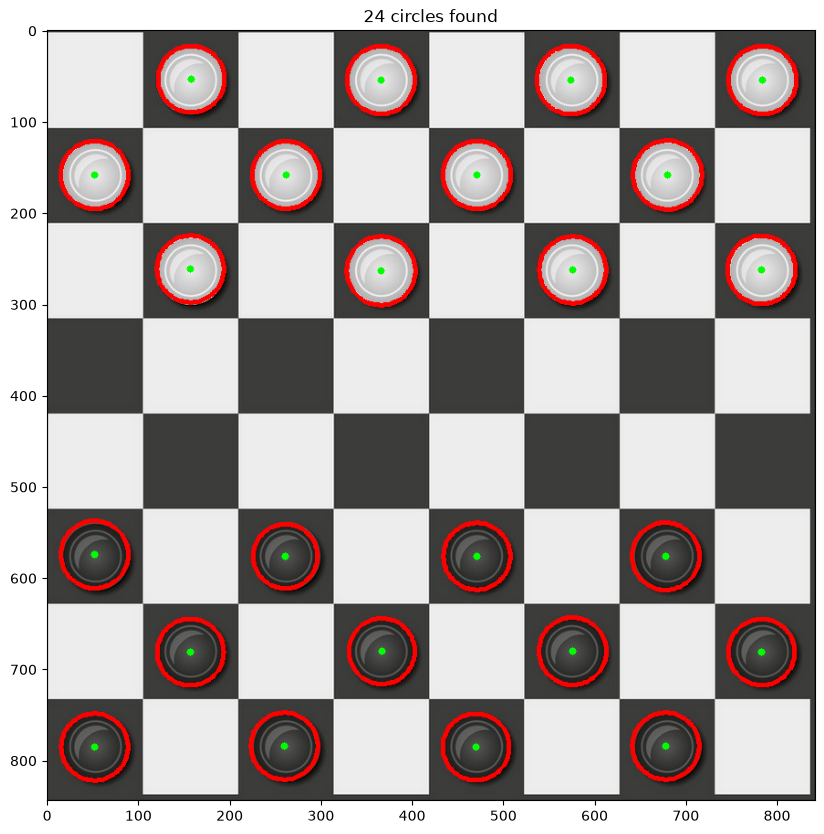
*Fig. 10. The 24 circles found.*

How the parameters act (measured on this image; the full list is in the notebook):

| Parameter | Effect here |
|---|---|
| `minRadius`, `maxRadius` | the most important pair. With 0, 0 (no limits) hundreds of circles come back, with radii of 17–483 px |
| `minDist` | about one piece diameter. Too small: one piece gets two circles (an inner ring at r ≈ 28 px plus the outer edge). Above ≈ 148 px: real pieces are suppressed |
| `param2` (votes) | with the radius limits, any value from 10 to 60 finds the same 24. Without limits, ≈ 700 circles at 30 and 24 at 80 |
| `param1` (Canny upper threshold) | the dark pieces lie on dark squares, so their edges are weak; lower `param1` if they disappear |
| blur before the call | a (9, 9) Gaussian removes the edges of the 12 dark pieces, so only the 12 light ones are found |

---

## Exercise 2: corner detection

**2a: Harris on the checkerboard.** The Harris response, `cv2.cornerHarris(gray, 2, 3, 0.04)`, was used to obtain a corner score for every pixel. The pixels above 0.01 × the maximum score form a mask. It is counted with `findContours` and dilated so it can be drawn in red. The result is 79 corner regions, all on the grid lines of the board and none on a piece: a circle's outline never changes direction sharply. The count is the same for every threshold from 0.01 to 0.2.

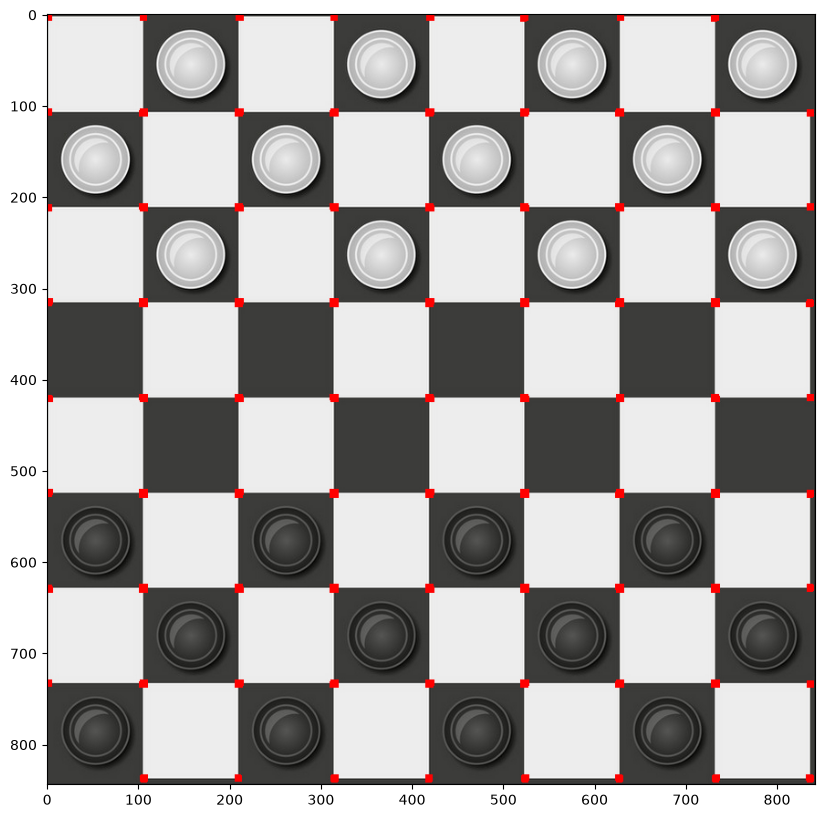
*Fig. 11. Cell 2a.*

**2b and 2c: Shi-Tomasi and Harris on the Lego image.** `cv2.goodFeaturesToTrack(gray, 100, 0.01, 10)` was used to obtain the 100 strongest corners, at least 10 px apart (138 pass the quality level). Harris with the same settings as 2a gives 111 corner regions.

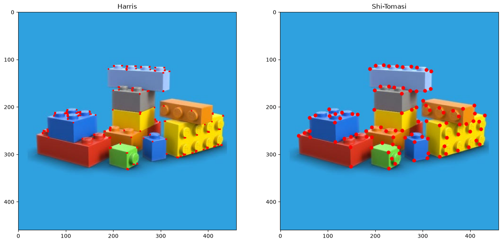
*Fig. 12. Cell 2c: Harris (left) and Shi-Tomasi (right).*

| | Harris (`cornerHarris`) | Shi-Tomasi (`goodFeaturesToTrack`) |
|---|---|---|
| Score | λ₁λ₂ − k(λ₁ + λ₂)² | min(λ₁, λ₂) |
| Output | a score per pixel; thresholding gives clusters of pixels | a list of points, strongest first |
| Number and spacing | no limit, no minimum spacing | at most `maxCorners`, at least `minDistance` apart |
| Threshold | relative to the best score: Lego 111 / 27 / 9 regions at 0.01 / 0.05 / 0.1 | `qualityLevel` relative to the best: 138 pass at 0.01, 71 at 0.1 |
| Use | marking corners | the input of a tracker (Exercise 4) |

---

## Exercise 3: feature matching

**Tutorial: SIFT.** SIFT was used to obtain keypoints and 128-value descriptors for Book.jpg (1,849 keypoints) and More_books.jpg (6,535). A brute-force matcher with the L2 norm gives every Book.jpg descriptor its nearest neighbour, so there are 1,849 matches. They are sorted by distance and the best 100 are drawn.

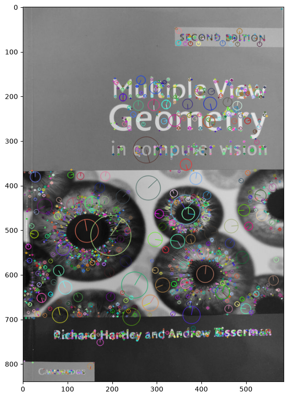 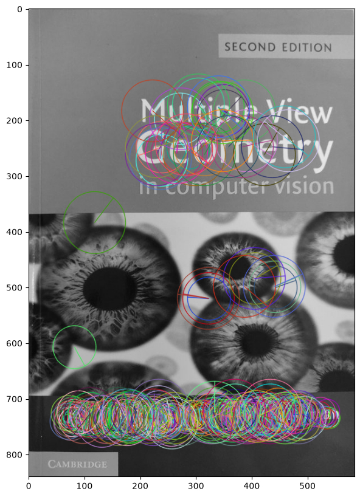
*Fig. 13. SIFT keypoints (left) and ORB keypoints (right, cell 3.1) on Book.jpg. The circle size shows the keypoint scale and the radius line its orientation.*

**Cells 3.1–3.3: ORB.** ORB was used the same way (`cv2.ORB_create(nfeatures=500)`, then `detectAndCompute`), with one essential change: the matcher uses `cv2.NORM_HAMMING`. The best 100 and the best 300 matches of both methods are drawn.

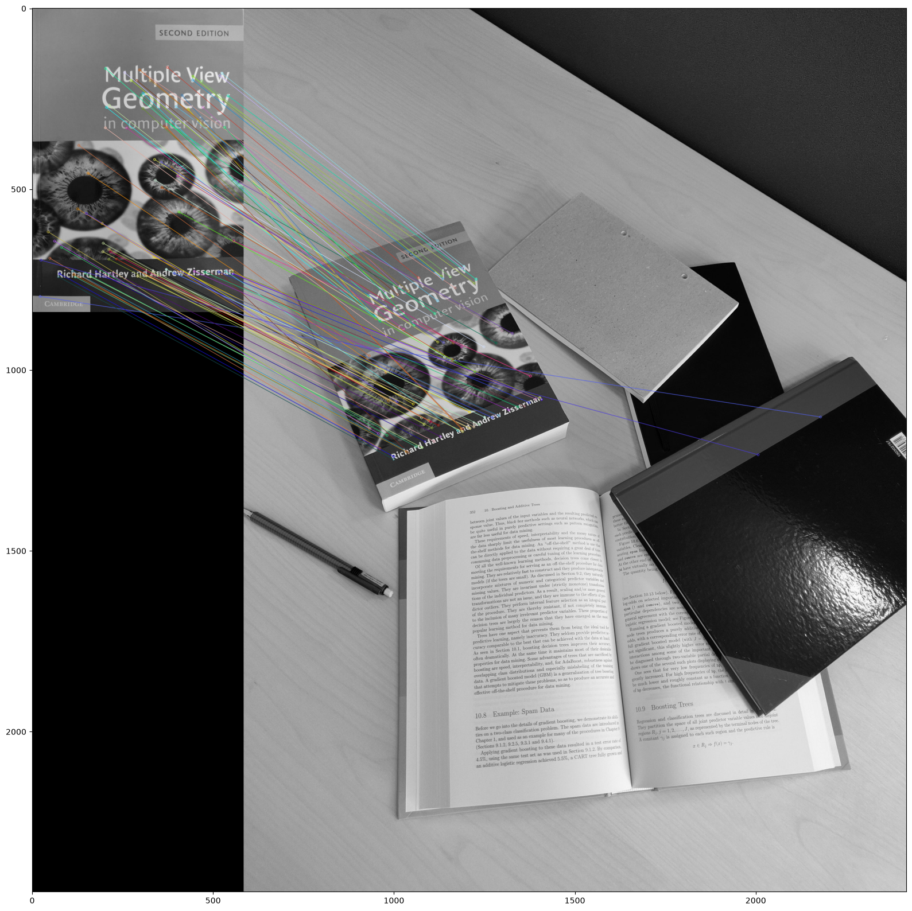
*Fig. 14. SIFT, best 100 matches (tutorial).*

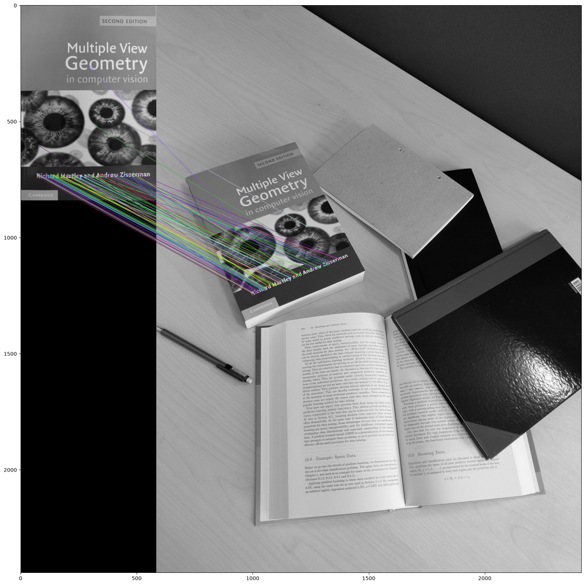
*Fig. 15. ORB, best 100 matches (cell 3.2).*

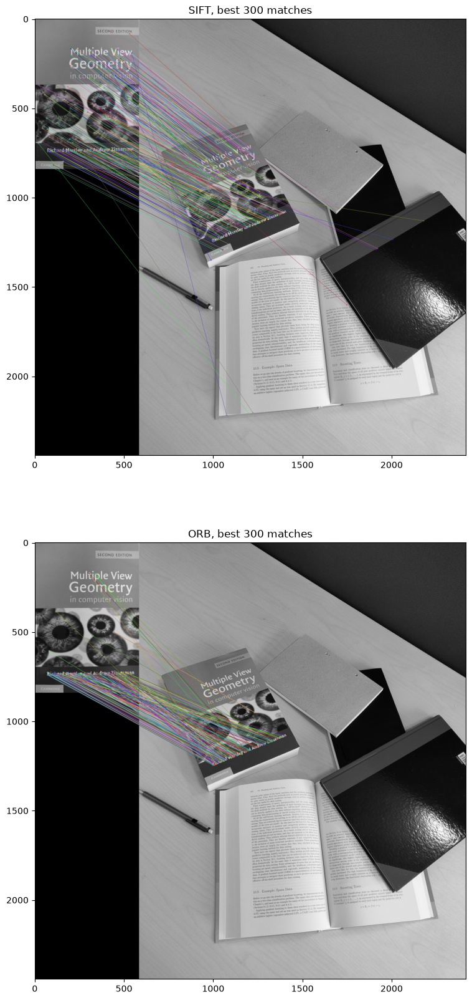
*Fig. 16. Best 300 matches: SIFT above, ORB below (cell 3.3).*

**Counting the correct matches (measured for this book, not in the notebook).** A homography fitted with RANSAC (5 px) was used to obtain an objective count; homographies are taught in [chapter 4](04_calibration_and_epipolar.md#calibration-with-a-planar-pattern). The book cover is planar, so a correct match must agree with one homography. The table gives the share of inliers among the best n matches.

| Best n matches | SIFT | ORB, 500 features | ORB, 3000 features |
|---|---|---|---|
| 100 | 81 % | 65 % | 76 % |
| 300 | 83 % | 44 % | 58 % |
| 500 | 82 % | 36 % | 50 % |

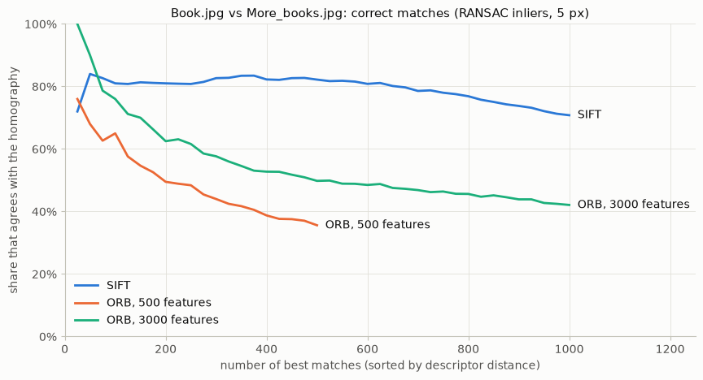
*Fig. 17. Share of the best n matches that agree with the homography.*

**Answer.** SIFT gives the better matches. Its share of correct matches stays above 80 % down to the 500th match, while ORB's falls quickly; this is the difference that appears when more than 100 matches are drawn. ORB is about 14 times faster (0.03 s against 0.42 s for both images on this machine), which is why it is used in real-time systems. Matching ORB with the default L2 norm leaves only 23 % of its best 100 matches correct.

---

## Exercise 4: optical flow

**Tutorial: sparse flow.** Shi-Tomasi corners were tracked from OF1.jpg to OF2.jpg with `cv2.calcOpticalFlowPyrLK` to obtain their displacement. With `qualityLevel=0.3` only 31 corners pass. Every corner is drawn with a line to its new position.

**Cell 4a: only the moving keypoints.** Thresholding the displacement of each tracked point (status 1) was used to separate the moving points. The 12 static points move at most 0.4 px (noise and interpolation), and the 19 moving ones 21–43 px, so `min_motion = 1` px separates them with a wide margin.

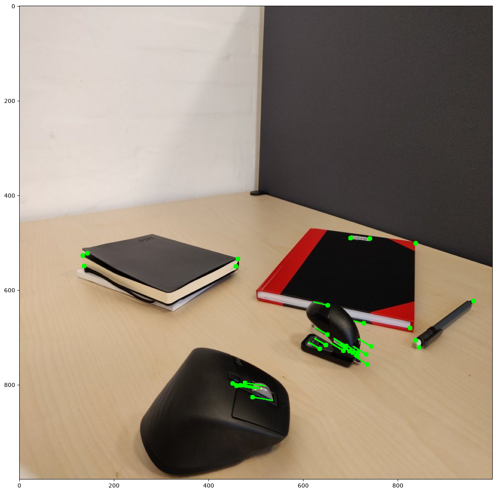
*Fig. 18. Tutorial: all 31 tracked points, static ones included.*

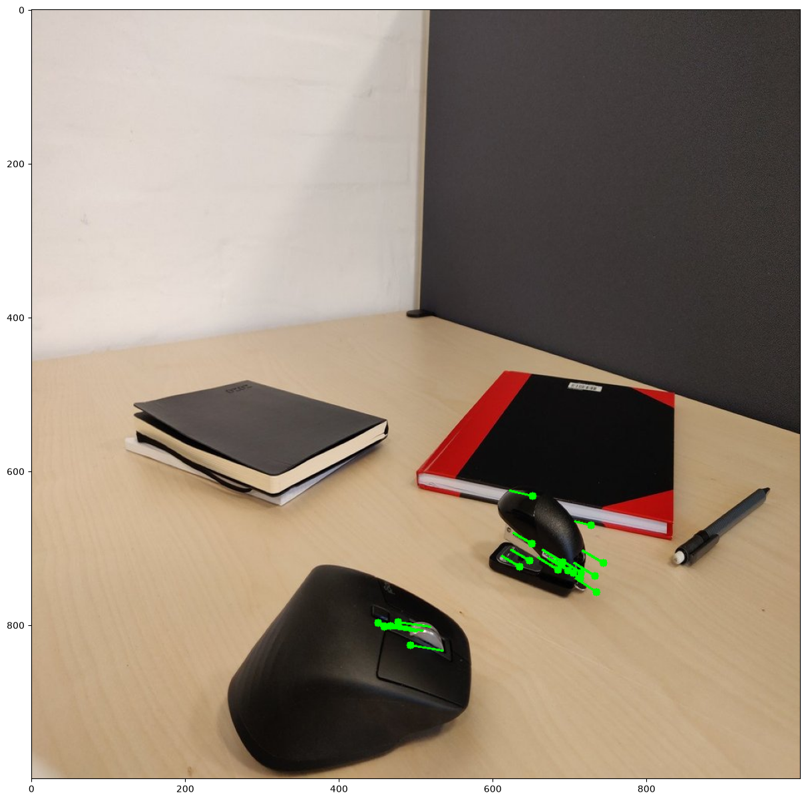
*Fig. 19. Cell 4a: the 19 points that moved more than 1 px.*

**Cells 4b.1 and 4b.2: dense flow.** `cv2.calcOpticalFlowFarneback(gray1, gray2, None, 0.5, 3, 15, 3, 5, 1.5, 0)` was used to obtain a displacement for every pixel; 8.5 % of the pixels move more than 1 px. Two displays were made:
- a colour image (Fig. 8 is the key), with `max_flow = 40` px at full brightness, because 99 % of the pixels move less than 43 px;
- arrows on a 25-px grid wherever the flow is longer than 1 px.

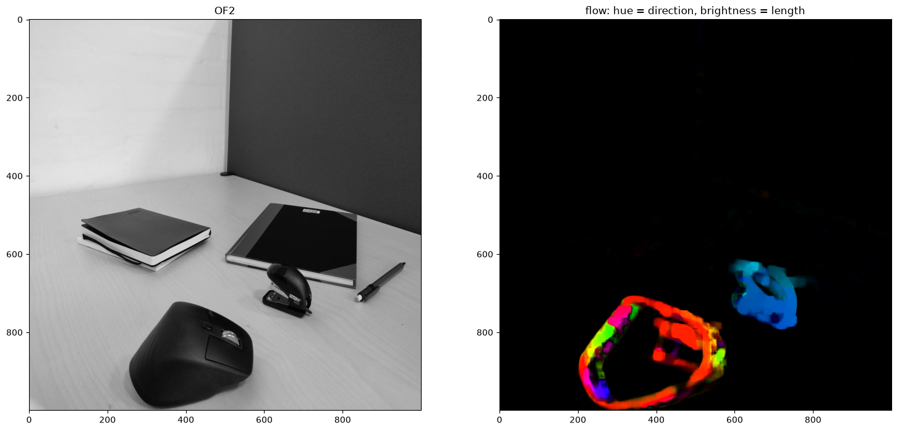
*Fig. 20. Cell 4b.1: hue = direction, brightness = length.*

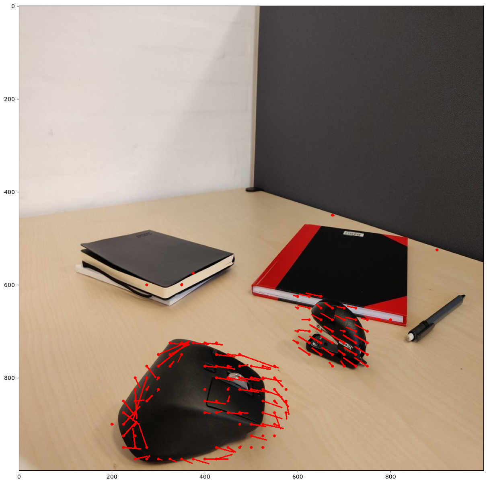
*Fig. 21. Cell 4b.2: flow vectors every 25 px.*

| Farnebäck parameter | Value | Meaning |
|---|---|---|
| `pyr_scale` | 0.5 | each pyramid level is half the previous one |
| `levels` | 3 | pyramid levels, including the image; more levels find larger motion |
| `winsize` | 15 | averaging window; larger = more robust and finds faster motion, but blurs motion boundaries |
| `iterations` | 3 | iterations per level |
| `poly_n` | 5 | neighbourhood of the polynomial fit (5 or 7) |
| `poly_sigma` | 1.5 | Gaussian σ of that neighbourhood (OpenCV suggests 1.1 for `poly_n` 5, 1.5 for 7) |
| `flags` | 0 | e.g. `cv2.OPTFLOW_FARNEBACK_GAUSSIAN` for a Gaussian window |

---

## Weekly Project 2: robot tracking

[Weekly Project 2.ipynb](../Class_2_weekly_project/Weekly%20Project%202.ipynb) tracks the moving robots of Robots.mp4 (1920 × 1080 px, 25 fps, 482 frames). The camera is static.

**Sparse.** Exercise 4a's logic, applied frame by frame, was used to track the moving robots:
- the 200 strongest Shi-Tomasi corners of the previous frame are tracked with pyramidal Lucas–Kanade;
- a corner is drawn only if it was tracked and moved more than 1 px.

Background corners move less than 0.3 px per frame, robot corners 2–18 px. New corners are detected in every frame, so robots that start moving are picked up. The whole loop takes 37 ms per frame, and a median of 31 corners per frame (maximum 62) is classified as moving.

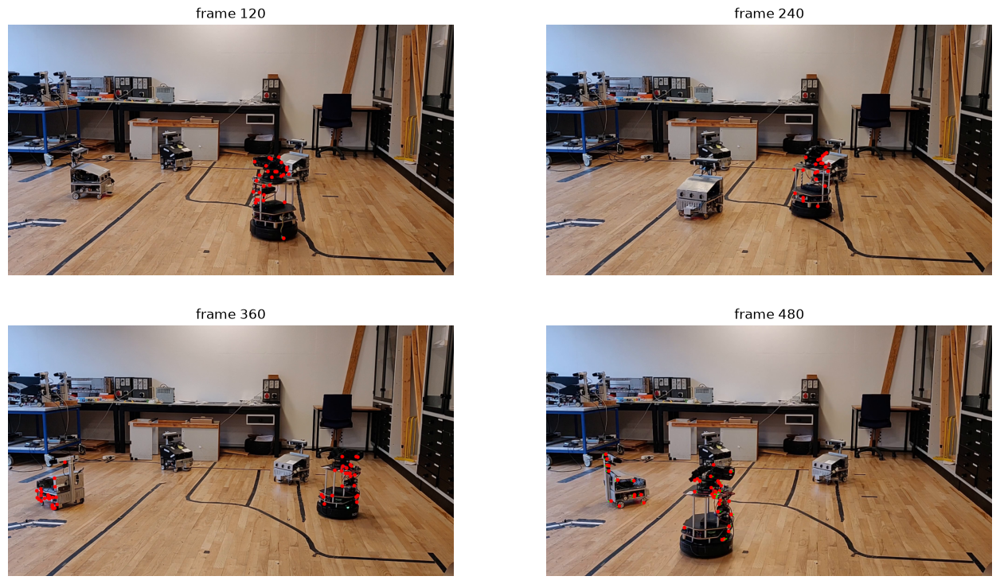
*Fig. 22. Sparse tracking: green = motion during this frame, red = new position.*

**Dense.** Farnebäck flow on half-size frames was used to obtain a motion value for every pixel. Full size would take ≈ 0.36 s per frame; half size takes ≈ 0.08 s. The flow is shown as a colour image, and the moving robots are outlined with the Class 1 tools:
1. threshold at 1 px;
2. 2 erosions remove noise pixels;
3. 6 dilations join each robot into one region;
4. contours are kept if their filled area exceeds 2,000 px.

The loop takes 79 ms per frame and finds at most 2 moving regions in any frame (median 2): the moving robots.

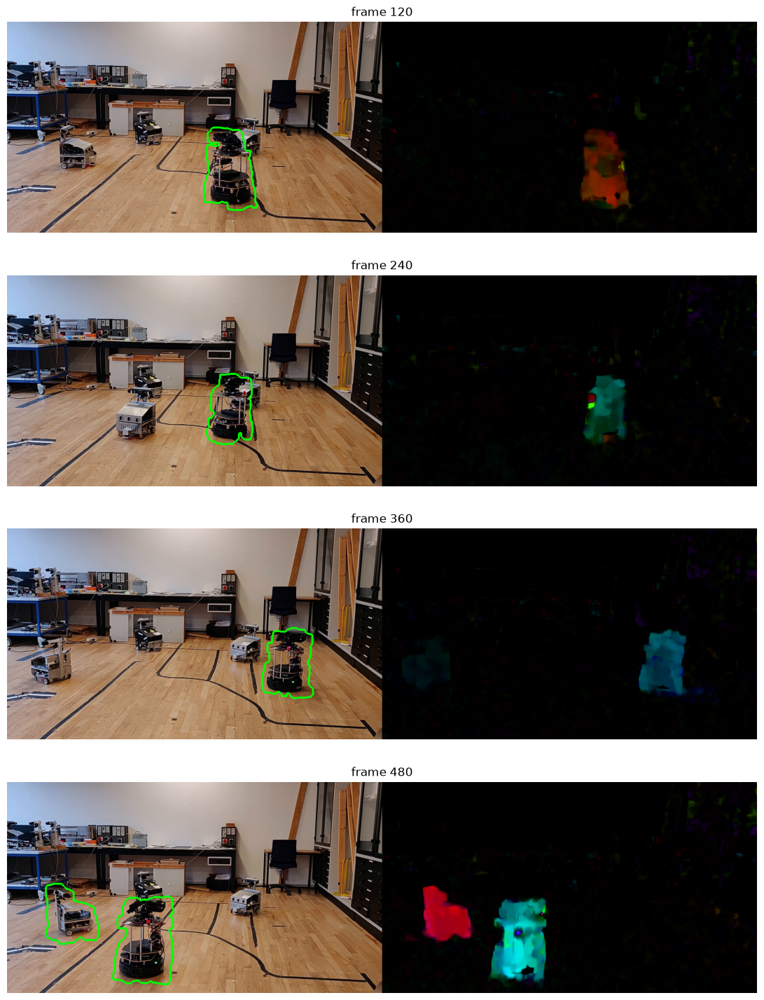
*Fig. 23. Dense flow: frame with outlined moving regions (left) and flow image (right).*

| | Sparse (Lucas–Kanade on corners) | Dense (Farnebäck) |
|---|---|---|
| Measures | the displacement of at most 200 corners | the displacement of every pixel |
| Time per frame | 37 ms at full size | 79 ms at half size (≈ 360 ms at full size) |
| Shows | points and short tracks on the textured parts of the robots | whole moving regions with the direction as colour |
| Needs | texture (corners) on the robot | nothing extra, but regions come out wider than the robot because of the averaging window |
| Errors to expect | noisy points just above the threshold; points lost when a robot turns | small spurious regions (removed by the area filter); robots close together merge |

The optional challenge (following one robot, also in Challenge.mp4) is not implemented. The notebook ends with two ways to do it: nearest region to the previous position, or descriptor matching with ORB or SIFT.

---

## When it fails

| Problem | Where | Cause | Fix |
|---|---|---|---|
| Edges full of noise | derivatives | differences amplify noise | smooth first (Gaussian, derivative of Gaussian) |
| Too many or too few edges | Canny | thresholds too low or too high | tune high for the seeds, low for continuity; smoothing sets the detail |
| Dark pieces not found | Exercise 1 with a (9, 9) blur | the blur removes their weak edges | no or little blur; lower `param1` |
| Hundreds of circles | `HoughCircles` without radius limits | lines and corners also vote | bracket the radius first, then tune `param2` |
| Corner count changes with the image | Harris threshold | the threshold is relative to the strongest corner | Shi-Tomasi with `maxCorners`, or a fixed threshold |
| Corner lost after zooming | Harris, Shi-Tomasi | fixed window size: no scale invariance | scale-space detector (DoG, SIFT, ORB's pyramid) |
| ORB matches mostly wrong | `BFMatcher()` default | L2 norm on binary descriptors (23 % correct) | `cv2.NORM_HAMMING` |
| Wrong matches among the best | any matcher | a nearest neighbour always exists; repeated text and patterns | ratio test, mutual check, RANSAC |
| Fitted line pulled away | least squares with outliers | every residual counts as noise (slope 0.30 instead of 0.5) | RANSAC, or Hough voting |
| RANSAC gives a poor model | wrong settings | threshold, sample size or iterations | δ matched to the noise, the minimal sample, enough iterations (N formula) |
| Garbage positions in tracking | `calcOpticalFlowPyrLK` | lost points (status 0) | use only points with status 1 |
| Static points marked as moving | sparse flow | sub-pixel noise | a motion threshold above the noise (1 px here) |
| Flow too slow for video | Farnebäck at full size | a computation for every pixel | compute on downscaled frames |
| Everything seems to move | moving camera | the background also moves | measure motion relative to the background (not needed here) |
| Image already drawn on | Exercise 1 lines, Exercise 4 tutorial | drawing works in place | reload or `.copy()` before drawing again |
| Jupyter freezes or crashes | `cv2.imshow` in a notebook | the window is never closed | `cv2.waitKey` in the loop and `cv2.destroyAllWindows()` at the end |

---

## Key takeaways

- **An edge is a large gradient.** Derivatives need smoothing first. Canny = smoothing + gradient + non-maximum suppression + hysteresis between two thresholds.
- **Good features are corners**: the local window changes for every shift, i.e. both eigenvalues of M are large. Harris scores λ₁λ₂ − k(λ₁+λ₂)², Shi-Tomasi min(λ₁, λ₂).
- **Invariance has to be built in.**
  - Rotation: a dominant orientation, relative to which the descriptor is computed.
  - Scale: detection across a scale space (DoG extrema).
  - SIFT = DoG keypoints + orientation + a 128-value gradient-histogram descriptor. ORB = FAST + orientation + a 256-bit descriptor (Hamming distance).
- **Matching proposes, verification decides.** Nearest neighbours always exist. The ratio test and the mutual check remove ambiguous matches; RANSAC keeps the ones consistent with a geometric model.
- **Outliers break least squares.**
  - The Hough transform votes in a bounded parameter space (θ, ρ for lines; 3 parameters for circles).
  - RANSAC fits minimal random samples and counts the inliers.
  - The number of RANSAC iterations follows from the inlier ratio and the sample size.
- **Optical flow assumes brightness constancy and small motion.** Lucas–Kanade solves a 2 × 2 least-squares system per window, which needs corners. Farnebäck gives a dense field. Pyramids handle larger motions.
- **Learned methods** (SuperPoint, LightGlue, LoFTR, RAFT) improve the measurements; explicit geometry still verifies them.
