# Chapter 3 · Stereo vision and template matching

**Sources**
- Class 3 lecture, *Stereo Vision*: [34759-PfAS-3-Stereo_Vision.pdf](../Class_3_multiple_view_geometry_1/34759-PfAS-3-Stereo_Vision.pdf), cited as **L3 s.N** (slide N = PDF page N).
- [Exercise 1 - Template Matching](../Class_3_multiple_view_geometry_1/Exercise%20week%203/Exercise%201%20-%20Template%20Matching.ipynb), [Exercise 2 - Stereo Block Matching](../Class_3_multiple_view_geometry_1/Exercise%20week%203/Exercise%202%20-%20Stereo%20Block%20Matching.ipynb) and [Weekly Project 3](../Class_3_weekly_project/Weekly%20project/Weekly%20Project%203.ipynb).
- Functions and terms: [reference.md](reference.md). The chapter uses SIFT from [chapter 2](02_feature_detection.md) to check results.

**Contents**
1. [Overview](#overview)
2. [Camera model and stereo vision](#camera-model-and-stereo-vision)
3. [Epipolar geometry](#epipolar-geometry)
4. [Rectified stereo](#rectified-stereo)
5. [Depth from disparity](#depth-from-disparity)
6. [The correspondence problem](#the-correspondence-problem)
7. [Local matching: windows and metrics](#local-matching-windows-and-metrics)
8. [Global matching](#global-matching)
9. [Exercise 1: template matching](#exercise-1-template-matching)
10. [Exercise 2: stereo block matching](#exercise-2-stereo-block-matching)
11. [Weekly Project 3: block matching by hand](#weekly-project-3-block-matching-by-hand)
12. [When it fails](#when-it-fails)
13. [Key takeaways](#key-takeaways)

---

## Overview

One image loses the depth of the scene: every point along a ray projects onto the same pixel. Two images taken from different positions recover it, because the position of a point in the second image depends on its depth. The whole class follows one chain:

| Step | Question | Result |
|---|---|---|
| geometry | where can a point of image 1 lie in image 2? | on one line (the epipolar line) |
| rectification | how can that line be made simple? | it becomes the same image row |
| matching | which pixel of that row is the same scene point? | the disparity d |
| triangulation | how far away is the point? | the depth Z = fB/d |

---

## Camera model and stereo vision

**Stereo vision** computes depth from two views of a scene taken from slightly different positions (L3 s.5–9). Human eyes are about 6 cm apart (L3 s.7), and the difference between the two retinal images gives depth perception.

**Pinhole model** (L3 s.11–12). All rays pass through one point, the optical centre, and hit the image plane at the focal distance f. A scene point (X, Y, Z), in camera coordinates, projects to

$$x = f\,\frac{X}{Z}, \qquad y = f\,\frac{Y}{Z}$$

Z is lost in this division, which is why one image cannot give depth. [Chapter 4](04_calibration_and_epipolar.md#camera-model) expands this into the full camera matrix.

---

## Epipolar geometry

Suppose a point p is seen in camera 1. The scene point lies somewhere on the ray through p and the optical centre O. Seen from camera 2, that ray is a line in the image. So the match p′ must lie on that line, and the search for it is **1-D instead of 2-D** (L3 s.14–22).

| Term | Definition (L3 s.18–21) |
|---|---|
| **Baseline** | the line connecting the two camera centres |
| **Epipole** | the point where the baseline intersects an image plane |
| **Epipolar plane** | the plane containing the two camera centres and a scene point |
| **Epipolar line** | the intersection of an epipolar plane with an image plane |

All epipolar lines of an image pass through its epipole (L3 s.23), because all epipolar planes contain the baseline.

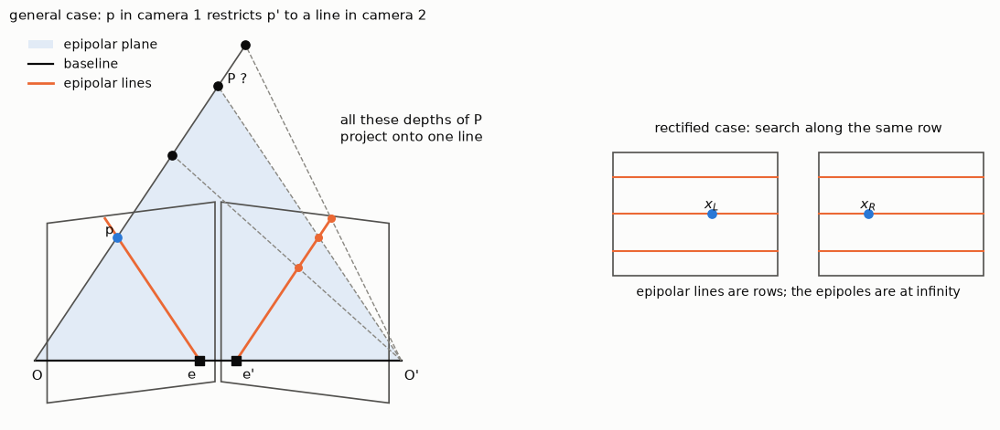
*Fig. 1. Left: all possible depths of P along the ray through p project onto one line in camera 2. Right: in a rectified pair the epipolar lines are image rows.*

---

## Rectified stereo

**Rectification** reprojects both images onto a common plane parallel to the baseline (L3 s.28). The epipolar lines become parallel, and under certain conditions also horizontal. The baseline is then parallel to the image plane and never intersects it, so the epipoles lie at infinity (L3 s.30).

A pixel in row y of the left image now has its match in row y of the right image. The match only has to be searched along one row. How rectification is computed is in [chapter 4](04_calibration_and_epipolar.md#rectification).

---

## Depth from disparity

In a rectified pair, take a point with depth Z, two cameras a baseline B apart, and focal length f (L3 s.33–41). The point appears at x_L in the left image and x_R in the right one, each measured from that image's own centre. The triangle (P, O_L, O_R) and the smaller triangle (P, x_L, x_R) are similar:

$$\frac{B - x_L + x_R}{Z - f} = \frac{B}{Z} \quad\Rightarrow\quad Z = f\,\frac{B}{x_L - x_R} = \frac{fB}{d}$$

**Disparity** d = x_L − x_R is the shift of the point between the two images. A map of d for every pixel is a **disparity map** (L3 s.43).

Depth is *inversely* proportional to disparity:
- near objects have a large disparity, far objects a small one;
- d = 0 means the point is infinitely far away;
- the depth error for one pixel of disparity error grows with the square of the distance: ΔZ ≈ Z² Δd / (fB). A larger baseline or focal length gives better depth resolution, but makes matching harder because the two views differ more.

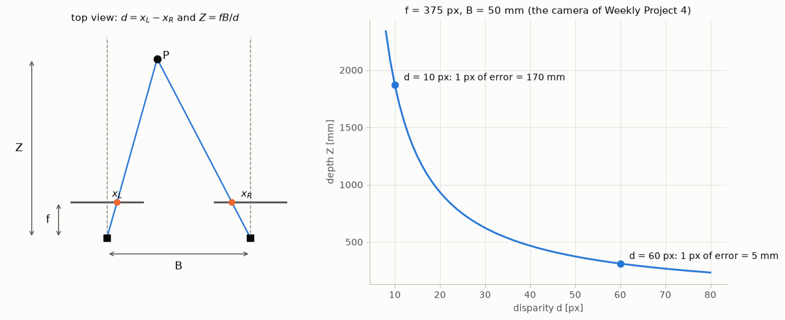
*Fig. 2. Left: the quantities of Z = fB/d. Right: with f = 375 px and B = 50 mm, one pixel of disparity error is 170 mm of depth at d = 10 px, but only 5 mm at d = 60 px.*

---

## The correspondence problem

Everything above assumes we know which pixels match (L3 s.32, 45). Finding them is the hard part. Besides the hard epipolar constraint, there are soft constraints (L3 s.46):

| Constraint | Meaning |
|---|---|
| **Similarity** | matching regions look similar |
| **Uniqueness** | a point in one image has at most one match in the other |
| **Ordering** | points on a surface appear in the same order along the row in both images (a thin object in front of a background breaks this) |
| **Limited disparity gradient** | disparity changes smoothly along surfaces, except at depth edges |

Matching also assumes that most scene points are visible in both views, and that matching regions have a similar appearance (L3 s.47).

**Sparse or dense** (L3 s.48–49).
- **Sparse:** extract features (SIFT, SURF, Harris, …) and match them. The matches are distinctive and reliable, and the method is fast, but depth is known only at the features.
- **Dense:** find a match for every pixel, using *local* (area-based), *global* (energy-based) or other methods. The result is a full depth map, but flat areas are ambiguous and the computation is larger.

---

## Local matching: windows and metrics

**Algorithm** (L3 s.50–51). For each epipolar line, and for each pixel in the left image, compare it with every pixel on the same line in the right image, and choose the one that maximises a similarity metric (or minimises a dissimilarity metric). One pixel alone is not distinctive, so **windows** are compared instead of single pixels.

**Metrics** (L3 s.52–53), for a template T and an image patch I of the same size:

| Metric | Formula | Best | Note |
|---|---|---|---|
| SAD (sum of absolute differences) | Σ \|T − I\| | smallest | simplest; cheapest |
| SSD (sum of squared differences) | Σ (T − I)² | smallest | large differences weigh more |
| NCC (normalised cross-correlation) | Σ TI / √(Σ T² Σ I²) | largest (≤ 1) | unaffected if all values of a patch are multiplied by a constant |

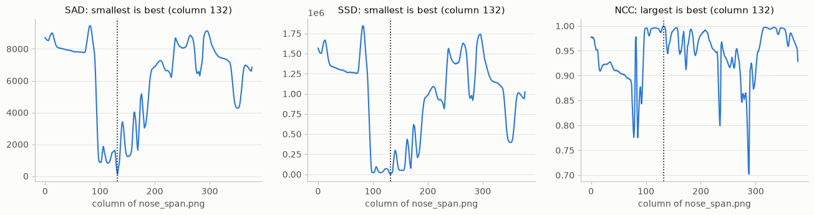
*Fig. 3. The three metrics for the nose template along `nose_span.png`. All find column 132. SAD and SSD have a clear minimum; NCC has a peak of 0.9999 on a baseline of about 0.96.*

**Window size** (L3 s.54):

| Window | Advantage | Disadvantage |
|---|---|---|
| small | keeps object edges and fine structure | few pixels to compare: noisy, ambiguous |
| large | more pixels: smooth, reliable in weak texture | spans depth edges, which blurs them; more computation |

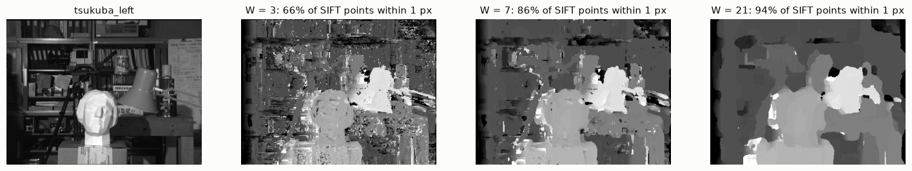
*Fig. 4. SAD on the Tsukuba pair. Against the 256 SIFT matches, 66 % are within 1 px at W = 3, 86 % at W = 7 and 94 % at W = 21. SIFT points lie on texture, so this measure cannot see the blurred edges of W = 21 in the image.*

**Good and bad areas** (L3 s.55). Matching works where a window is distinctive: textured regions and corners. It has problems with:
- flat areas (no texture, many columns have the same cost);
- repeated patterns (several columns match equally well);
- occluded regions (visible in one image only, so no correct match exists);
- reflective surfaces (the appearance depends on the viewpoint).

---

## Global matching

Local methods decide each pixel from its own neighbourhood only (L3 s.56). **Global methods** find better solutions at a higher computational cost (L3 s.57–59), by optimising the disparities of many pixels jointly:
- of all the pixels of each row, for example with dynamic programming;
- of all the pixels of the image, for example with graph cuts.

The problem is written as the minimisation of an energy with a data term and a smoothness term (L3 s.59):

$$E(d) = \sum_{p} C(p, d_p) + \lambda \sum_{(p,q)\ \text{neighbours}} V(d_p, d_q)$$

C says how well pixel p matches at disparity d_p. V penalises neighbouring pixels with different disparities. λ sets the balance. Global methods are not used in the exercises.

---

## Exercise 1: template matching

Template matching looks for a small image inside a larger one, by computing a similarity score at every position. It is the same operation as stereo matching, without the restriction to one row.

**Cell 1.1, tutorial: the crocodile.** `cv2.matchTemplate(gray_left, template, cv2.TM_CCORR_NORMED)` was used to obtain a similarity map. Each pixel of the map is the score of the template placed with its top-left corner there, so the map has size (1848 − 80 + 1) × (2724 − 236 + 1) = 1769 × 2489. `cv2.minMaxLoc` gives the position of the maximum, 0.9993 at (1523, 613), and a rectangle with the template's size is drawn from there.

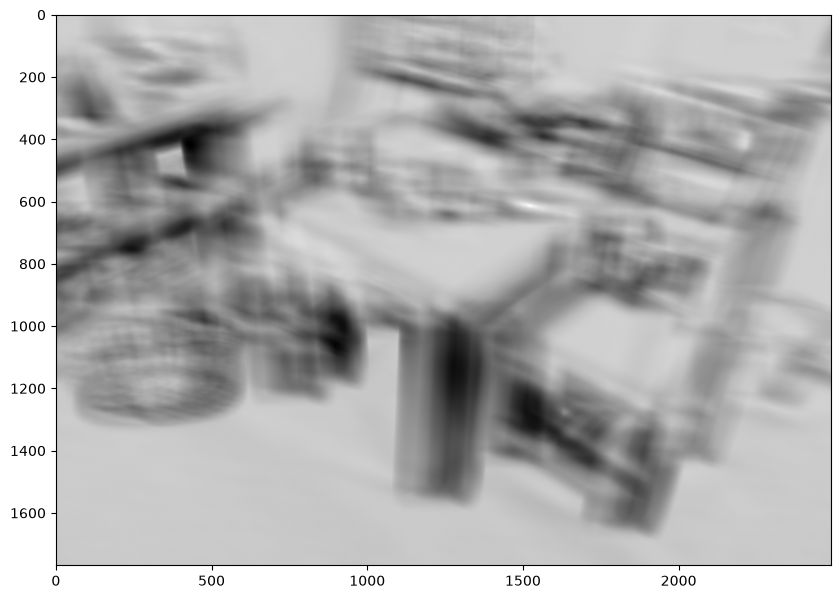
*Fig. 5. The similarity map: the whole map is bright (median 0.90), and the crocodile is its brightest point.*

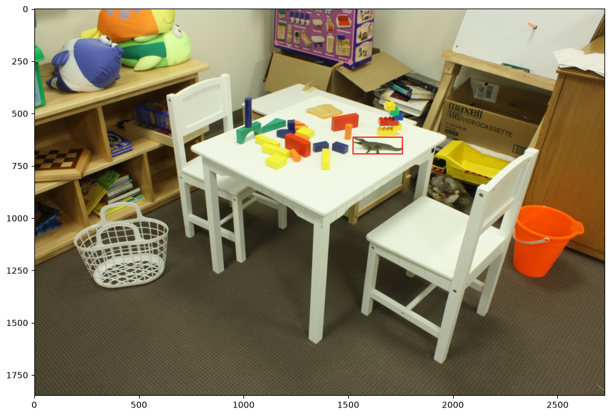
*Fig. 6. The best match.*

**Cell 1.2: the orange bucket.** The same two steps with `orange_bucket.png`. The file is a colour image, unlike the crocodile, so it must be converted to gray. Using one channel, as the crocodile cell does, puts the best match at (963, 1019) with a score of 0.65, which is wrong. With the conversion, the score is 1.0000 at (2278, 934), because the template was cut out of this image.

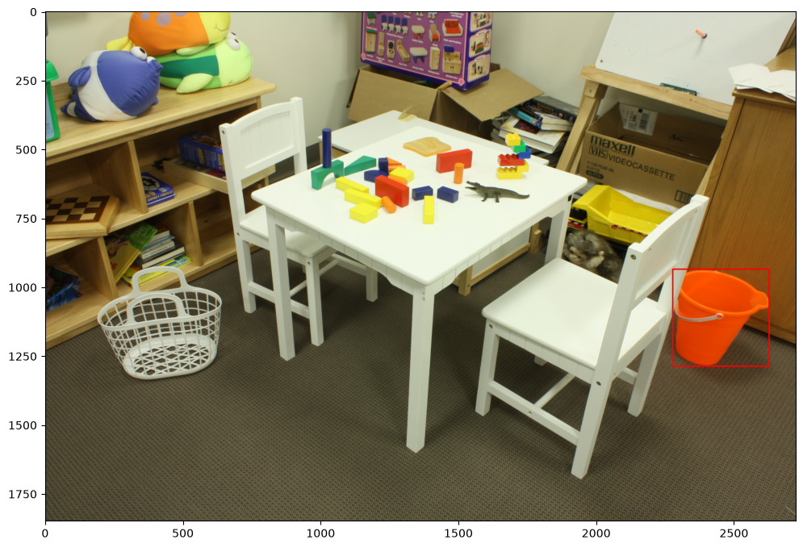
*Fig. 7. Cell 1.2.*

**Cell 1.3: `TM_SQDIFF`.** The map of squared differences was compared with the normalised correlation. Its best value is the **minimum**, so `min_loc` is used instead of `max_loc`. Both metrics find the same place for both templates.

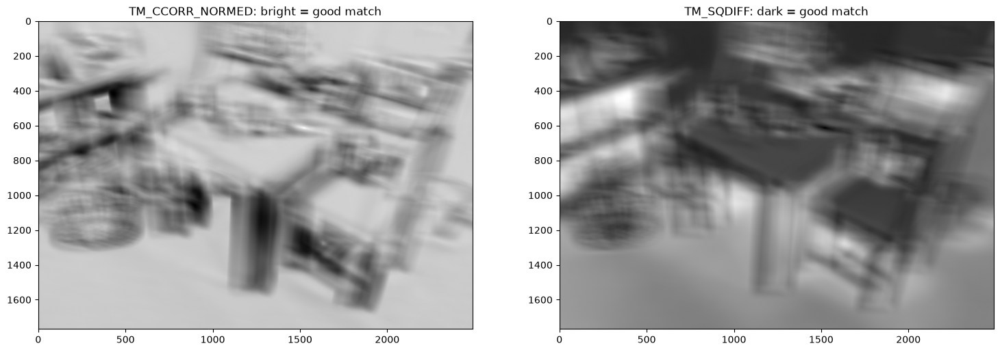
*Fig. 8. Cell 1.3: bright is good on the left, dark is good on the right.*

| Crocodile template | `TM_CCORR_NORMED` | `TM_SQDIFF` |
|---|---|---|
| best value | 0.9993 (maximum) | 1.11 × 10⁶ (minimum) |
| best value elsewhere in the image | 0.9538 | 6.92 × 10⁷ (about 60 times worse) |
| range | fixed: at most 1 | open: grows with the template size and the contrast |
| can use a fixed threshold, or compare templates | yes | no |
| separates the match from the rest | small step on a bright map | strongly |

---

## Exercise 2: stereo block matching

**Cell 2.1: `StereoBM` and its parameters.** OpenCV's block matcher, `cv2.StereoBM_create`, was used to obtain a disparity map of the play table at 1/5 of its size. With no ground truth, SIFT matches between the two images served as the check: the 272 matches have disparities from about 9.5 to 44 px, and a point counts as correct if the map is within 2 px of its SIFT value.

| Parameter | Meaning | Measured effect |
|---|---|---|
| `minDisparity` | smallest disparity searched | 7: below the farthest objects (≈ 9.5 px) |
| `numDisparities` | width of the search, a multiple of 16 | 48: reaches 55 px, beyond the nearest objects (≈ 44 px). A wider range loses more columns on the left, which have no complete search range |
| `blockSize` | odd window size | correct: 90 % at 5, 96–97 % at 9 and 15. Above about 21 the window spans edges and blurs them |
| `uniquenessRatio` | best cost must beat the second best by this percentage, else the pixel is invalid | valid pixels: 78 % at 1, 68 % at 5, 61 % at 10, 55 % at 15 |
| `speckleWindowSize`, `speckleRange` | connected regions smaller than the window, with disparity varying by at most the range, are removed | window 3 to 100: 61 % to 54 % valid |
| `disp12MaxDiff` | largest difference between left-to-right and right-to-left matching (detects occlusions) | 200 practically switches it off; 1 is strict |

`compute` returns disparities in 1/16 px (hence the division by 16), and invalid pixels get `minDisparity − 1`.

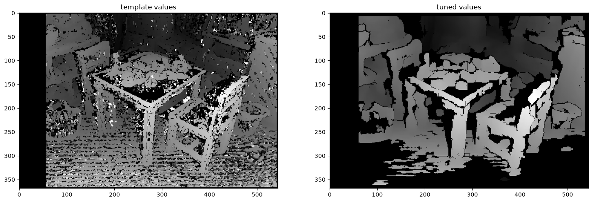
*Fig. 9. Cell 2.1. The template values give 71 % valid pixels and 90 % correct points. The tuned values give 54 % valid pixels and 98 % correct points.*

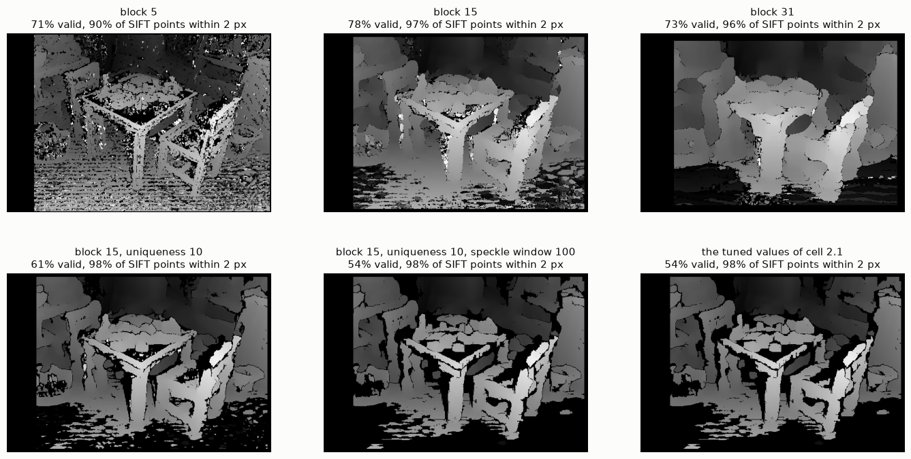
*Fig. 10. The effect of each parameter on the play table. Black pixels are invalid.*

The result is a trade-off: stricter checks leave more holes and fewer errors.

**Cell 2.2: point cloud.** `cv2.reprojectImageTo3D(disparity, Q)` was used to obtain a 3-D point per pixel: [X, Y, Z, W]ᵀ = Q [x, y, d, 1]ᵀ, then a division by W. The template's Q gives (x − w/2)/d, (h/2 − y)/d and −f/d, i.e. Z = fB/d with B = 1. The focal length is only a guess (0.8 w), so the cloud has no real units and can be stretched along the viewing direction. Real values need a calibration ([chapter 4](04_calibration_and_epipolar.md)).

Three changes were made to the template's export function:
- the file name is a parameter, so 2.3 doesn't overwrite 2.2;
- the image is passed in RGB order, because the template's BGR image swaps red and blue in the file;
- the PLY header lines start in the first column, as the format expects.

**Cell 2.3: the storage pair.** The same method with `num_disp = 112`. The SIFT matches here run from about 13 to 106 px, so a search up to 55 px covers only 73 % of them. With 112 the map covers 85 %, with 53 % valid pixels and 98 % of the points correct.

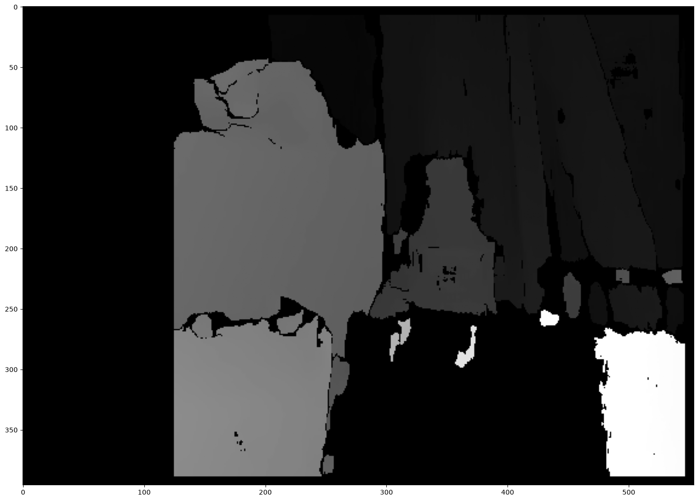
*Fig. 11. Cell 2.3.*

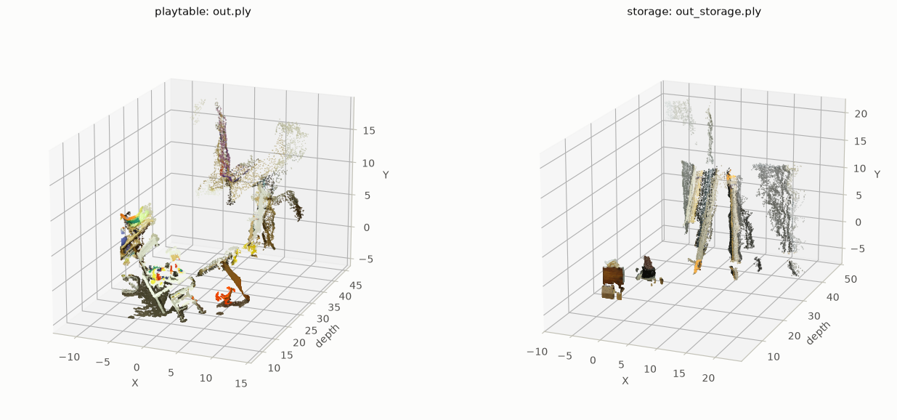
*Fig. 12. The two exported point clouds, about 40,000 points of each, with their image colours. `out.ply` has 107,922 points and `out_storage.ply` 116,723. The exercise asks to view them in Meshlab, which can also be done with these files.*

---

## Weekly Project 3: block matching by hand

The project forbids `cv2.matchTemplate` and `cv2.StereoBM`, so that the algorithm itself is written out.

**Step 1: SAD.** The sum of absolute differences of two equal-size patches, `np.sum(np.abs(a.astype(int) - b.astype(int)))`. The conversion to `int` is essential. In `uint8`, 3 − 5 wraps around to 254, and nose2 would get a SAD of 5613 instead of 119.

**Step 2: the best of three patches.** The candidate with the smallest SAD wins.

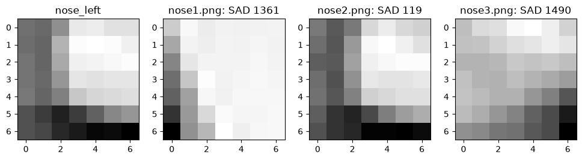
*Fig. 13. SAD 1361, 119 and 1490: nose2 is the match. With the wrapped values, nose3 would win.*

**Step 3: searching along a row.** The template slides over `nose_span.png` from left to right, and the column with the smallest SAD is kept.

```python
def find_in_span(template, span):
    w = template.shape[1]
    costs = []
    for x in range(span.shape[1] - w + 1):
        costs.append(sad(template, span[:, x:x + w]))
    return np.argmin(costs), costs
```

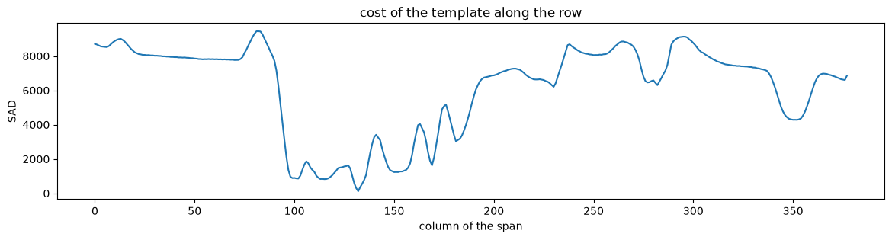
*Fig. 14. One clear minimum: 119 at column 132, while the next best columns cost about 300 and the median is about 7200.*

**Challenge: the full disparity map.** A 7 × 7 template around each pixel of the left image was searched in the same rows of the right image, to obtain the disparity of that pixel.

```python
for y in range(half, h - half):
    row = right[y - half:y + half + 1]
    for x in range(half, w - half):
        template = left[y - half:y + half + 1, x - half:x + half + 1]
        x_min = max(x - half - max_disp, 0)
        span = row[:, x_min:x + half + 1]           # a point lies further left in the right image
        best_x, costs = find_in_span(template, span)
        disp[y, x] = (x - half) - (x_min + best_x)
```

Only columns up to x are searched, because a point lies further left in the right image. The cost is proportional to pixels × `max_disp`, which is why the search is limited: 106,596 pixels × 65 candidates take about 20 s. SIFT matches of this pair have disparities from about 18 to 45 px, so `max_disp = 64`. With a limit of 20, 36 % of the pixels stop exactly at the limit. Against the SIFT matches, 86 % are within 1 px.

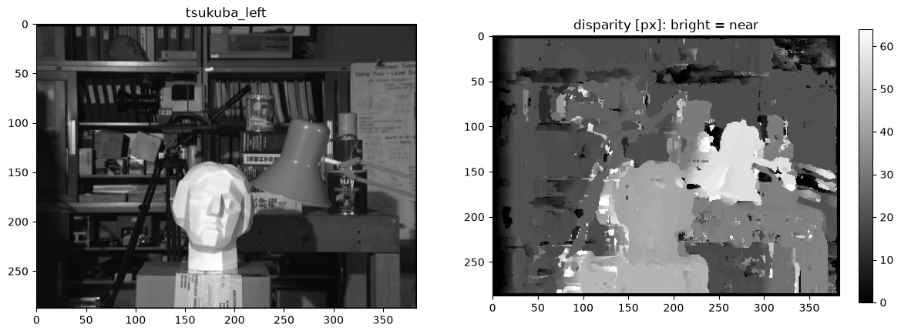
*Fig. 15. The hand-written matcher: 7 × 7 windows, SAD, `max_disp` 64.*

---

## When it fails

The last column says whether the notebook actually applies the fix.

| Problem | Where | Cause | Fix | Applied in the notebook? |
|---|---|---|---|---|
| Template found in the wrong place (score 0.65) | bucket, using one channel | the template is a colour image | convert it to gray | **yes**, cell 1.2 |
| Wrong location with `TM_SQDIFF` | cell 1.3 | a low value is the good one | use `min_loc` | **yes**, cell 1.3 |
| Match barely stands out | `TM_CCORR_NORMED` (median 0.90, best 0.9993) | bright patches correlate with a bright template | `TM_SQDIFF`, or a zero-mean metric such as `TM_CCOEFF_NORMED` (range −0.57 to 0.99) | **partly**: `TM_SQDIFF` is compared; `TM_CCOEFF_NORMED` is not used |
| Noisy disparity | `StereoBM`, template values | small window, weak checks | larger block, uniqueness, speckle filter | **yes**, cell 2.1 |
| Many holes (54 % valid) | tuned `StereoBM` | the checks reject ambiguous pixels | accept it, or use a global method | **no**: the holes stay |
| Band of invalid pixels on the left | `StereoBM` | those columns have no complete search range | keep `numDisparities` as small as the scene allows | **partly**: the range is chosen per scene, and the band stays |
| Nearest objects missing | storage with a range up to 55 px | disparities reach 106 px | a wider search | **yes**, cell 2.3 |
| Red and blue swapped in the PLY file | template's export cell | BGR image passed as colours | convert to RGB | **yes**, cell 2.2 |
| Stretched point cloud, no real units | `export_pointcloud` | f is a guess and B = 1 | calibrate the camera | **no** here; Weekly Project 4 gets real units |
| Wrong nose chosen | SAD in `uint8` | negative differences wrap around | convert to `int` | **yes**, step 1 |
| 36 % of the pixels stop at the limit | `max_disp = 20` | real disparities reach about 45 px or more | a larger `max_disp` | **yes**, challenge |
| Noise in flat areas | block matching | many columns cost the same | larger window (94 % at W = 21), or a global method | **no**: the project sets 7 × 7 |
| Wrong values next to objects and at the left border | block matching | occlusions: no correct match exists | left-right check | **no** in the hand-written matcher |
| Slow | nested Python loops | pixels × candidates | limit the search, or shrink the images | **partly**: the search is limited |

---

## Key takeaways

- **The epipolar constraint turns a 2-D search into a 1-D one**: a point in one image lies on a line in the other. All epipolar lines pass through the epipole.
- **Rectification makes those lines image rows**, with the epipoles at infinity. The search is then along the same row.
- **Z = fB/d.** Depth is inverse to disparity, so depth resolution falls quickly with distance. A larger baseline improves it but makes matching harder.
- **Correspondence is the hard part.** Windows are compared with a metric (SAD, SSD, NCC) under the soft constraints of similarity, uniqueness, ordering and limited disparity gradient.
- **Window size is a trade-off**: small windows keep edges and add noise; large windows are smooth and blur edges.
- **Matching needs texture.** Flat areas, repeated patterns and occlusions fail; checks such as uniqueness and left-right consistency turn wrong values into holes.
- **Local methods decide each pixel alone. Global methods** minimise a data term plus a smoothness term over a row or the whole image.
- **Template matching is the same operation without the epipolar restriction**: a score at every position, and the best one wins. Always check whether "best" is the maximum or the minimum of the metric.
