# Chapter 4 · Camera calibration and epipolar geometry

**Sources**
- Class 4 lectures:
  - [Camera Matrix and Camera Calibration](../Class_4_epipolar_geom_2_and_calibration/34759-PAS-7-Camera_Calibration_2026.pdf), cited as **L4a s.N**;
  - [Epipolar Geometry and the Fundamental Matrix](../Class_4_epipolar_geom_2_and_calibration/34759-PAS-7-Epipolar_Geometry_2_2026.pdf), cited as **L4b s.N**.
- [Exercise 1 - Monochrome camera calibration](../Class_4_epipolar_geom_2_and_calibration/Exercises_week_4/Exercises_week_4/Exercise%201%20-%20Monochrome%20camera%20calibration.ipynb), [Exercise 2 - Epipolar lines](../Class_4_epipolar_geom_2_and_calibration/Exercises_week_4/Exercises_week_4/Exercise%202%20-%20Epipolar%20lines.ipynb) and [Weekly Project 4](../Class_4_weekly_project/Weekly%20Project%204.ipynb).
- Functions and terms: [reference.md](reference.md). The chapter builds on [epipolar geometry and disparity in chapter 3](03_stereo_vision.md#epipolar-geometry), and on [SIFT and RANSAC in chapter 2](02_feature_detection.md#fitting-a-model-with-outliers).

**Contents**
1. [Overview](#overview)
2. [Camera model](#camera-model)
3. [Calibration with known 3-D points](#calibration-with-known-3-d-points)
4. [Calibration with a planar pattern](#calibration-with-a-planar-pattern)
5. [Lens distortion](#lens-distortion)
6. [The essential matrix](#the-essential-matrix)
7. [The fundamental matrix](#the-fundamental-matrix)
8. [Rectification](#rectification)
9. [Learned methods: what they replace](#learned-methods-what-they-replace)
10. [Exercise 1: calibrating a camera](#exercise-1-calibrating-a-camera)
11. [Exercise 2: epipolar lines](#exercise-2-epipolar-lines)
12. [Weekly Project 4: stereo calibration](#weekly-project-4-stereo-calibration)
13. [When it fails](#when-it-fails)
14. [Key takeaways](#key-takeaways)

---

## Overview

Chapter 3 used Z = fB/d with a guessed focal length and no real baseline, and it assumed rectified images. This chapter supplies what was missing.

| Question | Answer | Result |
|---|---|---|
| how does a 3-D point reach a pixel? | the camera model | K, R, T |
| how are those parameters measured? | calibration with a known pattern | K, distortion |
| how are two views related? | the essential and fundamental matrices | E, F, epipolar lines |
| how are images made ready for block matching? | rectification | rows are epipolar lines; f and B in real units |

The full pipeline is: **match → estimate E or F → rectify → disparity → Z = fB/d** (L4b s.20).

---

## Camera model

**Image formation** (L4a s.4–8). In a real pinhole camera the image plane lies behind the centre, so the image is inverted (cx = −f · X/Z). The model places it in front of the centre instead, which removes the sign and changes nothing else. The projected position depends on the ratio X/Z.

**Extrinsics** (L4a s.5–7) describe the pose of the camera relative to the world: rotation R and translation T. A world point X_p in homogeneous coordinates is expressed in the camera frame with

$$\begin{bmatrix} {}^kX_p \\ {}^kY_p \\ {}^kZ_p \end{bmatrix} = \begin{bmatrix} R & T \end{bmatrix} \begin{bmatrix} X_p \\ Y_p \\ Z_p \\ 1 \end{bmatrix}, \qquad T = -R\,C$$

where C is the position of the camera centre in the world.

**Intrinsics** (L4a s.5, 8–9) describe the camera itself: the focal lengths in pixels (f_x, f_y), the principal point (c_x, c_y) and the skew s. They transform the camera-frame point to the sensor:

$$K = \begin{bmatrix} f_x & s & c_x \\ 0 & f_y & c_y \\ 0 & 0 & 1 \end{bmatrix}$$

**Projection matrix** (L4a s.9–10). Together:

$$\lambda \begin{bmatrix} x \\ y \\ 1 \end{bmatrix} = \underbrace{K \begin{bmatrix} R & T \end{bmatrix}}_{P} \begin{bmatrix} X \\ Y \\ Z \\ 1 \end{bmatrix}$$

P is 3 × 4 and is defined up to scale (λ), which leaves **11 unknowns: 5 intrinsic + 6 extrinsic**. The equation is linear in the elements of P, which is what makes calibration solvable.

---

## Calibration with known 3-D points

Given points with known 3-D and 2-D positions, the scale λ is eliminated by dividing by the third row, so each correspondence gives **2 equations** (L4a s.11–13):

$$0 = p_{11}X + p_{12}Y + p_{13}Z + p_{14} - p_{31}xX - p_{32}xY - p_{33}xZ - p_{34}x$$

$$0 = p_{21}X + p_{22}Y + p_{23}Z + p_{24} - p_{31}yX - p_{32}yY - p_{33}yZ - p_{34}y$$

11 unknowns need at least **6 points** (L4a s.12). All the equations are stacked as Ap = 0, and the **Direct Linear Transform (DLT)** solves it (L4a s.14):
1. compute the singular value decomposition A = UDVᵀ;
2. take the column of V with the smallest singular value;
3. reshape it into the 3 × 4 matrix P.

---

## Calibration with a planar pattern

In practice we don't have known 3-D points, unless we make them: a **calibration pattern** has corners at known relative positions (L4a s.15). All of them lie on one plane, so we can set Z = 0.

**Homography** (L4a s.16–17). With Z = 0 the third column of P drops out, which leaves a 3 × 3 matrix H that maps the plane of the pattern to the image, x′ = Hx. H has 9 elements and is defined up to scale, so **8 unknowns**; each point gives 2 equations, so at least **4 correspondences** are needed.

**Normalised DLT** (L4a s.18). The DLT gets better conditioned when the coordinates are normalised first:
1. for each image, translate the points to zero mean and scale them so that the average distance to the origin is about √2;
2. form the matrix A;
3. solve with SVD, using the last column of V;
4. denormalise the result.

**Robustness and accuracy** (L4a s.19). The DLT is sensitive to outliers. Two complementary tools solve different problems:
- **RANSAC** gives robustness: it finds the inliers and rejects wrong correspondences (4 random matches, compute H, count the points with a projected distance below t, repeat N times, keep the H with the most inliers).
- **Nonlinear least squares** gives accuracy: it refines the result on those inliers.

**The complete pipeline** (Zhang's method, L4a s.23, 27):

| Step | What happens |
|---|---|
| many views of a known planar target | move the pattern in front of a static camera, in several orientations (L4a s.18) |
| detect target corners | known 3-D, measured 2-D |
| one homography per view | normalised DLT |
| closed-form first K | from constraints that each H puts on K |
| nonlinear refinement (Levenberg–Marquardt) | minimises the **reprojection error**: the distance between each detected corner and where the model projects it |

The output is K, the distortion coefficients and the pose of every view. Each view gives 2 constraints on K, because the first two columns of a rotation are perpendicular and have equal length. So at least 3 views are needed for the 5 intrinsics, and they must have different orientations. Views with the same orientation add no new constraints (L4a s.18).

---

## Lens distortion

A real lens bends straight lines (L4a s.20). The three common types are **barrel**, **pincushion** and **fisheye**. The usual model is a polynomial in the distance r from the principal point (L4a s.21). OpenCV's five coefficients (k₁, k₂, p₁, p₂, k₃) are, for normalised coordinates x = (X/Z), y = (Y/Z), and r² = x² + y²:

$$x' = x\,(1 + k_1 r^2 + k_2 r^4 + k_3 r^6) + 2p_1 xy + p_2(r^2 + 2x^2)$$

$$y' = y\,(1 + k_1 r^2 + k_2 r^4 + k_3 r^6) + p_1(r^2 + 2y^2) + 2p_2 xy$$

The k's are radial: the shift depends on the distance from the centre. The p's are tangential: they come from a lens that isn't exactly parallel to the sensor. Then u = f_x x′ + c_x and v = f_y y′ + c_y. Negative k₁ gives barrel distortion, positive k₁ pincushion.

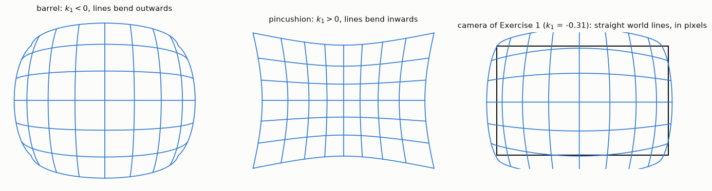
*Fig. 1. Straight grid lines under k₁ < 0, under k₁ > 0, and under the coefficients measured in Exercise 1 (k₁ = −0.31), in pixels. The black rectangle is the image.*

**Undistorting** works backwards. For each pixel of the corrected image, compute where it lies in the distorted image, using the formulas above, and interpolate the value there.

---

## The essential matrix

**General case** (L4b s.3–7). Two views, and a ray through the centre of one camera, define the baseline, the epipolar plane and the epipolar lines (definitions in [chapter 3](03_stereo_vision.md#epipolar-geometry)). Where the epipoles lie depends on the motion:
- cameras side by side and parallel: the epipoles are at infinity and the epipolar lines are parallel. This is the case used for disparity (L4b s.5);
- a camera moving forwards: the epipole is at the point the camera moves towards, and the epipolar lines radiate from it.

**Derivation** (L4b s.8–10). For **calibrated** cameras, convert pixels to camera coordinates with the inverse of K: x̂ = K⁻¹x, x̂′ = K′⁻¹x′. The two views are related by x̂ = R x̂′ + T. Take the cross product with T, which removes T, and then the dot product with x̂, which removes the left side:

$$\hat x \cdot (T \times \hat x) = \hat x \cdot (T \times R\hat x') \quad\Rightarrow\quad 0 = \hat x^T [T]_\times R\, \hat x'$$

That gives

$$\hat x^T E\, \hat x' = 0, \qquad E = [T]_\times R$$

where [T]× is the skew-symmetric matrix of the cross product. E relates the same scene point in the two views, using only the camera motion.

---

## The fundamental matrix

For **uncalibrated** pixels, substitute x̂ = K⁻¹x into the equation above (L4b s.11):

$$x^T F\, x' = 0, \qquad F = K^{-T} E\, K'^{-1}$$

| Property | Essential matrix E (L4b s.10) | Fundamental matrix F (L4b s.12) |
|---|---|---|
| Works on | calibrated, normalised points | raw pixels |
| Needs K | yes | no |
| Size | 3 × 3 | 3 × 3 |
| Epipolar line of x′ | E x′ | F x′ |
| Epipolar line of x | Eᵀx | Fᵀx |
| Epipoles | E e′ = 0, Eᵀe = 0 | F e′ = 0, Fᵀe = 0 |
| Rank | 2 (singular) | 2: det F = 0 |
| Degrees of freedom | 5 (3 rotation + 3 translation − 1 scale) | 7 (9 elements − 1 scale − 1 for det F = 0) |

**Convention.** The slides use l = F x′, which is the transpose of the form in Hartley & Zisserman (L4b s.12). OpenCV writes x′ᵀ F x = 0 with x in the first image. The ideas are the same, but the transpose matters when combining formulas from different sources.

**The 8-point algorithm** (L4b s.13). Each correspondence gives one linear equation in the 9 elements of F:

$$xx'f_{11} + xy'f_{12} + xf_{13} + yx'f_{21} + yy'f_{22} + yf_{23} + x'f_{31} + y'f_{32} + f_{33} = 0$$

8 correspondences determine F up to scale. They are stacked as A**f** = 0 and solved with SVD. The result usually does not have rank 2, so a second SVD sets its smallest singular value to 0.

**Robust version, compared with the homography** (L4b s.14):

| | Homography (no translation, or a plane) | Fundamental matrix (translation) |
|---|---|---|
| Relation | x′ = Hx | xᵀFx′ = 0 |
| Normalise coordinates | yes | yes |
| RANSAC sample | 4 points | 8 points |
| Solve | SVD | SVD, then enforce det F = 0 |
| De-normalise | H = T′⁻¹ H̃ T | F = Tᵀ F̃ T′ |

---

## Rectification

To use block matching, the general case must be converted to the rectified one (L4b s.15–19). Both images are warped so that corresponding points lie on the same row (scan-line aligned). The slides' example starts with no calibration: match points, compute F, compute the rectified images.

With a **calibrated** stereo pair the same goal is reached by rotating the cameras virtually:
1. find R and T between the cameras;
2. find rotations R₁ and R₂ that make both image planes parallel to the baseline and to each other;
3. give both new views the same camera matrix.

The result is two new projection matrices P₁ and P₂. In P₂ the entry P₂[0,3] = −fB holds the baseline, so depth comes out in real units.

Rectification is implemented as a **lookup map**. For each pixel of the new image: undo the new projection, undo the rotation, apply the distortion model and K, and read the original image there. So undistortion and rectification are done in one step.

---

## Learned methods: what they replace

Both lectures end with the same question: where can a network enter a geometric pipeline, and what does it change? There are three roles (L4a s.22, L4b s.20):

| Role | What happens | Example |
|---|---|---|
| **Measurements** | better corner or match detection; the solver is unchanged | SuperPoint, LightGlue, LoFTR into normalised 8-point and RANSAC (L4b s.21) |
| **Hybrid** | learned cues feed a geometric solver that is part of the network | GeoCalib (L4a s.24–26) |
| **Priors** | the network replaces what the data cannot give | monocular depth (L4b s.23). Only this role changes what you can guarantee |

**GeoCalib** (L4a s.24–27) estimates a camera from one ordinary photo. It does not regress the focal length directly, because a focal length is not visible anywhere in the image. It predicts two dense fields, an up-vector field and a latitude field, plus a per-pixel confidence. A differentiable Levenberg–Marquardt solver turns them into focal length, roll and pitch.

| | Target-based (Zhang) | Single image (GeoCalib) |
|---|---|---|
| Input | many views of a physical target | one ordinary photo |
| Recovers | f_x, f_y, c_x, c_y, skew, distortion, poses | focal length, roll, pitch |
| Principal point | estimated | assumed to be centred |
| Distortion | full radial and tangential model | one optional parameter |
| Typical accuracy | sub-pixel reprojection error | degrees of error on the field of view |
| Needs the camera | yes, physically | no |
| Fails when | target poorly covered, or one orientation only | scene lacks perspective cues; domain shift |

**RAFT-Stereo** (L4b s.22) replaces the matching cost and the disparity optimiser. It still needs a rectified pair, and it still needs f and B to give metres. It fails on occlusion, textureless surfaces and domain shift. An accurate disparity with a wrong baseline is still a wrong depth.

**Monocular depth** (L4b s.23). One image has no baseline, so Z = fB/d cannot give metric depth: the information is absent. Depth Anything V2 returns relative depth: it orders the scene, but cannot say 4 m or 8 m. "Metric" variants learn a scale from their training domain, and they transfer only as far as that domain does.

The conclusion (L4b s.24): use learning where measurement is hard; keep geometry for units, constraints and validation.

**Questions from L4a s.28**, with short answers:
1. *Why can a network predict an up-vector field but not a focal length?* The up-vector is visible at every pixel and can be supervised; focal length only acts through geometry.
2. *When does a centred principal point break?* In cropped images. The focal length then absorbs the error and comes out wrong.
3. *500 photos from an unknown phone?* You don't have the phone, so a target is impossible: single-image.
4. *Focal length 15 % wrong: what is corrupted?* Everything metric that depends on f, such as Z = fB/d and 3-D reconstruction. Results in the image alone (features, matches, disparity in pixels) survive.

---

## Exercise 1: calibrating a camera

**Corners.** `cv2.findChessboardCorners(gray, (7, 6))` was used to obtain the 42 inner corners of the board in each image. Trying all sizes on a sample of the images gave 7 × 6. The board is found in 21 of the 24 images; the others are skipped. `objp` holds the same corners on the plane z = 0, in units of one square. The square's real size only scales the translations, so it isn't needed for K or the distortion.

```python
ret, corners = cv2.findChessboardCorners(gray, (nb_vertical, nb_horizontal))
if ret == True:
    objpoints.append(objp)
    imgpoints.append(corners)
```

**Calibration.** `cv2.calibrateCamera(objpoints, imgpoints, size, None, None)` runs the pipeline above.

| Result | Value |
|---|---|
| RMS reprojection error | 0.472 px |
| f_x, f_y | 459.6, 458.5 px |
| c_x, c_y | 362.3, 246.6 px (image 752 × 480) |
| k₁, k₂, k₃ | −0.3135, 0.1328, −0.0292 |
| p₁, p₂ | 0.0003, 0.0003 |

k₁ < 0 is barrel distortion, and the tangential terms are very small.

**How many views.** A small RMS alone doesn't prove a good calibration. With few views the model has enough freedom to fit the corners without being correct.

| Views | Median RMS [px] | f_x range over 25 random subsets [px] |
|---|---|---|
| 3 | 0.10 | 429 – 3044 |
| 5 | 0.37 | 420 – 477 |
| 10 | 0.49 | 447 – 466 |
| 20 | 0.48 | 458 – 460 |

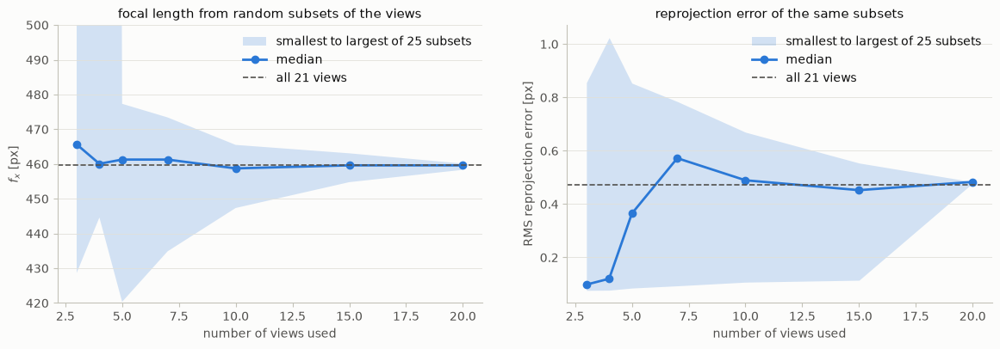
*Fig. 2. The error rises with more views, while the focal length settles. The 3- and 4-view subsets reach about 3000 px, off the left chart's scale.*

**Undistorting.** `cv2.getOptimalNewCameraMatrix(mtx, dist, (w, h), alpha, (w, h))` chooses the camera matrix of the corrected image. With alpha = 1 every source pixel is kept, black areas appear, and `roi` = (47, 85, 619, 328) is the rectangle without them. With alpha = 0 the image is zoomed so that no black remains. `cv2.undistort` then applies the correction.

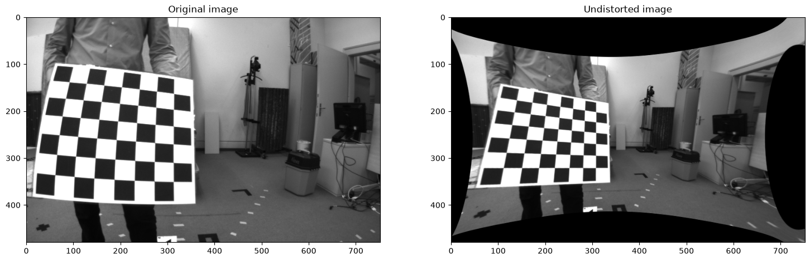
*Fig. 3. The original and the undistorted image (alpha = 1).*

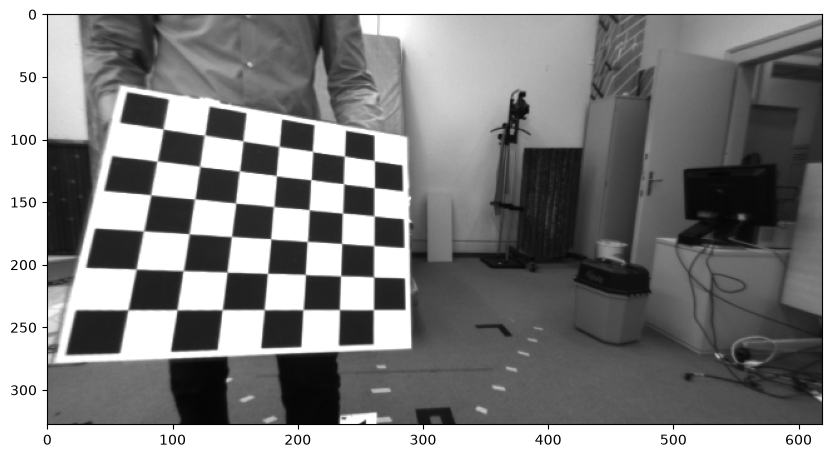
*Fig. 4. Cropped to `roi`.*

---

## Exercise 2: epipolar lines

**Cells 2.1 and 2.2.** SIFT and a brute-force matcher (chapter 2) were used to obtain the matches: 815 and 917 keypoints, and 815 matches sorted by distance.

**The fundamental matrix.** `cv2.findFundamentalMat(pts1, pts2, cv2.FM_RANSAC)` was used to estimate F from the best 200 matches. It runs the 8-point algorithm inside RANSAC, with a threshold of 3 px and at most 1000 tries by default. 110 matches (55 %) are inliers.

**Cell 2.3: the lines.** `cv2.computeCorrespondEpilines(points, which_image, F)` gives for each point its line (a, b, c) in the other image, scaled so that a² + b² = 1. Then |ax + by + c| is the distance from a point to the line, in pixels.

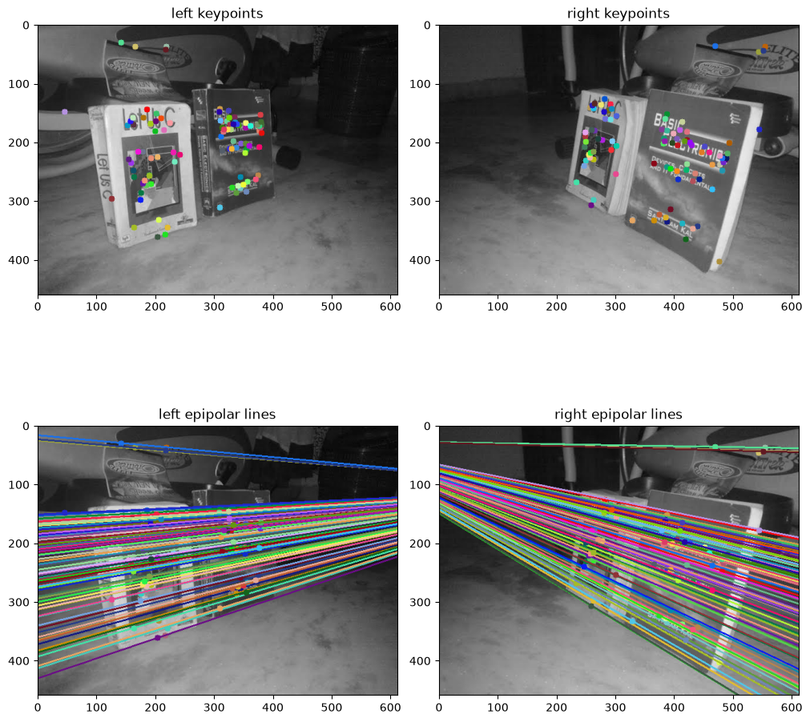
*Fig. 5. Cell 2.3: the inlier keypoints and their epipolar lines.*

**Cell 2.3b: changing the number of matches.** F is recomputed from a varying number of best matches. The median distance of the best 200 matches to their lines compares the results on equal terms.

| Best matches used | Inliers | Median distance [px] | Epipole |
|---|---|---|---|
| 20 | 11 (55 %) | 33.6 | (210, 301), inside the image |
| 50 | 28 (56 %) | 3.2 | (−552, 445) |
| **200** | **110 (55 %)** | **1.5** | **(959, 106)** |
| 800 | 120 (15 %) | 5.1 | (384, 48) |

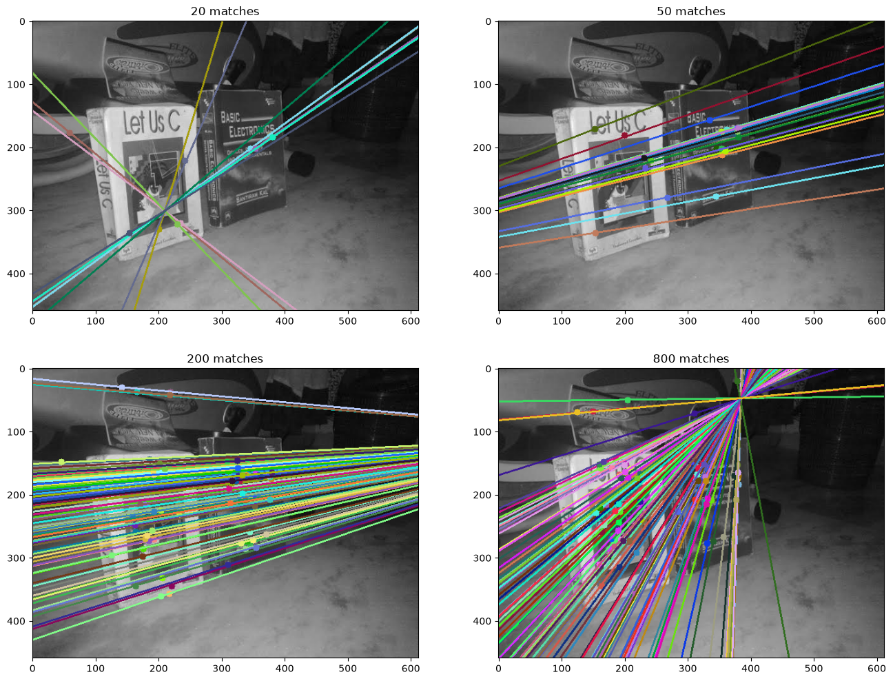
*Fig. 6. Cell 2.3b: the epipolar lines in the left image for each number of matches.*

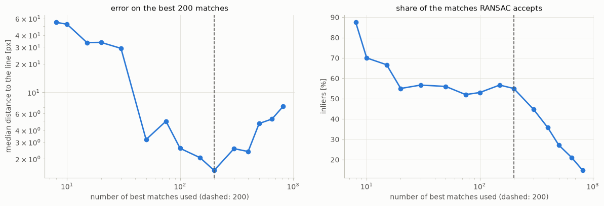
*Fig. 7. The error has its minimum near 200 matches (both axes of the left chart are logarithmic).*

**Answer to the exercise's question.** Too few and too many matches both make the lines worse.
- **Too few:** the inliers are fitted almost exactly, but the model isn't constrained elsewhere, so the lines are far from the other matches, and the epipole jumps around.
- **Too many:** the extra matches are mostly wrong. With 15 % inliers, RANSAC needs an all-inlier sample of 8, which takes log(0.01) / log(1 − 0.15⁸) ≈ 1.8 × 10⁷ tries for a 99 % chance, and it has only 1000. With 55 % inliers about 550 tries are enough. This is the [iteration formula from chapter 2](02_feature_detection.md#fitting-a-model-with-outliers).

The optional FLANN comparison in this notebook is not done.

---

## Weekly Project 4: stereo calibration

[Weekly Project 4.ipynb](../Class_4_weekly_project/Weekly%20Project%204.ipynb) calibrates a stereo camera, rectifies a pair, and runs the block matcher of Weekly Project 3 on it. The project allows OpenCV for undistortion and rectification, so `cv2.stereoCalibrate`, `cv2.stereoRectify`, `cv2.initUndistortRectifyMap` and `cv2.remap` are used, even though no template shows them. Only the `rs` image set was run (76 pairs, 640 × 480 px).

**Step 1: corners.** `findChessboardCorners` on both images of every pair, with a 9 × 6 pattern. A pair is used only if both views show the whole board, which is true for all 76. `objp` is multiplied by the square size, 33.6 mm, so all distances are in millimetres.

**Step 2: each camera on its own.** `cv2.calibrateCamera`, as in Exercise 1. RMS 0.210 px (left) and 0.199 px (right); f_x = 374.2 and 374.6 px. The distortion is very small (k₁ = −0.006).

**Step 3: relating the cameras.** `cv2.stereoCalibrate` with `cv2.CALIB_FIX_INTRINSIC` was used to obtain R and T while K and the distortion stay fixed.

```python
ret, K1, d1, K2, d2, R, T, E, F = cv2.stereoCalibrate(objpoints, imgpoints_left, imgpoints_right,
                                                      K1, d1, K2, d2, size, flags=cv2.CALIB_FIX_INTRINSIC)
```

Stereo RMS 0.213 px. T = (−49.82, 0.01, −0.06) mm, so the baseline is 49.82 mm, along x, and the cameras are rotated by only 0.07°.

**Step 4: rectification.** `cv2.stereoRectify` gives R₁, R₂, P₁, P₂ and Q. `cv2.initUndistortRectifyMap` builds one lookup map per camera, and `cv2.remap` applies it. The project's two steps, undistort and rectify, are both inside that map.

```python
R1, R2, P1, P2, Q, roi1, roi2 = cv2.stereoRectify(K1, d1, K2, d2, size, R, T, alpha=0)
map1_left, map2_left = cv2.initUndistortRectifyMap(K1, d1, R1, P1, size, cv2.CV_32FC1)
rect_left = cv2.remap(gray_left, map1_left, map2_left, cv2.INTER_LINEAR)
```

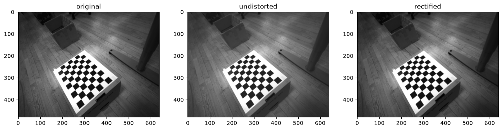
*Fig. 8. The left image of pair 49: original, after `cv2.undistort`, and rectified.*

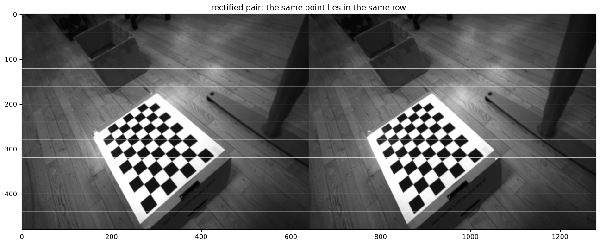
*Fig. 9. The rectified pair with horizontal lines to compare the rows.*

**Checking it.** The vertical offset between matching chessboard corners measures rectification directly.

| Image set | Mean offset before | Mean offset after |
|---|---|---|
| `rs` (in the notebook) | 0.09 px | 0.10 px |
| `mynteye` (measured separately, not in the notebook) | 3.57 px | 0.65 px |

**This camera was already almost rectified**, so rectification changes nothing measurable on `rs`. The method is shown by `mynteye`, whose cameras are rotated by 0.79° and whose distortion is k₁ = −0.33.

**Step 5: disparity and depth.** The hand-written matcher of Weekly Project 3 (7 × 7 windows, SAD, `max_disp = 64`) runs on pair 49 in 58 s. In the rectified pair f = 375.5 px and B = 49.82 mm come from P₁ and P₂, and depth is Z = fB/d.

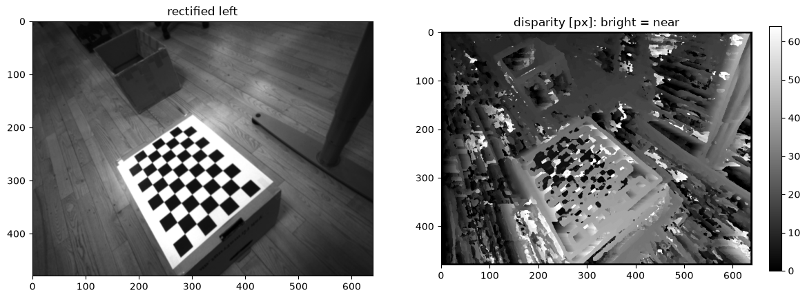
*Fig. 10. The hand-written block matcher on the rectified pair.*

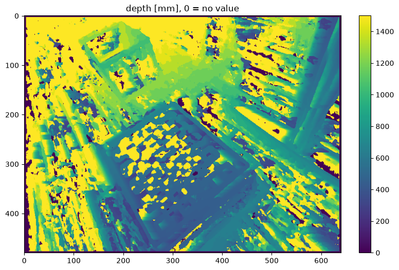
*Fig. 11. Z = fB/d in millimetres; 0 means no value.*

**Two checks with a known answer**, both from the chessboard:
- **Disparity.** At the board's corners the block matcher's median error is 0.27 px, and 85 % are within 1 px. Corners have strong texture, so this check is favourable.
- **Scale.** The corners are converted to 3-D with Z = fB/d, X = (x − c_x)Z/f, Y = (y − c_y)Z/f. The board is 547 mm away, and the distance between neighbouring corners is 33.64 mm along rows and 33.72 mm along columns, against the true 33.6 mm. So the calibration gives the correct real-world scale.

---

## When it fails

The last column says whether the notebook actually applies the fix.

| Problem | Where | Cause | Fix | Applied in the notebook? |
|---|---|---|---|---|
| Board not found in 3 of 24 images | Exercise 1 | the whole board must be visible | skip those images | **yes** |
| Low RMS but a wrong camera (3 views: RMS 0.10, f_x up to 3044 px) | calibration with few views | enough freedom to fit without being correct | many views, in different orientations | **yes**: all 21 views |
| Corners not refined | template comment "after refining them" | no refining function is shown in the course | `findChessboardCorners` already refines internally. Extra `cv2.cornerSubPix` measured: Exercise 1 (11 × 11 window) RMS 0.47 → 0.62, worse; `rs` (5 × 5) 0.21 → 0.16 | **no**: not a course function |
| Black areas after undistorting | alpha = 1 | every source pixel is kept | crop with `roi`, or alpha = 0 | **yes**: Exercise 1 crops; Weekly Project 4 uses alpha = 0 |
| `IndexError` on corner arrays | OpenCV 5 | `findChessboardCorners` returns shape (N, 2), not (N, 1, 2) | `corners.reshape(-1, 2)` | **yes** |
| F fits its matches but is wrong elsewhere (34 px) | 20 matches | the model is under-constrained | use more matches | **yes**: 200 |
| Inliers fall to 15 % | 800 matches | mostly wrong matches; 1000 RANSAC tries are too few | fewer, better matches, or the ratio test | **yes**: 200. The ratio test is not used |
| Positions up to 1 px off | template's `np.int32(pts1)` | truncates the sub-pixel positions | keep `np.float32` | **no**: the template's code stays |
| Epipole unstable | few matches | small changes in F move a distant epipole far | more matches; don't rely on a single estimate | **no**: the cell only shows it |
| Rectification shows no effect | `rs` set | this camera is already almost rectified | use `mynteye` to see it (3.57 → 0.65 px) | **no**: `folder = 'mynteye'` is a one-line switch, but needs `max_disp` ≈ 200 and about 10 minutes |
| Noise in flat areas | block matching | many columns cost the same | larger window, or a global method | **no**: 7 × 7, as in Weekly Project 3 |
| Depth uncertain when far | Z = fB/d, B = 50 mm | one pixel at 1 m is about 50 mm of depth (5 mm at 300 mm) | larger baseline, or stay close | **no**: a property of this camera |
| Wrong depth scale | a wrong `square` or baseline | scale comes from the calibration | check a known distance | **yes**: 33.64 mm against 33.6 mm |
| Windows left open, kernel problems | `cv2.imshow` in a notebook | template's display loop | `cv2.destroyAllWindows()` at the end | **yes** |

---

## Key takeaways

- **The camera model is P = K[R | T]**: 5 intrinsic and 6 extrinsic parameters, 11 unknowns, linear in the elements of P.
- **Calibration:** 6 known 3-D points are enough for the DLT (SVD, last column of V). In practice a planar pattern gives one homography per view (4 points, 8 unknowns), then a first K, then nonlinear refinement of the reprojection error.
- **Low reprojection error is not proof.** The pattern must appear in many orientations. Check against a known quantity whenever one exists.
- **Lens distortion** is a polynomial in r. k₁ < 0 is barrel, k₁ > 0 is pincushion. Undistorting works backwards, per output pixel.
- **E relates calibrated points, E = [T]× R, with 5 DOF. F relates raw pixels, F = K⁻ᵀ E K′⁻¹, with 7 DOF.** Both have rank 2, and both turn a point into its epipolar line.
- **F comes from the normalised 8-point algorithm inside RANSAC.** Too few matches under-constrain it; too many add outliers beyond what RANSAC can handle.
- **Rectification** rotates both views so that epipolar lines become rows. It is applied as one lookup map that also undistorts.
- **The whole chain is: chessboard → K, d → R, T → rectify → disparity → Z = fB/d in millimetres.**
- **Learning replaces measurements, not geometry.** Calibration and a baseline still supply the scale.
