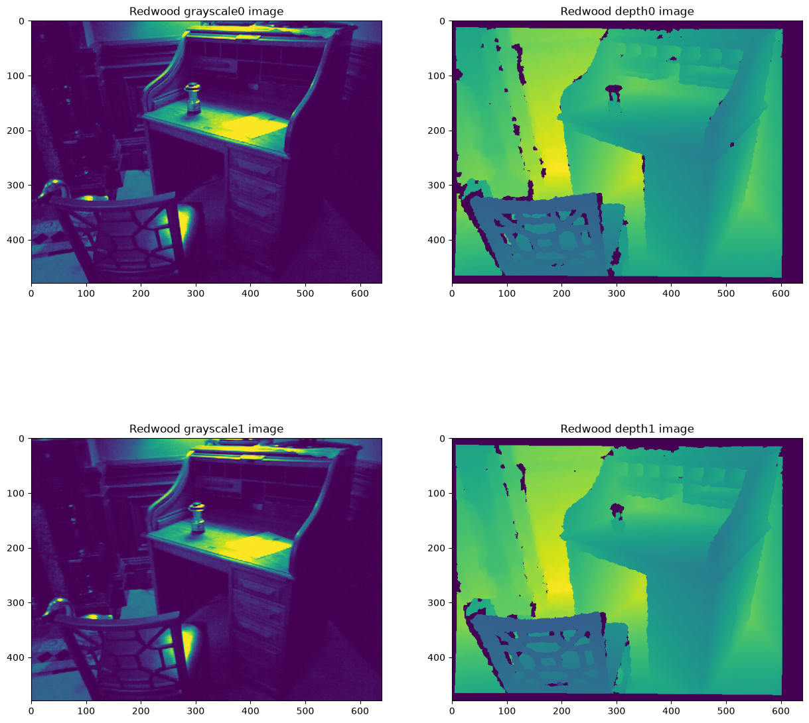
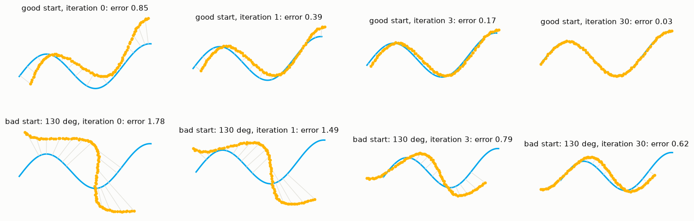
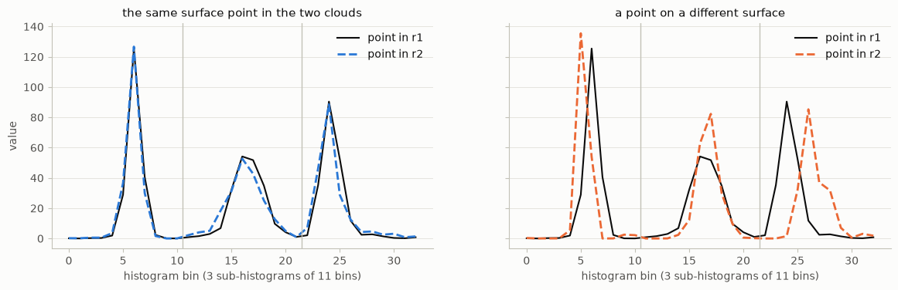
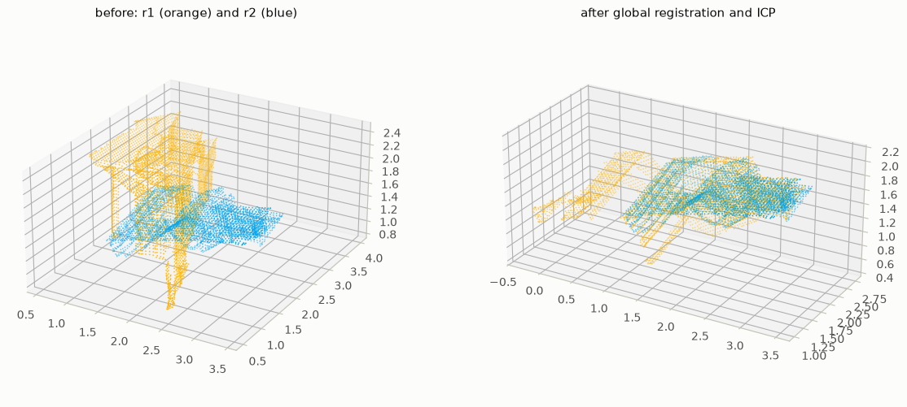
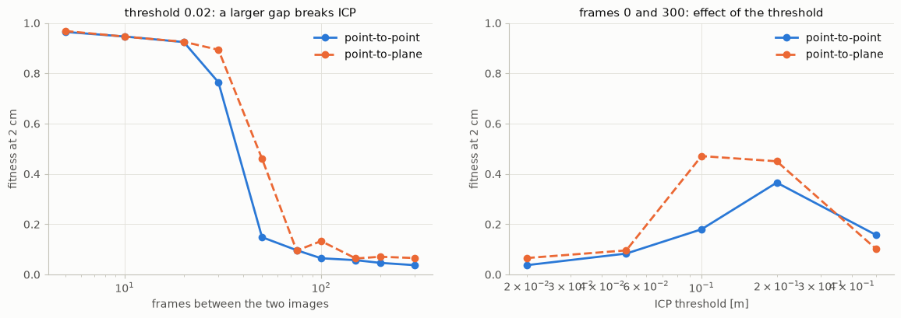
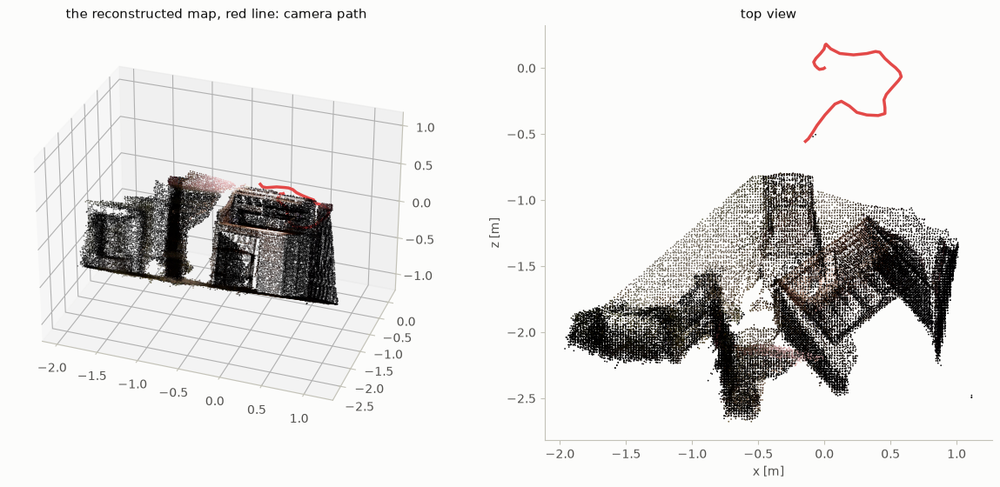

# Chapter 5 · Point clouds: pose estimation and registration

**Sources**
- Class 5 lecture, *3D Point Cloud Processing: Pose Estimation*: [34759-PfAS-5-Point_Cloud_Processing.pdf](../Class_5_point_cloud_processing/34759-PfAS-5-Point_Cloud_Processing.pdf), cited as **L5 s.N**. The "Cherry on Top" PDF in the same folder is, by its own disclaimer, not part of the exam.
- [Exercise 1](../Class_5_point_cloud_processing/Exercises_week_5/week5/Exercise1.ipynb) (global registration), [Exercise 2](../Class_5_point_cloud_processing/Exercises_week_5/week5/Exercise2.ipynb) (local registration) and [Weekly Project 5](../Class_5_weekly_project/weekly_project_5/Weekly%20Project.ipynb).
- Functions and terms: [reference.md](reference.md). The chapter builds on [RANSAC in chapter 2](02_feature_detection.md#fitting-a-model-with-outliers) and the [camera model in chapter 4](04_calibration_and_epipolar.md#camera-model).

**Contents**
1. [Overview](#overview)
2. [Point clouds and pose](#point-clouds-and-pose)
3. [From an RGB-D image to a point cloud](#from-an-rgb-d-image-to-a-point-cloud)
4. [The pose from matched points: Kabsch](#the-pose-from-matched-points-kabsch)
5. [Local alignment: ICP](#local-alignment-icp)
6. [Surface normals](#surface-normals)
7. [Global alignment: 3-D descriptors](#global-alignment-3-d-descriptors)
8. [Global alignment: RANSAC in 3-D](#global-alignment-ransac-in-3-d)
9. [Exercise 1: global registration](#exercise-1-global-registration)
10. [Exercise 2: ICP and reconstruction](#exercise-2-icp-and-reconstruction)
11. [Weekly Project 5: registration by hand](#weekly-project-5-registration-by-hand)
12. [When it fails](#when-it-fails)
13. [Key takeaways](#key-takeaways)

---

## Overview

Two point clouds show the same object or scene from different positions. Registration finds the rigid transformation that brings one onto the other. It is usually done in two steps (L5 s.12):

| Step | Goal | Method | Needs |
|---|---|---|---|
| **Global alignment** | a rough pose, from any starting position | 3-D features + RANSAC | enough distinctive shape |
| **Local alignment** | the exact pose | ICP | a good starting pose |

---

## Point clouds and pose

**Why point clouds** (L5 s.6). The world is 3-D, and 3-D geometry and shape often matter. A point cloud stores this directly: a list of (x, y, z) points, sometimes with colours and normals. Operations in 3-D are computationally heavy, and image features such as SIFT and SURF do not work on point clouds.

**Pose** (L5 s.8) is the transformation, a rotation and a translation, that maps one point cloud to another of the same object or scene. Equivalently, it is the camera's position relative to a known object or scene. It is written as a 4 × 4 matrix, so that transformations combine by multiplication:

$$T = \begin{bmatrix} R & t \\ 0 & 1 \end{bmatrix}, \qquad \begin{bmatrix} q \\ 1 \end{bmatrix} = T \begin{bmatrix} p \\ 1 \end{bmatrix}, \qquad T_{a \to c} = T_{b \to c}\, T_{a \to b}$$

A pose has 6 degrees of freedom: 3 for the rotation and 3 for the translation.

**Applications** (L5 s.10): robot grasping and manipulation, quality inspection, augmented reality and progressive map building.

---

## From an RGB-D image to a point cloud

An RGB-D camera gives a colour image and a depth image. Each pixel (u, v) with depth Z becomes a 3-D point by inverting the pinhole projection of [chapter 4](04_calibration_and_epipolar.md#camera-model):

$$X = \frac{(u - c_x)\,Z}{f_x}, \qquad Y = \frac{(v - c_y)\,Z}{f_y}$$

In Exercise 2, `RGBDImage.create_from_color_and_depth` pairs the two images, and `PointCloud.create_from_rgbd_image` does this computation with the given camera. `PrimeSenseDefault` means 640 × 480 px, f = 525 px and c = (319.5, 239.5). The depth image stores millimetres in 16 bits; Open3D converts them to metres and drops points beyond 3 m by default. The camera's y axis points down, so the template flips y and z for viewing.


*Fig. 1. Frames 0 and 5 of the RGB-D sequence: intensity and depth.*

---

## The pose from matched points: Kabsch

Given pairs (pᵢ, qᵢ) that are known to match, find R and t that minimise Σ |R pᵢ + t − qᵢ|². This is the core computation of both ICP and RANSAC, and is called **Kabsch** or **Procrustes** (L5 s.37, 39):

1. compute the centroids p̄ and q̄; subtracting them removes the translation;
2. compute H = Σ (pᵢ − p̄)(qᵢ − q̄)ᵀ;
3. take the singular value decomposition H = USVᵀ;
4. R = V diag(1, 1, d) Uᵀ, with d = det(VUᵀ), which prevents a mirror image;
5. t = q̄ − R p̄.

Three pairs that are not on one line are enough, so RANSAC samples 3 (L5 s.37).

---

## Local alignment: ICP

**Iterative Closest Point** (Besl and McKay, L5 s.15) aligns two clouds that are almost aligned already:

1. for each point p in model 1, find the nearest point q in model 2;
2. use all the pairs (p, q) to estimate the transformation from model 1 to model 2;
3. apply the transformation to the points of model 1;
4. repeat until convergence or a stop criterion.

The nearest point is usually not the true match. It only has to be closer to correct than before, so each iteration improves the pose. This is also the limit of the method: from a poor start the nearest points are wrong in a consistent way, and ICP settles in a wrong pose (L5 s.28).


*Fig. 2. ICP on a curve, with gray lines joining sampled points to their nearest neighbours. From a good start the error falls from 0.85 to 0.03 in 30 iterations. From a rotation of 130° it stops at 0.62, in a wrong pose.*

**Two error measures** are used in the exercises:

| | Point-to-point | Point-to-plane |
|---|---|---|
| Minimises | Σ \|R pᵢ + t − qᵢ\|² | Σ ((R pᵢ + t − qᵢ) · nᵢ)², with nᵢ the normal at qᵢ |
| Equations per pair | 3 | 1 |
| Solved by | Kabsch (exact for any rotation) | a linear system that assumes a small rotation |
| A point may slide along the surface | no | yes, at no cost |
| Needs normals | no | yes, on the target |

Point-to-plane usually converges faster on flat surfaces: the samples of two scans rarely fall on the same spots of a wall, and point-to-point penalises that difference although nothing is wrong.

**Parameters** of `registration_icp(source, target, threshold, trans_init, method)`:
- `threshold` is the largest distance at which two points are paired. A larger value recovers larger motions, and accepts more wrong pairs.
- `trans_init` is the starting pose.

**Evaluating a result** with `evaluate_registration` gives two numbers. **Fitness** is the share of source points that have a target point within the threshold: the overlap, the higher the better. **Inlier RMSE** is the error of those pairs: the lower the better. Fitness is limited by how much the two views really overlap, and the threshold has to be the same when comparing results.

---

## Surface normals

A normal is the direction perpendicular to the surface at a point. A point has no surface by itself, so the normal comes from its neighbours, using PCA (taught in Class 8, L8 s.19):

1. take a point and its k nearest neighbours, and subtract their centroid;
2. compute the 3 × 3 covariance matrix;
3. compute its eigenvalues λ₁ ≥ λ₂ ≥ λ₃ and eigenvectors e₁, e₂, e₃.

e₁ and e₂ span the best-fitting plane, and **e₃, the direction of least variance, is the surface normal**. λ₃ ≈ 0 means the surface is locally flat. The sign of e₃ is ambiguous, so it can be flipped towards the sensor.

`estimate_normals(KDTreeSearchParamHybrid(radius, max_nn))` does this for neighbours within `radius`, using at most `max_nn` of them. The radius sets the scale: too small and noise dominates, too large and corners are smoothed over. The exercises use 2 voxels.

---

## Global alignment: 3-D descriptors

ICP cannot start from very different poses (L5 s.28), so the rough pose comes from matching features, as in 2-D. A 3-D descriptor must describe the surface around a point in a way that doesn't depend on the pose.

**Spin images** (Johnson and Hebert, L5 s.29). A 2-D grid is "spun" around the surface normal of a point, and the neighbouring points are accumulated in the grid's bins while spinning. The descriptor is the resulting 2-D image, where each pixel holds a number of points.

**PFH, Point Feature Histograms** (Rusu et al., L5 s.31). For all pairs of points within a radius r of the point, compute 3 angle values from their normals and the direction between them (and possibly their distance d). Bin the set of all these values in a histogram, which is the multi-dimensional descriptor.

**FPFH, Fast PFH** (L5 s.32–33). A simplification of PFH that reduces the computation and keeps most of the discriminative power:
1. find all oriented points in a spherical neighbourhood of radius r around each point (with a k-d tree);
2. compute the relative angles using the surface normals and the direction from the source point to each neighbour;
3. the descriptor is a multi-dimensional histogram. In Open3D it has 33 values: 3 sub-histograms of 11 bins each.


*Fig. 3. FPFH histograms. The same surface point seen in r1 and r2 has a similar histogram (distance 35); a point on a different surface has a very different one (distance 192).*

---

## Global alignment: RANSAC in 3-D

Matching 3-D features generally gives many false matches, and a better matcher adds a large computational cost for only a small gain in accuracy, so an algorithm that is robust to outliers is needed (L5 s.35–36). RANSAC for pose estimation (L5 s.37):

1. randomly choose 3 pairs of matched points;
2. estimate the relative pose with Kabsch;
3. apply the transformation and assess its validity: the number of inliers (matched pairs whose distance became small), or the sum of the distances;
4. keep the transformation with the most inliers, and repeat the random sampling.

**Checkers** speed this up in Open3D. They reject a sample before the expensive inlier count: `EdgeLength` requires the distances between the 3 sampled points to be similar in both clouds, `Distance` requires them to lie close after the transformation, and `Normal` requires their normals to agree.


*Fig. 4. r1 (orange) and r2 (blue) before and after RANSAC + ICP. The rotation needed is 136°, far outside what ICP alone can reach.*

---

## Exercise 1: global registration

**Preparation.** `voxel_down_sample`, `estimate_normals` and `compute_fpfh_feature` were used to obtain a small cloud with a descriptor per point. At `voxel_size = 0.05`, r1 goes from 198,835 to 4,760 points, and r2 from 137,833 to 3,440.

```python
sample = pointcloud.voxel_down_sample(voxel_size)
sample.estimate_normals(o3d.geometry.KDTreeSearchParamHybrid(radius=voxel_size * 2, max_nn=30))
fpfh = o3d.pipelines.registration.compute_fpfh_feature(
    sample, o3d.geometry.KDTreeSearchParamHybrid(radius=voxel_size * 5, max_nn=100))
```

**RANSAC.** `registration_ransac_based_on_feature_matching` was used to obtain the transformation. The argument `True` keeps only matches that are the best in both directions; the threshold is 1.5 voxels. In this version of Open3D that argument is required, unlike the first example in the template. The results vary slightly between runs.

| Pair | Fitness before | RANSAC point-to-point | RANSAC point-to-plane |
|---|---|---|---|
| r1 → r2 | 0.07 | fitness 0.67, RMSE 0.03 m, 0.4 s | fitness 0.25, RMSE 0.046 m, about 1 min |
| r1 → r3 (exercise A) | 0.06 | fitness 0.77, RMSE 0.035 m, 2 s | fitness 0.27, RMSE 0.045 m, about 1 min |

**Is the result right?** Without viewing it, the check is consistency. r1→r2 followed by r2→r3 agrees with r1→r3, which was estimated independently, to 0.38° and 2.3 cm. So the large rotations (136° and 122°) are real. The transformation r2→r3 also matches the inverse of the second entry in `ICP/init.log` (fitness 0.775).

**Exercise B: checkers and voxel size.**

| Setting | Fitness | RMSE [m] | Time |
|---|---|---|---|
| no checkers | 0.67 | 0.03 | 0.4 s |
| edge length + distance | 0.67 | 0.03 | 0.08 s |
| all three | 0.67 | 0.03 | 0.05 s |
| voxel 0.1 | 0.67 | 0.054 | 0.03 s |
| voxel 0.03 | 0.65 | 0.018 | 8 s |

Checkers cost nothing here and save most of the time. A smaller voxel gives a more accurate pose at a much higher cost. The threshold scales with the voxel, so fitness values of different sizes can't be compared directly.

**Can point-to-plane work?** Not inside RANSAC. With the two checkers no sample passes, and samples of 6 points still reach only about 0.2, because 3 pairs cannot fix 6 unknowns, and the solution assumes a small rotation. It works well as a **second stage**: RANSAC with point-to-point, then ICP with point-to-plane from that pose, gives an RMSE of 0.021 m at a threshold of 0.05. The template's author reports the same difficulty.

---

## Exercise 2: ICP and reconstruction

**The ICP cell.** Frames 0 and 5, as full clouds of about 260,000 points, are almost aligned already. Point-to-point ICP raises the fitness from 0.918 to 0.990 and lowers the RMSE from 9.8 to 5.4 mm. The camera moved about 2 mm. The template suggests starting with point-to-plane, but these clouds have no normals yet, so the cell starts with point-to-point.

**A) Larger steps.** ICP pairs points only within the threshold of 2 cm, so it fails once the camera has moved further than that:

| Frames | 0 to 5 | 0 to 50 | 0 to 100 | 0 to 200 | 0 to 300 |
|---|---|---|---|---|---|
| Fitness before | 0.918 | 0.106 | 0.049 | 0.045 | 0.051 |
| Fitness after ICP | 0.990 | 0.177 | 0.092 | 0.055 | 0.059 |

**B) and C) Threshold, starting pose and error measure.** All for frames 0 and 300, downsampled to 2 cm, and judged at the same 2 cm distance:

| Setting | Point-to-point | Point-to-plane |
|---|---|---|
| threshold 0.02 | 0.04 | 0.07 |
| threshold 0.05 | 0.08 | 0.10 |
| threshold 0.1 | 0.18 | **0.47** |
| threshold 0.2 | 0.37 | 0.45 |
| threshold 0.5 | 0.16 | 0.10 |
| start = product of the small steps 0 → 20 → … → 300, then a final ICP | 0.23 | **0.47** |


*Fig. 5. Left: ICP's reach is limited by the threshold and the starting pose. Right: raising the threshold helps up to a point, then pairs too many wrong points. Point-to-plane is the better of the two whenever the task is hard.*

On the easy pair (0 to 5) the two measures agree: fitness 0.990, RMSE 5.39 mm, translations within 0.5 mm of each other. Point-to-plane takes 0.3 s against 0.9 s. So point-to-plane is not more accurate when the start is good; it is faster, and it reaches further.

**D) Reconstructing the room.** Pairwise ICP was used to obtain the pose of every 10th image, and the clouds were merged into one map.

```python
result = o3d.pipelines.registration.registration_icp(current, previous, threshold, trans_init, point_to_plane)
T = T @ result.transformation          # pose of this image in the coordinates of frame 0
new_points = load_cloud(i, voxel_size)
new_points.transform(T)
bedroom = bedroom + new_points
```

The direction matters: ICP goes from the current image to the previous one, and T maps the current image into the frame of image 0, so the new step multiplies on the right. The result is 39 steps, with a lowest fitness of 0.92 and a median of 0.98; a map of about 51,000 points, 3.1 × 2.1 × 2.2 m; and a camera path of 2.58 m.


*Fig. 6. The map built from 40 frames, with the camera path in red.*

**Tuning the map.** Aligned surfaces fall into the same voxels, so a tighter map has fewer points. With every 20th frame the lowest fitness falls to about 0.49 and the map grows to about 58,000 points. With point-to-point as well, it reaches about 88,000.

**Drift.** Each pose is built from the previous one, so errors accumulate along the path and are never corrected. Frame 300 reached through the small steps has a fitness of 0.46 against frame 0, not 1.

---

## Weekly Project 5: registration by hand

The project asks for an implementation of global registration. Open3D is used only for loading, downsampling, normals and FPFH, as in Monday's notebooks, and to score the result.

**Feature matching.** `cv2.BFMatcher(cv2.NORM_L2, crossCheck=True)` from [chapter 2](02_feature_detection.md#matching) was used on the FPFH features, which are ordinary 33-value vectors. It keeps pairs that are the best in both directions.

**RANSAC with Kabsch.** 5,000 iterations of the lecture's algorithm, followed by a recomputation from all the inliers of the best pose.

```python
for i in range(iterations):
    sample = np.random.choice(len(a), 3, replace=False)
    T = kabsch(a[sample], b[sample])
    distances = np.sqrt(np.sum((apply(T, a) - b)**2, axis=1))
    count = np.sum(distances < threshold)
    if count > best_count:
        best_T = T
        best_count = count
```

**Local registration (the first challenge).** `icp` pairs each source point with its nearest target point using `cv2.BFMatcher`, keeps the pairs closer than the threshold, and applies Kabsch, until the RMSE no longer changes. The second challenge, reconstructing the car from images, is not done.

| Pair | Matches | Inliers | Fitness before | RANSAC fitness, RMSE | After ICP |
|---|---|---|---|---|---|
| r1 → r2 | 1,021 | 417 | 0.070 | 0.670, 0.0229 m | 0.670, 0.0225 m (14 iterations) |
| car1 → car2 | 755 | 88 | 0.000 | 0.996, 0.0229 m | 0.997, 0.0159 m (6 iterations) |

Both runs take about 0.6 s. The hand-written r1 → r2 pose differs from Open3D's by only 0.7° and 4.5 cm. The car result can be checked from its numbers: the rotation is almost exactly a swap of the axes, with a translation of about (2.0, 2.0, 0.04) m, which fits the extents of the two clouds (3.39 × 2.01 × 1.27 m and 1.30 × 3.39 × 2.06 m).

---

## When it fails

The last column says whether the notebook actually applies the fix.

| Problem | Where | Cause | Fix | Applied in the notebook? |
|---|---|---|---|---|
| ICP stays near its start (fitness 0.06) | frames 0 and 300 | it pairs only points within the threshold | a better start or a larger threshold | **yes**, exercises B and C |
| ICP gets worse at a very large threshold (0.16 at 0.5 m) | exercise B | too many wrong pairs | a threshold near the expected motion | **yes**, compared in B |
| ICP from an arbitrary pose converges to a wrong one | Fig. 2 | nearest points aren't the true matches | global registration first | **yes**, Exercise 1 and the weekly project |
| Point-to-plane RANSAC fails (fitness 0.25, or 0 with checkers) | Exercise 1 | one equation per pair, and a small-rotation assumption | point-to-point RANSAC, then point-to-plane ICP | **yes**, exercise B |
| `TypeError` from the RANSAC function | template's first example | `mutual_filter` is now a required argument | pass `True` | **yes** |
| ICP with point-to-plane raises an error | template's ICP text | the clouds have no normals | `estimate_normals`, or use point-to-point first | **yes** |
| Slow RANSAC | no checkers | every sample is fully evaluated | checkers reject samples early | **yes**, compared in exercise B |
| Slow on full clouds | about 200,000 points | every step scales with the points | `voxel_down_sample` | **yes** |
| Corners smoothed in the normals | radius 0.5 m on a 2 cm cloud | too many neighbours | a radius of a few voxels (0.1 m) | **yes**, for the downsampled clouds |
| A mirror image from Kabsch | hand-written registration | the SVD can give a reflection | d = det(VUᵀ) | **yes** |
| The map slowly bends | pairwise chain | errors accumulate along the path | compare with older images and correct the path | **no** |
| Results change between runs | RANSAC | random samples; this Open3D has no `seed` argument | accept it, or set `np.random.seed` in hand-written code | **partly**: only the weekly project |
| Fitness looks low for a correct pose (0.65) | r1 → r2 | the clouds overlap only partly | compare with the check, not with 1 | **yes**: consistency check |

---

## Key takeaways

- **Pose = rotation + translation**, 6 degrees of freedom, a 4 × 4 matrix. Poses combine by multiplication.
- **Registration has two steps.** Global alignment (features + RANSAC) needs no starting pose and gives a rough result. Local alignment (ICP) needs a good start and gives an exact result.
- **Kabsch** gives the best rotation and translation for matched pairs: centre both sets, take the SVD of H, and guard against a reflection. Three pairs are enough.
- **ICP** alternates between finding nearest points and computing the pose. Its reach is limited by the threshold and the starting pose.
- **Point-to-plane** lets points slide along surfaces. It is faster and reaches further on flat scenes, but needs normals and a small rotation.
- **Normals come from PCA of a neighbourhood**: the direction of least variance.
- **FPFH** describes the local shape with a histogram of angles, independent of the pose. Matches contain many outliers, so RANSAC is essential.
- **Fitness** measures overlap and **inlier RMSE** the accuracy. Fitness depends on the true overlap, so check a result in another way when possible.
- **Chaining small ICP steps builds a map**, and its errors accumulate.
