# Chapter 6 · Regression, ranging and clustering

**Sources**
- Class 6 lecture, *3D Point Cloud Processing: Clustering & Regression*: [34759-PfAS-6-Point_Cloud_Processing.pdf](../Class_6_pcp_2/34759-PfAS-6-Point_Cloud_Processing.pdf), cited as **L6 s.N**. The "Cherry on Top" PDF in the same folder is, by its own disclaimer, not part of the exam.
- [Exercise 1](../Class_6_pcp_2/Exercises_week_6/week6/Exercise1.ipynb) (regression), [Exercise 2](../Class_6_pcp_2/Exercises_week_6/week6/Exercise2.ipynb) (clustering), [Exercise 3](../Class_6_pcp_2/Exercises_week_6/week6/Exercise%203%20-%20Ranging.ipynb) (ranging and RANSAC) and [Weekly Project 6](../Class_6_weekly_project/Weeklyproject6.ipynb).
- Functions and terms: [reference.md](reference.md).

**Contents**
1. [Overview](#overview)
2. [Regression](#regression)
3. [Clustering: k-means](#clustering-k-means)
4. [Clustering: mean shift](#clustering-mean-shift)
5. [Clustering: DBSCAN](#clustering-dbscan)
6. [Exercise 1: least squares](#exercise-1-least-squares)
7. [Exercise 2: clustering a point cloud](#exercise-2-clustering-a-point-cloud)
8. [Exercise 3: lidar ranging and RANSAC](#exercise-3-lidar-ranging-and-ransac)
9. [Weekly Project 6: k-means by hand](#weekly-project-6-k-means-by-hand)
10. [When it fails](#when-it-fails)
11. [Key takeaways](#key-takeaways)

---

## Overview

Machine learning gives tools for finding structure in point clouds and fitting models to them (L6 s.8, 52). The lecture places its methods in a taxonomy (L6 s.6):

| Family | Target values | Kind | Task |
|---|---|---|---|
| Supervised | known | **Regression** | predict a number: fit a line, plane or surface |
| Supervised | known | Classification | predict a class (Class 8) |
| Unsupervised | unknown | **Clustering** | group similar points |
| Reinforcement | — | — | a system acts in an environment to reach a goal |

---

## Regression

**Regression** assigns weights to the input variables and forms a weighted linear combination that predicts the output (L6 s.11). For 1 input and 1 output the result is a line; for n − 1 inputs and 1 output, a hyperplane in n dimensions.

**Error** (L6 s.13). The usual measure is the **mean squared error**, with t the true value and y the prediction:

$$\text{MSE} = \frac{1}{N}\sum_{i=1}^{N} (t_i - y_i)^2$$

**Linear regression and ordinary least squares** (L6 s.14). The output is a linear combination of the inputs, and the coefficients β minimise the squared error. Each row of the design matrix X is [1, xᵢ₁, …, xᵢ_K], where the 1 gives the intercept, and the solution is

$$\beta^* = (\mathbf{X}^\top\mathbf{X})^{-1}\mathbf{X}^\top\mathbf{y}$$

For one input this reduces to β₁ = Cov(x, y) / Var(x) and β₀ = ȳ − β₁x̄, which is the formula of [chapter 2](02_feature_detection.md#fitting-a-model-with-outliers).

**Polynomial regression** (L6 s.15). If the relation is not a straight line, add powers of the inputs as extra columns of X. The model is still linear in β, so the same formula applies. The degree can be found by cross-validation.

**Locally weighted regression** (L6 s.12) builds several linear models on small neighbourhoods of the data.

**On point clouds** (L6 s.16), regression can fit lines, planes and other surfaces. Two things to remember:
- errors are measured only along the output axis (for example z), so a near-vertical wall fits badly when z is the output;
- every point counts, so outliers pull the fit. That is why the robust RANSAC of [chapter 2](02_feature_detection.md#fitting-a-model-with-outliers) is often used.

---

## Clustering: k-means

**Clustering** partitions a point cloud into groups of similar points, and so finds its underlying structure (L6 s.19). No labels are needed.

**k-means** (L6 s.20–22) partitions the points into k clusters by minimising the **distortion**, the sum of squared Euclidean distances from each point to its cluster centre:

$$J = \sum_{k} \sum_{x \in C_k} \| x - \mu_k \|^2$$

It is an iterative process:
1. randomly initialise k cluster centres;
2. assign each point to its nearest centre;
3. recompute each centre as the centroid of its points;
4. stop if nothing changed, otherwise go to step 2.

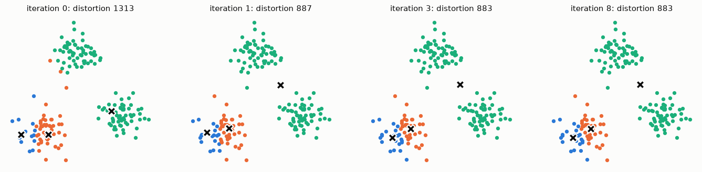
*Fig. 1. k-means from a poor start, with two centres in one group. The distortion falls from 1313 to 887 in the first iteration, then settles at 883.*

**How to choose k** (L6 s.23–24):
- **Elbow method.** Run k-means for several k, plot the distortion against k, and look for the k where the curve stops decreasing rapidly.
- **Silhouette analysis.** For each point, with a its mean distance to the points of its own cluster and b its mean distance to the points of the nearest other cluster, the coefficient is s = (b − a) / max(a, b). It is near +1 when the point is far from other clusters, near 0 on a boundary, and negative if it is probably in the wrong cluster.

**Issues** (L6 s.25):
- k has to be defined;
- the final assignment depends on the start, and may not be the global optimum, so several runs are normal;
- it can describe only convex cluster shapes;
- it is demanding as the number of points and dimensions grows.

**Which space?** (L6 s.26). Clustering doesn't have to happen in the 3-D space of the cloud. Features can be X, Y, Z alone, or X, Y, Z with colour (R, G, B, or L, U, V, or H, S, V), gradients or texture. K-means uses Euclidean distance, so the **scale of each feature decides how much it counts**.

---

## Clustering: mean shift

**Mean shift** (L6 s.27–39) finds the maxima, or modes, of a density function given discrete samples from it. It is a density hill-climbing algorithm. The density is estimated from the points themselves, with a kernel such as a Gaussian of bandwidth h (the size of the window):

$$\hat f(x) = \frac{1}{n}\sum_{i} K\!\left(\frac{x - x_i}{h}\right)$$

The **mean shift vector** points from the centre of a window to the centre of mass of the points in it, which is towards higher density. Algorithm (L6 s.39):

1. choose a kernel and a bandwidth;
2. for each point: centre a window on it, compute the mean of the data in the window, centre the window at the new mean, and repeat until it no longer moves;
3. merge windows that end up near the same peak;
4. assign points to clusters by which mode they end at.

The region whose trajectories all lead to the same mode is its **attraction basin**, and a cluster is all the data points in one basin (L6 s.37).

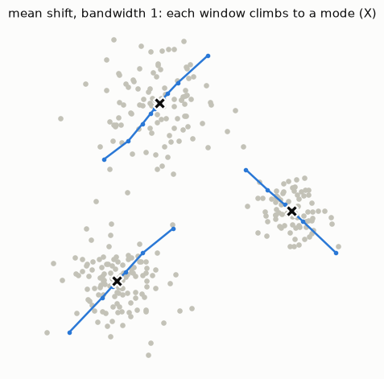
*Fig. 2. Mean shift with a Gaussian kernel of bandwidth 1. Six windows started in different places end in the three modes.*

Mean shift needs no k, and clusters can have any shape, but it has to choose the bandwidth, and it is slow because every point runs its own climb. For images, each pixel gets features such as colour, gradients and texture, with one kernel size for features and one for position (L6 s.40). The lecture's feature-space question applies to point clouds as well (L6 s.41). It is not used in the exercises; its implementation is the optional challenge of the weekly project.

---

## Clustering: DBSCAN

**DBSCAN** (L6 s.43–50) is density based: it partitions points into dense regions separated by less dense ones. A cluster is a maximal set of density-connected points, so clusters can have arbitrary shapes. It has two parameters: the radius ε and the count MinPts.

| Point type (L6 s.44) | Definition |
|---|---|
| **Core** | has at least MinPts points within ε, including itself |
| **Border** | has fewer than MinPts within ε, but lies in the neighbourhood of a core point |
| **Noise** | any other point |

Two core points within ε of each other share a *density edge*, and two points are *density-connected* if a path of such edges joins them (L6 s.47).

**Algorithm** (L6 s.48):
1. label the points as core, border or noise;
2. eliminate the noise points;
3. for every core point not yet in a cluster, create a new cluster with it and all the points density-connected to it;
4. assign each border point to one of the clusters of its core points.

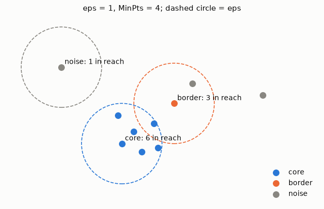
*Fig. 3. ε = 1 and MinPts = 4: 6 core points, 1 border point and 3 noise points.*

| Pros (L6 s.50) | Cons (L6 s.50) |
|---|---|
| clusters can have non-convex shapes | noise points belong to no cluster (which isn't necessarily bad) |
| the number of clusters isn't needed | ε and MinPts have to be defined |
| resistant to noise | problems with point clouds of varying density |

| | k-means | Mean shift | DBSCAN |
|---|---|---|---|
| Needs | k | bandwidth | ε, MinPts |
| Cluster shape | convex | any | any |
| Outliers | always assigned | always assigned | marked as noise |
| Repeatable | no (random start) | yes | yes, apart from some border points |
| Cost | low per iteration | high | moderate, with a spatial index |

---

## Exercise 1: least squares

**A) A line.** The OLS formula was used to obtain the regression line, with design matrix rows [1, xᵢ].

```python
X = np.column_stack((np.ones(len(x)), x))
beta = np.linalg.inv(X.T @ X) @ X.T @ Y
```

The result, y = 2.0032 + 0.3229x, equals `sklearn`'s `LinearRegression` to all printed digits, and also Cov/Var. The data was generated from y = 2 + 0.3x plus noise.

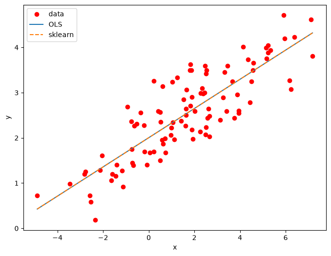
*Fig. 4. OLS and `sklearn` give the same line.*

**B) A plane.** The same formula with one more column, [1, xᵢ, yᵢ], on the 500 points of `spread_points.ply`, gives z = 10.814 + 0.032x + 1.527y, the same as `sklearn`. The RMSE is 1.60: the spread of the points around the plane.

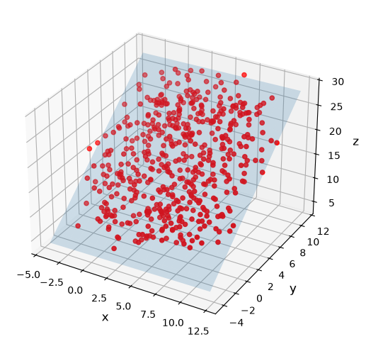
*Fig. 5. The fitted plane.*

---

## Exercise 2: clustering a point cloud

**The cube.** `create_box().sample_points_uniformly` gives 10,000 points on a cube, and the goal is to segment its 6 faces with k-means. `purity` measures the result: the share of points that belong to the most common face of their cluster.

| Features | Purity | Why |
|---|---|---|
| xyz | 0.42 | clusters are compact blobs, and each one spans several faces |
| normals | 0.50 | opposite faces have the same normals up to the sign, so only about 3 groups exist |
| xyz + normals (exercise A) | 0.78 | positions separate opposite faces, normals separate neighbouring faces |
| xyz + 0.1 × normals (B) | 0.43 | behaves like xyz |
| **xyz + 0.5 × normals (B)** | **0.90** | the best weight tested |
| xyz + 2 × normals (B) | 0.64 | |
| xyz + 5 × normals (B) | 0.50 | behaves like the normals |
| xyz + \|normals\| | 0.98 | removes the arbitrary sign of the estimated normals |

Only the ratio between the features matters: `xyz + 0.5 n` and `2 xyz + n` are the same problem. No weight segments the faces perfectly with the signed normals, because `estimate_normals` gives a point on a face n or −n arbitrarily.

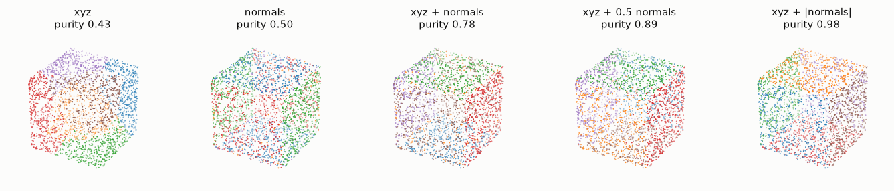
*Fig. 6. K-means on the cube with different features. Purity changes slightly between runs, because the points are sampled randomly.*

**C) All the shapes.** The six figures are separated in space, so xyz alone is enough: purity 1.000 with k = 6. The template's `create_moebius` is `create_mobius` in this Open3D version. The cells use 10,000 points instead of 100,000.

**D) A real scene.** `fragment.ply` is in `TestData/`, not in `pointclouds/` as the text says. It is downsampled to 2 cm (27,012 points).

| Features, k = 8 | Silhouette |
|---|---|
| xyz | 0.344 |
| xyz + normals | 0.363 |
| xyz + colours | 0.322 |
| FPFH | 0.372 |

None of the clusterings makes sense as objects. K-means forms only compact, convex groups, so it cuts one wall or floor into several pieces, and the number of objects isn't known either.

**E) DBSCAN.** `cluster_dbscan(eps, min_points)` was used on both clouds.

| Cloud | eps | Clusters | Noise | Result |
|---|---|---|---|---|
| shapes | 0.1 | 497 | 17 % | broken into pieces: eps is below the point spacing |
| shapes | 0.2 – 1.0 | 6 | 0 % | exactly the six figures, over a wide range |
| shapes | 1.5 | 3 | 0 % | figures merge |
| fragment | 0.02 | 0 | 100 % | everything is noise |
| fragment | 0.03 | 118 | 22 % | many fragments |
| fragment | 0.05 | 3 | 0 % | one cluster holds almost all the points |
| fragment | 0.1 | 1 | 0 % | everything is one cluster |

`eps` must lie between the distance between neighbouring points of a surface and the distance between separate objects. For the figures that range is wide. In a real scene objects touch the floor, so it hardly exists.

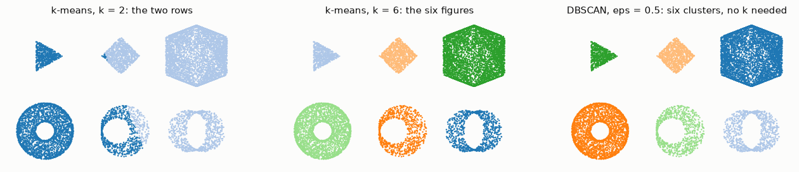
*Fig. 7. Top view of the figures: k-means with k = 2 and k = 6, and DBSCAN, which finds the six figures without being told how many.*

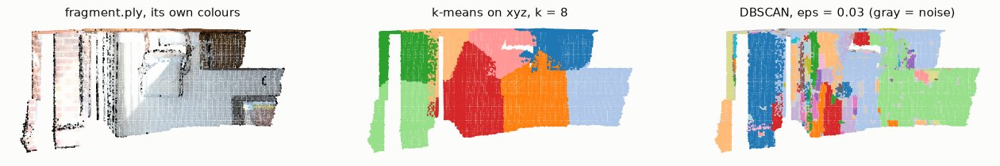
*Fig. 8. Top view of `fragment.ply`: its own colours, k-means, and DBSCAN.*

---

## Exercise 3: lidar ranging and RANSAC

A lidar measures distances over a sweep of angles. `laser.csv` holds one sweep of 541 ranges, from 135° to −135°, so a step of 0.5°.

**3.1: polar to Cartesian.** Each range and angle becomes a point with x = r cos θ and y = r sin θ. Not all values are measurements: 20 values are 0 and 30 are about 30 m, the sensor's maximum, meaning that no return came back. These are removed, which leaves 491 points. A 0 would otherwise become a false point at the sensor.

```python
angles = np.deg2rad(np.linspace(135, -135, len(laser)))
valid = (laser > 0) & (laser < 29)
x = laser[valid] * np.cos(angles[valid])
y = laser[valid] * np.sin(angles[valid])
```

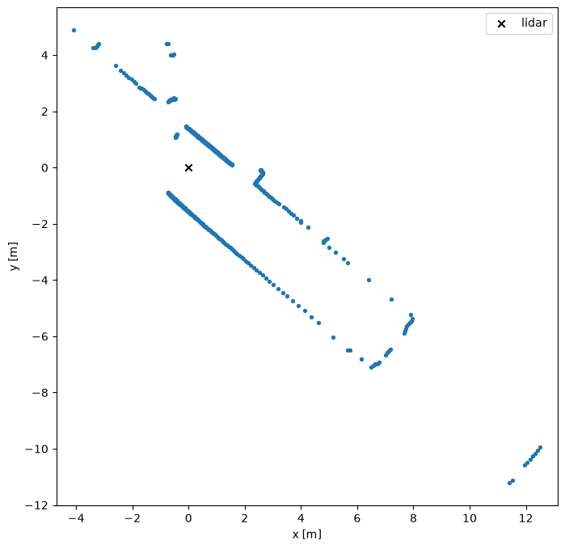
*Fig. 9. The scan of a hallway: two walls.*

**3.2 and 3.3: RANSAC.** `linear_model.RANSACRegressor` was used to obtain the line of one wall. By default, its inlier threshold is the median absolute deviation of y, here 1.27 m, which is more than half the hallway. So the default fit accepts about 310 points, not only those on a wall, and its slope of about −0.91 is pulled off.

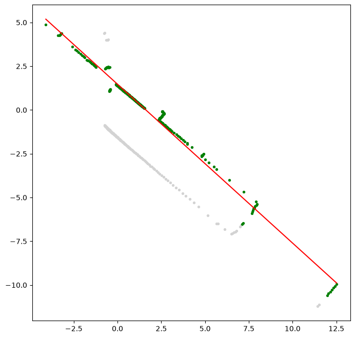
*Fig. 10. The default threshold accepts far too many points.*

**The second wall.** With `residual_threshold=0.1` the first fit keeps one wall. A second RANSAC on the outliers of the first finds the other.

| Wall | Line | Points |
|---|---|---|
| 1 | y = −0.843x + 1.398 | 244 |
| 2 | y = −0.862x − 1.561 | 165 |

The two walls are 0.6° from parallel. The distance between the lines, |c₁ − c₂| / √(1 + m²), gives the hallway's width: 2.26 m.

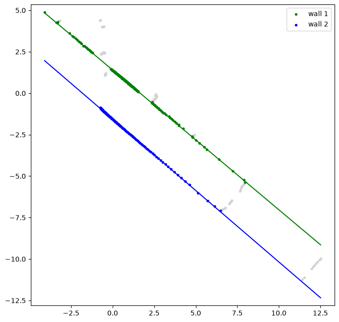
*Fig. 11. Removing the inliers of the first wall and running RANSAC again finds the second. This sequential method extracts several lines from one scan.*

---

## Weekly Project 6: k-means by hand

**The algorithm.** The lecture's four steps, in NumPy. The distance array has one row per point and one column per centre.

```python
centers = points[np.random.choice(len(points), k, replace=False)]      # step 1
for i in range(max_iterations):
    distances = np.sum((points[:, None, :] - centers[None, :, :])**2, axis=2)
    labels = np.argmin(distances, axis=1)                              # step 2
    new_centers = centers.copy()
    for j in range(k):
        if np.any(labels == j):
            new_centers[j] = points[labels == j].mean(axis=0)          # step 3
    if np.allclose(new_centers, centers):                              # step 4
        break
    centers = new_centers
```

**Several starts.** A single run often ends in a poor solution: for k = 6, five runs gave purities of 0.92, 0.92, 0.92, 0.92 and 1.00. `best_kmeans` therefore runs it 5 times, and keeps the result with the lowest distortion, which is the 1.00 run.

**Finding k.** For each k from 2 to 10 the cell computes the distortion and the silhouette (`metrics.silhouette_score`).

| k | 2 | 3 | 4 | 5 | **6** | 7 | 8 | 9 | 10 |
|---|---|---|---|---|---|---|---|---|---|
| Distortion | 5999 | 4217 | 2979 | 2326 | **1740** | 1433 | 1214 | 1078 | 954 |
| Silhouette | 0.569 | 0.474 | 0.533 | 0.522 | **0.534** | 0.472 | 0.479 | 0.482 | 0.421 |

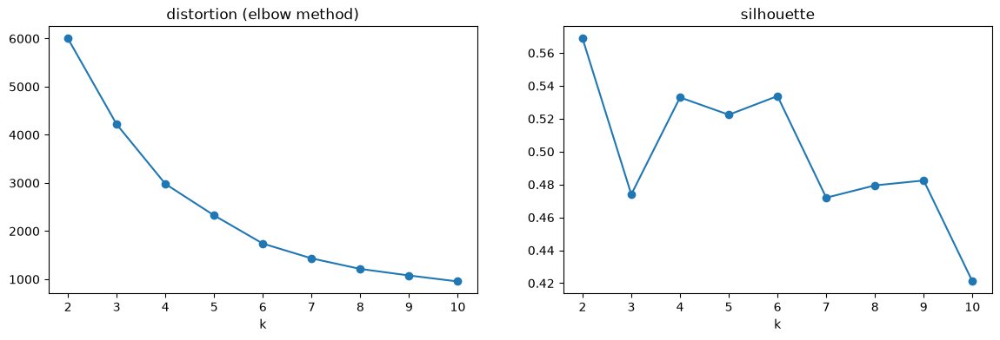
*Fig. 12. No sharp elbow in the distortion. The silhouette is highest at k = 2, and from k = 3 on it is highest at k = 6.*

**The result needs judgement.** The highest silhouette is at k = 2, which separates the two rows of figures (Fig. 7). Both that and the six figures are real structure at different scales, so the notebook searches from k = 3. It then finds k = 6, but narrowly: 0.534 against 0.533 for k = 4, so another random sample of points can choose k = 4. The optional mean-shift challenge is not done.

---

## When it fails

The last column says whether the notebook actually applies the fix.

| Problem | Where | Cause | Fix | Applied in the notebook? |
|---|---|---|---|---|
| Clusters span several faces (0.42) | cube, xyz | k-means only forms compact blobs | add normals as features | **yes**, exercises A and B |
| Opposite faces merged (0.50) | cube, normals | normals are equal up to the sign | add positions; use \|n\| | **yes**, A and B |
| The result depends on the feature scale | exercise B | Euclidean distance treats all features alike | weight the features | **yes**, B |
| Different result on each run; poor solution | k-means | random start, local optimum | several starts, keep the lowest distortion | **yes**, `n_init` and `best_kmeans` |
| The method can't choose k | Weekly Project 6 | k = 2 and k = 6 are both real; k = 4 and k = 6 are almost tied | look at the clusters as well as the score | **partly**: the search starts at k = 3, and the tie remains |
| `AttributeError: create_moebius` | templates | the name is `create_mobius` in this Open3D | use the current name | **yes** |
| File not found | Exercise 2 D | the file is in `TestData/` | correct the path | **yes** |
| Scene clusters don't match objects | `fragment.ply` | surfaces touch, and objects aren't convex blobs | better features; no setting tested solves it | **no** |
| DBSCAN all noise or all one cluster | `fragment.ply` | eps below the point spacing, or above the object gaps | tune eps; often no good value exists in a scene | **partly**: tuned, not solved |
| False points at the sensor | lidar | 0 and 30 m mean "no return" | remove them | **yes**, cell 3.1 |
| RANSAC accepts too much | default threshold (1.27 m) | it is the data's spread, not the noise | `residual_threshold=0.1` | **yes** |
| OLS pulled away by outliers | any regression | every point counts | RANSAC | **yes** in Exercise 3; **no** in Exercise 1, which has none |
| A vertical wall can't be fit | y = mx + c | infinite slope | fit x as a function of y, or use polar form or a plane through PCA | **no**: the walls here aren't vertical |

---

## Key takeaways

- **Regression** fits weights by minimising squared error. **OLS: β = (XᵀX)⁻¹Xᵀy.** The same formula fits lines, planes and polynomials.
- **OLS needs clean data**; outliers pull the fit, and errors count only along the output axis.
- **k-means** minimises distortion by alternating assignment and centroid updates. It needs k, depends on the start, and forms only convex clusters.
- **Choose k** with the elbow method or the silhouette, and check by looking. The two can disagree, and more than one k can be meaningful.
- **Features matter as much as the algorithm.** Combining positions and normals separates a cube's faces; scaling decides their influence.
- **Mean shift** climbs the density from every point. It needs a bandwidth, not k.
- **DBSCAN** grows clusters from dense points, finds any shape, marks noise, and needs no k, but depends strongly on ε.
- **Lidar ranges are polar coordinates.** Remove the "no return" values first. Sequential RANSAC, on the outliers of the previous fit, extracts several lines from one scan.
