# Chapter 7 · State estimation: histogram and Kalman filters

**Sources**
- Class 7 lecture, *State Estimation: Histogram and Kalman Filters*: [34759-PAS-6-Histogram-and-Kalman-Filters-2026.pdf](../Class_7_state_estimation/34759-PAS-6-Histogram-and-Kalman-Filters-2026.pdf), cited as **L7 s.N**. The optional [filtering playground](../Class_7_state_estimation/filtering-playground.html) in the same folder lets you change these filters interactively.
- [Exercise 1 - Histogram filter](../Class_7_state_estimation/Exercises%20week%207/Exercise1%20-%20Histogram%20filter.ipynb), [Exercise 2 - Kalman Filter](../Class_7_state_estimation/Exercises%20week%207/Exercise2%20-%20Kalman%20Filter.ipynb) and [Weekly Project 7](../Class_7_weekly_project/Project%20week%207/Project%20week%207.ipynb).
- Functions and terms: [reference.md](reference.md).

**Contents**
1. [Overview](#overview)
2. [The histogram filter](#the-histogram-filter)
3. [Gaussian beliefs](#gaussian-beliefs)
4. [The Kalman filter](#the-kalman-filter)
5. [Nonlinear models: EKF and UKF](#nonlinear-models-ekf-and-ukf)
6. [Several hypotheses: the particle filter](#several-hypotheses-the-particle-filter)
7. [A learned gain: KalmanNet](#a-learned-gain-kalmannet)
8. [Exercise 1: histogram filter in 2-D](#exercise-1-histogram-filter-in-2-d)
9. [Exercise 2: Kalman filters](#exercise-2-kalman-filters)
10. [Weekly Project 7: tracking a ball](#weekly-project-7-tracking-a-ball)
11. [When it fails](#when-it-fails)
12. [Key takeaways](#key-takeaways)

---

## Overview

**State estimation** chooses a state vector for the quantities we need, and estimates that state over time from sensors and a motion model (L7 s.2). It is used for localization, tracking, prediction and sensor fusion, and it reports its uncertainty alongside each estimate.

The estimate is not one value but a **belief**: a probability distribution over the state. All the filters in this chapter repeat the same two steps (L7 s.9, 33):

| Step | What happens | Effect on the uncertainty |
|---|---|---|
| **Prediction** (motion update) | the belief is moved through a motion model | it grows |
| **Measurement update** | the belief is multiplied by the likelihood of the measurement, then normalised | it shrinks |

The filters differ in how they store the belief (L7 s.4, 15, 32):

| Filter | State | Belief | Several hypotheses? | Cost |
|---|---|---|---|---|
| Histogram | discrete | probability per grid cell | yes | m^d cells: only low dimensions (L7 s.13) |
| Kalman, EKF, UKF | continuous | one Gaussian: mean and covariance | no | small: matrix operations |
| Particle | continuous | weighted samples | yes | needs enough particles |

---

## The histogram filter

**The state** is one cell of a grid, and the belief is one probability per cell, adding up to 1 (L7 s.10). With no information, all cells are equal (L7 s.6).

**Measurement update: Bayes' rule** (L7 s.7, 11).

$$p(\text{cell} \mid z) = \frac{p(z \mid \text{cell})\; p(\text{cell})}{p(z)}, \qquad p(z) = \sum_{\text{cells}} p(z \mid \text{cell})\, p(\text{cell})$$

The posterior is proportional to prior × likelihood; p(z) is the evidence, which only normalises. Slide example: five cells with prior 0.2, a sensor with P(red | red cell) = 0.6 and P(red | green cell) = 0.2, and a world of green, red, red, green, green. Sensing red gives the weights 0.04, 0.12, 0.12, 0.04, 0.04. Their sum is 0.36, and dividing by it gives 0.111, 0.333, 0.333, 0.111, 0.111.

**Motion update: total probability** (L7 s.8, 12). Prediction sums the contributions from all possible previous cells:

$$p(x_t = i) = \sum_{j} p(x_t = i \mid x_{t-1} = j, u)\; p(x_{t-1} = j)$$

A known shift only moves the belief (`np.roll`). Uncertain motion also spreads it, which is a convolution with the motion's distribution, such as [0.1, 0.8, 0.1]. Without new measurements, repeated motion spreads the belief until it is uniform.

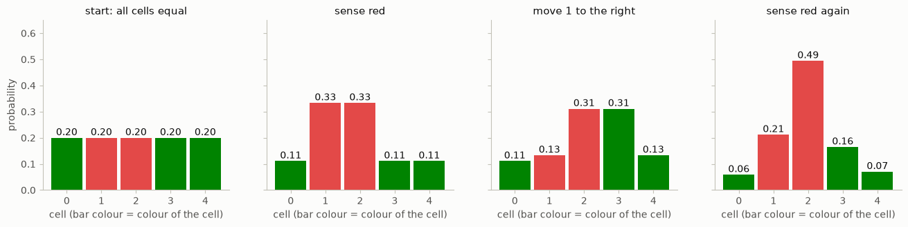
*Fig. 1. Sensing concentrates the belief on matching cells, and moving shifts and blurs it. A second measurement that agrees with the motion makes the belief sharper than before.*

**Repeated doors** (L7 s.5). In a corridor with several identical doors, the first "door" measurement gives one peak per door. Only after moving and sensing again do the peaks that don't fit disappear. A histogram can hold those several hypotheses at once.

**Cost** (L7 s.13). With m bins per dimension and d dimensions, a full grid has m^d cells, so fine grids and extra state variables quickly become too expensive.

---

## Gaussian beliefs

A Gaussian stores only a mean and a variance, instead of a whole grid. The Bayes recursion stays the same, and only the representation of the belief changes (L7 s.15). For a continuous state the curve is a density, and the area under it is 1 (L7 s.17):

$$p(x) = \frac{1}{\sqrt{2\pi\sigma^2}} \exp\!\left(-\frac{(x-\mu)^2}{2\sigma^2}\right)$$

**Measurement update** (L7 s.19–21). The product of the prior (μ, σ²) and the measurement (ν, r²) is a Gaussian with

$$\mu' = \frac{r^2\mu + \sigma^2\nu}{r^2 + \sigma^2}, \qquad \sigma'^2 = \frac{\sigma^2 r^2}{\sigma^2 + r^2}$$

The mean is a weighted average, closer to the more certain input. **The posterior is narrower than either input**, whenever the two are independent.

**Prediction** (L7 s.22). With an independent displacement (ν, r²), the means add and the variances add: μ′ = μ + ν, σ′² = σ² + r². Slide example: (8, 4) with a motion of (10, 6) gives (18, 10).

| Slide example | Prior | Measurement | Posterior |
|---|---|---|---|
| Equal uncertainty (s.21) | 10, 4 | 12, 4 | 11, 2 |
| More precise measurement (s.21) | 10, 8 | 13, 2 | 12.4, 1.6 |

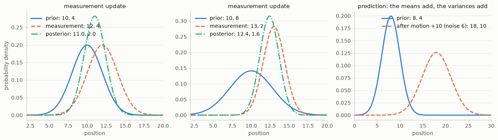
*Fig. 2. Left and middle: the update lands between the inputs, nearer the narrower one, and is narrower than both. Right: a prediction moves the Gaussian and widens it.*

**If the inputs strongly disagree** (L7 s.21), the formula still returns a narrow Gaussian between them, in a place supported by neither. The filter trusts its variances, so it needs a defensible model and calibrated uncertainty (L7 s.33).

---

## The Kalman filter

**Why a vector state** (L7 s.25–29). A state can include quantities that are never measured, such as velocity. The covariance matrix P links the components (L7 s.26). The prediction couples position with velocity, so measuring position also informs velocity, through the off-diagonal elements of P (L7 s.28).

For position and velocity with a time step of 1:

$$x = \begin{bmatrix} p \\ v \end{bmatrix}, \qquad F = \begin{bmatrix} 1 & 1 \\ 0 & 1 \end{bmatrix}, \qquad H = \begin{bmatrix} 1 & 0 \end{bmatrix}$$

**The equations** (L7 s.30):

| Step | Equation | Meaning |
|---|---|---|
| Prediction | x′ = F x + u | move the state with the model; u is the known state increment (B × control) |
| | P′ = F P Fᵀ + Q | move the uncertainty; Q is the covariance of unmodelled motion |
| Update | y = z − H x′ | **innovation**: measurement − expected measurement |
| | S = H P′ Hᵀ + R | uncertainty of the innovation; R is the measurement noise |
| | K = P′ Hᵀ S⁻¹ | **Kalman gain**: how much to trust the measurement |
| | x = x′ + K y | correct the state |
| | P = (I − K H) P′ | reduce the uncertainty |

The Kalman posterior is exact for a linear model, a Gaussian initial state and independent Gaussian noises (L7 s.15). The gain balances the two sources: if R is small compared with HP′Hᵀ, K is large and the measurement dominates; if P′ is small, K is small and the prediction dominates.

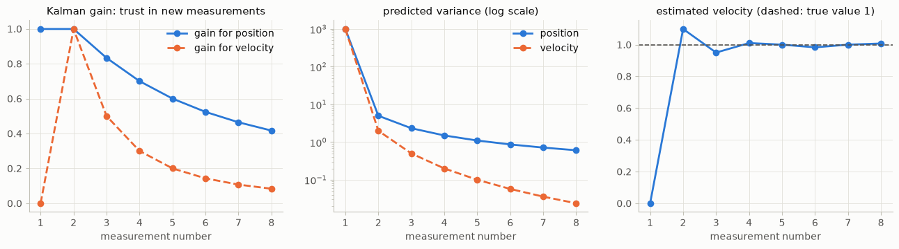
*Fig. 3. Exercise 2c. The gain starts at about 1 (the prior knows nothing) and falls as the filter gains confidence. The variance falls in the same way, and the velocity estimate, never measured, reaches 1 after two measurements.*

---

## Nonlinear models: EKF and UKF

The Kalman filter needs linear models. A radar, for example, measures range and bearing, while the state holds Cartesian position and velocity, and that relation is nonlinear (L7 s.31):

$$h(x) = \begin{bmatrix} \sqrt{p_x^2 + p_y^2} \\ \operatorname{atan2}(p_y, p_x) \end{bmatrix}$$

**Extended Kalman filter (EKF).** Evaluate the nonlinear f and h for the means, and use their local **Jacobians** (matrices of partial derivatives at the current estimate) for the covariance propagation:

$$x' = f(x, u), \quad P' = F_J P F_J^\top + Q, \quad y = z - h(x'), \quad S = H_J P' H_J^\top + R, \quad K = P' H_J^\top S^{-1}$$

For the radar's position part, with r = √(p_x² + p_y²):

$$H_J = \begin{bmatrix} p_x / r & p_y / r \\ -p_y / r^2 & p_x / r^2 \end{bmatrix}$$

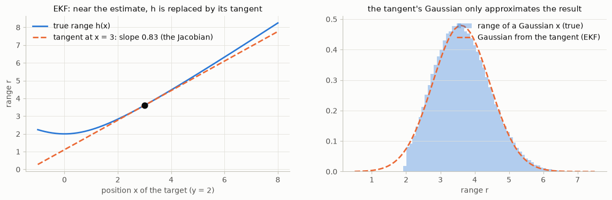
*Fig. 4. Left: near the estimate, the EKF replaces h by its tangent. Right: a Gaussian passed through h is no longer Gaussian, and the tangent gives only an approximation of it.*

**Unscented Kalman filter (UKF).** Pass selected **sigma points** through f and h, and compute the mean and covariance of the results. No Jacobians are needed.

Both keep one Gaussian. They should be compared for error and consistency on manoeuvres, and near difficult geometries (L7 s.31). In the radar example, the Jacobian becomes large near r = 0.

---

## Several hypotheses: the particle filter

With repeated doors, one Gaussian can place its mean **between** the plausible locations, where no door exists (L7 s.32). A **particle filter** replaces grid masses or a single Gaussian with weighted state samples:

1. sample the motion: move each particle with the model plus random noise;
2. weight each particle by the likelihood of the measurement at its position;
3. normalise the weights;
4. resample when needed: draw new particles in proportion to their weights.

It needs enough particles in the plausible regions. Check its recovery, its variability across runs and its computation cost (L7 s.32).

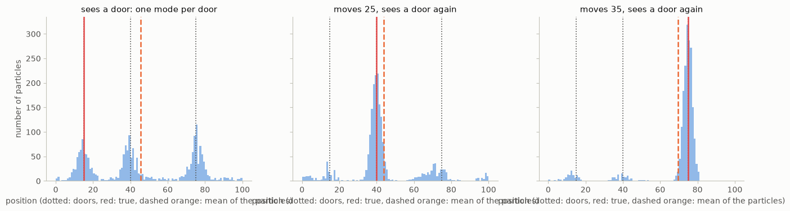
*Fig. 5. A simulated corridor with three doors. After the first "door" measurement, the particles form one group per door, and their mean (45.6) lies far from the truth (15), between the doors. After two more moves and measurements, 86 % of them are within 5 of the true position.*

---

## A learned gain: KalmanNet

Everything shares the update x⁺ = x⁻ + K (z − h(x⁻)). The classical filter calculates K from a covariance recursion with F, H, Q and R. **KalmanNet** (L7 s.34) keeps the prediction, innovation and correction steps, and lets a recurrent network estimate K from the filter's signals and their history. Only the gain is learned; the structure of the filter stays.

---

## Exercise 1: histogram filter in 2-D

The tutorial builds the 1-D filter of Fig. 1 (`sense`, `move` with `np.roll`, `ndimage.convolve1d`). The template's `ndimage.filters.convolve1d` no longer exists in this SciPy, so that call was changed.

**The exercise.** The 2-D Bayes rule was used in `sense`, to obtain the new belief over a 4 × 5 grid: multiply each cell by `phit` or `pmiss`, then divide by the sum. `move` is given, and only needs a 2-D kernel. Its weights must sum to 1, or probability would be lost.

```python
def sense(p, z):
    q = np.zeros((len(world), len(world[0])))
    for i in range(len(world)):
        for j in range(len(world[0])):
            hit = (z == world[i][j])
            q[i][j] = p[i][j] * (hit * phit + (1 - hit) * pmiss)
    return q / np.sum(q)

move_uncertainty = [[0, 0.1, 0], [0.1, 0.6, 0.1], [0, 0.1, 0]]
```

| Step | Best cell after sensing | Its probability |
|---|---|---|
| sense red, move up | (0, 0) | 0.060 |
| sense green, move up | (2, 3) | 0.117 |
| sense green, move up | (1, 2) | 0.172 |
| sense green, move left | (0, 2) | 0.235 |
| final belief, after the last move | (0, 1) | 0.173 |

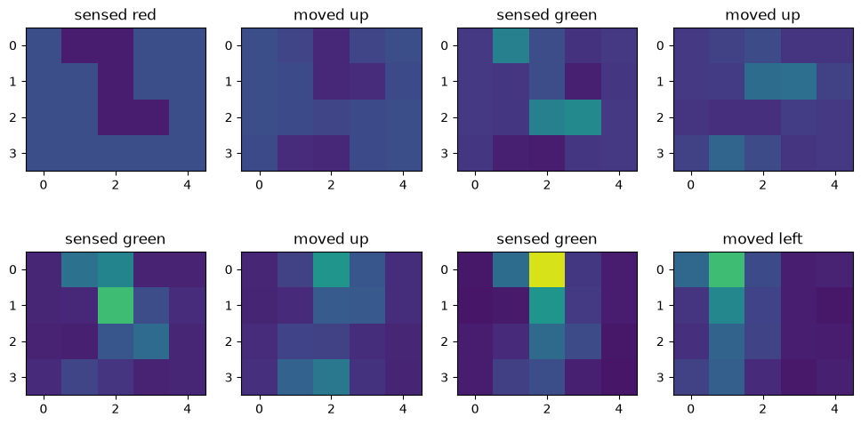
*Fig. 6. A red measurement says little, because most cells are red. Each green measurement concentrates the belief, because few cells are green. The peak also follows the moves.*

---

## Exercise 2: Kalman filters

**2a: the update.** From (4, 40) and (20, 4), the formula gives **(18.55, 3.64)**: close to the more certain input, and narrower than both.

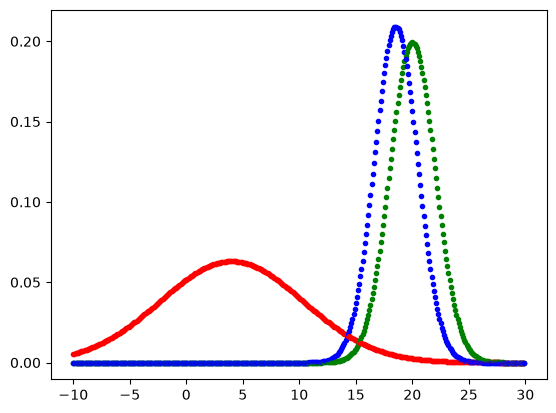
*Fig. 7. Cell 2a. The new Gaussian (blue) is taller than both inputs.*

**2b: the 1-D filter.** The start is (0, 10000), which means no knowledge, and the filter alternates update and prediction, with measurement variance 4 and motion variance 2. This is also the slide's exercise (L7 s.23).

| Measurement | After update | Motion | After prediction |
|---|---|---|---|
| 5 | 5.00, 4.00 | 1 | 6.00, 6.00 |
| 6 | 6.00, 2.40 | 1 | 7.00, 4.40 |
| 7 | 7.00, 2.10 | 2 | 9.00, 4.10 |
| 9 | 9.00, 2.02 | 1 | 10.00, 4.02 |
| 10 | 10.00, 2.01 | 1 | 11.00, 4.01 |

The variance settles at a steady state: the same amount is added by motion as is removed by measurement.

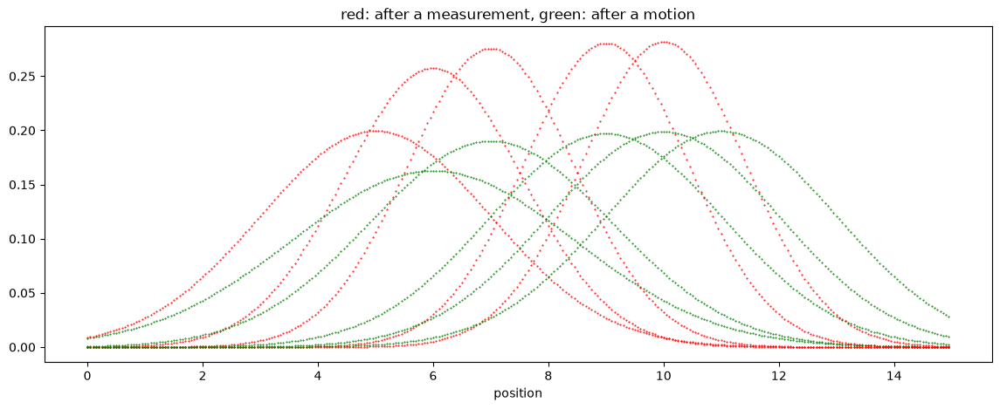
*Fig. 8. Cell 2b: tall after each measurement (red), lower after each motion (green).*

**2c: position and velocity.** The filter was implemented from the matrix equations, using `np.dot`, `np.linalg.pinv` and `np.transpose`. The template's `predict` has no Q.

```python
def update(x, P, Z, H, R):
    y = Z - np.dot(H, x)
    S = np.dot(np.dot(H, P), np.transpose(H)) + R
    K = np.dot(np.dot(P, np.transpose(H)), np.linalg.pinv(S))
    x = x + np.dot(K, y)
    P = np.dot(I - np.dot(K, H), P)
    return x, P
```

After the 8 measurements it predicts position 9.06 and velocity 1.01, with variances 0.61 and 0.024. Velocity is never measured, yet it is estimated from the second measurement on.

**2d: 2-D.** Only the matrices change: a 4-element state, F with the 1-D block twice, a 2 × 4 H, R = I, and a 4 × 4 identity. The functions run unchanged. The prediction is x = 8.01, vx = 1.00, y = 4.54, vy = 0.51.

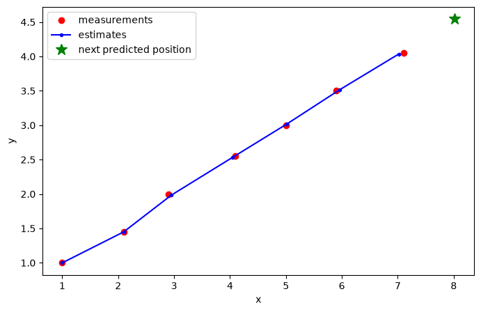
*Fig. 9. Cell 2d: the filter follows the noisy measurements along a straight line, and predicts the next position.*

---

## Weekly Project 7: tracking a ball

A red ball rolls through a 66-frame video (1920 × 1080 px) and passes behind an obstacle. The task is to detect it, track position, velocity and acceleration with a Kalman filter, and draw the tracked and predicted positions.

**Detector.** The project points to `cv2.HoughCircles`. The ball's radius was measured as about 76–85 px, so the search covers 70–95 px. Its edge is weak, so `param1` must be low (30). That also gives about 4 circles per frame, and false ones in every frame before the ball appears. So a circle is accepted only if its centre pixel is red, a per-channel rule as in [chapter 1](01_basic_image_processing.md#task-1-remove-the-yellow-square). The result is 18 detections and no false ones.

**Filter.** A 6-element state, [x, vx, ax, y, vy, ay]ᵀ, with F from x′ = x + v Δt + ½ a Δt² and Δt = 1 frame:

$$F = \begin{bmatrix} 1 & 1 & \tfrac{1}{2} & 0 & 0 & 0 \\ 0 & 1 & 1 & 0 & 0 & 0 \\ 0 & 0 & 1 & 0 & 0 & 0 \\ 0 & 0 & 0 & 1 & 1 & \tfrac{1}{2} \\ 0 & 0 & 0 & 0 & 1 & 1 \\ 0 & 0 & 0 & 0 & 0 & 1 \end{bmatrix}, \qquad H = \begin{bmatrix} 1 & 0 & 0 & 0 & 0 & 0 \\ 0 & 0 & 0 & 1 & 0 & 0 \end{bmatrix}$$

P starts at 1000 × I, and R is 25 × I (a detection error of about 5 px). The filter starts at the first detection. From there it predicts in every frame, and updates only when the ball is found.

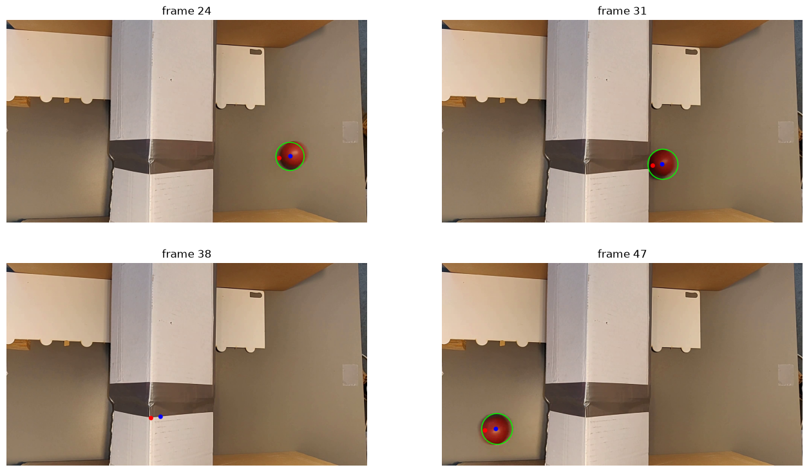
*Fig. 10. Green: detection. Blue dot: estimate. Red dot: prediction for the next frame. In frame 38 the ball is hidden, and the filter continues from its model alone.*

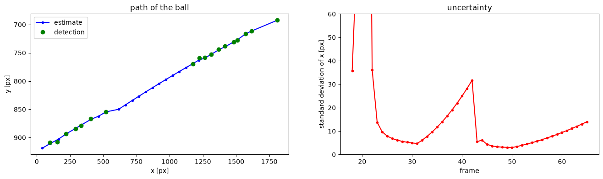
*Fig. 11. Left: detections and the estimated path through the gap. Right: the standard deviation of x falls with each detection and grows while there is none.*

| Measure | Result |
|---|---|
| Prediction error, median | about 12 px |
| Largest error | 193 px at frame 22: after the first detection the velocity is unknown, and the next detection comes 4 frames later |
| Error when the ball reappears (frame 43, after 11 frames without a detection) | 46 px |
| Standard deviation of x | 4.7 px at frame 31, 31.7 px at frame 42, 3.0 px at frame 50 |

**Two choices, measured.**
- **Starting at the first detection.** Starting from x = 0 instead makes the first update assign a false velocity (the position jump divided by the elapsed frames), and the next prediction is off by more than 1000 px.
- **No Q.** The exercise's `predict` has no Q, and that is the best choice for this short video, whose motion is close to constant acceleration. The error at reappearance is 46 px without Q, 85 px with Q = 0.1 and 172 px with Q = 1. For a longer video, or a ball that changes direction, Q would be needed.

The optional challenge, tracking several balls, is not done.

---

## When it fails

The last column says whether the notebook actually applies the fix.

| Problem | Where | Cause | Fix | Applied in the notebook? |
|---|---|---|---|---|
| Belief spreads until uniform | histogram, moving only | motion uncertainty with no measurements | measure regularly | **no**: the tutorial cell shows it on purpose |
| Probabilities no longer sum to 1 | `sense` | forgot to normalise | divide by the sum | **yes** |
| Probability lost in `move` | kernel | weights that don't sum to 1 | make them sum to 1 | **yes** |
| `AttributeError: ndimage.filters` | template's full 1-D code | removed from this SciPy | `ndimage.convolve1d` | **yes** |
| Too many cells | histogram in many dimensions | m^d cells | Kalman or particle filter | **no**: not needed here |
| Mean between two possible locations | Kalman with repeated doors | one Gaussian can't hold two peaks | histogram or particle filter | **no**: only in the figure |
| Narrow but wrong result | strongly disagreeing inputs | the update trusts the variances | a defensible model and calibrated R and Q | **no** |
| Filter stops following changes | Q = 0 on a long sequence | P keeps shrinking, so K goes to 0 | add Q | **no**: Q = 0 is the best here, on a short video |
| Filter jumps too much | Q too large | it trusts the model too little | lower Q | **yes**: Q = 1 gave 172 px, Q = 0 gave 46 px |
| Prediction off by more than 1000 px | start from x = 0 | the first update invents a velocity | set x at the first detection | **yes** |
| False circles in every frame | `HoughCircles` with low `param1` | a weak edge needs a low threshold | radius limits and a colour check | **yes** |
| Large error after the first detection (193 px) | frame 22 | velocity is unknown after one position | accept it; it goes away with more measurements | **no** |
| Linear filter on a nonlinear sensor | radar | h isn't linear | EKF or UKF | **no**: only in the text |
| Particle filter loses the true location | few particles | no particles near the truth | more particles; check runs | **no**: only in the figure |

---

## Key takeaways

- **A belief is a distribution**, and every filter repeats two steps. **Prediction** moves it and adds uncertainty. **Measurement update** multiplies by the likelihood, normalises, and removes uncertainty.
- **Bayes' rule:** posterior ∝ likelihood × prior. **Total probability:** prediction sums over all previous states.
- **Histogram filter:** any shape of belief, but m^d cells.
- **Gaussian update:** the mean is a weighted average, and the posterior is narrower than either input. **Prediction:** means add and variances add.
- **Kalman filter:** x′ = Fx + u, P′ = FPFᵀ + Q; y = z − Hx′, S = HP′Hᵀ + R, K = P′HᵀS⁻¹, x = x′ + Ky, P = (I − KH)P′. It is exact for linear models with Gaussian noise.
- **Unmeasured states can be estimated**, such as velocity from positions, because the covariance links them.
- **Without measurements the filter still predicts**, and its uncertainty shows how far to trust it.
- **EKF:** linearise with Jacobians. **UKF:** propagate sigma points. Both keep one Gaussian.
- **Particle filter:** weighted samples, for several hypotheses and nonlinear models, at the cost of needing enough particles.
- **Q and R decide the behaviour.** Measure their effect rather than assume it.
