# Chapter 8 · Classification

**Sources**
- Class 8 lecture, *Classification*: [34759-PfAS-8-Classification.pdf](../Class_8_classification/34759-PfAS-8-Classification.pdf), cited as **L8 s.N** (slide N = PDF page N).
- [Exercise 1](../Class_8_classification/week8/Exercise1.ipynb), [Exercise 2](../Class_8_classification/week8/Exercise2.ipynb), [Weekly Project](../Class_8_weekly_project/WeeklyProject.ipynb).
- Functions and terms: [reference.md](reference.md). The surface normals in this chapter are the ones from [chapter 5](05_point_cloud_registration.md), and regression and clustering are in [chapter 6](06_regression_and_clustering.md).

**Contents**
1. [Overview](#overview)
2. [What classification is](#what-classification-is)
3. [Dimensionality reduction with PCA](#dimensionality-reduction-with-pca)
4. [PCA for 3-D point clouds](#pca-for-3-d-point-clouds)
5. [k-nearest neighbours](#k-nearest-neighbours)
6. [Support vector machines](#support-vector-machines)
7. [Object detection](#object-detection)
8. [Exercise 1: SVMs on Iris](#exercise-1-svms-on-iris)
9. [Exercise 2: PCA and grid search](#exercise-2-pca-and-grid-search)
10. [Weekly Project: handwritten digits](#weekly-project-handwritten-digits)
11. [When it fails](#when-it-fails)
12. [Key takeaways](#key-takeaways)

---

## Overview

A classifier learns from labelled samples, and then predicts the label of a new sample. This class covers one tool for making the samples smaller (PCA), two classifiers (k-NN and SVM), and how a classifier can find objects in an image.

| Method | What it does | Used in |
|---|---|---|
| **PCA** | keeps the directions of largest variance | Exercise 2, Weekly Project |
| **k-NN** | votes among the k nearest training samples | lecture; a comparison in this book |
| **Linear SVM** | a straight boundary with the largest margin | Exercises 1 and 2 |
| **Kernel SVM** | a curved boundary through a kernel | Exercises 1 and 2, Weekly Project |
| **Grid search** | tries many parameter values by cross-validation | Exercise 2 |

---

## What classification is

**Types of machine learning** (L8 s.6):

| Type | Target values | Example |
|---|---|---|
| Supervised: **regression** | known and numeric | the line fits of [chapter 6](06_regression_and_clustering.md) |
| Supervised: **classification** | known and nominal (categories) | this chapter |
| Unsupervised: **clustering** | unknown | k-means and DBSCAN in [chapter 6](06_regression_and_clustering.md) |
| **Reinforcement learning** | none: the system interacts with a dynamic environment to reach a goal | not used in this course's exercises |

**Terms** (L8 s.8):
- **Classes (labels):** the categories to predict, such as setosa, versicolor and virginica.
- **Samples:** individual, independent examples, such as one flower.
- **Features:** the measurable properties of a sample, such as petal length. Together they form the **feature vector** x.

The output of a classification algorithm is usually a set of **decision boundaries** between the classes. A new sample gets the class of the side it falls on (L8 s.9).

**The pipeline** (L8 s.10) has three steps: take a training set of N samples, each labelled with one of K classes; train the classifier on it; and evaluate it on samples it has never seen, by comparing predicted and true labels. The samples kept apart for the last step are the **test set**. They show whether the model has **overfitted**, meaning it learned the training samples without learning a rule that holds for new ones.

---

## Dimensionality reduction with PCA

Many features usually help, but some may be redundant, and too many dimensions make the data sparse: the **curse of dimensionality**. Reducing the dimensions can improve both speed and performance (L8 s.12).

**Principal component analysis (PCA)** creates new features that are linear combinations of the original ones. The new features are orthogonal to each other, and the ones that account for a large share of the variance are kept (L8 s.14). In effect, it moves the data to a new coordinate system along its lines of greatest variance.

**The steps** (L8 s.15):
1. Centre the data.
2. Calculate the covariance matrix.
3. Compute its eigenvectors and eigenvalues. The eigenvector with the largest eigenvalue is the first principal component. It points in the direction of largest variance. The second is orthogonal to it and points in the direction of the second largest spread.
4. Sort the eigenvectors by their eigenvalues.
5. Calculate each one's share of the total variance: its eigenvalue divided by the sum of all eigenvalues.
6. Keep the eigenvectors that explain most of the variance, for example 95 %, and remove the rest.
7. Project the samples onto the eigenvectors that are left.

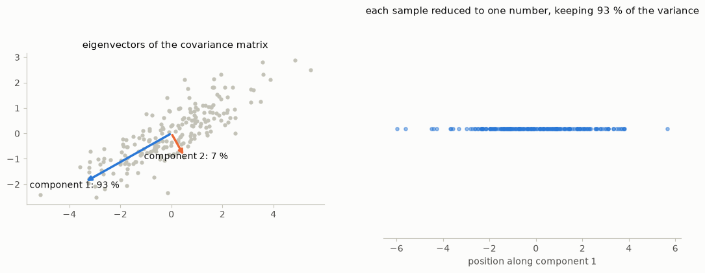
*Fig. 1. Left: the eigenvectors of a 2-D cloud's covariance. The first explains 93 % of the variance and the second 7 %. Right: projecting onto the first reduces each sample to one number.*

PCA ignores the labels. It keeps the directions of largest variance, and these are not always the directions that separate the classes. On Iris and MNIST they happen to work well.

---

## PCA for 3-D point clouds

PCA also describes the shape of 3-D points (L8 s.19–21). Here it doesn't reduce dimensions; it shows the local geometry.

- **Surface normals.** Take a point and its k nearest neighbours, centre them, and compute the 3 × 3 covariance matrix, with eigenvalues λ₁ ≥ λ₂ ≥ λ₃ and eigenvectors e₁, e₂, e₃. Then e₁ and e₂ span the best-fitting plane, and e₃, the direction of least variance, is the normal. λ₃ ≈ 0 means the surface is locally flat. The sign of e₃ is ambiguous, so it is flipped towards the sensor. These are the normals used by point-to-plane ICP in [chapter 5](05_point_cloud_registration.md).
- **Shape features.** The relative sizes of λ₁, λ₂ and λ₃ describe the shape of a neighbourhood. They form a compact, rotation-invariant feature vector, which a classifier can use to label each lidar point as ground, building, pole and so on.
- **Oriented bounding boxes.** Apply PCA to the (x, y) points of one segmented obstacle in bird's-eye view. Then e₁ is its heading, and the minimum and maximum after projecting onto e₁ and e₂ give its length and width. This is much tighter than an axis-aligned box. The caveat is that a lidar often sees only one or two sides, which biases the axes.

---

## k-nearest neighbours

**k-NN** (L8 s.23–26) is a geometric method based on one assumption: neighbouring samples belong to the same class. To classify a new sample x\*, compute its distance to all other samples, select the k nearest, and take

$$P(\text{class } j \mid x^*) = \frac{k_j}{K}$$

where $k_j$ is the number of nearest neighbours in class j, and K is the total number of nearest neighbours. With k = 5, a sample with 4 red neighbours is red with probability 4/5.

Its parameters are k and the distance metric, most commonly Euclidean; Mahalanobis and Manhattan are other options. There is no training step, but every prediction compares the sample with all stored samples.

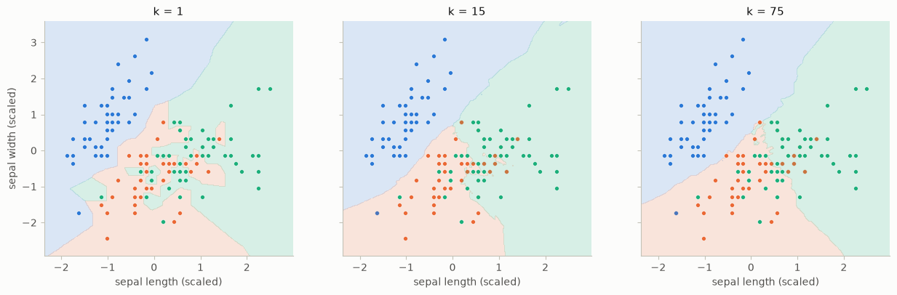
*Fig. 2. k-NN boundaries on two Iris features. Small k follows every noisy sample, and very large k starts to ignore local structure.*

Very small values of k perform poorly on noisy data, k-NN is a non-linear classifier, it is powerful despite its simplicity, and it can be very slow on large datasets (L8 s.26). This is measured for this book, with scikit-learn's `KNeighborsClassifier`:

| Data | k = 1 | k = 5 | k = 15 | Larger k |
|---|---|---|---|---|
| Iris, 2 sepal features (mean of 50 splits) | 71.9 % | 75.2 % | 75.4 % | k = 45: 76.4 % |
| Iris, 4 features (mean of 50 splits) | 94.5 % | 94.6 % | 94.8 % | k = 45: 86.0 % |
| MNIST, 50 PCA components | 97.34 % | 97.48 % | 97.17 % | — |

On MNIST, k-NN comes within about 1.2 % of the SVM from the [weekly project](#weekly-project-handwritten-digits) (98.68 %).

---

## Support vector machines

An **SVM** finds a line or surface in feature space that separates the classes (L8 s.28). Many lines may separate them, so it chooses by two criteria (L8 s.30):
1. The distance between the samples and the boundary is as large as possible: the **maximum margin**.
2. The samples are classified as well as possible.

The boundary is a hyperplane, written here in its standard form:

$$h(x) = w^\top x + b = 0$$

The distance between the two margin lines is $2 / \|w\|$, so maximising the margin means minimising $\|w\|$. The classification rule is $\hat{y} = \mathrm{sign}(h(x))$: a new sample is labelled 1 if it lies above the boundary and −1 otherwise (L8 s.32).

Only the samples on the margin define the boundary. These are the **support vectors** (L8 s.31).

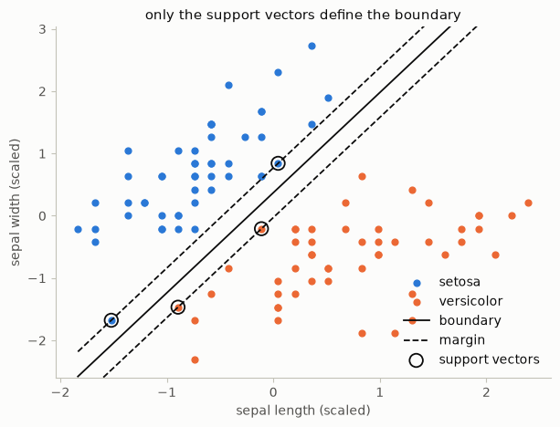
*Fig. 3. A linear SVM on two Iris classes. 4 of the 100 samples are support vectors; removing any other sample would not move the boundary.*

**The three extensions** (L8 s.33–36):
- **More than 2 dimensions.** The maths is the same: planes and hyperplanes instead of lines.
- **More than 2 classes.** In **1-vs-all**, one binary classifier per class is trained, and the largest decision value wins. In **1-vs-1**, one classifier per pair of classes is trained, and the class with the most votes wins. In scikit-learn, `LinearSVC` uses 1-vs-all and `SVC` uses 1-vs-1.
- **Data that isn't linearly separable.** The **kernel trick** replaces the dot product with a kernel function, which amounts to working in a higher-dimensional space where the data is linearly separable, without computing that space. Typical kernels are linear, polynomial and Gaussian (radial basis function, RBF).

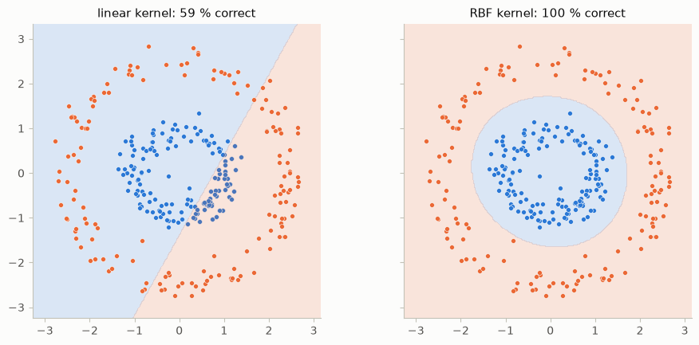
*Fig. 4. Two rings can't be separated by a line: the linear kernel gets 59 % right, and the RBF kernel 100 %.*

**The parameters:**
- **C** sets how strongly training mistakes are punished. A larger C gives a narrower margin that follows the training samples more closely.
- **gamma** (RBF) sets how far one sample reaches. A larger gamma gives a more local, wigglier boundary.
- **degree** (polynomial) is the degree of the polynomial.

---

## Object detection

**Classification** asks what is in the image, and gives one label for the whole image. **Object detection** asks which objects are there and where, and gives a class, a score and a bounding box per object. An autonomous system needs the "where" and "how many" (L8 s.38).

**Sliding window** (L8 s.39) reuses a classifier to decide "object or background". Slide a fixed-size window over the image a few pixels at a time; for each window, extract features and let the classifier give a score; and keep the windows above a threshold. Objects appear at different sizes, so this is repeated on an image pyramid. The lecture's summary names HOG features with an SVM as the classic combination (L8 s.43). The positions and scales add up to tens of thousands of windows per image, so features and classifier must be fast.

**Overlapping detections** (L8 s.40). Neighbouring windows and scales all fire on the same object. **Intersection over union** measures how much two boxes overlap:

$$\mathrm{IoU} = \frac{\mathrm{area}(A \cap B)}{\mathrm{area}(A \cup B)}$$

**Non-maximum suppression (NMS)** removes the duplicates: sort the detections by score; keep the highest; discard every remaining box with IoU above a threshold such as 0.5 with it; and repeat with the next box that is left.

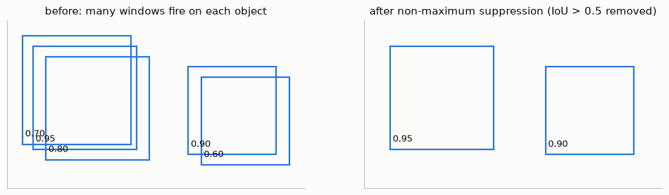
*Fig. 5. Five boxes on two objects become two after NMS with a threshold of 0.5.*

**Deep detectors** (L8 s.41) are the lecture's outlook; no exercise uses them. Convolutional networks learn the features and the classifier together. Two-stage detectors propose regions and then classify them (Faster R-CNN), and one-stage detectors predict boxes and classes in one pass (YOLO). Semantic segmentation gives every pixel a class, and instance segmentation also separates individual objects (Mask R-CNN).

---

## Exercise 1: SVMs on Iris

The Iris dataset has 150 samples of 3 species, each with 4 features: sepal length and width, and petal length and width.

**Normalization.** `StandardScaler` was used to bring each feature to mean 0 and standard deviation 1. An SVM maximises a distance, so a feature with larger numbers would otherwise dominate. Iris itself barely shows this, because all four features are in cm. An RBF SVM on all features gets 96.2 % raw and 95.9 % scaled, averaged over 50 random splits. If one feature is multiplied by 1000, raw falls to 67.8 %, while scaled stays at 95.9 %.

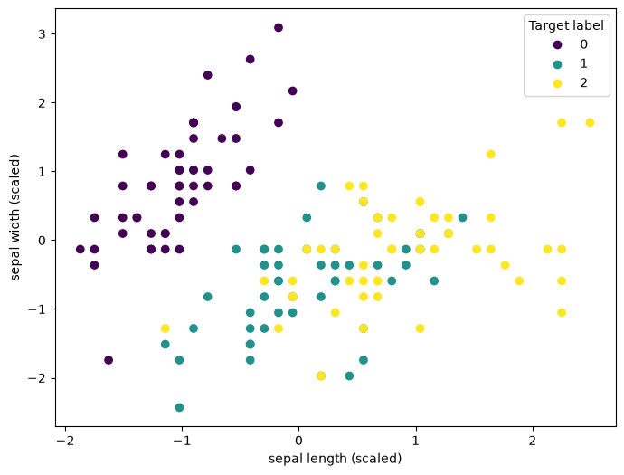
*Fig. 6. The two sepal features after normalization. One class is separate, and the other two overlap.*

**Split and LinearSVC.** `train_test_split` was used to keep 45 of the 150 samples for testing. `LinearSVC` then fits a linear boundary for each class against the rest.

```python
clf = sk.svm.LinearSVC(penalty='l2', loss='squared_hinge', random_state=0, max_iter=100000)
clf.fit(X_train, y_train)
```

The exercise's `max_iter=10e4` is a float, which this version of scikit-learn rejects. The result is 82.9 % on the training set and 68.9 % on the test set. All 16 setosa test samples are correct, and the errors are between versicolor and virginica.

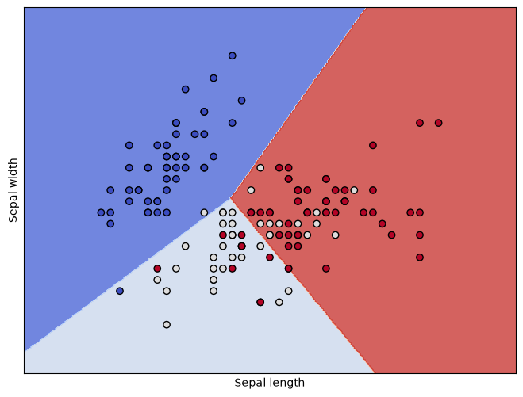
*Fig. 7. `LinearSVC` on the two sepal features.*

**Kernels and more features.** With 45 test samples, one sample is worth 2.2 %, so a single split can mislead. The table therefore shows both this split's testing accuracy and the mean over 100 random splits.

| Features | Linear SVC: this split | mean | RBF: this split | mean | Polynomial: this split | mean |
|---|---|---|---|---|---|---|
| 2 sepal | 80.0 % | 78.5 % | 77.8 % | 77.8 % | 66.7 % | 70.1 % |
| 2 sepal + petal length | 95.6 % | 95.3 % | 97.8 % | 90.5 % | 91.1 % | 86.8 % |
| 2 sepal + petal width | 97.8 % | 94.8 % | 95.6 % | 94.2 % | 88.9 % | 89.0 % |
| All 4 | 97.8 % | 96.0 % | 97.8 % | 95.7 % | 88.9 % | 91.4 % |

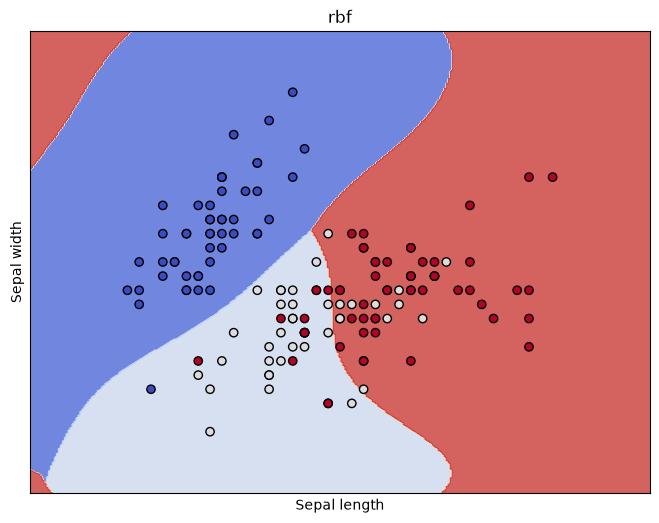
*Fig. 8. The RBF kernel on the sepal features. Its curved boundaries don't help, because the classes overlap in these two features.*

- **Kernels don't help on the sepal features.** The limit is the features, not the shape of the boundary.
- **The first petal feature gives the big jump,** from about 78 % to about 95 %. The fourth feature adds about 1 %, which is less than the 3 % standard deviation between splits.
- **The polynomial kernel is the weakest.** With its default `coef0=0` on centred data, it contains only degree-3 terms. Setting `coef0=1` raises the 2-feature mean from 70.2 % to 75.6 %.
- **`LinearSVC` and the linear `SVC` differ** in loss and in multi-class scheme. On 2 features their means are the same (78.6 % and 78.5 %), although this one split gives 68.9 % against 80.0 %. On all 4 features `SVC` is better, 96.0 % against 92.9 %.

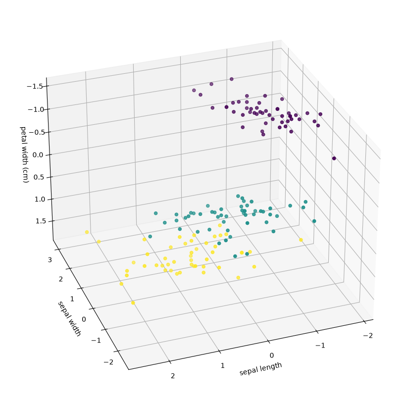
*Fig. 9. Three scaled features, each sample coloured by the class that the linear SVM predicts.*

---

## Exercise 2: PCA and grid search

**PCA.** `PCA(n_components=2)` was used to reduce the 4 scaled features to 2. The components explain 72.96 % and 22.85 % of the variance, 95.81 % together. The exercise text says 72.77 % and 23.03 %, which is slightly different but leads to the same conclusion.

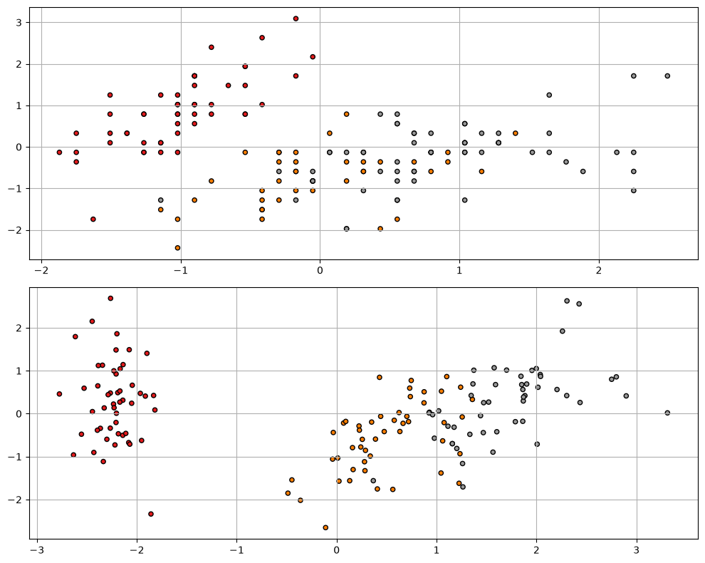
*Fig. 10. Upper: the first two scaled features. Lower: the two principal components. The classes separate much better along component 1.*

**SVM on the components.** Each component combines all four features, so it also carries the petal information.

| | 2 sepal features | 2 components | 3 components | 4 features |
|---|---|---|---|---|
| `LinearSVC`, this split | 68.9 % | 88.9 % | 93.3 % | 93.3 % |
| `LinearSVC`, mean of 100 splits | 78.6 % | 87.3 % | 92.6 % | 92.9 % |
| Linear `SVC`, this split | 80.0 % | 91.1 % | 97.8 % | 97.8 % |
| Linear `SVC`, mean of 100 splits | 78.5 % | 91.6 % | 95.6 % | 96.0 % |

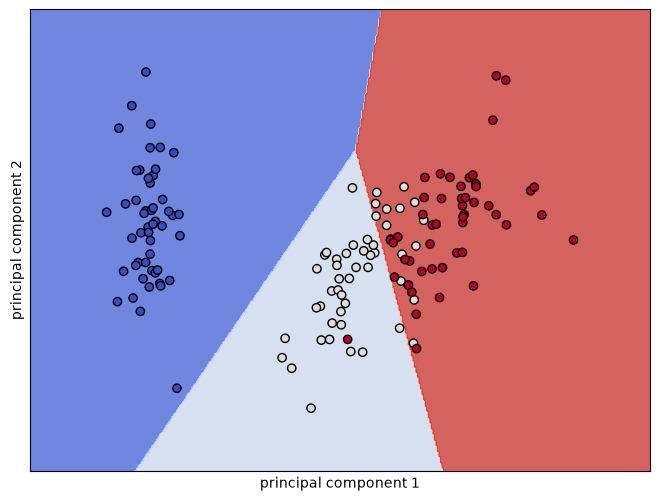
*Fig. 11. `LinearSVC` on the two principal components.*

Three components keep 99.48 % of the variance. The third adds only 3.67 %, yet it matters: the linear `SVC` rises from 91.6 % to 95.6 % on average. Low variance isn't the same as low usefulness.

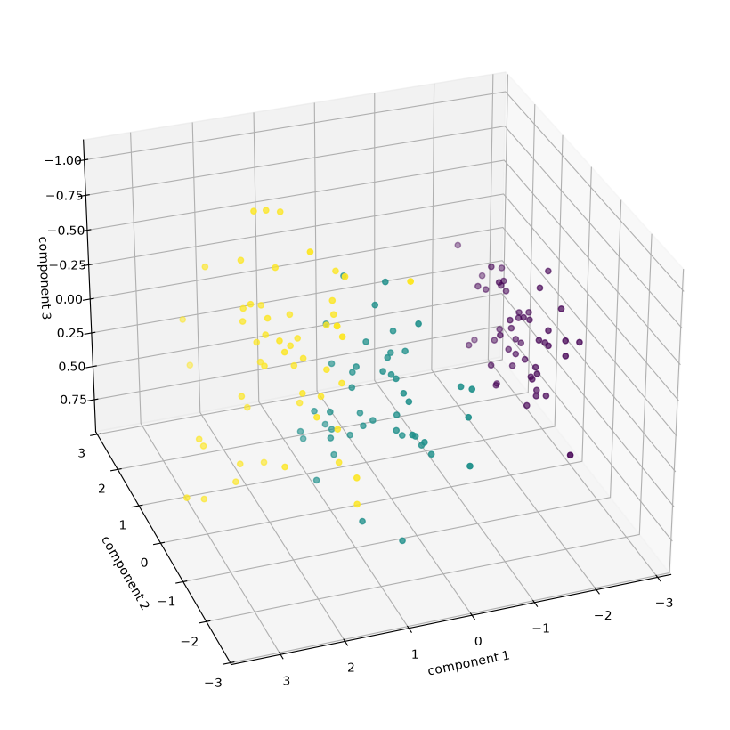
*Fig. 12. Three principal components, each sample coloured by the predicted class.*

**Best accuracy.** The best testing accuracy is 97.8 %, 44 of 45, reached by several models. Choosing one from a single split isn't reliable. Over 100 splits the best are the linear kernel on 4 features (96.0 %) and RBF on 3 components (95.7 %), which is a tie.

**Grid search.** `GridSearchCV` was used to try 50 values of C from 0.74 to about 4 × 10⁸, each scored by 3-fold cross-validation on the training set only.

```python
c = np.logspace(start = -15, stop = 1000, base = 1.02)
grid = GridSearchCV(clf, param_grid = {'C': c}, cv = 3, n_jobs = -1, scoring = 'accuracy')
grid.fit(X_train4, y_train4)
```

**k-fold cross-validation** splits the training set into k parts, trains on k − 1 of them and scores on the last, in turn. The test set stays untouched. The best value is C ≈ 1.69, with 96.2 % cross-validation accuracy and 97.8 % testing accuracy, the same as the default C = 1. The value of the search here is that C was chosen without looking at the test set.

---

## Weekly Project: handwritten digits

**The task:** classify the digits of MNIST with at least 80 % accuracy, with 98 % as a challenge. MNIST has 70,000 images of 28 × 28 pixels, and the standard split is 60,000 for training and 10,000 for testing. The project text warns that an SVM on the full dataset takes hours, and asks for dimensionality reduction.

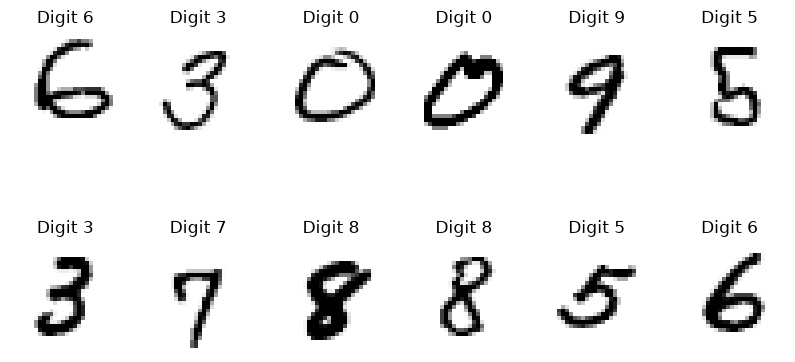
*Fig. 13. Some digits from the dataset.*

**The method.** PCA, which projects the 784 pixels onto 50 components, was used to obtain a small feature vector. An RBF SVM was then trained on it.

```python
pca = PCA(n_components=50, random_state=0)
train_components = pca.fit_transform(train_images)
test_components = pca.transform(test_images)

clf = svm.SVC(kernel='rbf', C=10, gamma='scale')
clf.fit(train_components, train_targets)
```

PCA is fitted on the training images only, so the test images have no influence on it.

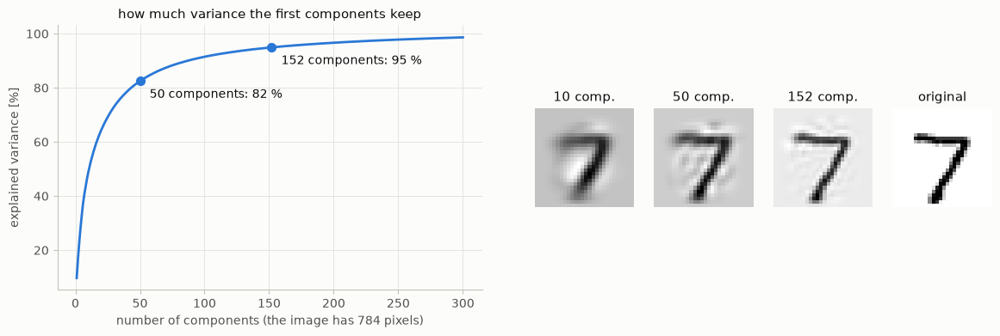
*Fig. 14. Left: 50 components keep 82.5 % of the variance, and 152 keep 95 %. Right: one digit rebuilt from 10, 50 and 152 components.*

**Choosing the values.** The number of components and C were chosen on a validation split: training on 10,000 of the first 50,000 images, and validating on the next 10,000. The test set wasn't used.

| Components | Explained variance | C = 1 | C = 10 |
|---|---|---|---|
| 30 | 73.1 % | 96.99 % | 97.31 % |
| 50 | 82.5 % | 97.20 % | **97.49 %** |
| 100 | 91.5 % | 97.14 % | 97.35 % |

The 95 % rule of the lecture would give 152 components here. 100 components already score lower than 50 and take longer, so going further has no benefit on this data.

**The result.** On the 10,000 test images:

| Training images | Test accuracy | Training time |
|---|---|---|
| 20,000 | 97.87 % | about 2 s |
| 60,000 | **98.68 %** | about 14 s |

This is above both the required 80 % and the 98 % challenge. 132 of the 10,000 test images are wrong.

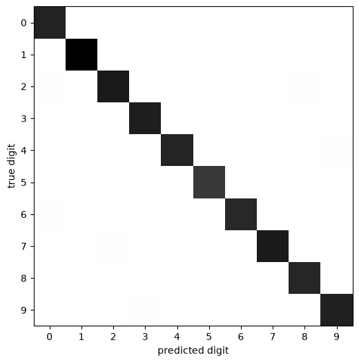
*Fig. 15. The confusion matrix. The diagonal holds the correct digits. The largest single error is 7 taken for 2, which happens 9 times.*

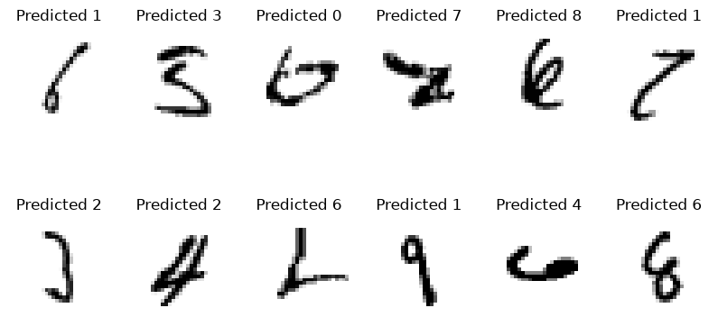
*Fig. 16. Test digits that were classified wrongly, each titled with the digit it was taken for.*

The project's second challenge, classifying faces from the `lfw` dataset, is not done.

---

## When it fails

The last column says whether the notebook actually applies the fix.

| Problem | Where | Cause | Fix | Applied in the notebook? |
|---|---|---|---|---|
| `InvalidParameterError` | `max_iter=10e4` from the text | it is a float | write 100000 | **yes** |
| 3-D plot stays empty | `Axes3D(fig, ...)` from the text | newer Matplotlib doesn't add it to the figure | `fig.add_axes(ax)` | **yes** |
| 68.9 % looks like a failure | one split of 45 test samples | one sample is worth 2.2 %, and the split is unlucky | average over random splits | **partly**: the means are in the text, measured outside the notebook |
| Accuracy stuck near 78 % with any kernel | 2 sepal features | versicolor and virginica overlap there | add petal features | **yes** |
| Accuracy falls to 68 % when one feature has large numbers | no normalization | that feature dominates the distance | `StandardScaler` | **yes** |
| The test set influences the scaler | Exercises 1 and 2 | the template scales before splitting | fit the scaler on the training set only | **no**, the order follows the template. The measured effect is 0 on Iris: 96.3 % both ways |
| The test set influences PCA | any PCA | fitting on all data | fit on the training set only | **Weekly Project: yes; Exercise 2: no** |
| Choosing the best of many tries gives a flattering number | Exercise 2, part 3 | the test set was used to choose | choose on cross-validation, then test once | **yes**, in part 4 |
| An SVM on all of MNIST takes hours | 784 features | training time grows quickly | PCA first | **yes** |
| The 95 % rule isn't the best choice | MNIST | variance isn't the same as usefulness | choose by validation accuracy | **yes** |
| Very slow prediction | k-NN on large data | every prediction compares with all samples | PCA first; or use an SVM | not used in the notebooks |

---

## Key takeaways

- **Classification** learns decision boundaries from labelled samples. Always evaluate on samples the model hasn't seen.
- **PCA:** the eigenvectors of the covariance matrix are the directions of most variance, and the eigenvalues say how much. Keep the largest ones and project. On 3-D points, the smallest eigenvector is the surface normal.
- **k-NN** votes among the k nearest samples. It is simple and non-linear, but slow on large datasets.
- **An SVM** maximises the margin, and only the support vectors define the boundary. Kernels give non-linear boundaries, and 1-vs-all or 1-vs-1 handle several classes.
- **Features matter more than the kernel:** on Iris, adding a petal feature gives about 17 %, while changing the kernel gives nothing.
- **Normalize** when features have different scales.
- **Don't trust one small test set:** differences of one or two samples are noise. Use cross-validation to choose parameters, and test once at the end.
- **PCA + SVM reaches 98.68 %** on MNIST in about 14 s of training.
- **Detection is classification applied to many image regions:** sliding window, features and classifier, then IoU and NMS to remove duplicates.
