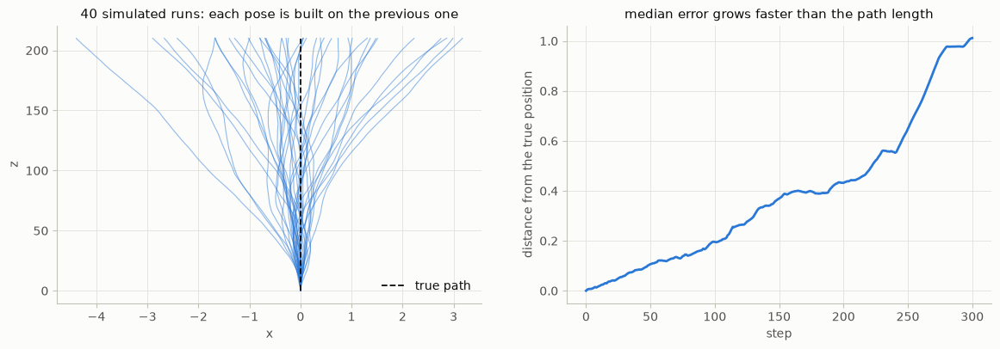
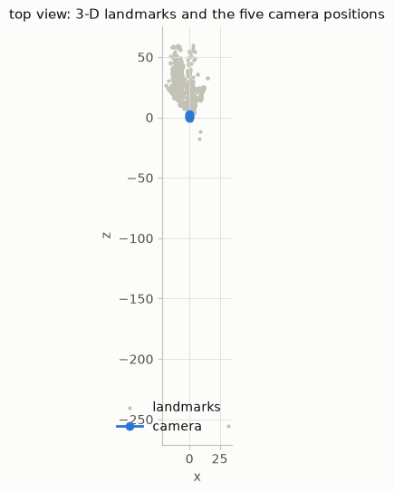
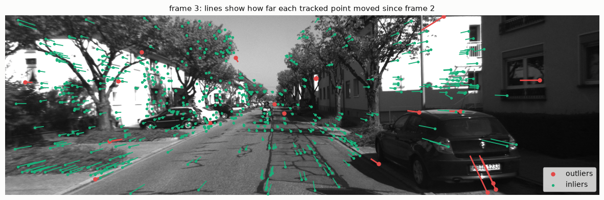
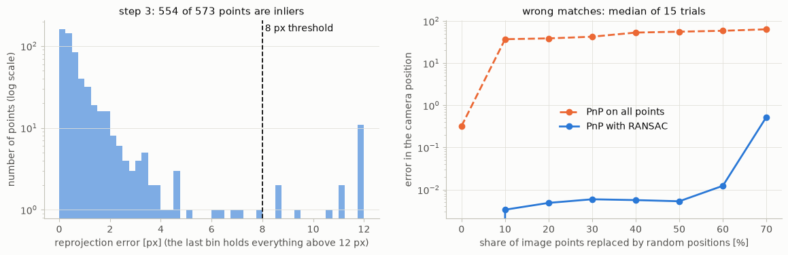
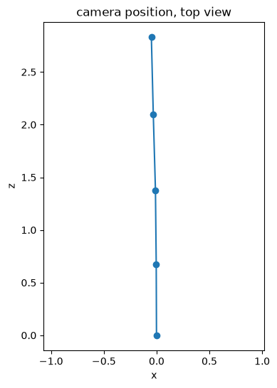
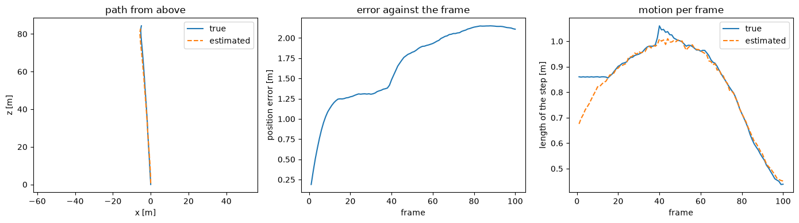
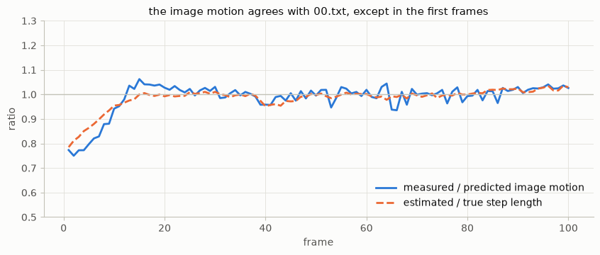

# Chapter 9 · Visual odometry

**Sources**
- Class 9 lecture, *Visual Odometry*: [31392-PAS-17-Visual_Odometry2025_split.pdf](../Class_9_visual_odom/31392-PAS-17-Visual_Odometry2025_split.pdf), cited as **L9 s.N** (slide N = PDF page N).
- [Exercise 1](../Class_9_visual_odom/Day%2017%20Exercises/Exercise%201.ipynb) and the [Weekly Project](../Class_9_weekly_project/Day%2018%20weekly%20project/weekly%20project.ipynb).
- Functions and terms: [reference.md](reference.md). This chapter builds on [optical flow in chapter 2](02_feature_detection.md#optical-flow), the [camera model and the essential matrix in chapter 4](04_calibration_and_epipolar.md), and [ICP and Kabsch in chapter 5](05_point_cloud_registration.md).

**Contents**
1. [What visual odometry is](#what-visual-odometry-is)
2. [Orientation](#orientation)
3. [Tracking motion in the image](#tracking-motion-in-the-image)
4. [Relative pose from 3-D to 3-D](#relative-pose-from-3-d-to-3-d)
5. [Relative pose from 3-D to 2-D: PnP](#relative-pose-from-3-d-to-2-d-pnp)
6. [Relative pose from 2-D to 2-D](#relative-pose-from-2-d-to-2-d)
7. [Comparing the three variants](#comparing-the-three-variants)
8. [Drift and bundle adjustment](#drift-and-bundle-adjustment)
9. [Visual-inertial odometry](#visual-inertial-odometry)
10. [Exercise 1: 3-D to 2-D visual odometry](#exercise-1-3-d-to-2-d-visual-odometry)
11. [Weekly Project: stereo visual odometry](#weekly-project-stereo-visual-odometry)
12. [When it fails](#when-it-fails)
13. [Key takeaways](#key-takeaways)

---

## What visual odometry is

**Visual odometry (VO)** uses cameras to estimate the pose (position and orientation) of a mobile system, by observing the apparent motion of the static world (L9 s.4). It assumes a static world in which only the mobile system moves. It was proposed as an alternative to wheel odometry, and its accuracy over reasonable trajectories is about 1 %. Its estimates are usually combined with other sensors: GPS, IMU, laser or wheel odometry (L9 s.5).

It is related to, but not the same as, two other problems (L9 s.4, 6):

| Problem | Estimates | Uses |
|---|---|---|
| **Visual odometry** | the poses over time | consecutive frames; it builds no map, and doesn't use earlier states to improve accuracy |
| **Structure from motion** | the poses and the 3-D points $\mathbf{X}_p$ | calibrated projections of all points in all frames, satisfying $(x_p^f, y_p^f) = \pi(R^f \mathbf{X}_p + t^f)$ |
| **Visual SLAM** | the poses and a map | state estimation, with re-observations of the same areas (loop closures) to optimise the localization |

**The three variants** of VO depend on what is known in each frame (L9 s.7):

| Variant | Frame k−1 | Frame k | Section |
|---|---|---|---|
| 3-D to 3-D | 3-D points | 3-D points | [below](#relative-pose-from-3-d-to-3-d) |
| 3-D to 2-D | 3-D points | 2-D image points | [PnP](#relative-pose-from-3-d-to-2-d-pnp), used in the exercise and the weekly project |
| 2-D to 2-D | 2-D image points | 2-D image points | [essential matrix](#relative-pose-from-2-d-to-2-d) |

---

## Orientation

A pose contains a rotation, and there are several ways to write one down (L9 s.8):

| Representation | Numbers | Advantages | Disadvantages |
|---|---|---|---|
| **Rotation matrix** | 9 | unique; no gimbal lock | no perturbation or interpolation; unintuitive |
| **Euler angles** | 3 | minimal; intuitive | gimbal lock; not commutative |
| **Axis-angle** | 3 | no gimbal lock; minimal; good for perturbation; a direct mapping to the rotation matrix | not linear when scaling the magnitude |
| **Quaternions** | 4 | as axis-angle, plus smooth trajectories | no direct geometric picture |

- **Not commutative:** the order of rotations matters. Rotating 90° about x and then 90° about z is not the same as the reverse.
- **Gimbal lock:** with Euler angles, at certain poses two rotation axes line up, and one degree of freedom is lost.
- **Axis-angle** is a 3-vector whose direction is the rotation axis and whose length is the angle in radians. This is the `rvec` of OpenCV. The inverse rotation has the same axis and the opposite angle, so it is simply −`rvec`. `cv2.Rodrigues` converts `rvec` to the rotation matrix R.

---

## Tracking motion in the image

Points have to be followed from frame to frame. There are two main approaches (L9 s.9):

- **Feature based.** Compute features in both images and match them ([chapter 2](02_feature_detection.md#matching)). Or compute features, and then do block matching around the initial point when the motion is small.
- **Optical flow.** Estimate the apparent motion directly.

**Optical flow** (L9 s.10–12), as in [chapter 2](02_feature_detection.md#optical-flow), starts from a pixel keeping its brightness when it moves a small distance, and expands that to first order:

$$I(x, y, t) = I(x + dx, y + dy, t + dt) \quad\Rightarrow\quad I_x u + I_y v + I_t = 0$$

One equation with two unknowns is a line in the (u, v) plane, so the problem is under-defined. **Lucas–Kanade** assumes a constant velocity in a neighbourhood: a 5 × 5 window gives 25 equations per pixel. This does not work on edges or in large flat areas, where the equations don't fix both u and v, and the motion must be small. An iterative approach handles larger motion: estimate the motion, warp the image, and repeat until nothing changes. The exercise uses the pyramid version.

---

## Relative pose from 3-D to 3-D

Both frames are given as 3-D points, as from a stereo or RGB-D camera (L9 s.14). This is the 3-D registration of [chapter 5](05_point_cloud_registration.md): PCA, SVD with RANSAC, ICP, or a combination of them. With correspondences, a rigid transformation fitted by RANSAC from 3 points minimises

$$\sum_i \left\| \mathbf{X}_i^{k-1} - (R\,\mathbf{X}_i^{k} + t) \right\|^2$$

---

## Relative pose from 3-D to 2-D: PnP

Frame k−1 is given as 3-D points, and frame k as 2-D image coordinates (L9 s.15). This is the **Perspective-n-Point (PnP)** problem. Given n 3-D points $\mathbf{P}_i$ and their projections $\mathbf{q}_i = (u_i, v_i)^T$, find $R$ and $t$ such that

$$\lambda_i \begin{bmatrix} u_i \\ v_i \\ 1 \end{bmatrix} = K\,(R\,\mathbf{P}_i + t)$$

where K is the known camera matrix and λᵢ > 0 is a scale factor (the depth).

**P3P**, a popular implementation, uses 3 points. Let O be the centre of perspective, and P₁, P₂, P₃ the "control points", at unknown distances s₁, s₂, s₃ from O. The angles α, β, γ between the viewing rays follow from the image points and K, and the distances a, b, c between the points are known. The cosine law gives

$$s_2^2 + s_3^2 - 2 s_2 s_3\cos\alpha = a^2,\qquad s_1^2 + s_3^2 - 2 s_1 s_3\cos\beta = b^2,\qquad s_1^2 + s_2^2 - 2 s_1 s_2\cos\gamma = c^2$$

These reduce to 2 quadratic equations with 2 unknowns, which give up to 4 solutions for R and t. RANSAC finds the correct one, or a 4th point checks them. Once the depths are known, the problem becomes 3-D to 3-D. Other methods exist; **EPnP** (n ≥ 4) reformulates the problem with virtual control points.

---

## Relative pose from 2-D to 2-D

Both frames are given as 2-D image coordinates (L9 s.16–18). The relation is the [essential matrix of chapter 4](04_calibration_and_epipolar.md#the-essential-matrix), E = [t]× R. The minimal solution uses **5 point correspondences**, and the solution minimises the reprojection error of the corresponding points. The slide asks why 5 and leaves it open. The reason: a pose has 6 degrees of freedom, but the scale of t can't be observed from two images, which leaves 3 for the rotation and 2 for the direction of t.

**The scale problem** (L9 s.18). E is defined only up to scale, so t is too: the direction of the motion is known, but not its length. The length has to come from somewhere else, such as a known distance between frames, known 3-D points, or another sensor.

This can be measured on the exercise's images. The table compares each 2-D to 2-D step (`cv2.findEssentialMat` and `cv2.recoverPose`, used here only for this book) with the PnP step from the exercise:

| Frames | 2-D to 2-D translation length | PnP step length | Angle between the two directions |
|---|---|---|---|
| 1 to 2 | 1.000 | 0.677 | 0.99° |
| 2 to 3 | 1.000 | 0.702 | 1.14° |
| 3 to 4 | 1.000 | 0.723 | 0.09° |
| 4 to 5 | 1.000 | 0.734 | 1.61° |

The direction agrees to within about 1.6°, but the 2-D to 2-D length is always exactly 1: the real length is simply not in the data. PnP gets it from the 3-D landmarks.

---

## Comparing the three variants

The slides ask three questions (L9 s.22) and give no answers in their text. The answers below were written for this book.

**Why are 2-D to 2-D and 3-D to 2-D better than 3-D to 3-D?** 3-D to 3-D minimises distances between triangulated 3-D points. The triangulation error grows quickly with distance (Z² Δd / (fB), [chapter 3](03_stereo_vision.md#depth-from-disparity)), so far points add large errors. The other two minimise the reprojection error in the image, which is what the camera actually measures, with about the same noise for near and far points.

**Why is stereo VO better even with 2-D to 2-D?** A stereo pair has a known baseline, so the scale can be recovered in every frame, and an error in scale doesn't accumulate. Points can also be triangulated within one time step, so the camera doesn't have to move first.

**How can VO be improved?** With bundle adjustment and other sensors, as in the next two sections.

---

## Drift and bundle adjustment

**What happens over time** (L9 s.24). VO accumulates the transformation $T_k$ from each frame to the next, which gives the whole trajectory:

$$C_n = T_n T_{n-1} \cdots T_1 C_0$$

Each $T_k$ has a small error, and each pose is built on the previous one, so the errors accumulate. An error in rotation is especially harmful, because it turns all of the later path.


*Fig. 1. A simulation with 1 % error in each step's length and 0.05° in each step's rotation. The median error is 0.11 after 35 units of path, 0.37 after 105, and 1.01 after 210: it grows faster than the path. The [weekly project](#weekly-project-stereo-visual-odometry) measures this on real footage.*

**Windowed bundle adjustment** (L9 s.25) optimises over several frames. It is like pose optimisation, but it also optimises the 3-D points:

$$\min_{C_k,\,\mathbf{X}_i} \sum_{k,i} \left\| \mathbf{p}_i^k - \pi(C_{k-1} \mathbf{X}_i) \right\|^2$$

Levenberg–Marquardt can be used to solve it, the same method that refines the [calibration in chapter 4](04_calibration_and_epipolar.md#calibration-with-a-planar-pattern). So as not to get stuck in a local minimum, the starting values must be close to the minimum, and that is what the frame-to-frame VO provides.

---

## Visual-inertial odometry

Other sensors can improve the accuracy: an IMU, a compass, GPS or a laser (L9 s.26).

**Visual-inertial odometry (VIO)** estimates the state (pose and velocity) from one or more cameras and one or more IMUs (L9 s.27). The two complement each other: cameras are slow and information rich; IMUs are fast but very noisy.

**Why an IMU gives the absolute scale** (L9 s.26, 28). A single moving camera measures the 3-D geometry and the motion only up to an unknown scale, since project(p) = project(s·p) for any scale s and point p. An IMU measures accelerations in real units, and it makes gravity observable, so metric scale and the direction of gravity can be recovered.

**The state of the filter** (L9 s.28) holds the 6-DoF pose of the IMU, its velocity, and the biases of the accelerometer and the gyroscope. The filter is of the [Kalman type from chapter 7](07_state_estimation.md#nonlinear-models-ekf-and-ukf), in one of two forms, depending on how the visual information is integrated (L9 s.27, 29). The slide text names the two and lists the examples; the definitions in the table are the usual ones:

| | Loosely coupled | Tightly coupled |
|---|---|---|
| Vision enters as | an already estimated pose, as one more measurement | the image measurements themselves, in the same estimator as the IMU |
| Examples | VINS-Mono, SVO+MSF | MSCKF, OKVIS, ROVIO |

---

## Exercise 1: 3-D to 2-D visual odometry

The exercise follows Algorithm 3 of the notebook, VO from 3-D to 2-D correspondences:

1. Once: capture two frames, extract and match features, and triangulate them.
2. At each iteration:
   1. capture a new frame;
   2. extract features and match them with the previous frame;
   3. compute the camera pose with PnP from the 3-D to 2-D matches;
   4. triangulate all new feature matches between the two frames;
   5. iterate.

The files already contain steps 1, 2.1 and 2.4: six images and, for each step, the 3-D landmarks with their 2-D positions in the previous image. The exercise is steps 2.2 and 2.3.


*Fig. 2. Top view of the landmarks and the five estimated camera positions. Landmarks with z above 60 or |x| above 40 are left out. Half of all landmarks have z below 23, and the path itself is under 3 units long.*

**1a: tracking.** Lucas–Kanade on a pyramid, `cv2.calcOpticalFlowPyrLK`, was used to find the points of the previous image in the next one.

```python
next_points, status, _ = cv2.calcOpticalFlowPyrLK(prev_img, next_img, prev_points, None, **params)

found = status.ravel() == 1
world_points = world_points[found]
prev_points = prev_points[found]
next_points = next_points[found]
```

The same mask is applied to all three arrays, because the i-th world point must stay paired with the i-th image point. Between 4 and 42 of about 600 points are lost in each step. Without this filter the estimated position changes by up to 0.023.


*Fig. 3. Frame 3: each line shows how far a tracked point moved since frame 2 (10 px on average). Of the 573 tracked points, 554 are inliers of the PnP step and 19 are outliers.*

**1b: the pose.** PnP inside RANSAC, `cv2.solvePnPRansac`, was used to obtain the pose from the 3-D landmarks and the tracked 2-D points.

```python
_, rvec, tvec, inliers = cv2.solvePnPRansac(landmark_3D, tracked_2Dpoints, K, None)

R, _ = cv2.Rodrigues(rvec)      # axis-angle -> rotation matrix
tvec = -R.T @ tvec              # position of the camera in the world
rvec = -rvec                    # orientation of the camera in the world: the inverse rotation
```

The result maps a world point into the camera: $X_c = R X_w + t$. The camera centre is where $X_c = 0$, so $C = -R^\top t$. `None` means no lens distortion. A point is an inlier if it reprojects within 8 px, the default.


*Fig. 4. Left: in step 3, almost all points lie well under the threshold (inliers: mean 0.76 px; outliers: median 13 px). Right: a share of the image points was replaced by random positions, measured for this book only. The error is the distance from the position that RANSAC gives on the unchanged data. PnP on all points is already 0.32 away without any change, and about 37 away with 10 % wrong matches. PnP with RANSAC stays near 0.01 up to 60 % wrong matches, and reaches 0.53 at 70 %.*

| Step | Points | Tracked | Inliers | Mean error of the inliers [px] | Mean motion in the image [px] |
|---|---|---|---|---|---|
| 1 | 631 | 627 | 612 | 0.35 | 0.0 |
| 2 | 621 | 579 | 562 | 0.79 | 12.5 |
| 3 | 602 | 573 | 554 | 0.76 | 10.0 |
| 4 | 625 | 619 | 597 | 0.78 | 12.4 |
| 5 | 666 | 652 | 625 | 0.80 | 15.3 |

Step 1 shows no motion because `img_0` and `img_1` are identical images.

**The result, against the notebook's hint.**

| Step | Position x, y, z | Hint | Orientation `rvec` | Hint |
|---|---|---|---|---|
| 1 | −0.00110, −0.00067, −0.00078 | same | 0.00007, 0.00007, −0.00010 | opposite sign |
| 2 | −0.00364, −0.00875, 0.67581 | same | 0.00217, −0.00326, 0.00244 | opposite sign |
| 3 | −0.01096, −0.01636, 1.37741 | same | 0.00365, −0.00752, 0.00100 | opposite sign |
| 4 | −0.03157, −0.02560, 2.09968 | same | 0.00510, −0.01122, 0.00083 | opposite sign |
| 5 | −0.04972, −0.03533, 2.83301 | same | 0.00561, −0.01613, −0.00042 | opposite sign |

The positions agree with the hint to within 0.000001. The rotations have the same size and the opposite sign: the hint prints the `rvec` of `solvePnPRansac` unchanged, which is the rotation from world to camera, while the exercise asks for the world frame, and that is its inverse. Deleting `rvec = -rvec` reproduces the hint exactly. OpenCV's RANSAC gave the same numbers in 6 repeated runs.

**1c: the direction.** The difference between the last and the first position gives the direction.


*Fig. 5. Cell 1c: the camera position, from above, with equal axes.*

The camera moved almost straight along +z: 2.83 units in z, against −0.05 in x and −0.04 in y, which is 1.2° from the z axis. In the camera convention z points forward, x right and y down, so it moved straight ahead, with a very slight drift to the left and up. It turned about 1° in total. The estimated steps are 0.68, 0.70, 0.72 and 0.73 per frame, and the [weekly project](#weekly-project-stereo-visual-odometry) compares these same frames with the true poses.

---

## Weekly Project: stereo visual odometry

**The task:** complete Algorithm 3 on 101 stereo frames, and compare the path with the true poses in `00.txt`. Here all the steps are implemented, including the ones the exercise's files provided. The first frames are the exercise's images, and the units are metres.

**The method.** Each step uses a method from an earlier section or chapter:

| Algorithm 3 | Method | Function |
|---|---|---|
| 1.1–1.3: first 3-D points | SIFT and the [ratio test](02_feature_detection.md#matching) between left and right, then triangulation | `SIFT_create`, `knnMatch`, `triangulatePoints` |
| 2.2: follow the points | [Lucas–Kanade](#tracking-motion-in-the-image) on a pyramid | `calcOpticalFlowPyrLK` |
| 2.3: camera pose | [PnP with RANSAC](#relative-pose-from-3-d-to-2-d-pnp) | `solvePnPRansac` |
| 2.4: new 3-D points | the same as 1.1–1.3, on the current stereo pair | `triangulatePoints` |

```python
landmark_3D, reference_2D, tracked_2D = featureTracking(reference_img, curImage, reference_2D, landmark_3D)
_, rvec, tvec, inliers = cv2.solvePnPRansac(landmark_3D, tracked_2D, K, None)

rot, _ = cv2.Rodrigues(rvec)
tvec = -rot.T.dot(tvec)                                     # the camera's position in the world
inv_transform = np.hstack((rot.T, tvec))                    # from camera to world coordinates

landmark_3D_new, reference_2D_new = extract_keypoints_sift(curImage, curImage_R, K, baseline)
```

**Triangulation.** The two cameras differ only by the baseline b = 0.54 m, so their projection matrices are $M_L = K[I \mid 0]$ and $M_R = K[I \mid (-b, 0, 0)^\top]$. `cv2.triangulatePoints` finds the 3-D point that best agrees with both image points, in homogeneous coordinates, so the result is divided by its fourth value.

**Why stereo matters here.** Algorithm 3 triangulates between two frames in time, which leaves the [scale problem](#relative-pose-from-2-d-to-2-d). The left and right images have a known baseline, so every frame's new points come with the real scale.

**World coordinates.** New points are triangulated in the current camera's coordinates, and `inv_transform` moves them to world coordinates. The next PnP then gives a world pose directly. It also means that every new point inherits the error of the current pose, which is how [drift](#drift-and-bundle-adjustment) enters this algorithm.

**The result.**

| Measure | Value |
|---|---|
| Length of the true path | 84.6 m |
| Error at the end | 2.11 m, 2.49 % of the path |
| Largest error | 2.15 m |
| Error at the end along x, y, z | −0.43, 1.45, −1.47 m |
| Rotation error at the end | 1.57° |
| Points per frame: matched, tracked, inliers (median) | 1012, 958, 894 |
| Error at frames 14, 25, 50, 75, 100 | 1.24, 1.31, 1.82, 2.09, 2.11 m |

The lecture gives about 1 % for VO over reasonable trajectories (L9 s.5), so this simple version, with no bundle adjustment, is in the same range but above it.


*Fig. 6. Left: the estimated and true path from above. Middle: the position error. Right: the length of each step.*

**The first frames.** More than half of the final error appears in the first 14 frames. There the estimated steps are 0.68 to 0.8 m, while `00.txt` gives a constant 0.86 m. To find out why, the image motion was compared with what the true pose and the stereo depth predict:

| Frames | Measured / predicted image motion | Estimated / true step |
|---|---|---|
| 1–5 | 0.77 | 0.83 |
| 6–14 | 0.94 | 0.95 |
| 15–30 | 1.03 | 1.00 |
| 31–100 | 1.00 | 1.00 |


*Fig. 7. From frame 15 on, the image motion and the step length agree with `00.txt`. Only the first frames differ.*

Tracking isn't the cause: SIFT matches between frames give the same image motion as Lucas–Kanade (a ratio of 0.99 to 1.00 on the 9 frames checked). The same depth pipeline gives the right step later on, so the scale is right. So in those first frames the images show less motion than `00.txt` says. Whether the cause is in the images or in `00.txt` isn't established, and from frame 12 on the error is 1.44 m over 74.2 m, or 1.9 %.

**What matters.** These variants were measured for this book:

| Variant | Error at the end | Largest error | Rotation at the end | Median inliers |
|---|---|---|---|---|
| Ratio 0.6 | 2.12 m | 2.15 m | 1.33° | 717 |
| Ratio 0.7 | 2.11 m | 2.15 m | 1.48° | 840 |
| **Ratio 0.75 (used)** | 2.11 m | 2.15 m | 1.57° | 894 |
| Ratio 0.8 | 2.10 m | 2.15 m | 1.71° | 942 |
| Ratio 0.9 | 2.27 m | 2.30 m | 1.68° | 1028 |
| No filter on `status` | 2.15 m | 2.22 m | 1.46° | 900 |
| **PnP without RANSAC** | **32.39 m** | 32.39 m | 26.66° | all points |

RANSAC is the one step the algorithm can't do without, and the ratio hardly matters from 0.6 to 0.8. About 1 % of the matches have an impossible negative disparity, and RANSAC handles those too: removing them doesn't lower the error.

The project's challenge, keeping old features across frames, and the larger dataset are not done.

---

## When it fails

The last column says whether the notebook actually applies the fix.

| Problem | Where | Cause | Fix | Applied in the notebook? |
|---|---|---|---|---|
| Pose far off (about 37 units at 10 % wrong matches) | PnP on all points | a least-squares fit trusts every match | RANSAC | **yes** |
| Wrong pairing of 3-D and 2-D points | tracking | lost points removed from only some arrays | the same mask on all three arrays | **yes** |
| Position off by up to 0.023 | tracking | lost points (`status` 0) kept | keep only `status == 1` | **yes** |
| Position is not the camera's | direct use of `tvec` | `tvec` is the world origin in camera coordinates | C = −Rᵀt | **yes** |
| Rotation sign differs from the hint | `rvec` | the hint prints world-to-camera | use −`rvec` for the world frame | **yes**: delete the line to match the hint |
| Motion too large for the tracker | fast motion, small window | Lucas–Kanade assumes small motion | pyramid levels (`maxLevel=3`) | **yes** |
| Tracking fails on edges and flat areas | Lucas–Kanade | the equations don't fix u and v | track corners | **yes** in the weekly project, with SIFT keypoints; in the exercise the points are given |
| Moving objects disturb the pose | scene | VO assumes a static world | RANSAC rejects them as long as they're a minority | **partly**: RANSAC is used; nothing else handles this |
| Motion length unknown | 2-D to 2-D | E is defined only up to scale | known 3-D points, stereo, or an IMU | **yes**: 3-D points in the exercise, stereo in the weekly project |
| Far points add errors | 3-D to 3-D | triangulation error grows with depth | minimise reprojection error instead | **yes**: PnP does |
| The path slowly drifts | any VO | errors accumulate along the chain | bundle adjustment; other sensors | **no**: 2.5 % after 100 frames in the weekly project |
| 32 m off after 85 m | weekly project, PnP on all points | wrong matches | RANSAC | **yes**: 2.11 m |
| `int(tvec[0])` raises a `TypeError` | weekly project template | newer NumPy doesn't convert a one-element array | `tvec[0, 0]` | **yes** |
| Steps up to 21 % shorter than `00.txt` | weekly project, frames 1–14 | not established: the tracking agrees, and later frames match | none known | **no** |

---

## Key takeaways

- **VO estimates the pose over time from the apparent motion of a static world.** Unlike structure from motion or visual SLAM, it estimates no full structure or map, and doesn't use re-observations.
- **Three variants:** 3-D to 3-D (registration, 3 points), 3-D to 2-D (PnP, P3P), and 2-D to 2-D (essential matrix, 5 points).
- **Axis-angle** is `rvec`: its direction is the axis and its length the angle; the inverse is −`rvec`. Euler angles have gimbal lock, and rotations don't commute.
- **PnP:** λ(u, v, 1)ᵀ = K(RP + t). The result maps world to camera, so the camera's position is C = −Rᵀt.
- **Use RANSAC.** One tenth wrong matches ruin plain PnP, while RANSAC is hardly affected up to 60 %.
- **2-D to 2-D has no scale**: only the direction of t can be recovered. PnP gets the scale from its 3-D points, and VIO from the IMU.
- **Errors accumulate** along C_n = T_n … T_1 C_0, and bundle adjustment reduces them by optimising poses and points over several frames.
- **Stereo gives the scale in every frame,** so the weekly project ends 2.11 m off after 84.6 m, without bundle adjustment.
- **RANSAC is the essential step:** without it, that error is 32 m. The ratio of the ratio test hardly matters.
- **Compare with ground truth frame by frame:** a total error doesn't show that most of it arises in the first 14 frames.
- **VIO combines** a slow, information-rich camera with a fast, noisy IMU, either loosely (pose as a measurement) or tightly (image measurements in the same estimator).
