# Chapter 10 · Final project: tracking the Husky

**Sources**
- [Project description](../Final_project/Final%20Project%20Description%20-%20Copy.pdf).
- [Final Project.ipynb](../Final_project/Final%20Project.ipynb): the solution, with its outputs saved.
- [Approach tests.ipynb](../Final_project/Approach%20tests.ipynb): the comparisons behind each choice, with its outputs saved.
- [The video](../Final_project/results/husky_tracking.mp4) and the other results in [results/](../Final_project/results/): tracks as CSV files, and point clouds as PLY files.
- Functions and terms: [reference.md](reference.md).

This chapter records the approaches, tests and results. It is material for the report, not the report itself.

**Contents**
1. [The task](#the-task)
2. [The solution at a glance](#the-solution-at-a-glance)
3. [Calibration and rectification](#calibration-and-rectification)
4. [Disparity and the 3-D scene](#disparity-and-the-3-d-scene)
5. [Detecting the robot](#detecting-the-robot)
6. [Tracking in 2-D and 3-D](#tracking-in-2-d-and-3-d)
7. [Tests without ground truth](#tests-without-ground-truth)
8. [The cornerSubPix decision](#the-cornersubpix-decision)
9. [When it fails](#when-it-fails)
10. [Discussion and limitations](#discussion-and-limitations)
11. [Key takeaways](#key-takeaways)

---

## The task

A Husky A200 robot is filmed by two fixed cameras in a large arena. The task is to calibrate the cameras and to track the robot in 2-D and 3-D, also while it is completely hidden.

| Data | Frames | What happens |
|---|---|---|
| `0_calib` | 37 pairs | a calibration board on a tripod |
| `1_no_obstacle` | 256 pairs | constant speed and distance, no occlusion |
| `2_obstacle` | 291 pairs | constant speed and distance, passes behind a large white board |
| `3_curved_bend` | 397 pairs | a curved path, with the distance changing |
| `4_circle` | 650 pairs | a circular path, with the distance changing |

All images are 1280 × 720 PNG files, raw and unrectified. The project also asks for a report of 10 ± 2 pages with a Discussion and Limitations section, and a short video. It expects course methods; deep learning may only complement them, and none is used here.

**What the data gives away.** Three numeric checks on the first frames shaped the whole solution:
- **The cameras don't move.** The mean difference from a sequence's median image is about 1 gray level, and only 0.1 to 0.6 % of the pixels change by more than 30. So background subtraction can work.
- **The raw rows don't match.** Matching points in the left and right image differ by a median of 17.8 rows, so rectification is essential.
- **The file times suggest about 3 frames per second:** 256 frames span 83 s, and 650 frames span 221 s. This assumes the files were written as the images were captured, so all speeds below are per frame.

---

## The solution at a glance

| Goal | Method | Class |
|---|---|---|
| Calibrate and rectify | chessboard corners, RANSAC with a homography, `calibrateCamera`, `stereoCalibrate`, `stereoRectify`, `remap` | 2, 4 |
| Disparity and 3-D scene | `StereoBM`, `reprojectImageTo3D`, RANSAC for the floor plane | 3, 6 |
| Detect the robot | background subtraction, threshold, erosion and dilation, contours, a size check in metres from stereo | 1, 3 |
| Track, also through occlusions | constant-velocity Kalman filter in 2-D and 3-D, with a Mahalanobis gate | 7 |
| Check the results | RANSAC line, least-squares circle, floor plane, hidden detections | 6 |

**The results:**

| Result | Value |
|---|---|
| Stereo reprojection error | 0.43 px |
| Row difference of scene matches, raw → rectified | median 17.8 → 0.6 px; 90 % 18.9 → 1.8 px |
| Boxes checked by eye on a random sample | 29 of 30 are the robot; the other is rejected by the size check |
| Sequence 1: straightness over 6.5 m | 0.055 m from a line |
| Sequence 2: straightness over 7.9 m | 0.109 m from a line |
| Sequence 2: after about 60 frames behind the board | prediction off by 64 px, or 0.40 m |
| Sequence 4: circle fit | radius 4.42 m, residual 0.41 m |
| Robot's measured length, against the published 0.99 m | 0.956 m, 3.4 % short |
| Video | all 4 sequences, 1,594 frames, 39 MB |

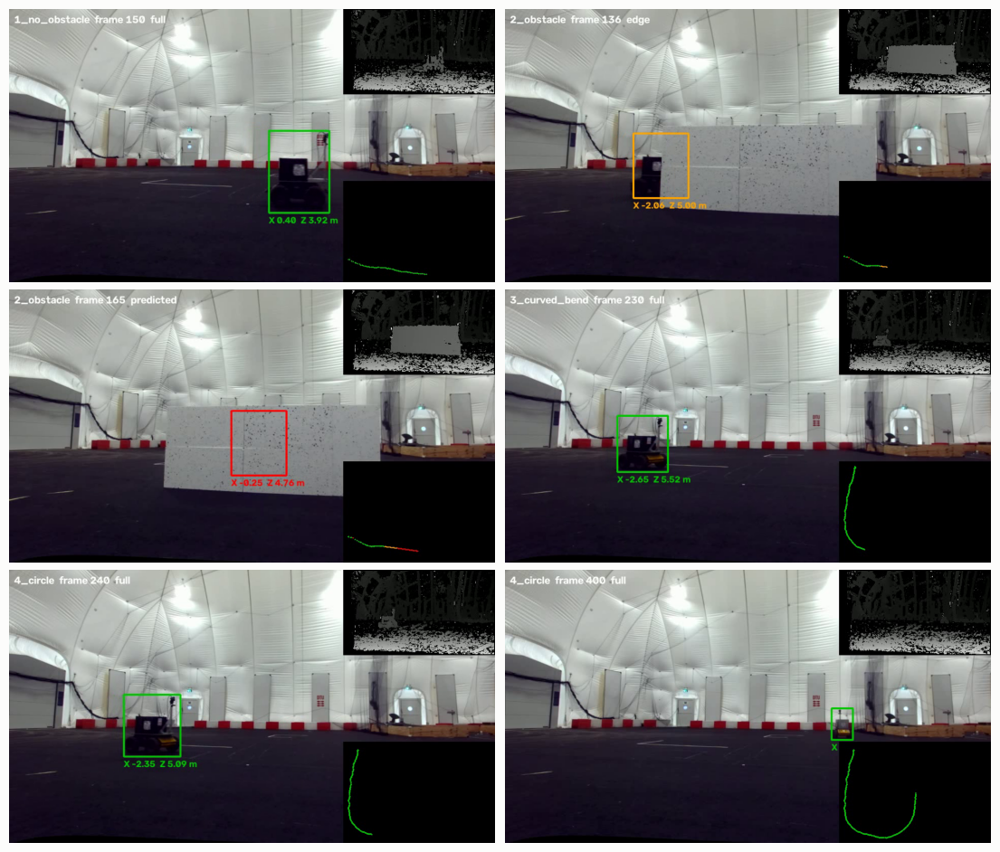
*Fig. 1. Frames from the video. The box is green when measured, orange when only an edge is visible, and red when predicted; the robot in the third frame is completely behind the board. The upper inset is the disparity map, and the lower one the track from above.*

---

## Calibration and rectification

**The approach.** `cv2.findChessboardCorners` was used to find the corners, `cv2.calibrateCamera` to get each camera's K and distortion, `cv2.stereoCalibrate` to get the pose between the cameras, and `cv2.stereoRectify` with `cv2.initUndistortRectifyMap` to get the rectifying maps. This is the route of [Weekly Project 4](04_calibration_and_epipolar.md). Three problems had to be solved along the way.

**The board's size in the image.** The pattern has (7, 5) inner corners: (8, 5) and (7, 6) are found in no image, while smaller patterns are found only now and then, on part of the board. The board is small, with 10 to 50 px between corners, so it is found in only 15 left and 16 right images. Trying each image at scales from 1 to 3 with `cv2.resize` raises that to 23 and 21, and to 19 usable pairs.

**Wrong corners.** The first calibration was poor: 2.3 px stereo error, and 19 px row differences at the 90th percentile. Fitting one homography per view showed the cause: most corners fit within 1 px, but a few are off by 5 to 8 px, mostly along the outer rows. RANSAC with a homography removes them, because a planar board's corners must all agree with one homography. This removed 78 of the 665 corners in the stereo views, and it is the most important step of the calibration.

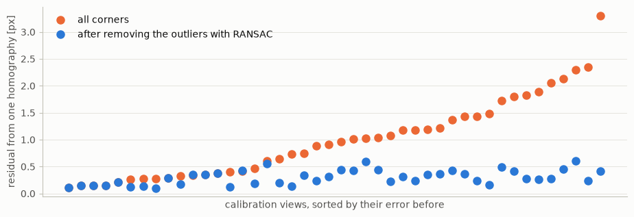
*Fig. 2. Each view's residual from one homography. The median falls from 0.94 to 0.28 px, and the maximum from 3.31 to 0.61 px.*

**The corner order.** The board has 8 × 6 squares, so it looks the same after a turn of 180°, and the corner list may start at either end. Each list is therefore put in the same left-to-right order.

**The test that matters.** A low reprojection error only says that the model fits the board. So each variant is also scored on the real scene: SIFT with the ratio test ([chapter 2](02_feature_detection.md#matching)) matches points between the rectified left and right frames, and these should lie on the same row. A negative disparity is physically impossible, so the share of those is a second score.

| Variant | Stereo views | Reprojection L / R / stereo [px] | Scene rows: median / 90 % [px] | Negative disparity |
|---|---|---|---|---|
| One scale | 14 | 1.69 / 1.23 / 2.38 | 4.63 / 13.36 | 42.4 % |
| Several scales | 20 | 1.42 / 1.11 / 2.32 | 3.60 / 19.37 | 41.9 % |
| Several scales, `cornerSubPix` | 20 | 1.27 / 1.02 / 2.19 | 2.81 / 18.06 | 18.3 % |
| **Several scales, RANSAC (used)** | 19 | 0.34 / 0.28 / 0.43 | **0.61 / 1.82** | 2.0 % |
| Several scales, `cornerSubPix`, RANSAC | 20 | 0.14 / 0.14 / 0.30 | 0.47 / 1.84 | 1.4 % |
| Used, k₃ fixed at 0 | 19 | 0.35 / 0.30 / 0.56 | 1.47 / 2.93 | 6.3 % |
| Used, k₃ and tangential fixed at 0 | 19 | 0.36 / 0.30 / 0.69 | 1.07 / 4.53 | 10.1 % |
| Used, only k₁ | 19 | 0.36 / 0.31 / 1.13 | 1.75 / 6.68 | 14.2 % |

Simpler distortion models fit the board almost as well but are clearly worse on the scene, so the full 5-parameter model stays. The result: focal lengths of 620.0 and 617.2 px, a baseline of 1.53 squares (12.2 cm), and a rotation of (−0.53°, −0.37°, −0.04°) between the cameras.

**How much of the image to keep.** `alpha` in `cv2.stereoRectify` sets this, and a first choice of 1 caused a strange fault: a second blob at the left edge that moved opposite to the robot. At large `alpha` the output reaches regions where the distortion formula runs backwards, and the map folds over and creates a mirror image. Checking for places where the map runs backwards shows this directly:

| `alpha` | Rectified focal length [px] | Valid pixels, left / right | Folded pixels, left |
|---|---|---|---|
| 0 | 771 | 100 % / 100 % | 0 |
| **0.15 (used)** | 690 | 99.2 % / 94.0 % | 0 |
| 0.25 | 636 | 94.3 % / 87.0 % | 0.59 % |
| 0.5 | 500 | 82.4 % / 72.9 % | 10.5 % |
| 1 | 228 | 31.3 % / 31.1 % | 16.0 % |

So 0.15 is the largest tested value without folds, and it keeps the most of the view.

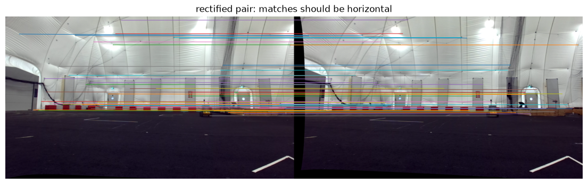
*Fig. 3. A rectified pair with some of the SIFT matches. The lines are horizontal.*

---

## Disparity and the 3-D scene

**The approach.** `cv2.StereoBM_create` was used to compute disparity, with 64 disparities and a block size of 15, and `cv2.reprojectImageTo3D` to turn it into 3-D points with the calibrated Q. The disparity is valid at 66 to 69 % of the pixels. Lowering `numDisparities` from 128 to 64 matters, because the matcher has no result in a left band of that width, where the robot enters.

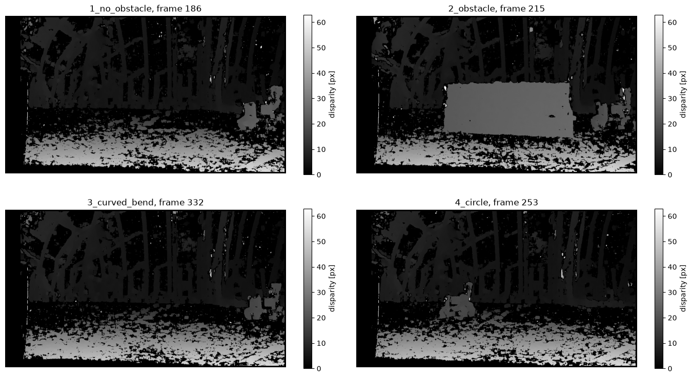
*Fig. 4. The disparity maps, each from the frame where the robot is largest. Near objects are bright. Sequence 2 shows the board at one clear disparity.*

For each sequence, a coloured point cloud of that same frame is written to `results/`, with about 120,000 points. Every second pixel and everything beyond 40 m is left out.

**The empty scene.** The median of 41 frames spread over a sequence removes everything that moves. Disparity on these empty images gives the floor without the robot.

**The floor plane.** `linear_model.RANSACRegressor` was used to fit Y = aX + bZ + c through the points below the horizon. It agrees across the sequences, without using the robot at all: a camera height of 0.76 to 0.79 m, the normal within 0.5° of each other, and 80 to 92 % of the points as inliers. The floor gives a bird's-eye view of the tracks, and an independent test of them.

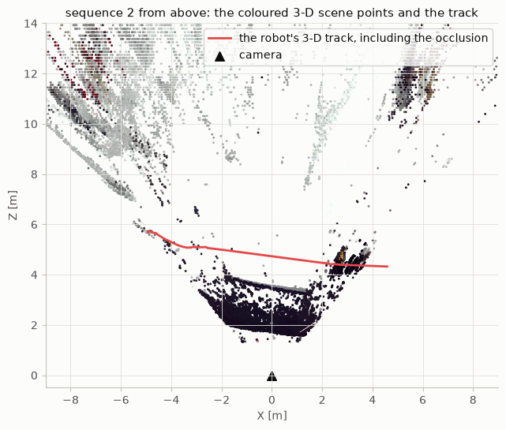
*Fig. 5. Sequence 2 from above: the coloured scene points and the 3-D track. The track passes behind the board, whose points form the arc in front of it.*

---

## Detecting the robot

**The approach.** Background subtraction was used to find what differs from the empty scene. The image is blurred with a 5 × 5 Gaussian, the absolute difference from the background is taken per channel, and the largest channel counts, so a colour change is seen even when the brightness barely changes. A threshold gives a mask, one erosion removes single noisy pixels, and two dilations close small gaps. `cv2.findContours` then gives the blobs.

```python
difference = np.abs(blurred.astype(int) - background.astype(int)).max(axis=2)
mask = (difference > FG_THRESHOLD).astype(np.uint8) * 255
mask = cv2.dilate(cv2.erode(mask, None, iterations=1), None, iterations=2)
```

**Fragments.** The robot's black body on the dark floor can split into pieces, such as the mast and the lower body. Blobs within 30 % of the largest box's size are merged into one box.

**The threshold** is a trade-off, tested on every 5th frame. The last column compares the largest single blob's box with the merged box at threshold 18:

| Threshold | Frames with a robot-sized blob, of 321 | Blobs per frame | Largest box / merged box: median, lowest 10 % |
|---|---|---|---|
| 8 | 267 | 4.5 | 1.14, 1.08 |
| 12 | 263 | 3.2 | 1.05, 1.02 |
| **18 (used)** | 256 | 2.2 | 1.00, 0.68 |
| 25 | 251 | 2.0 | 0.94, 0.59 |
| 40 | 217 | 2.8 | 0.38, 0.12 |

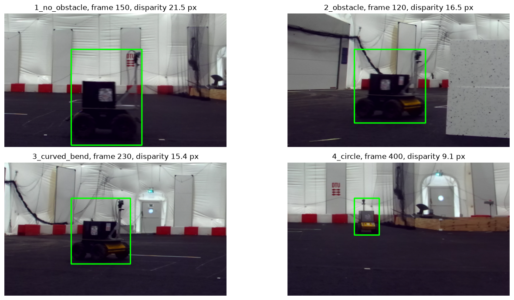
*Fig. 6. Detections in the four sequences, from a near robot to a far one.*

**Checking by eye.** On a random sample of 30 blobs across the sequences, 29 are the robot, with tight boxes. The other is the white floor marking in the first frames of sequence 2. The cause of that blob wasn't investigated, but it is only 0.4 m wide, which the size check below rejects. The track of sequence 2 starts at frame 96.

**The size check.** Stereo gives real size: width in metres = w × B / d. Complete boxes in sequences 1, 3 and 4 are 0.7 to 1.4 m wide and 1.0 to 1.3 m high, including the mast. So a box must be 0.6 to 2.2 m wide and 0.8 to 2.2 m high. This is a use of 3-D that a single camera couldn't offer: the marking above and a small nearby object can look the same size in pixels as the far robot.

**The robot's disparity.** Four methods from the course were compared on every 2nd frame. In sequences 1 and 2 the distance should be nearly constant, so the jitter and the spread of the depth measure the noise. Spread here is the 10-to-90 % range of the depth divided by its median.

| Sequence | Method | Disparity [px] | Frame-to-frame jitter [px] | Spread of depth |
|---|---|---|---|---|
| 1 | **StereoBM, median over the foreground (used)** | 20.8 | **0.06** | **0.15** |
| 1 | Box offset, left against right | 21.0 | 1.00 | 0.31 |
| 1 | `matchTemplate`, sub-pixel | 19.2 | 0.24 | 2.61 |
| 1 | SIFT matches, median | 19.1 | 0.48 | 0.46 |
| 2 | **StereoBM (used)** | 16.6 | **0.12** | **0.20** |
| 2 | Box offset | 16.0 | 1.00 | 0.39 |
| 2 | `matchTemplate` | 9.4 | 0.49 | 1.22 |
| 2 | SIFT | 15.3 | 0.48 | 1.90 |
| 4 | **StereoBM (used)** | 7.9 | **0.06** | 0.81 |
| 4 | Box offset | 8.0 | 0.50 | 0.83 |
| 4 | `matchTemplate` | 7.7 | 0.08 | 0.79 |
| 4 | SIFT | 7.8 | 0.09 | 0.79 |

The spread in sequence 4 is the real change in distance. Template and SIFT matching produce large outliers. The likely reason is that their boxes contain background at another disparity, which the median over the foreground pixels avoids.

**Other detectors.** Three simple alternatives were compared with the background subtraction on every 5th frame. A hit means the box centre lies inside the reference box; a good box means an IoU of at least 0.5.

| Detector | Hit: all | Sequences 1 / 2 / 3 / 4 | Good box | False alarms |
|---|---|---|---|---|
| **Background subtraction** | reference | | | |
| Colour: yellow, H 15–35 | 15 % | 15 / 18 / 6 / 19 % | 0 % | 5 of 64 |
| Frame difference | 63 % | 100 / 100 / 64 / 53 % | 0.9 % | 3 of 64 |
| Farnebäck optical flow | 58 % | 100 / 100 / 59 / 48 % | 44 % | 8 of 64 |

Colour fails because only 38 % of the robot's saturated pixels are yellow, and the panels are often out of view. The motion methods find the robot only when it moves enough between frames, which is why the far, slow robot of sequences 3 and 4 is often missed. They also only see its moving edges, which gives poor boxes.

**A classifier from Class 8.** A sliding window with PCA and an SVM doesn't depend on motion at all. It was trained on three sequences, with the main detector's boxes as positives and random crops as negatives, and tested on the fourth, on every 10th frame. Windows of six sizes are resized to 40 × 40 pixels, reduced to 40 PCA components (about 95 % of the variance), and scored by an RBF SVM, and non-maximum suppression removes duplicates.

| Tested on | Hit | Good box | Other boxes per frame | False alarms |
|---|---|---|---|---|
| Sequence 2 | 83 % | 33 % | 1.2 | 9 of 16 |
| Sequence 4 | 46 % | 42 % | 3.5 | no empty frames |

This is far weaker than background subtraction here, and the numbers are rough, because there are only a few dozen test frames. It would still be the natural second detector for a robot that stops. The lecture pairs the SVM with HOG features, but this test uses plain pixels, because no course template shows HOG.

---

## Tracking in 2-D and 3-D

**The approach.** A [Kalman filter](07_state_estimation.md) with a constant-velocity model was used to follow the robot and to predict it when it can't be seen. The same code runs in 2-D, on the image position, and in 3-D, on the position from stereo.

$$x_{k+1} = F x_k,\qquad F = \begin{bmatrix} I & I \\ 0 & I \end{bmatrix},\qquad Q = G G^\top \sigma_a^2,\qquad G = \begin{bmatrix} \tfrac12 I \\ I \end{bmatrix}$$

**What is tracked.** The tracked point is the bottom centre of the box, where the wheels meet the floor. The top of the box jumps when the mast is hidden, but the bottom stays stable.

**Measurement noise.** Depth noise grows with the square of the distance (Z² Δd / fB, [chapter 3](03_stereo_vision.md#depth-from-disparity)), so the 3-D filter sets R per frame: 2 px sideways and 0.3 px in disparity.

**Three kinds of frame.** A frame contributes in one of three ways:

| Frame | Condition | What it updates |
|---|---|---|
| **Full box** | not touching the valid image's edge, a plausible size in metres, at least 85 % of the usual width, inside the gate | the whole position |
| **Cut-off box** | hidden in part by the board or the image's edge, and near the predicted row | only the sideways position, from the visible edge plus half the usual width |
| **No box** | nothing, or nothing plausible | nothing: the filter only predicts |

The gate is a squared Mahalanobis distance of 13.8 (99.9 % for 2 degrees of freedom). If 8 full boxes in a row are rejected, the filter accepts the next one, so it can't stay locked out.

**The visible edge.** This is the idea that helps most during occlusions. As the robot slides behind the board, its box shrinks, and the box's centre moves at half the true speed. That would slow the filter's velocity just before it has to predict. But the edge that isn't hidden still moves at the right speed. Disparity isn't used in these frames, because the pixels near the board are biased towards the board's own disparity.

| Sequence 2: error at the first full box after the board | Without visible edges | With visible edges |
|---|---|---|
| 2-D filter | 205.7 px | 77.1 px |
| 3-D filter | 117.9 px, 0.75 m | **63.6 px, 0.40 m** |

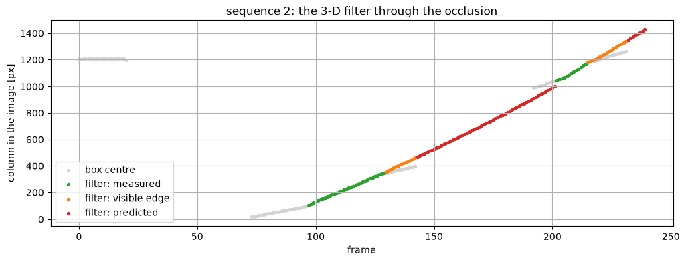
*Fig. 7. Sequence 2: the box centre (gray) leaves the true motion when the robot is partly hidden, which the visible edges (orange) correct. The filter predicts through the occlusion (red), and meets the robot again on the other side. The gray points near frame 15 are the floor marking, which the filter ignores.*

**What each frame contributed:**

| Sequence | Tracked frames | Full | Edge | Predicted | Gated |
|---|---|---|---|---|---|
| 1 | 81–209 | 103 | 18 | 7 | 0 |
| 2 | 96–239 | 45 | 30 | 67 | 1 |
| 3 | 0–359 | 331 | 18 | 10 | 0 |
| 4 | 0–649 | 649 | 0 | 0 | 0 |

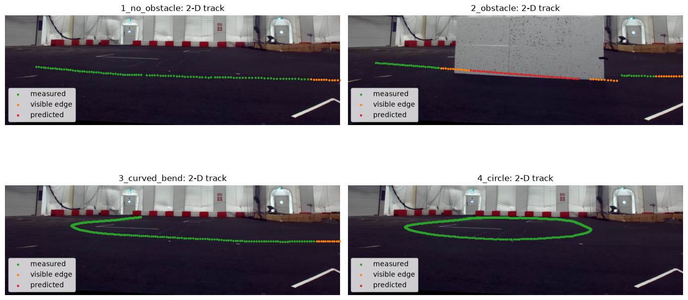
*Fig. 8. The 2-D tracks on the empty scene.*

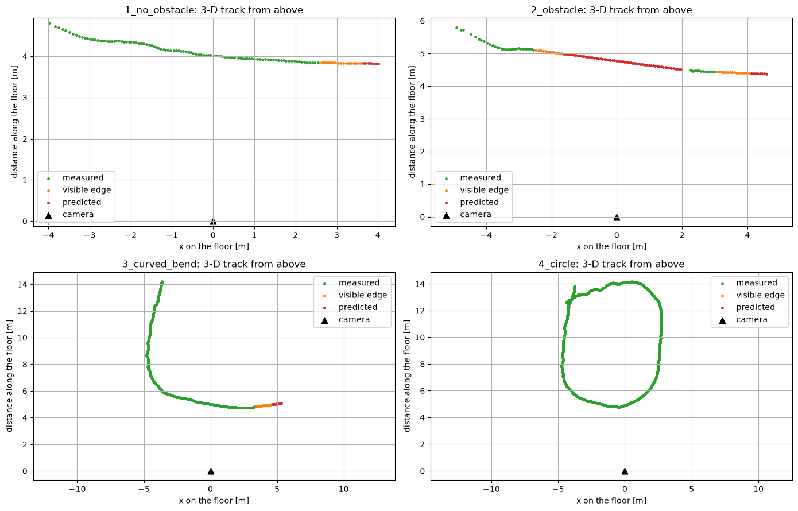
*Fig. 9. The 3-D tracks from above. The projection onto the floor uses the plane fitted without the robot.*

---

## Tests without ground truth

There is no ground truth, so the tests use what the description and the scene guarantee.

**Straight and steady: sequences 1 and 2.** The description says constant speed and constant distance.

| | Path length | Distance from a line | Angle to the image plane | Mean distance | Speed |
|---|---|---|---|---|---|
| Sequence 1 | 6.51 m | 0.055 m | −7.4° | 4.15 m | 0.065 ± 0.011 m per frame |
| Sequence 2 | 7.91 m | 0.109 m | −7.2° | 5.03 m | 0.072 ± 0.022 m per frame |

Both paths are straight to within 1 to 1.5 % of their length. If the frame rate of 3 per second is right, the speed is about 0.2 m/s. The same angle in both suggests a shared cause, and the next section shows that a large part of it comes from the calibration.

**Wheels on the floor.** The bottom of the box should lie on the plane fitted without the robot.

| | Median distance | 10 % to 90 % |
|---|---|---|
| Sequence 1 | −0.105 m | −0.121 to −0.021 m |
| Sequence 2 | −0.071 m | −0.207 to −0.032 m |
| Sequence 3 | −0.058 m | −0.140 to 0.044 m |
| Sequence 4 | −0.044 m | −0.164 to 0.071 m |

The bottom of the box lies 4 to 11 cm below the plane. Two independent 3-D measurements agreeing this closely is a good sign. The systematic part could come from a reflection or shadow under the robot, or from a small depth error; this test can't tell them apart.

**The circle: sequence 4.** Linear least squares ([chapter 6](06_regression_and_clustering.md)) gives a radius of 4.42 m with a residual of 0.41 m. The path spans 7.5 m in X but 9.4 m in Z, so it is about 25 % longer in depth than in width.

**A rigid robot.** The robot's height in pixels must be proportional to its true disparity, so a line through height against measured disparity should pass through zero. It crosses at 1.17 px instead, which suggests that measured disparity may be about 1 px too large.

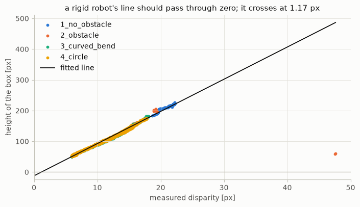
*Fig. 10. Box height against measured disparity for all sequences. The fitted line should pass through the origin.*

Removing that offset was tested, and the evidence conflicts, so **it isn't applied**:

| Offset removed | Robot height at disparity 6–10 / 10–15 / 15–22 | Circle radius, residual | Floor spread, sequence 4 |
|---|---|---|---|
| **0 px (used)** | 1.09 / 1.11 / 1.21 m | 4.42 m, 0.41 m | 0.24 m |
| 0.5 px | 1.16 / 1.15 / 1.24 m | 4.86 m, 0.52 m | 0.28 m |
| 1.0 px | 1.26 / 1.20 / 1.28 m | 5.39 m, 0.66 m | 0.34 m |

The height test gets better, but the circle and floor tests get worse. A disparity of 7 px changes by 14 % with an offset of 1 px, so distant depths carry this uncertainty.

**The metric scale.** The board's squares are 80 × 80 mm, as given by the professor; the project description doesn't state it. All distances in this chapter scale with this one number, and the baseline becomes 12.2 cm. This allows an independent check: the robot is side-on in the middle of sequence 1, where its box is 0.956 m long, only 3.4 % short of the Husky's published 0.99 m.

**Predicting through occlusions.** The real occlusion allows only one comparison, which is the 64 px above. So detections that are known were hidden from the filter for 15, 30 or 60 frames, many times over, and the prediction at the end of each gap was compared with the hidden detection.

| RMS error at the end of the gap [px] | 15 frames | 30 frames | 60 frames |
|---|---|---|---|
| Sequence 1, straight: 2-D filter | 13.0 | 32.9 | 81.2 |
| Sequence 1, straight: **3-D filter** | 17.7 | 26.5 | 74.6 |
| Sequence 3, bend: 2-D filter | 10.4 | 33.6 | 121.4 |
| Sequence 3, bend: **3-D filter** | 16.4 | 45.9 | 160.7 |
| Sequence 4, circle: 2-D filter | 9.1 | 29.2 | 101.2 |
| Sequence 4, circle: **3-D filter** | 9.4 | 24.3 | 89.4 |

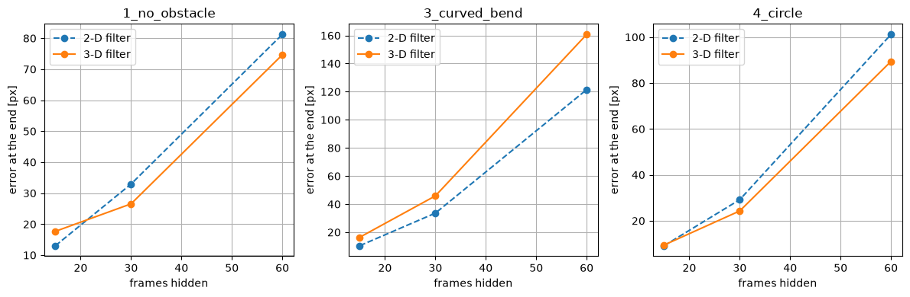
*Fig. 11. The hidden-detection test. The error grows with the length of the gap, and faster on curved paths, where a constant velocity doesn't hold.*

The errors are similar. The 3-D filter is a little better on sequences 1 and 4, and worse on the bend. Its main advantage is that its prediction is physically meaningful: constant velocity holds on the floor, while it doesn't hold exactly in the image.

**Choosing the motion noise.** The noise is chosen from this test, not from the real occlusion, so that the real occlusion stays a fair test. Each row gives the error at 30 and 60 frames for sequences 1, 3 and 4. For the 2-D filter, 0.3 px is a balanced choice. For the 3-D filter, 0.1 squares is at least as good as 0.03 and 0.05 at every gap, and 0.3 squares is worse on the circle.

| Filter, noise | Seq. 1: 30, 60 | Seq. 3: 30, 60 | Seq. 4: 30, 60 |
|---|---|---|---|
| 2-D, 0.05 px | 36.0, 65.3 | 42.6, 136.2 | 38.0, 115.8 |
| 2-D, 0.1 px | 37.5, 67.8 | 36.9, 126.4 | 33.0, 107.6 |
| **2-D, 0.3 px** | 40.8, 74.9 | 32.3, 118.2 | 28.4, 99.7 |
| 2-D, 1.0 px | 40.5, 81.3 | 30.4, 113.8 | 26.3, 95.6 |
| 3-D, 0.03 squares | 25.6, 122.5 | 46.5, 163.3 | 30.1, 110.1 |
| 3-D, 0.05 squares | 27.0, 86.9 | 48.0, 166.9 | 25.7, 96.7 |
| **3-D, 0.1 squares** | 26.6, 45.0 | 47.3, 162.7 | 25.4, 89.1 |
| 3-D, 0.3 squares | 24.1, 20.6 | 43.5, 151.1 | 41.8, 128.4 |

With few gaps per setting, differences of a few pixels aren't meaningful. At a much smaller noise, 0.02 px in 2-D, the filter trusts its model so much that it rejects real boxes.

---

## The cornerSubPix decision

**What it is.** `cv2.findChessboardCorners` gives each corner's approximate position. `cv2.cornerSubPix` then moves it to a position accurate to a fraction of a pixel. It uses this fact: at the true corner q, the image gradient $G_i$ at any nearby point $p_i$ is perpendicular to the line from $p_i$ to q. In a flat area the gradient is zero, and on an edge it points across the edge, while the corner lies along that edge. So for every pixel in a window around the estimate:

$$G_i^\top (q - p_i) = 0 \quad\Rightarrow\quad q = \Big(\sum_i G_i G_i^\top\Big)^{-1} \sum_i G_i G_i^\top p_i$$

This is a least-squares solution, and $\sum_i G_i G_i^\top$ is the same matrix as in the [Harris detector](02_feature_detection.md). The window then moves to the new q, and the step repeats until the corner moves less than 0.01 px or 30 iterations have passed. In the call used here, `(5, 5)` is the half-size of the window, so 11 × 11 pixels, and `(-1, -1)` means there is no excluded zone in its centre. It can't fix a corner that is several pixels off, which is why RANSAC is still needed.

**Why it is off.** It is a standard step in calibration, but no course material shows it, so `USE_SUBPIX` in the notebook is **off**. Removing it was tested on the final code, and on the scene's rows it costs almost nothing. The 3-D tests show more of a difference. Both columns use a 3-D motion noise of 0.05 squares, so that they are comparable.

| Test | Without (used) | With `cornerSubPix` | Better |
|---|---|---|---|
| Stereo reprojection error | 0.43 px | 0.30 px | with |
| Scene rows: median, 90 % | 0.61, 1.82 px | 0.47, 1.84 px | about equal |
| Floor inliers per sequence | 80–92 % | 54–77 % | without |
| Disparity offset from the height test | 1.18 px | 1.98 px | without |
| Robot's length, against the published 0.99 m | 3.4 % short | 7.8 % short | without |
| Angle of sequences 1, 2 (should be near 0) | −7.1°, −7.1° | −2.6°, −3.3° | with |
| Distance from a line, sequences 1, 2 | 0.056, 0.116 m | 0.053, 0.067 m | with |
| Speed variation, sequences 1, 2 | 17 %, 29 % | 9 %, 13 % | with |
| Floor spread, sequences 1 to 4 | 0.10, 0.18, 0.18, 0.24 m | 0.03, 0.04, 0.06, 0.07 m | with |
| Circle residual | 0.41 m | 0.30 m | with |
| Sequence 2 after the board | 56 px, 0.36 m | 6 px, 0.21 m | with |

With it, the 3-D tracks are better on most tests, at the price of a larger disparity offset and a robot that measures shorter. Both of those suggest that depths come out too small, so neither version is clearly right. Switching it on is a one-word change plus deleting `results/`, and takes about 7 minutes to run.

The large effect of such a small refinement shows how sensitive this calibration is. The two versions differ by about 0.9° in rotation.

---

## When it fails

The last column says whether the notebook actually applies the fix.

| Problem | Where | Cause | Fix | Applied in the notebook? |
|---|---|---|---|---|
| Board found in under half of the images | corners | the board is small in the image | retry at larger scales | **yes**: 23 and 21 of 37 |
| 2.3 px stereo error; row differences of 19 px | calibration | a few corners off by 5–8 px | RANSAC with a homography | **yes** |
| A mirror image of the robot | rectification | large `alpha` folds the map | `alpha` = 0.15 | **yes** |
| A cut-off robot looks complete | black margins at larger `alpha` | it touches the margin, not the image's edge | compute the valid columns | **yes** |
| The robot splits into pieces | foreground | black body on a dark floor | threshold 18, merge nearby blobs | **yes** |
| A blob that isn't the robot | sequence 2's floor marking | not investigated | size check in metres | **yes** |
| The track starts on a wrong blob and never recovers | track start | the first blob was accepted | size check; restart after leaving the image | **yes** |
| The filter rejects every box | motion noise too small | the gate gets too tight | re-accept after 8 rejections; choose the noise by test | **yes** |
| The box centre is wrong when partly hidden | board, image edge | the box shrinks | visible edge plus half the usual width | **yes** |
| Disparity biased near the board | partly hidden frames | pixels take the board's disparity | don't use disparity in those frames | **yes** |
| Depth tilts by about 7° on a path of constant distance | calibration | few, small views of the board | `cornerSubPix` gives about 3°; a better calibration | **no**: off by default |
| Far depths are uncertain; the circle is 25 % too long | disparity at 6–8 px | 1 px is about 14 % | a better calibration | **no**: the tests conflict |
| 100–160 px off after 60 frames on bends | constant-velocity model | the robot turns | a turning motion model | **no**: the real occlusion is on a straight path |
| The robot isn't tracked while entering | start of the track | the first full box is needed for the width | run the filter backwards from the first full box | **no** |
| A stopped robot would vanish | background subtraction | a median removes what doesn't move | a second detector, such as the sliding window | **no**: only tested; the robot doesn't stop here |

---

## Discussion and limitations

The project asks for this reflection in the report. These are the points the measurements support.

**What works well.** The fixed cameras make background subtraction reliable: 29 of 30 sampled boxes are correct, and sequence 4 is detected in all 650 frames. Stereo adds a physical size check. The Kalman filter carries the robot through about 60 frames without any measurement and meets it again within 0.40 m. RANSAC turned out to be the most valuable single tool, for the corners and for the floor.

**The main limitation is the calibration.** The board is small in the image and mostly near the centre, so the image's far left and bottom are hardly constrained. Two calibrations that differ only in sub-pixel refinement differ by about 0.9° in rotation and by 4° in the apparent direction of the same straight path. Rectification looks excellent on rows, but rows only test the vertical direction, while depth depends on the horizontal one. This is why the disparity offset, the circle's shape and the tilt can't all be resolved from this data.

**Other limitations:**
- **Depth at a distance.** At 14 m the disparity is about 6 px. With 0.3 px of noise that is 0.7 m, and any bias adds to it.
- **Background subtraction assumes a moving robot, fixed cameras and stable light.** The median also uses the whole sequence, including future frames, so it can't run live as it stands.
- **The constant-velocity model** predicts a straight line. Sequence 2's occlusion suits it, but a turn behind the board wouldn't be followed.
- **No ground truth,** so the tests show consistency, not accuracy. The hidden-detection test uses detections as the reference, and they are themselves a few pixels off.
- **Only one real occlusion** was available, with one result.
- **Timing is assumed:** speeds are per frame, and the 3 frames per second rests on file times.
- **The size limits are set from these sequences,** and the 0.99 m used to check the scale should be confirmed against the Husky's datasheet.

**Possible improvements, with more time or resources:**
- **Recalibrate** with a larger board, closer to the cameras, and into the corners of the image. This would help everything else.
- **Use `cornerSubPix`,** if allowed, for the gains listed above.
- **Refine with bundle adjustment** ([chapter 9](09_visual_odometry.md#drift-and-bundle-adjustment)), using static scene points together with the board.
- **Use the floor as a second depth source:** a point on a known plane gets its depth from one camera, and could be fused with stereo in the filter, which would help most at a distance.
- **A turning motion model** with the EKF of [chapter 7](07_state_estimation.md#nonlinear-models-ekf-and-ukf), which should predict bends better.
- **A running background** updated over time, instead of a median of the whole sequence, so that it can work live.
- **A second detector** for a robot that stops: the sliding window with better features, such as HOG.
- **A deep detector as a complement,** as the description allows: the lecture's outlook mentions YOLO and Faster R-CNN. It would need labelled images, and the boxes from this pipeline could serve as a start.

---

## Key takeaways

- **Look at the data first.** A few numeric checks showed that the cameras are fixed and the rows are off by 18 px, which decided the approach.
- **Reprojection error isn't enough.** Test the calibration on the real scene: SIFT matches should lie on the same row, and no disparity may be negative.
- **RANSAC rescued the calibration:** a few wrong corners caused most of the error, and a planar board offers a way to find them.
- **Check `alpha`:** too much of the image makes the map fold, which creates a false second object.
- **Fixed cameras make background subtraction very strong,** and stereo adds a size check in metres.
- **A median over the foreground** gives a far steadier disparity than matching a box that contains background.
- **Track the wheels' point, not the box centre,** and use the visible edge when the robot is partly hidden.
- **Tune on hidden detections, test on the real occlusion,** so that the final number stays honest.
- **When tests conflict, say so.** The disparity offset improves one test and worsens two, so it isn't applied, and the uncertainty is reported.
- **Calibration is the main limitation:** a small board gives uncertain rotation, which affects depth more than anything else in the pipeline.
