# Chapter 10 · Final project: tracking the Husky

**Sources**
- [Project description](../Final_project/Final%20Project%20Description%20-%20Copy.pdf).
- [Final Project.ipynb](../Final_project/Final%20Project.ipynb): the solution, with its outputs saved.
- [Approach tests.ipynb](../Final_project/Approach%20tests.ipynb): the comparisons behind each choice, with its outputs saved.
- [The video](../Final_project/results/husky_tracking.mp4) and the other results in [results/](../Final_project/results/): tracks as CSV files, and point clouds as PLY files.
- Functions and terms: [reference.md](reference.md).

This chapter records the approaches, tests and results. It is material for the report, not the report itself.

**Contents**
1. [The task](#the-task)
2. [The solution at a glance](#the-solution-at-a-glance)
3. [Calibration and rectification](#calibration-and-rectification)
4. [Disparity and the 3-D scene](#disparity-and-the-3-d-scene)
5. [Detecting the robot](#detecting-the-robot)
6. [Tracking in 2-D and 3-D](#tracking-in-2-d-and-3-d)
7. [Tests without ground truth](#tests-without-ground-truth)
8. [When it fails](#when-it-fails)
9. [Discussion and limitations](#discussion-and-limitations)
10. [Key takeaways](#key-takeaways)

---

## The task

A Husky A200 robot is filmed by two fixed cameras in a large arena. The task is to calibrate the cameras and to track the robot in 2-D and 3-D, also while it is completely hidden.

| Data | Frames | What happens |
|---|---|---|
| `0_calib` | 37 pairs | a calibration board on a tripod |
| `1_no_obstacle` | 256 pairs | constant speed and distance, no occlusion |
| `2_obstacle` | 291 pairs | constant speed and distance, passes behind a large white board |
| `3_curved_bend` | 397 pairs | a curved path, with the distance changing |
| `4_circle` | 650 pairs | a circular path, with the distance changing |

All images are 1280 × 720 PNG files, raw and unrectified. The project also asks for a report of 10 ± 2 pages with a Discussion and Limitations section, and a short video. It expects course methods; deep learning may only complement them, and none is used here. One OpenCV function outside the course is used: `cv2.findChessboardCornersSB`, for the board's corners. The approach tests also use `cv2.cornerSubPix`, only for comparison.

**What the data gives away.** Three numeric checks on the first frames shaped the whole solution:
- **The cameras don't move.** The mean difference from a sequence's median image is about 1 gray level, and only 0.1 to 0.6 % of the pixels change by more than 30. So background subtraction can work.
- **The raw rows don't match.** Matching points in the left and right image differ by a median of 17.8 rows, so rectification is essential.
- **The file times suggest about 3 frames per second:** 256 frames span 83 s, and 650 frames span 221 s. This assumes the files were written as the images were captured, so all speeds below are per frame.

---

## The solution at a glance

| Goal | Method | Class |
|---|---|---|
| Calibrate and rectify | chessboard corners with `findChessboardCornersSB`, RANSAC with a homography, `calibrateCamera`, `stereoCalibrate` refining both cameras together, `stereoRectify`, `remap` | 2, 4, plus one function outside the course |
| Disparity and 3-D scene | `StereoBM`, `reprojectImageTo3D`, RANSAC for the floor plane | 3, 6 |
| Detect the robot | background subtraction, threshold, erosion and dilation, contours, a size check in metres from stereo | 1, 3 |
| Track, also through occlusions | constant-velocity Kalman filter in 2-D and 3-D, with a Mahalanobis gate | 7 |
| Check the results | RANSAC line, least-squares circle, floor plane, hidden detections | 6 |

**The results:**

| Result | Value |
|---|---|
| Stereo reprojection error | 0.22 px |
| Row difference of scene matches, raw → rectified | median 17.8 → 0.19 px; 90 % 18.9 → 0.60 px |
| Boxes checked by eye on a random sample | 30 of 30 are the robot |
| Sequence 1: straightness over 7.2 m | 0.046 m from a line, at −2.0° |
| Sequence 2: straightness over 8.9 m | 0.060 m from a line, at −3.1° |
| Sequence 2: after 49 frames fully behind the board | prediction off by 14 px, or 0.16 m |
| Sequence 4: circle fit | radius 5.22 m, residual 0.63 m, 1.4 times longer in depth than in width |
| Robot's measured length, against the published 0.99 m | 0.964 m, 2.6 % short |
| Video | all 4 sequences, 1,594 frames, 33 MB |

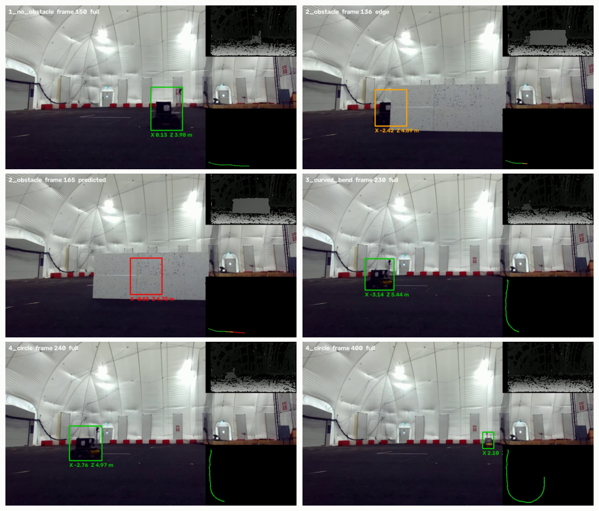
*Fig. 1. Frames from the video. The box is green when measured, orange when only an edge is visible, and red when predicted; the robot in the third frame is completely behind the board. The upper inset is the disparity map, and the lower one the track from above.*

---

## Calibration and rectification

**The approach.** `cv2.findChessboardCornersSB` was used to find the corners, and RANSAC with a homography to check them. `cv2.calibrateCamera` gives each camera's K and distortion as a starting point, and `cv2.stereoCalibrate` then refines both cameras together with the pose between them. `cv2.stereoRectify` with `cv2.initUndistortRectifyMap` gives the rectifying maps. This is the route of [Weekly Project 4](04_calibration_and_epipolar.md), with two changes that the next sections explain: the corner detector, and the joint final calibration.

### How the calibration was chosen

This is the order in which the calibration was built and tested, and what each step showed. The tables are in the sections after it.

1. **The course's route.** Weekly Project 4 finds the corners with `findChessboardCorners` and calibrates each camera alone. It then finds the pose between the cameras with each camera's numbers kept fixed. Below, this is called two-step calibration.
2. **Too few boards.** The board is small in the image, so the detector found it in only 15 left and 16 right images out of 37. Enlarging each image up to 3 times before searching raised that to 23 and 21.
3. **A few wrong corners.** The stereo error was 2.3 px, because a few corners were 5 to 8 px off, mostly along the board's outer rows. All corners of a flat board must fit one homography, so RANSAC with a homography found and removed them. The error fell to 0.43 px, and matching points in the rectified images lay within 0.6 px of the same row (median). By the usual checks, the calibration looked excellent.
4. **The 3-D tests disagreed.** Paths that should be at a constant distance were tilted by 7°. The height test found that the disparities were about 1.2 px too large.
5. **Why the usual checks missed it.** The errors that matter for depth move points left or right along the row, so the row test hardly sees them. Changing one camera's focal length by 0.5 % tilts a path by 10°, while the row test barely changes.
6. **The result depended on luck.** Repeating the calibration on random selections of the images moved the tilt anywhere between −33° and 0°. So the 7° was mostly decided by which images happened to be used.
7. **The cause was the two-step calibration.** Each camera's focal length and image centre are fitted alone, where nothing ties the two cameras together, and then kept fixed. Refining both cameras together in the stereo step, the joint calibration, made the result stable. With the classic corners, though, it bent the floor, so that the floor's points no longer fit a plane. The likely reason is the bottom of the image, where the board never appears and the classic corners are poor.
8. **Better corners.** `cornerSubPix` made the typical corner accurate, but couldn't fix the badly wrong ones. `findChessboardCornersSB` found the board in more images, 26 and 25, with no badly wrong corners.
9. **The final choice: SB corners with joint calibration.** The tilt fell to −2° and −3°, the disparity offset to 0.1 px, and the robot's length to within 2.6 % of the published value, and the floor fits a plane again. Random selections of the images now give nearly the same result.
10. **One test got worse: the circle.** It went from 1.26 to 1.40 times longer in depth than in width. The two-step calibration made the disparities 1.2 px too large, which made far distances too short. That happened to hide a stretch in depth that comes from somewhere else. Two errors cancelled, and fixing one revealed the other.

**What this revealed:**
- A low reprojection error and straight rows don't prove that depth is right.
- A calibration has to be tested in 3-D, on facts that are known: straight paths, a flat floor, a rigid robot of known size.
- A calibration should be repeated on random selections of the images before one result is trusted.
- Errors can cancel. A test that gets worse after a real fix can point to a second problem.

### What better calibration images would need

Only the 37 given pairs exist, so this applies to a future recording.

**What is missing.** 22 of the 37 pairs are usable. In 7 more, the board is found in only one image, and in 8 in neither. The board appears mostly in the middle of the image. An 8 × 6 grid over the left image has 48 cells; SB's corners reach 39 of them, but only 15 of the 24 cells along the image's border, and only the two leftmost cells of the bottom row. The board is also small: 10 to 50 px between corners, so it never covers more than about a third of the image's width.

**Why it matters.** Lens distortion is strongest near the edges and corners of the image, which is where the calibration has the least data. More views help only if they show the board in new places: more views in the middle add little.

**How to take them:**
- **Fill the corners and the bottom of the image.** Place the board low and close for the bottom, and in each corner of the image.
- **Bring the board close,** so it covers a large part of the image, and take some views far away too.
- **Tilt the board,** up to about 45°, in different directions. Views of a board facing the camera straight on can't separate its distance from the focal length; tilted views can.
- **Both cameras must see the whole board in the same pair,** for the stereo step.
- **Keep the cameras fixed to each other, and the focus unchanged.** Tilting the whole camera rig to reach the corners is fine only if the two cameras can't move relative to each other.
- **Even light, no glare, no motion blur, and a flat board.** A plain background around the board helps the detector find its edge.

### Corner detection

**The board's size in the image.** The pattern has (7, 5) inner corners. The board is small in the image, with 10 to 50 px between corners. At the original size, `cv2.findChessboardCorners` from Class 4 finds it in only 15 left and 16 right images. Trying each image at scales from 1 to 3 with `cv2.resize` raises that to 23 and 21. `cv2.findChessboardCornersSB` finds it in 26 and 25 at the original size.

**How the three detectors work.**
- **`cv2.findChessboardCorners`** thresholds the image, finds the black squares, and takes the corners where they meet.
- **`cv2.cornerSubPix`** takes those corners and moves each one to a position accurate to a fraction of a pixel. It uses this fact: at the true corner q, the image gradient $G_i$ at any nearby point $p_i$ is perpendicular to the line from $p_i$ to q. In a flat area the gradient is zero, and on an edge it points across the edge, while the corner lies along that edge. So for every pixel in a window around the estimate:

$$G_i^\top (q - p_i) = 0 \quad\Rightarrow\quad q = \Big(\sum_i G_i G_i^\top\Big)^{-1} \sum_i G_i G_i^\top p_i$$

  This is a least-squares solution, and $\sum_i G_i G_i^\top$ is the same matrix as in the [Harris detector](02_feature_detection.md). The window then moves to the new q, and the step repeats until the corner moves less than 0.01 px or 30 iterations have passed. `(5, 5)` is the half-size of the window, so 11 × 11 pixels. It can't fix a corner that is several pixels off.
- **`cv2.findChessboardCornersSB`** looks for the X-shaped pattern of a corner directly, with a filter that responds where the surrounding pattern is point-symmetric, and returns each corner to a fraction of a pixel (Duda and Frese, 2018). Its flags make it search exhaustively, normalise the brightness first, and refine the corners.

**Accuracy.** All corners of a planar board must agree with one homography. So each image's 35 corners get one fitted homography, and the distance from it measures the detector's error.

| Detector | Board found, left / right | Pairs | Distance from the planar shape: median / worst |
|---|---|---|---|
| `findChessboardCorners`, scales 1 to 3 | 23 / 21 | 20 | 0.94 / 3.31 px |
| the same, with `cornerSubPix` | 23 / 21 | 20 | 0.19 / 3.26 px |
| **`findChessboardCornersSB` (used)** | **26 / 25** | **22** | **0.15 / 0.57 px** |

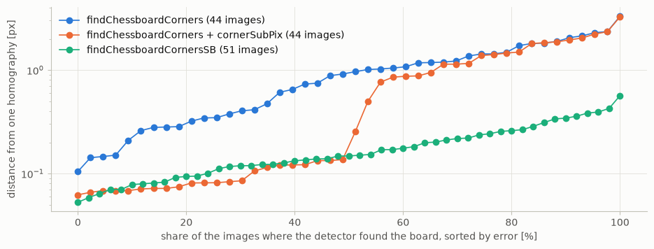
*Fig. 2. Each image's distance from one homography, sorted, for the three detectors. `cornerSubPix` brings the typical corner close to SB's, but not the worst ones.*

`cornerSubPix` makes the typical corner almost as accurate as SB's, but it can't fix the corners that the classic detector places 5 to 8 px wrong, mostly along the outer rows. SB has none of these, and finds more boards.

**Wrong corners.** RANSAC with a homography removes any corner that doesn't fit the board's planar shape. With the classic detector, it removes 78 of the 665 corners in the stereo views and is essential: without it, the stereo error is 2.3 px (table below). With SB it removes only 10, and stays as a check.

**The corner order.** The board has 8 × 6 squares, so it looks the same after a turn of 180°, and the corner list may start at either end. Each list is therefore put in the same left-to-right order.

### Two-step or joint calibration

**The two methods.**
- **Two-step:** each camera is calibrated alone with `cv2.calibrateCamera`, from all the images where it sees the board. `cv2.stereoCalibrate` then keeps those numbers fixed (`CALIB_FIX_INTRINSIC`) and finds only the rotation and translation between the cameras.
- **Joint (used):** `cv2.stereoCalibrate` starts from the same numbers but refines them too (`CALIB_USE_INTRINSIC_GUESS`).

In both, each stereo pair gives the board one position in the room, which each camera sees from its own viewpoint. The difference is what may adapt to that position. In the two-step method, each camera's focal length and image centre come from separate fits, where nothing ties the two cameras together, and they can't change afterwards. In the joint method, if one camera's focal length is slightly off, its predicted corners miss what it saw, and the fit corrects it.

**What the row test can't see.** Depth depends on how the two cameras compare horizontally: the ratio of their focal lengths, their horizontal image centres, and the small turn between them about the vertical axis. These move points along the rows, so the row test hardly notices them. Each line below changes one number of the used calibration:

| Change | Scene rows, 90 % | Angle, sequence 1 | Circle depth / width | Robot length | Disparity offset |
|---|---|---|---|---|---|
| none | 0.61 px | −1.7° | 1.40 | 0.964 m | 0.14 px |
| right focal length +0.5 % | 0.64 px | −11.7° | 1.60 | 0.995 m | −0.56 px |
| right image centre `cx` +5 px | 0.56 px | −1.4° | 0.82 | 0.758 m | 5.18 px |
| turn about the vertical axis +0.2° | 0.82 px | −0.7° | 1.17 | 0.863 m | 2.42 px |
| turn about the sideways axis +0.2° | 2.54 px | +0.3° | 1.43 | 0.961 m | 0.23 px |

Only the last change shows clearly in the row test, and it is the one that hardly matters for depth. So a calibration must also be tested in 3-D.

**On the scene.** Each variant is scored by the reprojection error on the board, the row difference of SIFT matches on real frames after rectification ([chapter 2](02_feature_detection.md#matching)), and the share of matches with a negative disparity, which is physically impossible:

| Variant | Stereo views | Reprojection L / R / stereo [px] | Scene rows: median / 90 % [px] | Negative disparity | Baseline [squares] |
|---|---|---|---|---|---|
| classic, one scale, two-step | 14 | 1.69 / 1.23 / 2.38 | 4.63 / 13.36 | 42.4 % | 2.11 |
| classic, two-step | 20 | 1.42 / 1.11 / 2.32 | 3.59 / 19.36 | 41.7 % | 2.15 |
| classic + `cornerSubPix`, two-step | 20 | 1.27 / 1.02 / 2.19 | 2.81 / 18.06 | 18.3 % | 2.14 |
| classic, RANSAC, two-step | 19 | 0.34 / 0.28 / 0.43 | 0.61 / 1.79 | 1.9 % | 1.53 |
| classic + `cornerSubPix`, RANSAC, two-step | 20 | 0.14 / 0.14 / 0.30 | 0.47 / 1.84 | 1.4 % | 1.55 |
| SB, RANSAC, two-step | 22 | 0.21 / 0.16 / 0.38 | 0.56 / 1.76 | 0.9 % | 1.51 |
| classic, RANSAC, joint | 19 | 0.34 / 0.28 / 0.32 | 0.51 / 1.69 | 1.5 % | 1.50 |
| classic + `cornerSubPix`, RANSAC, joint | 20 | 0.14 / 0.14 / 0.15 | 0.19 / 0.88 | 1.7 % | 1.50 |
| **SB, RANSAC, joint (used)** | 22 | 0.21 / 0.16 / 0.22 | **0.19 / 0.61** | 0.9 % | 1.50 |
| used, k₃ fixed at 0 | 22 | 0.23 / 0.19 / 0.24 | 0.26 / 1.09 | 1.1 % | 1.50 |
| used, k₃ and tangential fixed at 0 | 22 | 0.23 / 0.20 / 0.25 | 0.20 / 1.01 | 1.3 % | 1.49 |
| used, only k₁ | 22 | 0.24 / 0.20 / 0.26 | 0.18 / 0.64 | 1.4 % | 1.49 |

RANSAC is essential for the classic corners, and the joint calibration improves the rows with every detector. Fixing k₃, or k₃ and the tangential terms, is worse on the scene. Keeping only k₁ is about as good on the rows, which don't separate it from the full 5-parameter model, so the full model stays.

**The 3-D tests for each calibration.** Rerunning the whole pipeline for every calibration would take minutes, so the approach tests reuse the stored robot boxes. Each complete box's bottom centre, in the left image and shifted by the disparity in the right image, is mapped back to the original images with the stored calibration; these positions don't depend on any calibration. Each variant then rectifies them again and recomputes the 3-D position, on which the tests of the [tests section](#tests-without-ground-truth) are repeated. The boxes are used without the Kalman filter, so the numbers differ slightly from the main notebook's. The speed ratio is the robot's speed when driving along the depth divided by its speed when driving sideways, in sequence 4.

| Calibration | Angle, seq. 1 / 2 | Circle depth / width, residual | Speed ratio | Robot length | Offset | Floor inliers | Wheel spread |
|---|---|---|---|---|---|---|---|
| classic, RANSAC, two-step | −6.9° / −7.1° | 1.27, 0.41 m | 1.08 | 0.952 m | 1.24 px | 83–94 % | 8–24 cm |
| classic + `cornerSubPix`, two-step | −2.7° / −3.6° | 1.16, 0.30 m | 1.00 | 0.917 m | 1.65 px | 53–83 % | 4–7 cm |
| SB, two-step | −1.8° / −5.1° | 1.42, 0.98 m | 1.16 | 0.996 m | −1.19 px | 89–93 % | 13–35 cm |
| classic, joint | −3.8° / −5.3° | 1.50, 0.82 m | 1.24 | 0.981 m | −0.23 px | **6–14 %** | 23–46 cm |
| classic + `cornerSubPix`, joint | −3.6° / −5.5° | 1.43, 0.71 m | 1.24 | 0.976 m | −0.02 px | 65–89 % | 3–9 cm |
| **SB, joint (used)** | **−1.7° / −3.0°** | 1.40, 0.63 m | 1.25 | 0.964 m | **0.14 px** | **88–98 %** | **3–12 cm** |

SB with the joint calibration is best or close to best on every test except the circle and the speed ratio. The joint calibration with the classic corners breaks the floor: only 6 to 14 % of the floor points fit a plane. The most likely cause is that the freed distortion numbers go wrong at the bottom of the image, where the board never appears and the classic corners are poor.

**Stability.** A single calibration can look good by chance. So each calibration is repeated 50 times. Each time, 37 pairs are drawn at random from the 37, and each drawn pair is put back, so some pairs appear twice and others not at all. The table gives the range that holds 90 % of the results. Each draw keeps only about two thirds of the different pairs, so the ranges are wider than the real uncertainty, but they compare the variants fairly.

| Calibration | Angle, seq. 1 | Angle, seq. 2 | Circle depth / width | Robot length | Offset |
|---|---|---|---|---|---|
| classic, RANSAC, two-step | −33.4° to 0.4° | −37.4° to 5.2° | 0.80 to 1.83 | 0.848 to 1.105 m | −2.71 to 20.09 px |
| SB, two-step | −11.0° to 7.3° | −22.1° to 8.9° | 0.92 to 1.81 | 0.958 to 1.080 m | −2.27 to 39.03 px |
| classic, joint | −4.9° to −2.5° | −7.2° to −4.1° | 1.45 to 1.59 | 0.965 to 0.992 m | −0.82 to 0.36 px |
| **SB, joint (used)** | **−3.5° to −0.7°** | **−5.2° to −1.9°** | **1.35 to 1.46** | **0.958 to 0.972 m** | **0.03 to 0.27 px** |

With the two-step method, the angle of a straight path swings by more than 30° depending on which images are used. Its rounder circles in the 3-D table are therefore not evidence of a better calibration. With the joint calibration, any selection of images gives nearly the same result, and with SB the spread is the smallest. In particular, the circle settles at about 1.4 times longer in depth than in width.

**The result.** Focal lengths of 615.2 and 614.1 px, a baseline of 1.497 squares (12.0 cm), and a rotation of (0.09°, −0.51°, −0.05°) between the cameras.

**How much of the image to keep.** `alpha` in `cv2.stereoRectify` sets this. At large `alpha`, the output reaches regions where the distortion formula runs backwards: the map folds over and creates a mirror image, which shows up as a second blob moving opposite to the robot. Checking for places where the map runs backwards shows where this starts:

| `alpha` | Rectified focal length [px] | Valid pixels, left / right | Folded pixels, left |
|---|---|---|---|
| 0 | 642 | 100 % / 100 % | 0 |
| **0.15 (used)** | 608 | 100 % / 96.3 % | 0 |
| 0.25 | 585 | 97.5 % / 92.7 % | 0 |
| 0.4 | 550 | 89.4 % / 86.4 % | 0.05 % |
| 1 | 412 | 61.2 % / 57.0 % | 10.9 % |

At 0.15 the left image has no black margin and no folded pixel. Values up to 0.25 are also free of folds, and would keep a little more of the view at the cost of black margins.

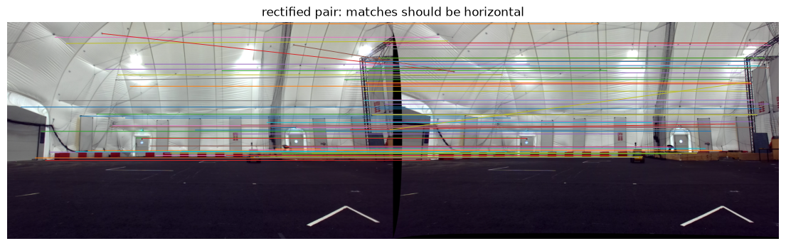
*Fig. 3. A rectified pair with some of the SIFT matches. The lines are horizontal.*

---

## Disparity and the 3-D scene

**The approach.** `cv2.StereoBM_create` was used to compute disparity, with 64 disparities and a block size of 15, and `cv2.reprojectImageTo3D` to turn it into 3-D points with the calibrated Q. The disparity is valid at 76 % of the pixels. Lowering `numDisparities` from 128 to 64 matters, because the matcher has no result in a left band of that width, where the robot enters.

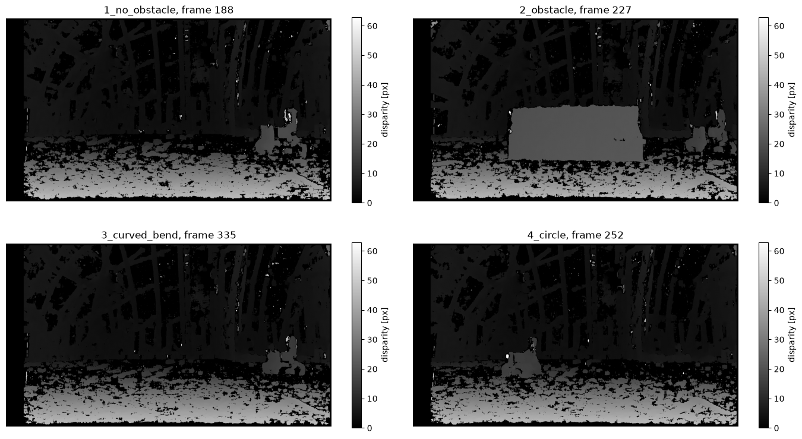
*Fig. 4. The disparity maps, each from the frame where the robot is largest. Near objects are bright. Sequence 2 shows the board at one clear disparity.*

For each sequence, a coloured point cloud of that same frame is written to `results/`, with about 140,000 points. Every second pixel and everything beyond 40 m is left out.

**The empty scene.** The median of 41 frames spread over a sequence removes everything that moves. Disparity on these empty images gives the floor without the robot.

**The floor plane.** `linear_model.RANSACRegressor` was used to fit Y = aX + bZ + c through the points in the lower part of the image. It agrees across the sequences, without using the robot at all: a camera height of 0.735 to 0.743 m, normals within 0.3° of each other, and 88 to 97 % of the points as inliers. The floor gives a bird's-eye view of the tracks, and an independent test of them.

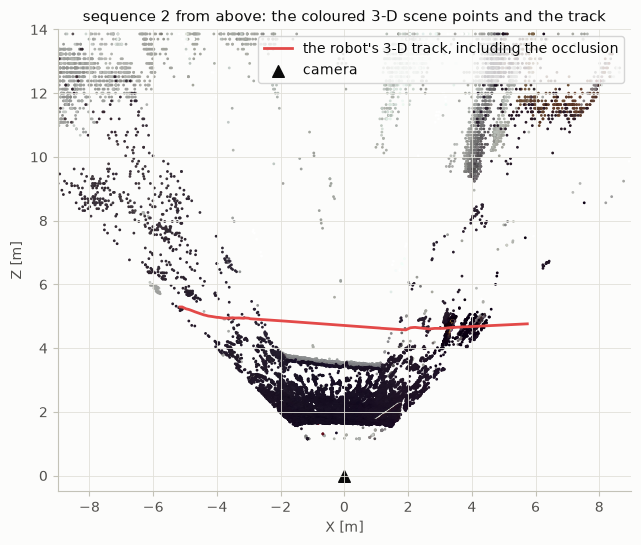
*Fig. 5. Sequence 2 from above: the coloured scene points and the 3-D track. The track passes behind the board, whose points form the arc in front of it.*

---

## Detecting the robot

**The approach.** Background subtraction was used to find what differs from the empty scene. The image is blurred with a 5 × 5 Gaussian, the absolute difference from the background is taken per channel, and the largest channel counts, so a colour change is seen even when the brightness barely changes. A threshold gives a mask, one erosion removes single noisy pixels, and two dilations close small gaps. `cv2.findContours` then gives the blobs.

```python
difference = np.abs(blurred.astype(int) - background.astype(int)).max(axis=2)
mask = (difference > FG_THRESHOLD).astype(np.uint8) * 255
mask = cv2.dilate(cv2.erode(mask, None, iterations=1), None, iterations=2)
```

**Fragments.** The robot's black body on the dark floor can split into pieces, such as the mast and the lower body. Blobs within 30 % of the largest box's size are merged into one box.

**The threshold** is a trade-off, tested on every 5th frame. The last column compares the largest single blob's box with the merged box at threshold 18:

| Threshold | Frames with a robot-sized blob, of 321 | Blobs per frame | Largest box / merged box: median, lowest 10 % |
|---|---|---|---|
| 8 | 273 | 5.2 | 1.14, 1.08 |
| 12 | 267 | 3.4 | 1.05, 1.02 |
| **18 (used)** | 260 | 2.1 | 1.00, 0.67 |
| 25 | 250 | 2.0 | 0.94, 0.58 |
| 40 | 162 | 2.9 | 0.26, 0.11 |

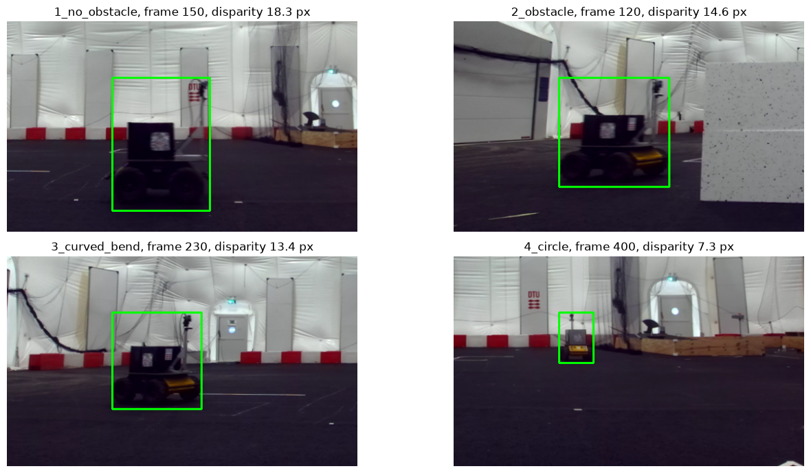
*Fig. 6. Detections in the four sequences, from a near robot to a far one.*

**Checking by eye.** On a random sample of 30 boxes across the sequences, all 30 are the robot, with tight boxes. One of them is only the robot's front, entering at the left edge of the image, where there is no disparity yet, so the tracker doesn't use it. The only blob in sequence 2 that isn't the robot is a thin strip along the top of the image in frame 3. Its cause wasn't investigated, but stereo puts it at 27 m wide, which the size check below rejects. The track of sequence 2 starts at frame 98.

**The size check.** Stereo gives real size: width in metres = w × B / d. Complete boxes in sequences 1, 3 and 4 are 0.8 to 1.3 m wide and 1.2 to 1.3 m high, including the mast (5 to 95 %). So a box must be 0.6 to 2.2 m wide and 0.8 to 2.2 m high. This is a use of 3-D that a single camera couldn't offer: a large distant object and a small nearby one can look the same size in pixels.

**The robot's disparity.** Four methods from the course were compared on every 2nd frame. In sequences 1 and 2 the distance should be nearly constant, so the jitter and the spread of the depth measure the noise. Spread here is the 10-to-90 % range of the depth divided by its median.

| Sequence | Method | Disparity [px] | Frame-to-frame jitter [px] | Spread of depth |
|---|---|---|---|---|
| 1 | **StereoBM, median over the foreground (used)** | 18.2 | **0.06** | **0.04** |
| 1 | Box offset, left against right | 17.5 | 0.50 | 0.19 |
| 1 | `matchTemplate`, sub-pixel | 16.6 | 0.24 | 2.82 |
| 1 | SIFT matches, median | 16.8 | 0.34 | 0.86 |
| 2 | **StereoBM (used)** | 14.9 | **0.06** | **0.09** |
| 2 | Box offset | 15.5 | 0.50 | 0.22 |
| 2 | `matchTemplate` | 9.4 | 0.37 | 1.40 |
| 2 | SIFT | 13.6 | 0.44 | 1.32 |
| 4 | **StereoBM (used)** | 6.4 | **0.06** | 0.93 |
| 4 | Box offset | 6.0 | 0.50 | 0.91 |
| 4 | `matchTemplate` | 6.0 | 0.08 | 0.89 |
| 4 | SIFT | 6.2 | 0.08 | 0.91 |

The spread in sequence 4 is the real change in distance. Template and SIFT matching produce large outliers in sequences 1 and 2. The likely reason is that their boxes contain background at another disparity, which the median over the foreground pixels avoids.

**Other detectors.** Three simple alternatives were compared with the background subtraction on every 5th frame. A hit means the box centre lies inside the reference box; a good box means an IoU of at least 0.5.

| Detector | Hit: all | Sequences 1 / 2 / 3 / 4 | Good box | False alarms |
|---|---|---|---|---|
| **Background subtraction** | reference | | | |
| Colour: yellow, H 15–35 | 16 % | 22 / 36 / 9 / 16 % | 0 % | 0 of 59 |
| Frame difference | 60 % | 100 / 100 / 59 / 48 % | 0 % | 2 of 59 |
| Farnebäck optical flow | 55 % | 100 / 100 / 61 / 39 % | 44 % | 23 of 59 |

Colour fails because only 40 % of the robot's saturated pixels are yellow, and the panels are often out of view. The motion methods find the robot only when it moves enough between frames, which is why the far, slow robot of sequences 3 and 4 is often missed. They also only see its moving edges, which gives poor boxes.

**A classifier from Class 8.** A sliding window with PCA and an SVM doesn't depend on motion at all. It was trained on three sequences, with the main detector's boxes as positives and random crops as negatives, and tested on the fourth, on every 10th frame. Windows of six sizes are resized to 40 × 40 pixels, reduced to 40 PCA components (about 95 % of the variance), and scored by an RBF SVM, and non-maximum suppression removes duplicates.

| Tested on | Hit | Good box | Other boxes per frame | False alarms |
|---|---|---|---|---|
| Sequence 2 | 100 % | 29 % | 2.9 | 0 of 18 |
| Sequence 4 | 55 % | 33 % | 7.9 | 1 of 1 |

This is far weaker than background subtraction here, and the numbers are rough, because there are only a few dozen test frames. It would still be the natural second detector for a robot that stops. The lecture pairs the SVM with HOG features, but this test uses plain pixels, because no course template shows HOG.

---

## Tracking in 2-D and 3-D

**The approach.** A [Kalman filter](07_state_estimation.md) with a constant-velocity model was used to follow the robot and to predict it when it can't be seen. The same code runs in 2-D, on the image position, and in 3-D, on the position from stereo.

$$x_{k+1} = F x_k,\qquad F = \begin{bmatrix} I & I \\ 0 & I \end{bmatrix},\qquad Q = G G^\top \sigma_a^2,\qquad G = \begin{bmatrix} \tfrac12 I \\ I \end{bmatrix}$$

**What is tracked.** The tracked point is the bottom centre of the box, where the wheels meet the floor. The top of the box jumps when the mast is hidden, but the bottom stays stable.

**Measurement noise.** Depth noise grows with the square of the distance (Z² Δd / fB, [chapter 3](03_stereo_vision.md#depth-from-disparity)), so the 3-D filter sets R per frame: 2 px sideways and 0.3 px in disparity.

**Three kinds of frame.** A frame contributes in one of three ways:

| Frame | Condition | What it updates |
|---|---|---|
| **Full box** | not touching the valid image's edge, a plausible size in metres, at least 85 % of the usual width, inside the gate | the whole position |
| **Cut-off box** | hidden in part by the board or the image's edge, and near the predicted row | only the sideways position, from the visible edge plus half the usual width |
| **No box** | nothing, or nothing plausible | nothing: the filter only predicts |

The gate is a squared Mahalanobis distance of 13.8 (99.9 % for 2 degrees of freedom). If 8 full boxes in a row are rejected, the filter accepts the next one, so it can't stay locked out.

**The visible edge.** This is the idea that helps most during occlusions. As the robot slides behind the board, its box shrinks, and the box's centre moves at half the true speed. That would slow the filter's velocity just before it has to predict. But the edge that isn't hidden still moves at the right speed. Disparity isn't used in these frames, because the pixels near the board are biased towards the board's own disparity.

| Sequence 2: error at the first full box after the board | Without visible edges | With visible edges |
|---|---|---|
| 2-D filter | 237.8 px | 53.3 px |
| 3-D filter | 127.5 px, 0.99 m | **13.8 px, 0.16 m** |

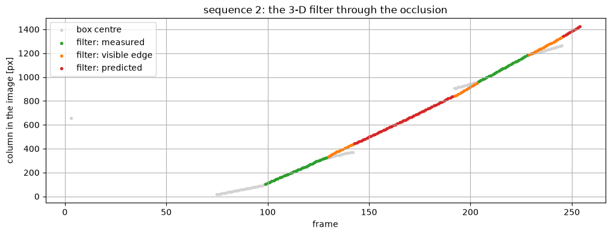
*Fig. 7. Sequence 2: the box centre (gray) leaves the true motion when the robot is partly hidden, which the visible edges (orange) correct. The filter predicts through the occlusion (red), and meets the robot again on the other side. The gray point at frame 3 is the strip along the top of the image, which the filter ignores.*

**What each frame contributed:**

| Sequence | Tracked frames | Full | Edge | Predicted | Gated |
|---|---|---|---|---|---|
| 1 | 83–223 | 114 | 18 | 8 | 0 |
| 2 | 98–254 | 56 | 42 | 58 | 0 |
| 3 | 0–380 | 347 | 19 | 14 | 0 |
| 4 | 0–649 | 648 | 0 | 1 | 0 |

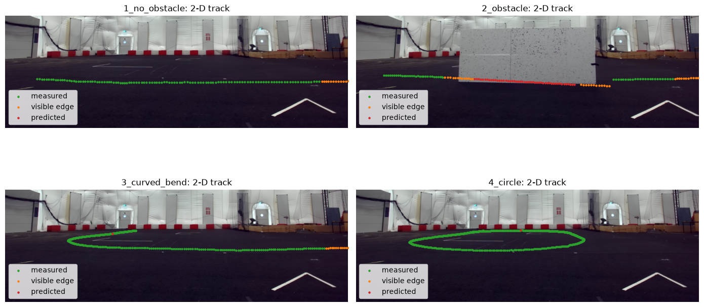
*Fig. 8. The 2-D tracks on the empty scene.*

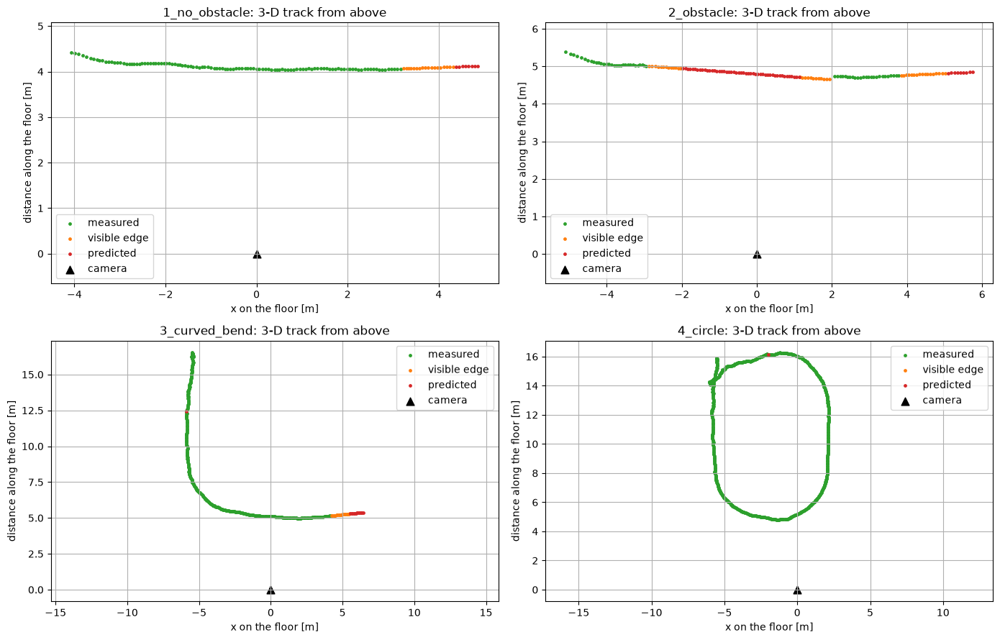
*Fig. 9. The 3-D tracks from above. The projection onto the floor uses the plane fitted without the robot.*

---

## Tests without ground truth

There is no ground truth, so the tests use what the description and the scene guarantee.

**Straight and steady: sequences 1 and 2.** The description says constant speed and constant distance.

| | Path length | Distance from a line | Angle to the image plane | Mean distance | Speed |
|---|---|---|---|---|---|
| Sequence 1 | 7.23 m | 0.046 m | −2.0° | 4.12 m | 0.065 ± 0.007 m per frame |
| Sequence 2 | 8.87 m | 0.060 m | −3.1° | 4.93 m | 0.074 ± 0.013 m per frame |

Both paths are straight to within 0.7 % of their length. If the frame rate of 3 per second is right, the speed is about 0.2 m/s. The angles are small but not zero. The stability test puts the calibration's own spread at about −3.5° to −0.7° for sequence 1, so part of the angle may come from the calibration, and part may be real if the robot wasn't driven exactly parallel to the cameras.

**Wheels on the floor.** The bottom of the box should lie on the plane fitted without the robot.

| | Median distance | 10 % to 90 % |
|---|---|---|
| Sequence 1 | −0.109 m | −0.128 to −0.094 m |
| Sequence 2 | −0.139 m | −0.150 to −0.112 m |
| Sequence 3 | −0.100 m | −0.145 to −0.068 m |
| Sequence 4 | −0.136 m | −0.180 to −0.082 m |

The bottom of the box lies 10 to 14 cm below the plane, with a spread of 3 to 10 cm. Two independent 3-D measurements agreeing this closely is a good sign. The systematic part could come from the mask reaching below the wheels, through a shadow or reflection under the robot and the dilation, or from a small depth error; this test can't tell them apart.

**The circle: sequence 4.** Linear least squares ([chapter 6](06_regression_and_clustering.md)) gives a radius of 5.22 m with a residual of 0.63 m. The path spans 8.2 m sideways but 11.5 m in depth, so it is 1.4 times longer in depth than in width. Its far side is 16 m away, at a disparity of only 4.6 px, where 1 px is 22 % of the depth.

**A rigid robot.** The robot's height in pixels must be proportional to its true disparity, so a line through height against measured disparity should pass through zero. It crosses at 0.10 px, so the disparity has no measurable offset.

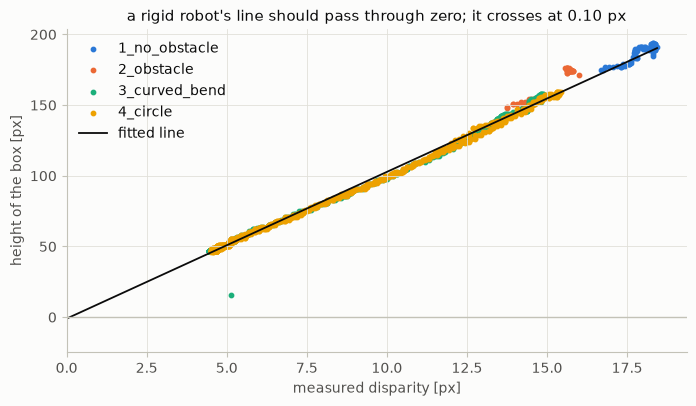
*Fig. 10. Box height against measured disparity for all sequences. The fitted line should pass through the origin.*

Removing an offset anyway makes every test worse, so none is applied:

| Offset removed | Robot height at disparity 6–10 / 10–15 / 15–22 | Circle radius, residual | Wheel spread, sequence 4 |
|---|---|---|---|
| **0 px (used)** | 1.21 / 1.23 / 1.25 m | 5.22 m, 0.63 m | 0.10 m |
| 0.5 px | 1.29 / 1.28 / 1.29 m | 5.93 m, 0.83 m | 0.17 m |
| 1.0 px | 1.39 / 1.33 / 1.33 m | 6.86 m, 1.11 m | 0.27 m |

**The metric scale.** The board's squares are 80 × 80 mm, as given by the professor; the project description doesn't state it. All distances in this chapter scale with this one number, and the baseline becomes 12.0 cm. This allows an independent check: the robot is side-on in the middle of sequence 1, where its box is 0.964 m long, only 2.6 % short of the Husky's published 0.99 m.

**Predicting through occlusions.** The real occlusion allows only one comparison, which is the 14 px above. So detections that are known were hidden from the filter for 15, 30 or 60 frames, many times over, and the prediction at the end of each gap was compared with the hidden detection.

| RMS error at the end of the gap [px] | 15 frames | 30 frames | 60 frames |
|---|---|---|---|
| Sequence 1, straight: 2-D filter | 5.1 | 11.4 | 35.6 |
| Sequence 1, straight: **3-D filter** | 5.3 | 10.3 | 35.3 |
| Sequence 3, bend: 2-D filter | 8.3 | 27.2 | 100.2 |
| Sequence 3, bend: **3-D filter** | 14.8 | 40.9 | 149.7 |
| Sequence 4, circle: 2-D filter | 7.6 | 25.2 | 90.7 |
| Sequence 4, circle: **3-D filter** | 9.7 | 28.4 | 114.4 |

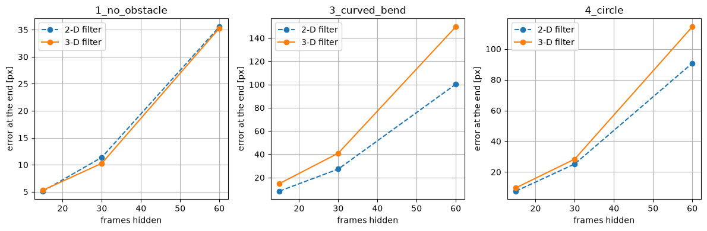
*Fig. 11. The hidden-detection test. The error grows with the length of the gap, and faster on curved paths, where a constant velocity doesn't hold.*

On the straight path the two filters are equal. On the bend and the circle, the 2-D filter is better. The 3-D filter's advantages are that its prediction is physically meaningful, since constant velocity holds on the floor and not exactly in the image, and that it is clearly better on the real occlusion: 14 px against 53 px.

**Choosing the motion noise.** The noise is chosen from this test, not from the real occlusion, so that the real occlusion stays a fair test. Each row gives the error at 30 and 60 frames for sequences 1, 3 and 4:

| Filter, noise | Seq. 1: 30, 60 | Seq. 3: 30, 60 | Seq. 4: 30, 60 |
|---|---|---|---|
| 2-D, 0.05 px | 19.9, 59.8 | 37.0, 117.5 | 35.4, 107.7 |
| 2-D, 0.1 px | 20.6, 61.2 | 32.1, 109.2 | 30.9, 100.4 |
| 2-D, 0.3 px | 18.6, 54.2 | 28.3, 102.7 | 26.9, 93.5 |
| **2-D, 1.0 px** | 12.8, 35.3 | 27.1, 99.8 | 25.3, 90.4 |
| 2-D, 3.0 px | 18.3, 28.8 | 27.7, 98.3 | 25.3, 89.2 |
| 3-D, 0.03 squares | 12.6, 47.1 | 39.8, 152.2 | 31.0, 121.2 |
| 3-D, 0.05 squares | 11.4, 39.7 | 40.2, 154.6 | 27.7, 113.9 |
| **3-D, 0.1 squares** | 12.0, 36.5 | 42.8, 159.7 | 25.7, 110.2 |
| 3-D, 0.3 squares | 25.4, 39.6 | 46.1, 163.0 | 26.2, 109.3 |

For the 2-D filter, 1.0 px is best or within 1.5 px of the best at every gap, except sequence 1 at 60 frames, where 3.0 px is better but is worse at 30 frames. For the 3-D filter, 0.1 squares is best or close to best on sequences 1 and 4, and within 5 % of the best on the bend. With few gaps per setting, differences of a few pixels aren't meaningful. The real occlusion, which played no part in the choice, shows the limit of this method: there the 2-D filter ends 53 px off with 1.0 px, while 0.3 px gives 27 px. The 3-D filter's result doesn't change.

---

## When it fails

The last column says whether the notebook actually applies the fix.

| Problem | Where | Cause | Fix | Applied in the notebook? |
|---|---|---|---|---|
| Board found in under half of the images | corners | the board is small in the image | `findChessboardCornersSB`; the classic detector needs larger scales | **yes**: 26 and 25 of 37 |
| A few corners off by 5–8 px | the classic detector's corners | mostly along the outer rows | `findChessboardCornersSB`, and RANSAC with a homography as a check | **yes** |
| Straight paths tilt by up to 30°, depending on the images used | two-step calibration | each camera's focal length and image centre are fitted alone, then fixed; the row test can't see the error | joint calibration | **yes**: −2.0° and −3.1° |
| The floor isn't a plane | joint calibration with the classic corners | freed distortion numbers at the image's bottom | accurate corners: `findChessboardCornersSB` | **yes** |
| A mirror image of the robot | rectification | large `alpha` folds the map | `alpha` = 0.15 | **yes** |
| A cut-off robot looks complete | black margins at larger `alpha` | it touches the margin, not the image's edge | compute the valid columns | **yes** |
| The robot splits into pieces | foreground | black body on a dark floor | threshold 18, merge nearby blobs | **yes** |
| A blob that isn't the robot | a strip along the top of the image in sequence 2 | not investigated | size check in metres | **yes** |
| The track starts on a wrong blob and never recovers | track start | the first blob was accepted | size check; restart after leaving the image | **yes** |
| The filter rejects every box | motion noise too small | the gate gets too tight | re-accept after 8 rejections; choose the noise by test | **yes** |
| The box centre is wrong when partly hidden | board, image edge | the box shrinks | visible edge plus half the usual width | **yes** |
| Disparity biased near the board | partly hidden frames | pixels take the board's disparity | don't use disparity in those frames | **yes** |
| The circle is 1.4 times longer in depth than in width | far depths, at 4.6–8 px of disparity | the far robot's disparity, or the path itself | see the possible improvements below | **no** |
| 90–150 px off after 60 frames on bends | constant-velocity model | the robot turns | a turning motion model | **no**: the real occlusion is on a straight path |
| The robot isn't tracked while entering | start of the track | the first full box is needed for the width | run the filter backwards from the first full box | **no** |
| A stopped robot would vanish | background subtraction | a median removes what doesn't move | a second detector, such as the sliding window | **no**: only tested; the robot doesn't stop here |

---

## Discussion and limitations

The project asks for this reflection in the report. These are the points the measurements support.

**What works well.**
- **The calibration.** Rectified rows agree within 0.19 px (median), and the result hardly changes with the images used. Two choices made this possible: accurate corners from `findChessboardCornersSB`, and calibrating both cameras jointly. The row test alone couldn't show the difference, because the errors that matter for depth move points along the rows.
- **Detection.** The fixed cameras make background subtraction reliable: 30 of 30 sampled boxes are the robot, and sequence 4 is detected in 649 of its 650 frames. Stereo adds a physical size check.
- **Tracking.** The 3-D Kalman filter carries the robot through 49 frames without any measurement, and meets it again within 0.16 m.
- **RANSAC** checks the corners and fits the floor.

**The main limitation is the far depths.** The circle of sequence 4 comes out 1.4 times longer in depth than in width, and its far side is 16 m away, at 4.6 px of disparity. The calibration seems not to be the cause: the height test finds no disparity offset, the robot's length is within 2.6 %, and the result is stable across image selections. So the stretch comes either from how the far robot's disparity is measured, or from the path itself, which may not be a perfect circle.

**Other limitations:**
- **The board covers mostly the centre of the image.** The bottom of the image has almost no corners, so the distortion there is the least certain.
- **Straight paths tilt by 2° to 3°.** This may be real, or a small calibration error: the stability test gives about ±1.5° around −2°.
- **Depth at a distance.** At 16 m the disparity is about 4.6 px. With 0.3 px of noise that is about 1 m, and any bias adds to it.
- **Background subtraction assumes a moving robot, fixed cameras and stable light.** The median also uses the whole sequence, including future frames, so it can't run live as it stands.
- **The constant-velocity model** predicts a straight line. Sequence 2's occlusion suits it, but a turn behind the board wouldn't be followed.
- **The motion noise was chosen on hidden detections.** For the 2-D filter, that choice is worse on the real occlusion (53 px against 27 px).
- **No ground truth,** so the tests show consistency, not accuracy. The hidden-detection test uses detections as the reference, and they are themselves a few pixels off.
- **Only one real occlusion** was available, with one result.
- **Timing is assumed:** speeds are per frame, and the 3 frames per second rests on file times.
- **The size limits are set from these sequences,** and the 0.99 m used to check the scale should be confirmed against the Husky's datasheet.

**Possible improvements, with more time or resources:**
- **Check the circle's shape first.** If an ellipse fitted to the path has its long axis pointing away from the cameras, the stretch is a depth error. If not, the path itself is probably oval.
- **A cleaner disparity for the far robot.** Take the median only from the robot's inner pixels, by eroding the mask more, or compute the disparity around the robot with a smaller block. At a distance, the mask's edge and the 15 × 15 blocks include floor and wall pixels at other distances.
- **Use the floor as a second depth source.** The line from the camera through the wheel pixel meets the known floor plane at one point. At 16 m, 1 px of error in that pixel's row is about 4 % of the depth, while 0.3 px of disparity noise is about 6.5 %.
- **Use the robot's height in the image as a third depth source.** Its true height, measured near the cameras with stereo, gives the distance from its height in pixels, which doesn't change when the robot turns.
- **Fuse these depths in the Kalman filter,** each with its own noise, or use an EKF ([chapter 7](07_state_estimation.md#nonlinear-models-ekf-and-ukf)) that measures column, row and disparity directly.
- **A turning motion model** with the EKF, which should predict bends better.
- **A running background** updated over time, instead of a median of the whole sequence, so that it can work live.
- **A second detector** for a robot that stops: the sliding window with better features, such as HOG.
- **With new calibration images:** a larger board, placed close to the cameras and in the corners and bottom of the image.
- **A deep detector as a complement,** as the description allows: the lecture's outlook mentions YOLO and Faster R-CNN. It would need labelled images, and the boxes from this pipeline could serve as a start.

---

## Key takeaways

- **Look at the data first.** A few numeric checks showed that the cameras are fixed and the rows are off by 18 px, which decided the approach.
- **Reprojection error and the row test aren't enough.** Both can look good while depth is wrong, because the errors that matter for depth move points along the rows. Test the calibration in 3-D, on facts you know: straight paths, a flat floor, a rigid robot of known size.
- **Calibrate both cameras jointly.** Calibrating each alone and fixing the result leaves their comparison loose, and the 3-D results then depend on which images happened to be used.
- **Accurate corners matter.** `findChessboardCornersSB` finds more boards with smaller errors. With poor corners, even the joint calibration fails.
- **Repeat a test on random selections of the data** before trusting a single good number.
- **Check `alpha`:** too much of the image makes the map fold, which creates a false second object.
- **Fixed cameras make background subtraction very strong,** and stereo adds a size check in metres.
- **A median over the foreground** gives a far steadier disparity than matching a box that contains background.
- **Track the wheels' point, not the box centre,** and use the visible edge when the robot is partly hidden.
- **Tune on hidden detections, test on the real occlusion,** so that the final number stays honest, and report it when the two disagree.
- **Far depths are the remaining weakness:** at a few pixels of disparity, a small error in the robot's disparity changes its distance a lot.
